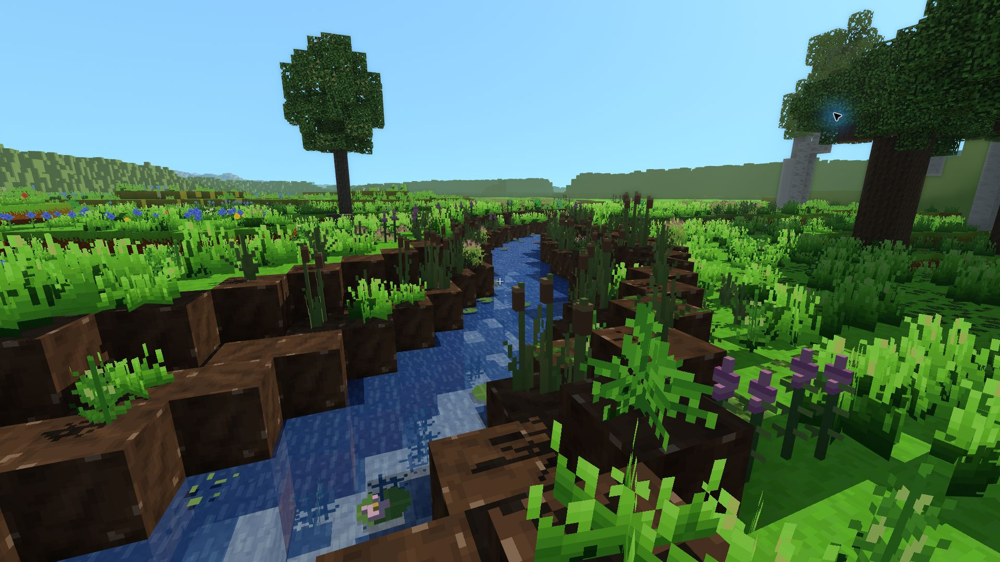
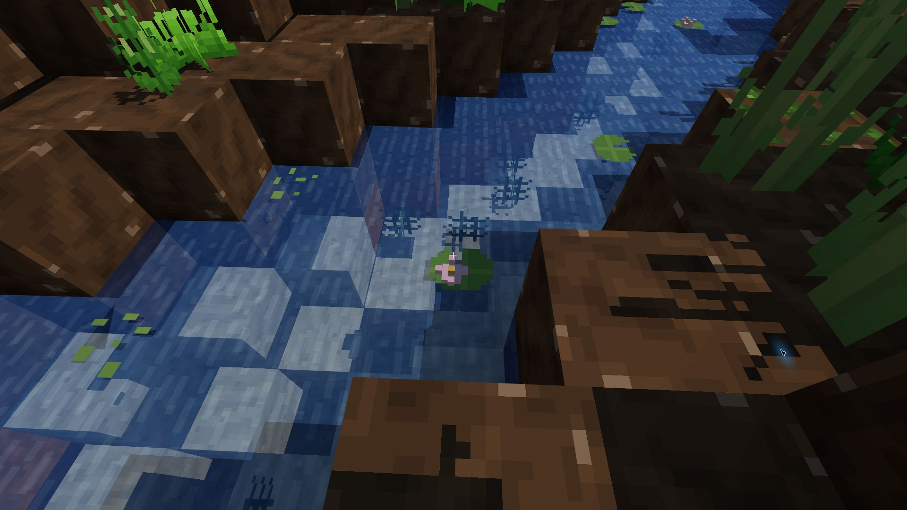
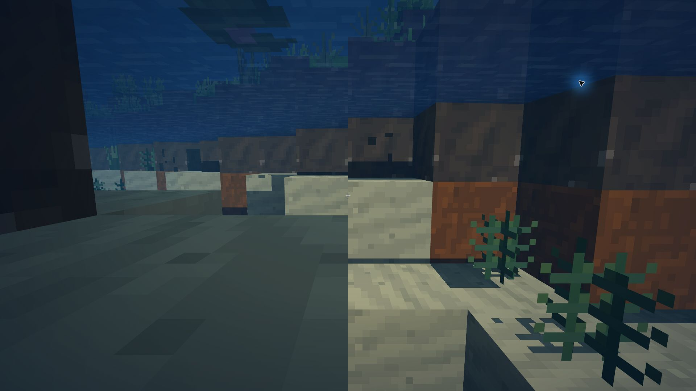

# Pikselowe rośliny rzeczne — 0.27.1

PR #55 zmienia modele sześciu rodzajów roślin rzecznych wprowadzonych w 0.26.0.
Bazą porównania jest wydana wersja 0.27.0 (commit `752a940`).

## Wygląd i budowa

- Wspólna siatka: **1/16 bloku**, zgodna z pojedynczym pikselem tekstury 16×16.
- Łodygi pałek i krwawnicy oraz kwiatostany są bryłami z takich pikseli.
- Liście, turzyce i wywłócznik mają schodkowe kontury z płaskich, dwustronnych pikseli. Płaty nie potrzebują grubości 0,01, aby były widoczne z obu stron.
- Lilie mają pikselowy obrys z wcięciem, żyłkę oraz warianty z przestrzennym kwiatem. Rzęsa składa się z małych płaskich plamek.
- Model trzymany w dłoni korzysta z tej samej geometrii. Ikony mają wyraźną siatkę 16×16 bez wygładzonych skosów.
- Obroty o 90° i przesunięcia o 1/16 zachowują siatkę w świecie, także na ujemnych współrzędnych. Delikatny ruch od wiatru i wody nadal animuje model.

Sąsiednie piksele tego samego koloru łączą się w prostokąty, a bryły nie mają ścian wewnętrznych. Modele pozostają we wspólnej geometrii chunków: bez osobnych obiektów, materiałów i wywołań rysowania dla każdej rośliny. Zmiana nie wymaga regenerowania świata ani migracji zapisanych bloków.

## Pomiar RTX 3050 Laptop

Windows, zasilacz, Electron 44.4.5, sprzętowy D3D11, 1920×1080, skala 100%.
Seed `2138286349`, kamera `(198, 62, -261)`, południe, 82 wczytane chunki i 515 kafelków dalekiego terenu. Pełne bloki: 48, daleki teren: 8192, cienie: 3, promienie światła włączone. Identyczne ustawienia i blok trawy w dłoni w obu wersjach. Panel diagnostyczny ukryty podczas pomiaru; 10 s rozgrzewki + 30 s próbkowania.

| Pomiar bez limitu gry | 0.27.0 | 0.27.1 |
| --- | ---: | ---: |
| Średnie FPS | 143,71 | 143,95 |
| 1% najwolniejszych klatek | 100,82 FPS | 108,56 FPS |
| Średni czas GPU | 3,53 ms | 3,60 ms |
| Wywołania rysowania | 348 | 348 |
| Trójkąty w scenie | 655 446 | 746 218 |
| Klatki powyżej 33,34 ms | 0 | 0 |

Wynik FPS jest ograniczony odświeżaniem ekranu około 144 Hz; nie oznacza wzrostu szybkości gry. W tej scenie dodatkowa geometria kosztuje około 0,07 ms GPU. Jest to pomiar ustalonej sceny nad rzeką, a nie gwarancja minimum FPS podczas generowania nowych chunków lub dla wszystkich ustawień zasięgu.

Drugi pomiar, z limitem 60 FPS: średnio **60,01 FPS**, p99 **21,2 ms**, maksimum **22,1 ms**, bez klatek powyżej 33,34 ms. Ogranicznik pracuje na cyklu ekranu około 144 Hz, dlatego odstępy między klatkami nie są idealnie równe 16,67 ms (1% najwolniejszych: 46,66 FPS). GPU: średnio 3,76 ms. Zmiana modeli nie modyfikuje ogranicznika.

## Sprawdzenia

Pełne `npm test` przechodzi. Test modeli sprawdza siatkę 1/16, prostokątne ściany, kierunek normalnych, granice i zakotwiczone korzenie, łączenie pikseli bez utraty otworów i kolorów oraz brak wewnętrznych ścian brył. Kontrole meshera porównują geometrię wody, światło i przepływ przed i po dodaniu rośliny, także na granicy chunków. Testy interakcji z wodnymi roślinami obejmują 27 przypadków.

Próbne kompilacje Windows i Android oraz laboratorium światła przeszły w GitHub Actions. Wersja jest przygotowana w PR; publikacja w `voxel-game-wydania` nastąpi dopiero po scaleniu.

W natywnym oknie gry sprawdzono lilię z bliska, celowanie w jej nowy model, model i ikonę w dłoni oraz ponowne sadzenie na wodzie. Obejrzano też pałki i krwawnicę wzdłuż brzegu, wywłócznik pod wodą oraz spód pływających liści. Tafla pozostaje ciągła. Sprzętowe sprawdzenie materiałów na RTX 3050 przeszło: 34 programy i warianty WebGL 1/2.

Surowe pomiary i zdjęcia: [pomiary/rosliny-pikselowe-0.27.1](pomiary/rosliny-pikselowe-0.27.1/).

`before.json` odpowiada 0.27.0, `after.json` — 0.27.1; wszystkie pomiary wykonano 30.10.2026. `qa-harness.js` dokumentuje lokalny pomiar w osobnym profilu gry, bez zmiany zapisów i ustawień zainstalowanej aplikacji. Historyczna nazwa świata testowego „Rośliny — 0.26.0” nie określa wersji uruchomionego kodu.

