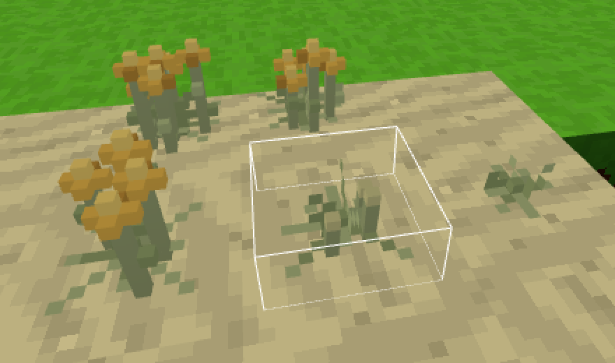
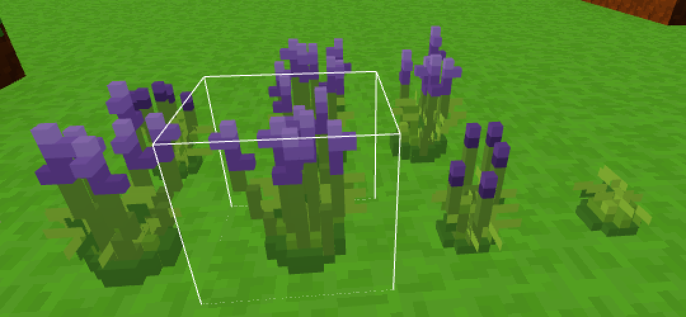
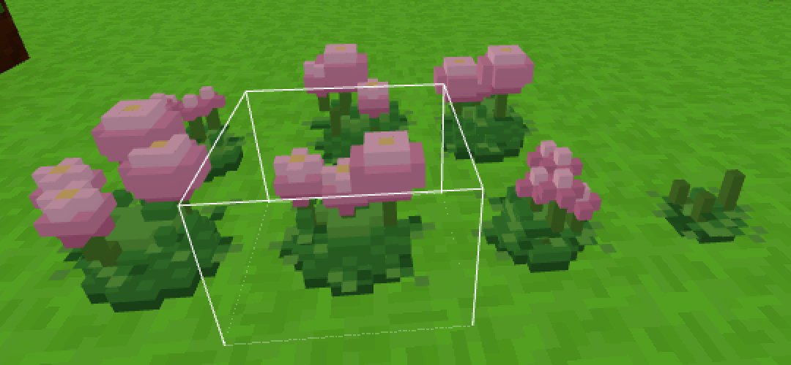
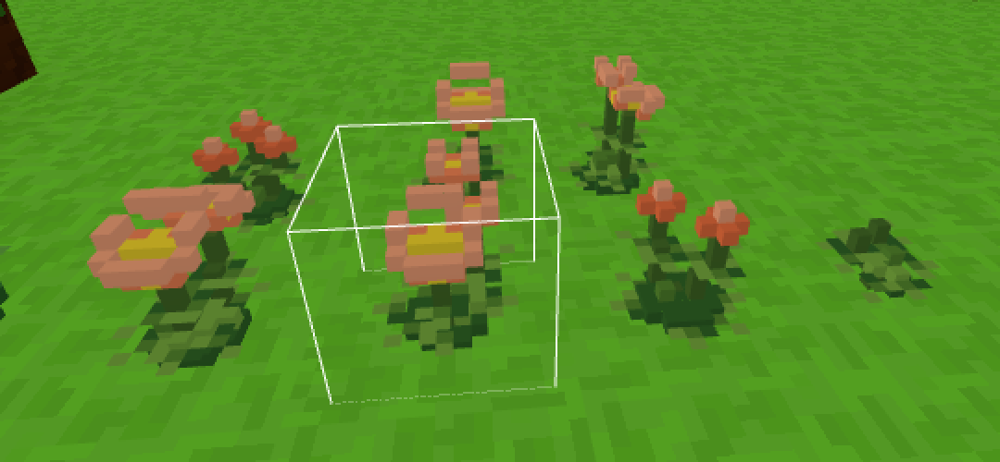
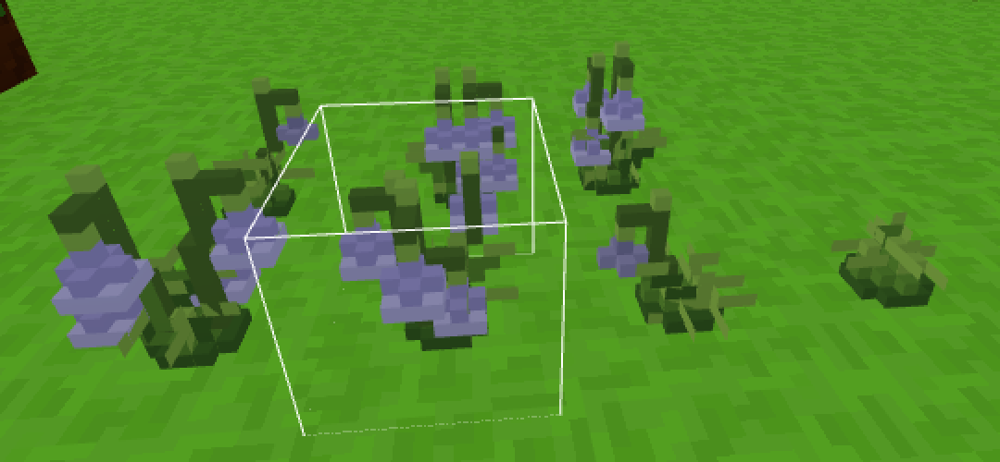
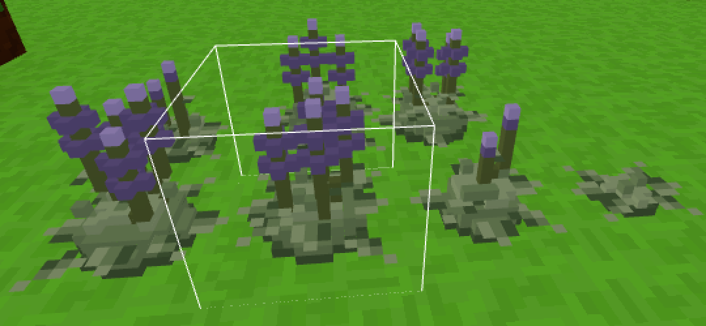
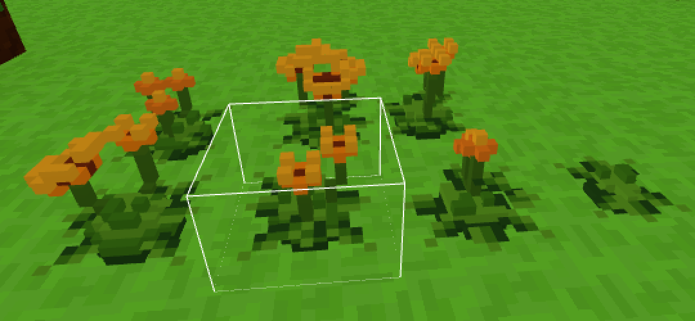
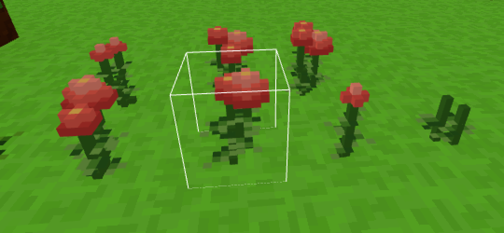
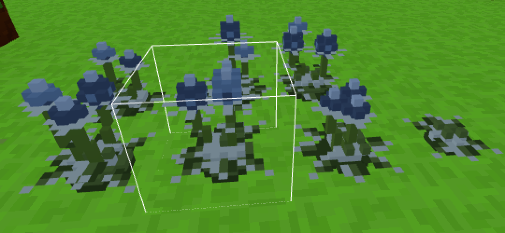

# Rośliny z paczek (assets/rosliny/)

Nowe rośliny dodaje się jak paczki drzew - folder z obrazkami i opisem,
bez pisania kodu. Są dwa rodzaje:

- **duża roślina z obrazka** - skrzyżowane płaszczyzny w rozmiarze
  obrazka, np. **amarantus** (do 2 bloków wysokości, bordowe, zwisające
  wiechy),
- **mała roślina z pikseli** (model `kepka`) - prawdziwy, mały model
  z pikseli 1/16 bloku, bez obrazka etapu, np. **kocanka piaskowa**
  (do 10 pikseli, złote baldachy na piasku), krzaczek **lawenda**
  (kępa liści, wachlarz łodyg z fioletowymi kłosami), krzak **piwonia**
  (kopułka liści, kuliste różowe kwiaty), **zawilec** (okółki liści,
  otwarte, przechylone kwiaty), **dzwonek gołębi** (zwisające dzwonki)
  **szałwia** (szarozielony krzak, kłosy w okółkach), **nagietek**
  (pomarańczowe koszyczki), **cynia** (liście parami, kwiaty z pięter
  płatków) albo **mikołajek** (niebieskie główki na gwiazdach kolców).




















## Skala: 16 pikseli na blok

Blok to 1 m, gracz ma 1.8 bloku. Każdy piksel tekstury rośliny ma ten
sam rozmiar co piksel bloku - 1/16 bloku - więc **rozmiar obrazka to
rozmiar rośliny w świecie**:

| roślina | obrazek | w świecie |
|---|---|---|
| zwykły kwiat (mak) | 16 x 16 | ok. 1 blok (płaszczyzny rozciągnięte) |
| młody amarantus | 17 x 21 | 1.1 x 1.3 bloku |
| amarantus z wiechami | 20 x 27 | 1.25 x 1.7 bloku |
| dojrzały amarantus | 26 x 32 | 1.6 x 2 bloki - wyższy od gracza |

Roślina większa niż blok to te same skrzyżowane płaszczyzny co trawa,
tylko większe: wystaje nad swoją komórkę (i trochę w bok), kołysze się
na wietrze. Celownik trafia ją także w części nad komórką. Wyższy etap
rośnie tylko, gdy nad rośliną jest wolne miejsce - pod daszkiem czeka.

## Z atlasu do gry

Obrazki roślin są narysowane jak pixel art na dużym obrazku (np. 1254 x
1254), cztery na jednym: zwykle trzy etapy wzrostu i przedmiot. "Piksel"
takiego rysunku ma kilkanaście pikseli obrazka (amarantus: 14.3 x 14.7),
nie leży w równej siatce, brzegi są rozmyte, czasem z kolorową obwódką.
Zwykłe zmniejszenie do 16 x 16 daje rozmazany wynik - dlatego
`tools/rosliny_z_atlasu.py`:

1. rozdziela obrazki (spójne plamy, nie ćwiartki - duża roślina wchodzi
   na sąsiednią),
2. znajduje siatkę pikseli rysunku (krok z widma krawędzi, każda granica
   dosunięta do krawędzi) i odczytuje każdy piksel ze środka komórki -
   bez obwódek; amarantus ma tak 34 x 42 piksele,
3. zmniejsza do skali gry (16 pikseli na blok) **wszystkie etapy tą samą
   skalą** - piksel jest równy we wszystkich etapach. Zmniejszanie jest
   "pikselowe": nowy piksel dostaje kolor z palety rośliny (24 kolory),
   który zajmuje w jego polu najwięcej miejsca; ciemne kolory (łodygi,
   cienie) ważą trochę więcej, żeby cienkie łodygi nie znikały; żadnego
   mieszania kolorów,
4. sprząta pojedyncze odstające piksele i dziurki,
5. przedmiot mieści w 16 x 16.

```
python tools/rosliny_z_atlasu.py "Atlas tekstur bordowego amarantusa.png" assets/rosliny/amarantus --wysokosc 32 --nazwy etap1,etap2,etap3,wiecha --podglad podglad.png
```

`--wysokosc` - wysokość najwyższego etapu w pikselach gry: prawdziwa
wysokość rośliny w metrach x 16. Podgląd pokazuje atlas, odczytane
piksele rysunku i wynik (powiększone).

## Paczka rośliny

`assets/rosliny/lista.json` - lista folderów, `assets/rosliny/<roslina>/`:

```json
{
    "nazwa": "Amarantus",
    "nazwaAngielska": "Amaranth",
    "opis": "wysoka (do 2 m) roślina z długimi, zwisającymi, bordowymi wiechami",
    "pierwszeId": 237,
    "etapy": [
        { "plik": "etap1.png", "nazwa": "Młody amarantus" },
        { "plik": "etap2.png", "nazwa": "Amarantus (zawiązuje wiechy)" },
        { "plik": "etap3.png", "nazwa": "Amarantus (dojrzałe wiechy)" }
    ],
    "czasWzrostu": 300,
    "przedmiot": { "klucz": "wiecha", "plik": "wiecha.png", "nazwa": "Wiecha amarantusa", "grupy": ["red"] },
    "zbior": { "ile": [1, 3], "wraca": 2 },
    "gdzieRosnie": { "biomy": ["laka"], "plamy": 0.025, "gestosc": 0.22, "etapy": [0.2, 0.3, 0.5] },
    "zrodlo": { "atlas": "Atlas tekstur bordowego amarantusa.png", "wysokosc": 32 }
}
```

| pole | znaczenie |
|---|---|
| `nazwa`, `nazwaAngielska`, `opis` | nazwy i opis (`/rosliny amarantus`) |
| `pierwszeId` | numer bloku pierwszego etapu; etapy biorą kolejne numery. Nowe rośliny: **5000-9999** (od 0.30.0, tylko rośliny); dawny zakres 100-239 jest wspólny z paczkami drzew (rośliny od góry - amarantus 237-239). Raz użytego numeru nie wolno zmieniać (zapisuje się w świecie) |
| `etapy` | 1-4 etapy wzrostu: obrazek (do 64 x 64), nazwa, `plaszczyzny` (2-4, domyślnie 2) - albo zamiast obrazka `model` (mała roślina z pikseli, niżej) |
| `czasWzrostu` | średnio sekund na etap (domyślnie jak krzaki, 150) |
| `przedmiot` | przedmiot ze zbioru, obrazek 16 x 16; `grupy` - w których grupach składników jest (`red`, `green`, `blue`, `purple` - kolorowe lampy) |
| `zbior` | PPM na ostatnim etapie: `ile` [od, do], `wraca` - do którego etapu wraca roślina |
| `podloze` | na czym rośnie oprócz ziemi, np. `["sand"]` |
| `gdzieRosnie` | teren realistyczny: `biomy`, `plamy` (jaka część biomu w plamach), `gestosc` (jak gęsto w plamie), `etapy` (jak często który etap) |
| `zrodlo` | skąd są obrazki (dla porządku - gra tego nie czyta) |

Zniszczona roślina daje młodą (pierwszy etap) - można ją posadzić.
Paczka z błędem jest pomijana, błąd jest na czacie i w `/rosliny bledy`.
Paczka tekstur zmienia przedmiot (16 x 16), ale jeszcze nie duże obrazki
etapów.

## Mała roślina: model "kepka"

Roślina niższa niż ok. pół bloku z obrazka 16 x 16 to plama kilku
pikseli - pomniejszony rysunek traci kształt. Zamiast obrazka etap
dostaje **model z pikseli** (`src/rendering/TuftGeometry.js`), w tej
samej skali co bloki - jeden piksel modelu to 1/16 bloku:

- **liście** przy ziemi w jednym z układów:
  - `rozeta` (domyślny) - płaska gwiazda wąskich liści tuż nad ziemią
    (gracz patrzy na małe rośliny z góry), w środku kilka stojących
    liści - kocanka,
  - `kepa` - krzaczek: niska kopułka z kostek (jak mały blok liści,
    postrzępiona, z jaśniejszymi pikselami), z niej wachlarze wąskich,
    stojących liści w kilku pionowych płaszczyznach - z każdej strony
    widać kępę; liście z brzegu niższe i bardziej odchylone - lawenda,
  - `krzak` - wysoka kopułka liści z kostek (spód w cieniu, jaśniejszy
    wierzch), z boków na różnych wysokościach wystają płaskie liście -
    postrzępiony, liściasty brzeg - piwonia,
  - `brak` - bez liści przy ziemi,
- **łodygi** - słupki 1 x 1 piksel w różnych miejscach kępki (nie
  stykają się), na nich 1-2 listki; `rozchylone` - łodyga zaczyna się
  w kępie i schodkami odchyla się na swoje miejsce (wachlarz łodyg);
  `liscie` - co kilka pikseli płaski liść (z góry: środkowy listek
  i szersze boki, 3 piksele szerokości), za każdym razem w inną stronę,
  albo okółek (`okolek`: kilka liści na jednej wysokości, dookoła -
  jak parasolka pod kwiatem zawilca); `"naprzeciw": true` - liście
  parami w przeciwne strony, kolejne pary na krzyż (cynia),
- **kwiaty** na łodygach: `baldach` - kopułka z kostek (krzyżyk, nad nim
  jaśniejszy środek, jeden koszyczek w cieniu), `klos` - kolumna kwiatów
  (co drugi piksel kwiatek z boku, na zmianę z czterech stron; dół
  ciemny, czubek jasny; `rozmiar` 1-2 to zamknięte pąki; `"okolki": true`
  - piętra kwiatów dookoła łodygi rozdzielone kawałkiem łodygi, jak
  u szałwii), `pompon` -
  pełny, kulisty kwiat (rozmiar 1 - 3 x 3, rozmiar 2 - 5 x 5 pikseli,
  ciemny spód, jasny wierzch, `srodek` w innym kolorze), `pak` - jeden
  piksel pąka (rozmiar 2 - okrągły pąk z krzyżyka kostek), `talerz` -
  otwarty kwiat jak miseczka (środek z pręcikami niżej, jaśniejszy brzeg
  płatków wyżej), przechylony na zewnątrz kępy - widać go z góry i z boku
  (rozmiar 1 - 3 x 3, 2 - 5 x 5 pikseli), `dzwonek` - zwisające dzwonki:
  na szczycie łodygi zielony czubek, niżej co 4 piksele zagięta szypułka
  (pierwsza na zewnątrz kępy, następne na boki) i dzwonek w dół - zielony
  kielich, wąska szyjka, szeroki jaśniejszy brzeg, od spodu pręciki
  (`srodek`); rozmiar 1 - wąski (pąk), 2 - dzwon 3 x 3, `warstwy` - pełny
  kwiat z pięter płatków coraz węższych ku górze (ciemny, szeroki spód,
  jaśniejsze piętra, `srodek` na szczycie; rozmiar 1 - 3 x 3, dwa piętra,
  2 - 5 x 5, trzy piętra), `oset` - jajowata główka z kostek w kratkę
  (jasne i ciemne kwiatki na przemian), pod nią płaska gwiazda
  kolczastych przysadek w 8 stron w kolorze `liscJasny` (rozmiar 1 -
  główka 3 x 3 x 3, 2 - 3 x 3 x 4), albo brak.
  `rozmiar` może być zakresem `[od, do]` - każda łodyga losuje (piwonia
  ma duże i małe kwiaty).

Każda kępka ma **8 odmian** (losowane z numeru odmiany i nazwy paczki -
ta sama w tym samym miejscu), kołysze się na wietrze, światło ma
miękkie jak zwykłe rośliny (boki kostek nie ciemnieją pod słońce).
Ikonka w ekwipunku to ten sam model z ukosa. Rozmiar etapu (do `/rosliny`
i miejsca nad rośliną) wynika z parametrów: kocanka 8 x 4, 10 x 6
i 10 x 10 pikseli, lawenda 12 x 6, 12 x 11 i 14 x 15 pikseli, piwonia
12 x 6, 14 x 9 i 16 x 12 pikseli, zawilec 10 x 4, 12 x 8 i 12 x 12
pikseli, dzwonek 12 x 5, 12 x 11 i 14 x 13 pikseli, szałwia 12 x 4, 14 x 11
i 16 x 14 pikseli, nagietek 12 x 3, 14 x 9 i 14 x 12 pikseli, cynia 10 x 7, 12 x 11
i 14 x 13 pikseli, mikołajek 12 x 3, 14 x 11 i 14 x 14 pikseli.

```json
"etapy": [
    { "nazwa": "Młoda kocanka",
      "model": { "rodzaj": "kepka", "liscie": { "ile": [5, 7], "dlugosc": [2, 3] } } },
    { "nazwa": "Kocanka (kwitnie)",
      "model": {
          "rodzaj": "kepka",
          "liscie": { "ile": [7, 8], "dlugosc": [3, 4] },
          "lodygi": { "ile": [4, 6], "wysokosc": [5, 8], "promien": 3 },
          "kwiaty": { "rodzaj": "baldach", "rozmiar": 1 }
      } }
],
"kolory": { "lisc": "#94a06a", "liscJasny": "#b4bc84", "liscCiemny": "#6d7448", "lodyga": "#9ea474",
            "kwiat": "#e8b24a", "kwiatJasny": "#f7cf6c", "kwiatCiemny": "#bf8a35", "pak": "#cfc58a" }
```

| pole modelu | znaczenie (piksele = 1/16 bloku) |
|---|---|
| `liscie.uklad` | `rozeta` (domyślnie), `kepa`, `krzak` albo `brak` |
| `liscie.ile`, `liscie.dlugosc` | rozeta: ile liści [od, do] (0-12), długość od środka (1-7); kępa: ile liści (0-32), wysokość (1-12); krzak: `dlugosc` - wysokość kopułki |
| `liscie.promien` | kępa, krzak: promień kopułki (0-5, domyślnie 2); liście sięgają o 2 dalej |
| `liscie.brzeg` | krzak: długość liści z boków kopułki (1-4, domyślnie 2) |
| `lodygi.ile`, `lodygi.wysokosc`, `lodygi.promien` | łodygi: ile (0-12, domyślnie bez łodyg), wysokość [od, do] (1-24), jak daleko od środka szczyt (0-6) |
| `lodygi.rozchylone` | `true` - łodygi wyrastają bliżej środka i odchylają się na boki (wachlarz) |
| `lodygi.liscie` | `{ "co": 1-6, "dlugosc": [od, do] }` - płaskie liście na łodygach co tyle pikseli (nad kopułką krzaka), długość 1-5, `"naprzeciw": true` - parami; `{ "okolek": 2-5, "dlugosc": [od, do] }` - okółek liści w ok. połowie łodygi |
| `kwiaty` | `{ "rodzaj": "baldach", "rozmiar": 1-2 }`, `{ "rodzaj": "klos", "rozmiar": 1-6, "okolki": true }` (długość kłosa; okółki - z przerwami), `{ "rodzaj": "pompon", "rozmiar": 1-2 }`, `{ "rodzaj": "talerz", "rozmiar": 1-2 }`, `{ "rodzaj": "dzwonek", "rozmiar": 1-2 }`, `{ "rodzaj": "warstwy", "rozmiar": 1-2 }`, `{ "rodzaj": "oset", "rozmiar": 1-2 }`, `{ "rodzaj": "pak", "rozmiar": 1-2 }` albo brak; `rozmiar` - liczba albo `[od, do]` |
| `kolory` | 9 kolorów: `lisc`, `liscJasny`, `liscCiemny`, `lodyga`, `kwiat`, `kwiatJasny`, `kwiatCiemny`, `pak`, `srodek` (środek kwiatu) - dla całej paczki (obok `etapy`), etap może zmienić własnymi `model.kolory` |

Kolory najlepiej wziąć z atlasu rośliny (`tools/rosliny_z_atlasu.py
--podglad` pokazuje paletę). Przedmiot (np. bukiet) dalej jest obrazkiem
16 x 16 z atlasu. Mała kępka ma do ok. 300 ścian na odmianę, krzaczki
z kwiatami (lawenda, piwonia) ok. 400-490 - `tools/sprawdz_rosliny.mjs`
pilnuje 520.
Etap może mieć własne `model.kolory` - lawenda ma pąki w ciemniejszym
fiolecie niż kwiaty.

Lawenda (kępa, łodygi rozchylone, kłosy):

```json
"model": {
    "rodzaj": "kepka",
    "liscie": { "uklad": "kepa", "ile": [20, 24], "dlugosc": [7, 9], "promien": 3 },
    "lodygi": { "ile": [6, 8], "wysokosc": [8, 11], "promien": 5, "rozchylone": true },
    "kwiaty": { "rodzaj": "klos", "rozmiar": 4 }
}
```

Piwonia (krzak, liście na łodygach, pompony dwóch wielkości):

```json
"model": {
    "rodzaj": "kepka",
    "liscie": { "uklad": "krzak", "promien": 4, "dlugosc": [4, 5] },
    "lodygi": { "ile": [3, 5], "wysokosc": [6, 8], "promien": 4, "rozchylone": true, "liscie": { "co": 2, "dlugosc": [2, 3] } },
    "kwiaty": { "rodzaj": "pompon", "rozmiar": [1, 2] }
}
```

Zawilec (mała kępka liści, okółek na łodydze, kwiaty-talerzyki):

```json
"model": {
    "rodzaj": "kepka",
    "liscie": { "uklad": "krzak", "promien": 2, "dlugosc": [2, 2] },
    "lodygi": { "ile": [2, 3], "wysokosc": [6, 8], "promien": 3, "rozchylone": true, "liscie": { "okolek": 3, "dlugosc": [2, 2] } },
    "kwiaty": { "rodzaj": "talerz", "rozmiar": [1, 2] }
}
```

Dzwonek gołębi (kępa liści, łodygi ze zwisającymi dzwonkami; pąki to
małe dzwonki w ciemniejszych kolorach etapu):

```json
"model": {
    "rodzaj": "kepka",
    "liscie": { "uklad": "kepa", "ile": [12, 14], "dlugosc": [5, 7], "promien": 2 },
    "lodygi": { "ile": [2, 3], "wysokosc": [10, 12], "promien": 3, "rozchylone": true },
    "kwiaty": { "rodzaj": "dzwonek", "rozmiar": 2 }
}
```

Szałwia (te same części co lawenda i piwonia - krzak z dłuższymi liśćmi
z boków, kłosy w okółkach):

```json
"model": {
    "rodzaj": "kepka",
    "liscie": { "uklad": "krzak", "promien": 4, "dlugosc": [4, 5], "brzeg": 3 },
    "lodygi": { "ile": [3, 4], "wysokosc": [7, 9], "promien": 3, "rozchylone": true, "liscie": { "co": 3, "dlugosc": [2, 3] } },
    "kwiaty": { "rodzaj": "klos", "rozmiar": 5, "okolki": true }
}
```

Cynia (bez liści przy ziemi, liście parami na krzyż, kwiaty z pięter):

```json
"model": {
    "rodzaj": "kepka",
    "liscie": { "uklad": "brak" },
    "lodygi": { "ile": [2, 3], "wysokosc": [8, 10], "promien": 3, "rozchylone": true, "liscie": { "co": 2, "dlugosc": [2, 3], "naprzeciw": true } },
    "kwiaty": { "rodzaj": "warstwy", "rozmiar": [1, 2] }
}
```

## Komendy

| komenda | co robi |
|---|---|
| `/rosliny` | lista roślin z paczek |
| `/rosliny amarantus` | opis: etapy z rozmiarami, przedmiot, gdzie rośnie, numery bloków |
| `/rosliny ogrod [roslina]` | wszystkie etapy przed tobą, roślina w rzędzie |
| `/rosliny znajdz amarantus` | najbliższa we wczytanym terenie |
| `/rosliny bledy` | błędy paczek roślin |
| `/daj amarantus_etap3` | blok etapu (posadzisz go PPM), `/daj amarantus_wiecha` - przedmiot |
| `/krzaki rosnij [etapy]` | rośliny i krzaki w okolicy rosną od razu |

Wiecha amarantusa jest w grupie "coś czerwonego" - czerwona lampa: lampa
+ wiecha.

## Plan: wszystkie rośliny z atlasów

Atlasy w `Obrazy/voksel game/roślinność` (28). Rysunek ma zwykle
40-45 pikseli wysokości, a większość roślin jest niższa niż 1 m - więc
zmniejszenie bywa 3-5 razy. Proponowane rozmiary (prawdziwa wysokość
-> bloki / piksele) i modele:

| roślina | naprawdę | w grze | model, pomysł |
|---|---|---|---|
| **amarantus** | 1-2 m | **2 bloki (32 px)** | duży krzyż - **zrobione** |
| czarny bez | 3-6 m | 2.5-3 bloki (40-48 px) | duży krzyż prawie bez zmniejszania (rysunek ~43 px); albo paczka drzew z owocami |
| indygowiec | krzew 1-1.5 m | 1.25 bloku (20 px) | krzyż z 3 płaszczyznami (gęsty krzew); liście - "coś niebieskiego" |
| gorczyca | 0.6-1.2 m | 1 blok (16 px) | krzyż; nasiona |
| len | 0.3-1 m | 0.9 bloku (14 px) | smukły krzyż; wiązka lnu |
| marzanna barwierska | 0.6-1 m | 1 blok (16 px) | krzyż; korzenie - "coś czerwonego" |
| **piwonia** | krzew ~1 m | **16 x 12 px** | **`kepka`: krzak, liście na łodygach, pompony - zrobione** (0.33.0) |
| **cynia** | 0.3-0.9 m | **14 x 13 px** | **`kepka`: liście parami, kwiaty z pięter - zrobione** (0.38.0) |
| **mikołajek** | 0.3-0.9 m | **14 x 14 px** | **`kepka`: główki na gwiazdach kolców - zrobione** (0.39.0) |
| **lawenda** | 0.3-0.6 m | **do 15 px (prawie blok)** | **`kepka`: kępa + rozchylone łodygi z kłosami - zrobione** (0.32.0) |
| **szałwia** | 0.3-0.6 m | **16 x 14 px** | **`kepka`: krzak, kłosy w okółkach - zrobione** (0.36.0) |
| **nagietek** | 0.3-0.6 m | **14 x 12 px** | **`kepka`: krzak, talerzyki (tylko `roslina.json`) - zrobione** (0.37.0) |
| wilczomlecz, mięta wodna | 0.3-0.6 m | 0.6 bloku (10 px) | `kepka`; mięta przy wodzie |
| **dzwonek gołębi** | 0.3-0.5 m | **14 x 13 px** | **`kepka`: kępa liści, zwisające dzwonki - zrobione** (0.35.0) |
| storczyk | 0.3-0.5 m | 0.5 bloku (8 px) | krzyż albo `kepka` |
| **kocanka piaskowa** | 0.1-0.3 m | **do 10 px (0.6 bloku)** | **model z pikseli `kepka` - zrobione** (0.31.0): rozeta, łodygi, baldachy |
| **zawilec** | 0.1-0.3 m | **12 x 12 px** | **`kepka`: okółki liści, kwiaty-talerzyki - zrobione** (0.34.0) |
| barwinek | 0.1-0.2 m, płożący | płasko | model płaski na ziemi (jak kępki mchu) z kwiatkami |
| porost oliwkowy, porost iglasty, żółta ochra | płaskie | płasko | model płaski na kamieniu i korze (jak opadłe liście), 4 odmiany |
| grzyby półkowe | 5-30 cm | płasko na boku pnia | model przy ścianie (jak wieniec), na pniach |
| lotos | liść 0.5 m na wodzie | liść płasko na tafli, kwiat 0.5 bloku nad wodą | jak grzybień (rośliny wodne 0.26.0) |
| glony głębinowe, turkusowa alga | pod wodą | 1-2 bloki / 0.5-1 blok | roślina w wodzie (jak wywłócznik) |
| rumianek, wrzos | 0.2-0.5 m | już są w grze | nowe tekstury dla obecnych bloków (14 px) |

Mniejsze niż 0.6 bloku: zwykłe zmniejszenie traci szczegóły - takie
rośliny lepiej zrobić modelem `kepka` (kolory z atlasu, kształt
z parametrów) albo poprawić piksele ręcznie. Krzaczki mogą też dostać
własne modele (np. obszerna kula liści z pikseli, blok liści z wystającymi
gałązkami) - model `kepka` jest pierwszym z nich.

**Numery bloków:** od 0.30.0 blok ma numer 2-bajtowy (do 65279) - nowe
rośliny dostają numery **5000-9999** (osobny zakres tylko dla roślin),
miejsca wystarczy na tysiące etapów. Opis zapisu: `docs/numery-blokow.md`.
