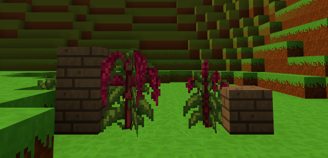

# Rośliny z paczek (assets/rosliny/)

Nowe rośliny dodaje się jak paczki drzew - folder z obrazkami i opisem,
bez pisania kodu. Pierwsza: **amarantus** (do 2 bloków wysokości,
bordowe, zwisające wiechy).



## Skala: 16 pikseli na blok

Blok to 1 m, gracz ma 1.8 bloku. Każdy piksel tekstury rośliny ma ten
sam rozmiar co piksel bloku - 1/16 bloku - więc **rozmiar obrazka to
rozmiar rośliny w świecie**:

| roślina | obrazek | w świecie |
|---|---|---|
| zwykły kwiat (mak) | 16 x 16 | ok. 1 blok (płaszczyzny rozciągnięte) |
| młody amarantus | 17 x 21 | 1.1 x 1.3 bloku |
| amarantus z wiechami | 20 x 27 | 1.25 x 1.7 bloku |
| dojrzały amarantus | 26 x 32 | 1.6 x 2 bloki - wyższy od gracza |

Roślina większa niż blok to te same skrzyżowane płaszczyzny co trawa,
tylko większe: wystaje nad swoją komórkę (i trochę w bok), kołysze się
na wietrze. Celownik trafia ją także w części nad komórką. Wyższy etap
rośnie tylko, gdy nad rośliną jest wolne miejsce - pod daszkiem czeka.

## Z atlasu do gry

Obrazki roślin są narysowane jak pixel art na dużym obrazku (np. 1254 x
1254), cztery na jednym: zwykle trzy etapy wzrostu i przedmiot. "Piksel"
takiego rysunku ma kilkanaście pikseli obrazka (amarantus: 14.3 x 14.7),
nie leży w równej siatce, brzegi są rozmyte, czasem z kolorową obwódką.
Zwykłe zmniejszenie do 16 x 16 daje rozmazany wynik - dlatego
`tools/rosliny_z_atlasu.py`:

1. rozdziela obrazki (spójne plamy, nie ćwiartki - duża roślina wchodzi
   na sąsiednią),
2. znajduje siatkę pikseli rysunku (krok z widma krawędzi, każda granica
   dosunięta do krawędzi) i odczytuje każdy piksel ze środka komórki -
   bez obwódek; amarantus ma tak 34 x 42 piksele,
3. zmniejsza do skali gry (16 pikseli na blok) **wszystkie etapy tą samą
   skalą** - piksel jest równy we wszystkich etapach. Zmniejszanie jest
   "pikselowe": nowy piksel dostaje kolor z palety rośliny (24 kolory),
   który zajmuje w jego polu najwięcej miejsca; ciemne kolory (łodygi,
   cienie) ważą trochę więcej, żeby cienkie łodygi nie znikały; żadnego
   mieszania kolorów,
4. sprząta pojedyncze odstające piksele i dziurki,
5. przedmiot mieści w 16 x 16.

```
python tools/rosliny_z_atlasu.py "Atlas tekstur bordowego amarantusa.png" assets/rosliny/amarantus --wysokosc 32 --nazwy etap1,etap2,etap3,wiecha --podglad podglad.png
```

`--wysokosc` - wysokość najwyższego etapu w pikselach gry: prawdziwa
wysokość rośliny w metrach x 16. Podgląd pokazuje atlas, odczytane
piksele rysunku i wynik (powiększone).

## Paczka rośliny

`assets/rosliny/lista.json` - lista folderów, `assets/rosliny/<roslina>/`:

```json
{
    "nazwa": "Amarantus",
    "nazwaAngielska": "Amaranth",
    "opis": "wysoka (do 2 m) roślina z długimi, zwisającymi, bordowymi wiechami",
    "pierwszeId": 237,
    "etapy": [
        { "plik": "etap1.png", "nazwa": "Młody amarantus" },
        { "plik": "etap2.png", "nazwa": "Amarantus (zawiązuje wiechy)" },
        { "plik": "etap3.png", "nazwa": "Amarantus (dojrzałe wiechy)" }
    ],
    "czasWzrostu": 300,
    "przedmiot": { "klucz": "wiecha", "plik": "wiecha.png", "nazwa": "Wiecha amarantusa", "grupy": ["red"] },
    "zbior": { "ile": [1, 3], "wraca": 2 },
    "gdzieRosnie": { "biomy": ["laka"], "plamy": 0.025, "gestosc": 0.22, "etapy": [0.2, 0.3, 0.5] },
    "zrodlo": { "atlas": "Atlas tekstur bordowego amarantusa.png", "wysokosc": 32 }
}
```

| pole | znaczenie |
|---|---|
| `nazwa`, `nazwaAngielska`, `opis` | nazwy i opis (`/rosliny amarantus`) |
| `pierwszeId` | numer bloku pierwszego etapu; etapy biorą kolejne numery. Nowe rośliny: **5000-9999** (od 0.30.0, tylko rośliny); dawny zakres 100-239 jest wspólny z paczkami drzew (rośliny od góry - amarantus 237-239). Raz użytego numeru nie wolno zmieniać (zapisuje się w świecie) |
| `etapy` | 1-4 etapy wzrostu: obrazek (do 64 x 64), nazwa, `plaszczyzny` (2-4, domyślnie 2) |
| `czasWzrostu` | średnio sekund na etap (domyślnie jak krzaki, 150) |
| `przedmiot` | przedmiot ze zbioru, obrazek 16 x 16; `grupy` - w których grupach składników jest (`red`, `green`, `blue`, `purple` - kolorowe lampy) |
| `zbior` | PPM na ostatnim etapie: `ile` [od, do], `wraca` - do którego etapu wraca roślina |
| `podloze` | na czym rośnie oprócz ziemi, np. `["sand"]` |
| `gdzieRosnie` | teren realistyczny: `biomy`, `plamy` (jaka część biomu w plamach), `gestosc` (jak gęsto w plamie), `etapy` (jak często który etap) |
| `zrodlo` | skąd są obrazki (dla porządku - gra tego nie czyta) |

Zniszczona roślina daje młodą (pierwszy etap) - można ją posadzić.
Paczka z błędem jest pomijana, błąd jest na czacie i w `/rosliny bledy`.
Paczka tekstur zmienia przedmiot (16 x 16), ale jeszcze nie duże obrazki
etapów.

## Komendy

| komenda | co robi |
|---|---|
| `/rosliny` | lista roślin z paczek |
| `/rosliny amarantus` | opis: etapy z rozmiarami, przedmiot, gdzie rośnie, numery bloków |
| `/rosliny ogrod [roslina]` | wszystkie etapy przed tobą, roślina w rzędzie |
| `/rosliny znajdz amarantus` | najbliższa we wczytanym terenie |
| `/rosliny bledy` | błędy paczek roślin |
| `/daj amarantus_etap3` | blok etapu (posadzisz go PPM), `/daj amarantus_wiecha` - przedmiot |
| `/krzaki rosnij [etapy]` | rośliny i krzaki w okolicy rosną od razu |

Wiecha amarantusa jest w grupie "coś czerwonego" - czerwona lampa: lampa
+ wiecha.

## Plan: wszystkie rośliny z atlasów

Atlasy w `Obrazy/voksel game/roślinność` (28). Rysunek ma zwykle
40-45 pikseli wysokości, a większość roślin jest niższa niż 1 m - więc
zmniejszenie bywa 3-5 razy. Proponowane rozmiary (prawdziwa wysokość
-> bloki / piksele) i modele:

| roślina | naprawdę | w grze | model, pomysł |
|---|---|---|---|
| **amarantus** | 1-2 m | **2 bloki (32 px)** | duży krzyż - **zrobione** |
| czarny bez | 3-6 m | 2.5-3 bloki (40-48 px) | duży krzyż prawie bez zmniejszania (rysunek ~43 px); albo paczka drzew z owocami |
| indygowiec | krzew 1-1.5 m | 1.25 bloku (20 px) | krzyż z 3 płaszczyznami (gęsty krzew); liście - "coś niebieskiego" |
| gorczyca | 0.6-1.2 m | 1 blok (16 px) | krzyż; nasiona |
| len | 0.3-1 m | 0.9 bloku (14 px) | smukły krzyż; wiązka lnu |
| marzanna barwierska | 0.6-1 m | 1 blok (16 px) | krzyż; korzenie - "coś czerwonego" |
| piwonia | krzew ~1 m | 1 blok, szeroka (16 px) | krzyż z 3 płaszczyznami; kwiat |
| cynia, mikołajek | 0.3-0.9 m | 0.75 bloku (12 px) | krzyż |
| nagietek, wilczomlecz, szałwia, lawenda, mięta wodna | 0.3-0.6 m | 0.6 bloku (10 px) | krzyż; lawenda i szałwia krzaczaste (3 płaszczyzny), mięta przy wodzie |
| storczyk, dzwonek | 0.3-0.5 m | 0.5 bloku (8 px) | krzyż |
| zawilec, kocanka piaskowa | 0.1-0.3 m | 0.3 bloku | **kępka**: 2-3 małe roślinki (po 5-6 px) w jednym bloku, narysowane od nowa w tej skali (kwiat = 1-2 piksele koloru), zamiast jednej pomniejszonej |
| barwinek | 0.1-0.2 m, płożący | płasko | model płaski na ziemi (jak kępki mchu) z kwiatkami |
| porost oliwkowy, porost iglasty, żółta ochra | płaskie | płasko | model płaski na kamieniu i korze (jak opadłe liście), 4 odmiany |
| grzyby półkowe | 5-30 cm | płasko na boku pnia | model przy ścianie (jak wieniec), na pniach |
| lotos | liść 0.5 m na wodzie | liść płasko na tafli, kwiat 0.5 bloku nad wodą | jak grzybień (rośliny wodne 0.26.0) |
| glony głębinowe, turkusowa alga | pod wodą | 1-2 bloki / 0.5-1 blok | roślina w wodzie (jak wywłócznik) |
| rumianek, wrzos | 0.2-0.5 m | już są w grze | nowe tekstury dla obecnych bloków (14 px) |

Mniejsze niż 0.6 bloku: zwykłe zmniejszenie traci szczegóły - narzędzie
daje dobrą podstawę, ale przy 5-10 pikselach trzeba będzie poprawić
piksele ręcznie albo zrobić kępkę kilku małych roślin.

**Numery bloków:** od 0.30.0 blok ma numer 2-bajtowy (do 65279) - nowe
rośliny dostają numery **5000-9999** (osobny zakres tylko dla roślin),
miejsca wystarczy na tysiące etapów. Opis zapisu: `docs/numery-blokow.md`.
