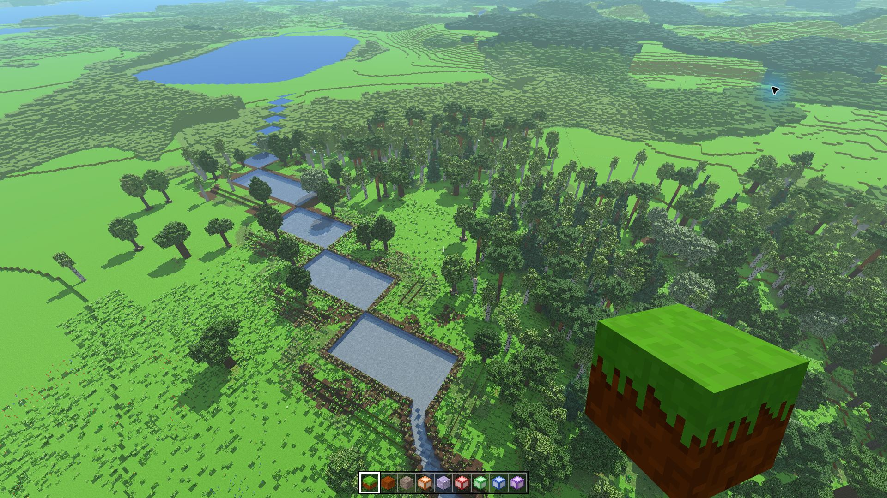
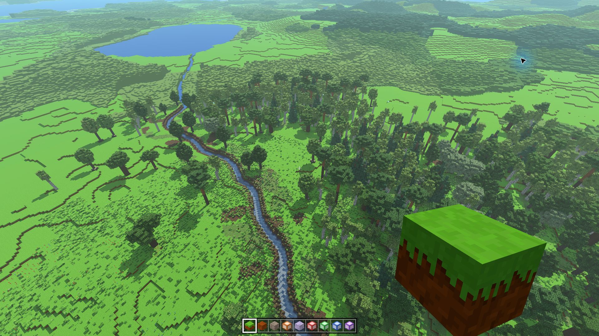

# Naprawa rzek i jezior — 0.25.1

PR [#52](https://github.com/kamilstefaniak12321-pixel/voxel-game/pull/52)
naprawia teren realistyczny: dawne suche koryta, piaszczyste przedłużenia
ujść oraz łańcuchy prostokątnych basenów. Wersja jest przygotowana dla
Windowsa i Androida; samo utworzenie PR nie publikuje aktualizacji.

## Przyczyny i poprawki

- **Suche szczeliny** pochodziły z osobnej warstwy `ravine`, niezależnej
  od sieci rzek. Warstwa została usunięta. Makrorzeźba, doliny, góry
  i górskie żleby zachowują swoje pola szumu.
- **Piaskowe wały przy ujściu** powstawały przez podnoszenie brzegów
  koryta także na zanurzonym dnie morza. Generator zachowuje teraz
  naturalne dno i łączy ujście z taflą morza. Brzegi na lądzie pozostają.
- **Prostokątne baseny** były skutkiem uznawania całej historii szukania
  przelewu za zalany obszar jeziora. Obejmowała ona również suche siodła
  i oddzielone nimi zagłębienia. Woda zajmuje teraz wyłącznie połączony
  z dnem obszar poniżej blokowego poziomu tafli. Zachowana droga do
  przelewu staje się ciągłym korytem rzeki.
- **Prostokątne spłaszczenia wzgórz** wynikały z wygładzania terenu
  wewnątrz całej ramki jeziora. Wpływ jeziora zależy teraz od rzeczywistej
  odległości od brzegu i wygasa przed końcem zasięgu wyszukiwania.
- **Powrót gracza do zasypanej szczeliny** jest zabezpieczony: tylko
  pozycja kolidująca z załadowanymi blokami zostaje przesunięta do
  najbliższego wolnego miejsca powyżej. Wolna jaskinia, pokój lub lot
  zachowują zapisaną pozycję. Nie usuwa się żadnych bloków.

Wysokości siatki spływu mają jednakową precyzję przy pierwszym odczycie
i odczycie z pamięci, aby progi jezior nie zależały od kolejności wizyt.

## Powtarzalne miejsca do sprawdzenia

Utwórz osobny świat **Realistyczny** w trybie kreatywnym.
Wpisanie samych cyfr w polu seeda tworzy seed liczbowy; w testach kodu
`2138286349` również musi być liczbą, nie tekstem.

| Seed | Pozycja kamery | Co porównać z 0.25.0 |
| --- | --- | --- |
| `2138286349` | `/tp 188 132 -252` | Dokładne miejsce ze zgłoszenia: prostokątne baseny zastąpione wąskim korytem. Odcinek leży około X=208–320, Z=−224–−160. |
| `lighting-rtx3050-0231` | `/tp 968 83 -175` | Ujście około X=968, Z=−216: brak piaszczystej obwódki wysuniętej w morze. Patrz na północ, w dół. |
| `lighting-rtx3050-0231` | `/tp 0 103 30` | Dawne suche rozcięcie przy X=0, Z=0: teren tworzy ciągłe zbocze. Patrz na północ, w dół. |

Dla porównania oświetlenia zatrzymaj czas komendami
`/czas predkosc 0` i `/czas ustaw 12:00`. Obejrzyj te same miejsca przy
pełnych blokach oraz po oddaleniu, gdy przechodzą w uproszczony teren.
Pełna szczegółowość pozwala odróżnić błąd generatora od uproszczenia widoku.

## Istniejące światy

Po ponownym wejściu do świata poprawki obejmują nowe i nietknięte obszary,
również wcześniej odwiedzone. Samo oglądanie terenu nie utrwala bloków.

Chunk zmieniony przez gracza jest zapisany w całości. Aktualizacja
zachowuje jego budowle, wykopy, wodę i dawne podłoże, także w dalekim
widoku. Stare koryto może więc pozostać wewnątrz takiego fragmentu,
a na styku z nowym terenem może wystąpić uskok. Format zapisu nie pozwala
bezpiecznie oddzielić starych bloków generatora od zmian gracza.
Nie ma automatycznego kasowania ani regenerowania tych zapisów.

Nurt jest przeliczany osobno i nie zmienia geometrii zapisanych chunków.
Generator klasyczny pozostaje bez zmian.

## Zakres sprawdzeń

`npm test` obejmuje dotychczasowe sprawdzenia gry oraz pięć nowych testów:

| Test | Sprawdzane zachowanie |
| --- | --- |
| `tools/sprawdz_teren_rzek.mjs` | Usunięcie suchej szczeliny, zachowanie pozostałych form terenu, dokładny seed zgłoszenia oraz ciągły odpływ jeziora po blokach wody bez suchych przerw i wysokich ścian. |
| `tools/sprawdz_ujscia.mjs` | Ujścia do morza i jeziora, zachowanie brzegów lądowych, brak wpływu pustej części ramki jeziora; także 6165 zanurzonych próbek rzeczywistego terenu. |
| `tools/sprawdz_rzeki_zapisy.mjs` | Zapis i wczytanie budowli, wykopu i wody bez zmiany bloków; nowy generator w nietkniętym sąsiedztwie i zgodność dalekiego widoku z zapisem. |
| `tools/sprawdz_rzeki_kolejnosc.mjs` | Identyczne wyniki przy odwrotnej kolejności odwiedzin i po dogenerowaniu źródeł, granice chunków i stref, nurt, kolory oraz daleki teren; również seed `2138286349`. |
| `tools/sprawdz_pozycje_po_generacji.mjs` | Bezpieczna pozycja po zasypaniu koryta, narożnik czterech chunków, zachowanie jaskini, budowli i lotu, brak zmian bloków. |

Workflow **Laboratorium światła** sprawdza ponadto prawdziwe renderowanie
WebGL. Oczekiwanie na wynik korzysta z istniejącego 180-sekundowego budżetu
całego scenariusza, aby wolniejsza kompilacja w SwiftShader nie przerywała
go wcześniejszym, niezależnym limitem 30 sekund. Asercje pozostają bez zmian.
Workflow **Aplikacje (komputer i telefon)** buduje i sprawdza instalator
Windows oraz aplikację Android bez publikacji w ramach PR.

## Obraz i wydajność

Sprawdzenie 29.10.2026 na RTX 3050 Laptop, na zasilaczu. Oddzielna
lokalna kopia gry w Electron 44.4.5 / Chrome 152, pełny ekran 1920×1080,
DPR 1, skala renderowania 100%, domyślny VSync i ekran 144 Hz.
Zainstalowana gra pozostawała w menu pauzy; użyto oddzielnych zapisów.

W obu wersjach kamera `(188,132,-252)`, yaw `3.65`, pitch `-0.7`,
seed liczbowy `2138286349`, południe i zatrzymany czas. Cienie wysokie,
daleki teren 8192, szczegóły dalekiego terenu 2. Bez obniżania jakości
światła ani skracania horyzontu. Każda próba: 10 s rozgrzewki + 30 s
pomiaru nieruchomej kamery. GPU mierzone przez timer WebGL, odstępy
klatek i czas CPU osobno. To pomiar załadowanej sceny, nie całej podróży.

| Próba | Pełne bloki | Średnie FPS | 1% low | p99 klatki | Średni czas GPU |
| --- | ---: | ---: | ---: | ---: | ---: |
| 0.25.0, bez limitu | 48 | 134,0 | 64,5 | 13,2 ms | 5,40 ms |
| 0.25.1, bez limitu | 48 | 120,3 | 56,5 | 15,6 ms | 5,15 ms |
| 0.25.1, bez limitu, większe obciążenie | 192 | 54,1 | 25,1 | 35,1 ms | 11,93 ms |
| 0.25.1, limit 60, ukryty tekst diagnostyczny | 48 | 60,0 | 44,1 | 22,2 ms | 7,80 ms |

Przy standardowym zasięgu pełnych bloków pozostaje zapas wydajności GPU,
ale całkowity czas klatki jest gorszy niż w próbce 0.25.0. Nie jest to
pomiar wykazujący brak regresji. Przy limicie 60 najdłuższa klatka miała
25,1 ms; nierówne odstępy klatek na ekranie 144 Hz pozostają widoczne
w 1% low. Przy 192 pełnych blokach cel stałych 60 FPS nie jest osiągnięty.
Te ograniczenia pozostają do dalszych prac nad wydajnością.

Pomiar samego generatora w Node (mediana trzech prób po rozgrzewce,
18 obszarów) wyniósł 558 ms przed i 669 ms po zmianie. Pętla 73728 kolumn
przy kroku 1: 141 ms przed i 165 ms po. Wyznaczenie rzeczywiście
połączonej wody ma dodatkowy koszt przygotowania terenu; wartości nie
są czasami pojedynczej klatki ani pomiarem GPU.

Surowe wyniki: [przed](pomiary/rzeki-0.25.1/rtx3050-przed.json),
[po](pomiary/rzeki-0.25.1/rtx3050-po.json),
[runtime](pomiary/rzeki-0.25.1/runtime.json),
[CPU przed](pomiary/rzeki-0.25.1/generator-przed.json),
[CPU po](pomiary/rzeki-0.25.1/generator-po.json).

Zdjęcia mają tę samą kamerę i 192 bloki pełnej geometrii, aby widoczne
były rzeczywiste brzegi, a nie tylko uproszczony widok z daleka.

Przed — ciąg prostokątnych basenów:

Po — ciągła rzeka, zachowane właściwe jezioro i jego odpływ:

Ujście również obejrzano w grze przy pełnych blokach do 192: piaskowa
obwódka zamykająca rzekę zniknęła, woda łączy się z morzem. Ujęcia mają
tę samą pozycję i kierunek kamery, lecz różne rozmiary okna (przed:
1625×877 w przeglądarce, po: 1920×1080 w Electron), więc służą do
oceny geometrii, nie porównania FPS:
[ujście przed](pomiary/rzeki-0.25.1/ujscie-przed.png),
[ujście po](pomiary/rzeki-0.25.1/ujscie-po.png).

Obejrzano też dawne koryto przy `(0,0)` w tym samym świecie kontrolnym:
w pełnej geometrii jest teraz ciągłe zbocze bez suchego rozcięcia
([widok z gry](pomiary/rzeki-0.25.1/koryto-po.png)).

## Następne etapy

Po sprawdzeniu napraw zaplanujemy roślinność w trzech strefach: na brzegach,
pod wodą i na powierzchni rzek. To wydanie nie dodaje nowych roślin.
Do oświetlenia wrócimy osobno, zachowując cel 60 FPS na RTX 3050
i spójny daleki widok.
