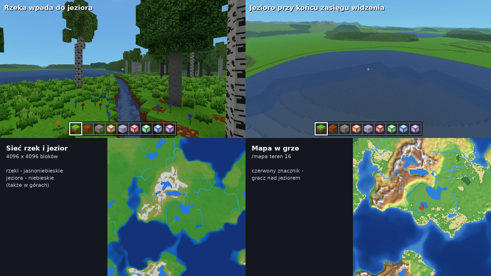

# Rzeki i jeziora



Rzeki w terenie realistycznym: skąd się biorą, którędy płyną, jak
powstają jeziora i nurt. Kod: `src/world/terrain/Rivers.js`, liczby do
strojenia: `RIVERS` w `src/world/terrain/TerrainShape.js`. Plan całego
rozdziału o terenie: `docs/generator-terenu.md` (etap 3).

## Co ustaliliśmy z Kamilem

- Rzeki **średniej wielkości** i w średniej liczbie. Później dojdą
  **rzeki główne** (dużo szersze) i **strumyki** (węższe).
- Rzeka płynie **zawsze w dół** (albo prawie poziomo, ale nigdy pod
  górę) - **wzdłuż spadku terenu**, dnem doliny, a nie w poprzek
  zbocza. Nie robi zalewisk ani wielkich ścian wody.
- Kończy się w **morzu** albo w **jeziorze**. Morze ma zawsze jeden
  poziom (48), jeziora mogą być na różnych wysokościach - np. w górach
  między szczytami.
- **Meandry** (zakręty) - tylko na płaskim terenie.
- **Nurt** niesie gracza (i w przyszłości rzeczy). Rozlewanie się
  wody przy kopaniu - później, osobno.

## Jak to działa

```
makrorzeźba co 16 bloków ──► spływ: z każdej kratki do najbardziej
(teren bez wzgórz)             stromo w dół położonej sąsiedniej
                                     │
źródła (losowo, wyżej częściej) ─────┤
                                     ▼
                           bieg rzeki: w dół aż do morza;
                           zagłębienie po drodze ─► jezioro do poziomu
                           przelewu, rzeka wypływa przelewem
                                     │
                                     ▼
                           koryto: gładka krzywa przez środki kratek,
                           meandry na płaskim, poziom wody spada w dół
                           rzeki; doliny, brzegi, dno, nurt
```

1. **Makrorzeźba** - wysokość terenu tylko z dużych form (kontynent,
   wyżyny, góry, płaskowyże, depresje), bez wzgórz i pagórków
   (`RealisticGenerator.compute` z `DETAIL_MACRO`). Na niej woda nie
   utyka w każdym dołku między pagórkami - spływa dolinami.
2. **Spływ** - na siatce co `cell` (16) bloków woda z każdej kratki
   płynie do sąsiedniej (z 8), do której jest najbardziej stromo w dół.
   Dzięki temu rzeka zawsze idzie w dół zbocza, a nie w poprzek.
3. **Zagłębienia i jeziora** - kratka bez niższego sąsiada to dno
   zagłębienia. Woda wypełnia je od dna w górę (zawsze zalewa najniższą
   kratkę brzegu), aż trafi na **przelew** - kratkę niższą niż woda, z
   której woda spływa dalej (do morza albo do głębszego zagłębienia).
   Tafla jeziora jest płaska, na poziomie przelewu, a rzeka wypływa
   z jeziora przelewem. Dwa sąsiednie zagłębienia, które przelewałyby
   się jedno do drugiego, stają się jednym jeziorem. Rzeka wpływa do
   jeziora (i wypływa z niego) od miejsca, gdzie woda ma co najmniej
   2 bloki głębokości - nie urywa się na płyciźnie przed wodą.
   - płytsze niż `lakeMinDepth` (4 bloki) - bez jeziora: rzeka
     przecina zagłębienie i lekko wcina się w próg,
   - większe niż `lakeMaxCells` kratek (albo sięgające dalej niż
     1024 bloki od dna) - jezioro **bez odpływu**: rzeka tam się kończy.
4. **Źródła** - w każdym kwadracie `sourceSpacing` x `sourceSpacing`
   bloków najwyżej jedno, w losowym (ale zawsze tym samym dla seeda)
   miejscu; szansa rośnie z wysokością (`sourceChance`: od nizin do
   gór). Ze źródła liczony jest bieg rzeki aż do morza albo jeziora bez
   odpływu. Rzeki, które się spotkają, płyną dalej razem - im więcej
   źródeł powyżej, tym szersza rzeka. Źródło, z którego woda nie dociera
   do morza ani do (głębokiego) jeziora w promieniu `maxLength` bloków,
   jest pomijane.
5. **Koryto** - przez środki kratek prowadzimy gładką krzywą (zakręty
   zaokrąglone), a na płaskim terenie wyginamy ją w **meandry** (do
   `meander` bloków w bok; na spadku nie wcale). Poziom wody: kilka
   bloków poniżej makrorzeźby (`waterBelow`), nigdy wyżej niż w górze
   rzeki; do jeziora rzeka wpływa równo z taflą, do morza - na poziomie
   morza. Gdzie poziom zmienia się o blok, jest mały próg (woda spływa
   o blok niżej).
6. **Brzeg jeziora** - woda stoi w kratkach jeziora i do `LAKE_RIM`
   (6) bloków dalej, tam gdzie makrorzeźba jest poniżej tafli. Obok
   wody teren nigdy nie jest niżej niż tafla (inaczej woda stałaby
   ścianą), dalej najwyżej łagodnie opada - o blok co 2 bloki, po 8
   blokach o blok co blok. Przy przelewie to **próg**, przez który
   wypływa rzeka; dołki (dolinki, wąwozy) przy jeziorze nie schodzą
   poniżej tafli. Rzeka przy jeziorze, do którego wpływa albo z którego
   wypływa, ma poziom równy tafli i dopiero dalej opada (wznosi się) tak
   samo łagodnie - bez ściany wody na granicy jeziora. (Dwa jeziora tuż
   obok siebie na bardzo różnych wysokościach - w górach - łączy
   wodospad na rzece między nimi.)
7. **Teren przy wodzie**:
   - w pasie `bank` bloków od koryta (i nisko nad taflą jeziora)
     wzgórza i pagórki wygładzają się do makrorzeźby,
   - brzegi opadają do wody najwyżej `bankSlope` bloku na blok (niziny
     łagodnie, góry stromiej), dalej dolina rozchyla się coraz bardziej
     - na końcu nie ścina już terenu, więc nie ma progu,
   - tuż przy korycie brzeg jest **blok nad wodą** (także przy progach
     na rzece) - woda nie wylewa się i nie stoi ścianą,
   - koryto: najgłębsze na środku (`depth` + część szerokości), dno
     z piasku, w górach ze żwiru; brzegi to trawa (nie skała, choć
     obok jest stromo), drzewa nie rosną w wodzie ani na samym brzegu.
8. **Nurt** - kierunek: wzdłuż rzeki, siła: z jej spadku (`flow`:
   od 0,6 bloku/s na płaskim do 3,2 w górach). Chunk zapamiętuje nurt
   każdej kolumny (`chunk.flow`, w zapisie go nie ma - liczy go
   generator), gracz w wodzie płynie z nurtem (tym mocniej, im głębiej
   jest), a tekstura wody na rzece płynie w stronę nurtu.

**Wszystko zależy tylko od seeda i położenia**, więc chunki można
generować w dowolnej kolejności. Rzeki liczą się po kawałku, gdy są
potrzebne (obszary 256 x 256 bloków - przy pierwszym obszarze świata
trwa to ok. 0,3-0,6 s, potem po trochu), i zostają w pamięci. Żeby
chunk wiedział o każdej rzece, która przez niego płynie, przy
przygotowaniu obszaru liczymy wszystkie źródła bliżej niż
`maxLength` + zapas - dlatego rzeka nie może być dłuższa.

**Daleki teren** pokazuje rzeki i jeziora w kratkach do 32 bloków
(rzeka węższa niż kratka i tak ją zalewa - inaczej z daleka by znikała);
dalej - bez rzek. Wierzch dalekiej wody jest na wysokości powierzchni
bliskiej wody (trochę poniżej bloku), a bliska woda tuż przy końcu
prawdziwych chunków robi się nieprzezroczysta w kolorze dalekiej wody
(`waterMaterial` w `BlockRenderData.js`) - tam pod nią nie ma już
narysowanego dna, więc przez wodę widać by jasny pas nieba.

## Liczby (RIVERS w TerrainShape.js)

| liczba | co robi |
|---|---|
| `cell` | siatka spływu (bloki) |
| `sourceSpacing`, `sourceChance` | ile źródeł (mniej odstępu, większa szansa = więcej rzek) |
| `maxLength` | najdłuższa rzeka (w linii prostej od źródła) |
| `minLength` | najkrótsza rzeka (kratki) - krótsze się nie tworzą |
| `lakeMinDepth`, `lakeMaxCells` | od jakiej głębokości zagłębienie jest jeziorem; największe jezioro |
| `LAKE_RIM`, `lakeRamp` (w `Rivers.js`) | jak daleko woda jeziora sięga w kratki brzegu; jak łagodnie opada teren za jego wodą |
| `halfWidth`, `widthPerSource` | szerokość koryta (połowa) przy źródle i największa; o ile szersza po połączeniu |
| `depth`, `waterBelow` | głębokość koryta; o ile woda jest poniżej terenu |
| `bankSlope`, `bank` | jak stromo opadają brzegi (niziny, góry); pas wygładzonych wzgórz |
| `meander`, `meanderScale`, `meanderSlope` | meandry: jak daleko w bok, co ile bloków zakręt, od jakiego spadku rzeka płynie prosto |
| `flow`, `flowSlope` | nurt: najwolniejszy i najszybszy, jak zależy od spadku |

W `src/config.js`: `RIVER_PUSH` (jak mocno nurt niesie gracza),
`RIVER_TEXTURE` (jak szybko płynie tekstura), `WATER_FLOW_MAX`.

Najwygodniej stroić tak: zmienić liczbę, odświeżyć grę, `/mapa teren 16`
(rzeki jasnoniebieskie, jeziora niebieskie) i `/rzeka statystyki`.

## Komendy

| komenda | co robi |
|---|---|
| `/rzeka` | nurt tam, gdzie jesteś, i dokąd płynie stąd woda (do morza / jeziora, ile bloków, przez ile jezior); poza rzeką - najbliższa rzeka |
| `/rzeka znajdz [tp]` | najbliższa rzeka (z teleportem nad brzeg, twarzą do wody) |
| `/rzeka jezioro [tp]` | najbliższe jezioro, do którego wpływa rzeka |
| `/rzeka nurt <0-3>` | jak mocno nurt niesie gracza (0 - wcale) |
| `/rzeka statystyki` | ile rzek, źródeł, jezior policzono dotąd |
| `/teren znajdz rzeka tp`, `/teren znajdz jezioro tp` | to samo przez `/teren` |
| `/mapa teren 16`, `/mapa formy` | rzeki i jeziora na mapie (formy: *rzeka*, *jezioro*) |

Osiągnięcie *Spływ* - daj się ponieść nurtowi rzeki przez 100 bloków.

## Czego jeszcze nie ma (dalej)

- **Rzeki główne** (szerokie, z rozlewiskami przy ujściu) i **strumyki**
  (wąskie, od źródeł w górach) - kolejne warstwy z tymi samymi zasadami.
- **Rozlewanie się wody** - woda płynąca do wykopanych dołów, nurt
  z poziomów wody (dziś nurt jest z generatora, woda stoi).
- **Wodospady** na stromych progach, **ujścia** (estuaria, delty).
- Rzeki nie zmieniają się w chunkach zmienionych przez gracza - zostaje
  zapisany stan; nurt jest liczony z generatora.
- Rzeki w terenie klasycznym - nie będzie (klasyczny się nie zmienia).
