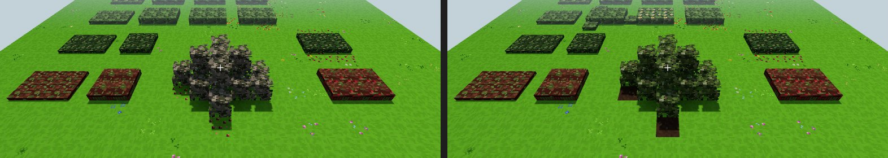

# Sad: opadłe owoce i zimowy rozwój roślin (1.22.0)

Pomysł Kamila: zima to pora, w której nic nie rośnie - i w której
rozstrzyga się następny rok. Krok 2b „kuchni i spiżarni"; wcześniej:
[owocowanie w porach roku](pory-owocowania.md).

Na zrzucie po lewej zima: krzew maliny bez liści i czerwone opadłe
owoce na trawie obok brusznicy. Po prawej wiosna po rozliczeniu: ciemne
plamy czarnoziemu pod krzewem i nowe, niskie sadzonki obok kęp.

## Co się dzieje w roku

**Po porze owocowania** (gdy minie pora rośliny) owoce, których nikt
nie zebrał, **spadają**. Roślina zostaje pusta, a na ziemi leży płaska
warstwa opadłych owoców:

- pod krzewem i drzewem - na ziemi pod gałązką (liście nie zatrzymują
  owoców, pień i inne bloki tak),
- przy roślinie stojącej na ziemi (krzak, żurawina, poziomka) - obok niej.

Bez wolnej ziemi owoce przepadają. Opadłe owoce można podnieść
(zniszczyć warstwę): dają jeden owoc. Dzika róża, rokitnik i żurawina
trzymają owoce przez zimę - zrzucają je dopiero wiosną.

**Na wiosnę** (pierwsze rozliczenie po zimie):

| Co | Szansa |
|---|---|
| ziemia pod opadłymi owocami zamienia się w **czarnoziem** | 50% |
| z opadłych owoców wyrasta **sadzonka** tej samej rośliny | 25% |
| roślina daje odtąd **o jeden owoc więcej** przy każdym zbiorze | 30% |
| ... gdy w zeszłym roku zbierano z niej owoce | +25% |
| ... gdy rośnie na czarnoziemie | +25% |
| roślina niska **rozrasta się** na wolne miejsce obok | 25% (na czarnoziemie +20%) |

- Większy plon ma sufit: **najwyżej 3 owoce więcej**. Liczy się każda
  owocująca gałązka krzewu i drzewa osobno, tak jak osobno się z nich
  zbiera.
- Rozrastają się żurawina, brusznica, truskawki i poziomki - na jedno
  z czterech sąsiednich miejsc, jeśli jest tam ziemia. Roślina, która ma
  już 4 sąsiadki tego samego gatunku (z ośmiu miejsc dookoła), się nie
  rozrasta. Dynia i cukinia nie rozrastają się wcale.
- Reszta opadłych owoców znika.
- Gracz w pobliżu dostaje jeden napis, np. *Po zimie: 3 rośliny dają
  więcej owoców, 1 nowa sadzonka z opadłych owoców*.

Wybór należy do gracza: zebrać wszystko dla siebie (i dać roślinie
premię za opiekę) albo zostawić część owoców, żeby ogród sam się
użyźniał i rozsiewał.

## Kiedy i gdzie

- **Tylko w chunkach zmienionych przez gracza** - tak jak wzrost
  ([uprawa.md](uprawa.md)). Dzikie rośliny w nietkniętym terenie nie
  zrzucają owoców i się nie rozwijają.
- Chunk rozlicza się, gdy jest wczytany, przy pierwszej okazji po
  zmianie pory. Po długiej nieobecności - **raz**, nie za każdy rok.
- Chunk, który gracz dopiero co zmienił, zaczyna liczyć od dziś.

## Osiągnięcia i komendy

*Dobrze przezimowały* (roślina daje więcej owoców), *Samosiejka*
(sadzonka z opadłych owoców).

`/sad` - stan pamięci sadu i premia rośliny pod celownikiem,
`/sad opadnij` - rozlicza koniec pory w chunkach wokół gracza,
`/sad wiosna` - rozlicza je tak, jakby minęła zima.

## Dla programisty

- `src/game/Orchard.js` - całość zasad: `settle(chunk, from, to)`
  (jedno przejście po blokach chunka), `drop`, `spread`, liczby na górze
  pliku. Numer pory: `seasonSerial` (rok × 4 + pora).
- Pamięć w zapisie świata (`worldInfo.orchard`): `levels` („x,y,z" →
  premia), `picked` (miejsca zbiorów w tym roku), `chunks` („cx,cz" →
  numer pory ostatniego rozliczenia).
- `src/blocks/fallenFruit.js` - bloki opadłych owoców (numery
  15200-15399) i `fallenFor(blok z owocami)`.
- Zbiór: `GameInteraction.harvestTarget` dodaje premię i zapamiętuje
  zbiór. Rysunki: `python3 tools/opadle_tekstury.py`.

## Czego nie ma (luki)

- **Gra ze znajomymi**: pamięć sadu ma tylko gospodarz. Gość zbiera bez
  premii, a jego zbiory nie liczą się roślinie jako opieka.
- **Premii nie widać** na roślinie - widać ją tylko po liczbie zebranych
  owoców i w `/sad` (pod celownikiem).
- Premia jest przypisana do miejsca, nie do rośliny: przesadzona roślina
  zaczyna od zera, a nowa posadzona w tym samym miejscu przed wiosną
  dziedziczy premię poprzedniej.
- Opadłe owoce nie gniją stopniowo - leżą bez zmian do wiosny; zebrane
  dają zwykły owoc.
- Sadzonka drzewa z opadłych jabłek wyrasta pod koroną matki (drzewo
  rośnie, jeśli ma nad sobą miejsce - inaczej czeka).
- Czarnoziem na razie pomaga tylko w zimowym rozwoju (tempo wzrostu -
  w planie „ziemia i owoce z charakterem").
- Pora snu: po przespaniu zmiany pory rozliczenie następuje zaraz po
  obudzeniu.
- Rozliczenie przegląda cały chunk (raz na porę, jeden chunk na pół
  sekundy); nie mierzyłem tego na prawdziwej karcie.
