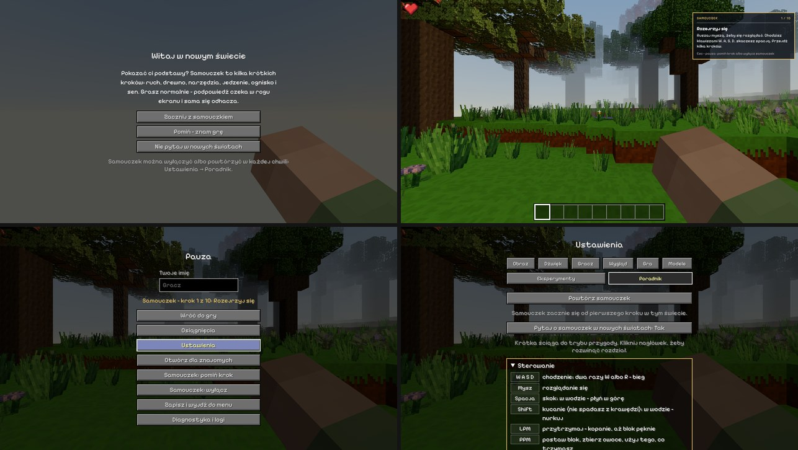

# Samouczek, poradnik i strojenie liczb (0.99.0)

Pierwsze dziesięć minut w nowym świecie. Trzy rzeczy: **samouczek**,
który prowadzi gracza krok po kroku, **poradnik** - notatka w
ustawieniach, do której można wrócić, i **strojenie liczb**, żeby te
pierwsze minuty nie karały za niewiedzę.

## Samouczek

Nowy świat w trybie przygody zaczyna się pytaniem:

| Przycisk | Co robi |
|---|---|
| **Zacznij z samouczkiem** | samouczek rusza od pierwszego kroku |
| **Pomiń - znam grę** | w tym świecie samouczka nie ma (Esc robi to samo) |
| **Nie pytaj w nowych światach** | jak wyżej i wyłącza pytanie na przyszłość |

Samouczek to **karta w prawym górnym rogu**: który krok, co zrobić,
krótka rada. Gra się normalnie - krok **sam się odhacza**, gdy gracz
zrobi to, o co prosi. Rzeczy zrobione wcześniej (ktoś już coś zjadł
albo ma siekierę) zaliczają się od razu, gdy przyjdzie ich kolej.

| Krok | Co trzeba zrobić |
|---|---|
| 1. Rozejrzyj się | przejść kilka bloków |
| 2. Zdobądź drewno | rozbić pień |
| 3. Zrób deski | wytworzyć deski w siatce 2 × 2 |
| 4. Zrób patyki | wytworzyć patyki |
| 5. Zrób siekierę | wytworzyć siekierę (3 skały i patyk) |
| 6. Zjedz coś | zjeść cokolwiek |
| 7. Sprawdź samopoczucie | otworzyć okno statusu (C) |
| 8. Ułóż ognisko | ułożyć 6 polan |
| 9. Rozpal ognisko | rozpalić je |
| 10. Prześpij noc | przespać noc (w dzień karta mówi, żeby poczekać do wieczora) |

Po ostatnim kroku karta znika, a gracz dostaje osiągnięcie *Już wiem,
co i jak*.

**Pomijanie.** W pauzie (Esc) są przyciski *Samouczek: pomiń krok*
i *Samouczek: wyłącz*; na telefonie są wprost na karcie.

**Powtórka.** *Ustawienia → Poradnik → Powtórz samouczek* (z pauzy
w grze) zaczyna go od pierwszego kroku w bieżącym świecie - także
w świecie sprzed 0.99.0. Tam też jest przełącznik *Pytaj o samouczek
w nowych światach*.

Samouczek działa tylko w trybie przygody i we własnym świecie (gość
w grze ze znajomymi go nie widzi). Stan zapisuje się ze światem. Na
telefonie teksty kroków mówią o dotyku zamiast o klawiszach.

## Poradnik

*Ustawienia → Poradnik*: dziesięć krótkich rozdziałów, rozwijanych po
kliknięciu nagłówka - sterowanie, pierwszy dzień, wytwarzanie
i narzędzia, jedzenie i energia, ognisko, noc i sen, zioła i napary,
uprawa, upadki i woda, co jeszcze warto wiedzieć. Dostępny z menu
głównego i z pauzy; na telefonie rozdział o sterowaniu opisuje dotyk.

## Strojenie liczb

Do 0.98 liczby energii i snu były ustawione na oko. Teraz
`tools/sprawdz_balans.mjs` symuluje trzech graczy (spokojnego, zwykłego
i biegacza) na prawdziwej logice gry i sprawdza **cele**:

| Cel | Wynik po strojeniu (zwykły gracz) |
|---|---|
| bez jedzenia: burczenie w pierwszym kwadransie, ale nie od razu | po 9 minutach |
| pierwsza kara (zmęczenie) nie wcześniej niż po 12 minutach | po 13 minutach |
| wyczerpanie nie wcześniej niż po kwadransie | po 16 minutach |
| trzy pieczone posiłki dziennie wystarczają | tak, kondycja rośnie |
| samych jabłek trzeba najwyżej sześciu na dobę | ok. 5 |
| pierwszego dnia senność dopiero wieczorem | o 19:00 |
| po nocy na ziemi „niewyspany" dopiero po zmroku | senny od popołudnia, niewyspany po 19:00 |

Żeby je spełnić, zmieniły się cztery liczby:

| Liczba | Było | Jest | Dlaczego |
|---|---|---|---|
| koszt skoku | 0,2 | 0,1 | samo chodzenie po pagórkach zjadało prawie połowę energii |
| energia na start | 75 | 80 | nowy gracz męczył się już po 9 minutach |
| sen na gołej ziemi (najwyżej) | 60 | 66 | po takiej nocy gracz był „niewyspany" jeszcze przed zmrokiem |
| pierwsza doba w świecie | kara za mało posiłków | bez kary | gracz dopiero się uczy, a zaczyna rano |

Reszta (czasy kopania, pieczenie, ognisko, utykanie, oddech) mieści się
w celach bez zmian. Pełne liczby pokazuje
`node tools/sprawdz_balans.mjs --raport`.

## Do testów

- nowy świat w trybie przygody - pytanie o samouczek,
- `/ustaw samouczek wyl` - bez pytania w nowych światach,
- kroki zalicza zwykła gra; do przyspieszenia: `/daj oak_log 4`,
  `/daj axe`, `/daj oak_firewood 6`, `/czas ustaw noc`.

## Dla programisty

- `src/game/Tutorial.js` - kroki (`TUTORIAL_STEPS`: nagłówek, tekst na
  komputer i telefon, rada, warunek zaliczenia) i przebieg. **Nowy
  krok** to jeden wpis w tej liście.
- `src/ui/TutorialPanel.js`, `src/ui/hud.css` (`#tutorial`) - karta.
- `src/ui/guide.js` - treść poradnika (`GUIDE`); **nowy rozdział** to
  jeden wpis. `Menu.guideNote`, `Menu.tutorialControls`,
  `Menu.showTutorialOffer` w `src/ui/Menu.js`.
- `src/main.js` - pytanie na początku świata (`shouldOffer`), zdarzenie
  otwarcia okna statusu.
- Ustawienie `tutorial` (`src/settings/Settings.js`), zakładka `guide`
  (`src/ui/settingsLayout.js`).
- Stan w zapisie świata: `worldInfo.tutorial = { step, done, skipped }`.
- Klawisze w tekstach kroków i poradnika pisze się nazwą czynności
  (`[eat]`, `{break}`) - gracz mógł je przypisać inaczej
  ([klawisze.md](klawisze.md)); telefon ma własne teksty (`touch`).
- Testy: `node tools/sprawdz_samouczek.mjs` (kroki, przebieg, liczby
  w tekstach zgodne z grą), `node tools/sprawdz_balans.mjs` (cele
  strojenia).
