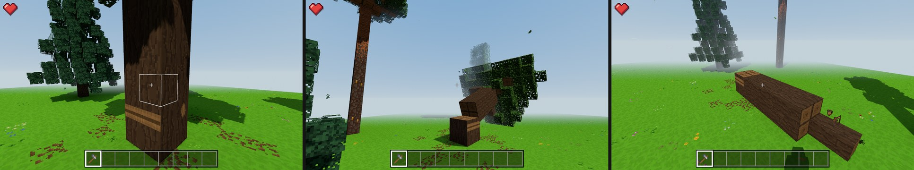

# Ścinanie drzew

Część B projektu [drewno.md](drewno.md) (rozdział 3). **W grze od
1.36.0**: drzewo jako jeden byt, ciosy i karb, upadek, leżący pień,
konary. Jeszcze nie ma: kozłów, powalonych drzew na start, twardości
siekier (lista na końcu - *Luki*).

## Jak się ścina

1. Weź **siekierę** (każda działa tak samo) i w trybie przygody bij
   w **pień żywego drzewa** (LPM, można trzymać). To **cios**, nie
   kopanie: zamach trwa 0,6 s i kosztuje trochę energii.
2. W pniu rośnie **karb** - jasny pas drewna na tej ścianie, w którą
   bijesz.
3. Po ostatnim ciosie drzewo **trzeszczy, przechyla się przez sekundę
   i pada** - 2-4 sekundy, wysokie dłużej. Pada **od ciebie**: w tę
   stronę świata, w którą patrzysz przy ostatnim ciosie.
4. Na końcu huk, wstrząs obrazu i chmura liści. Zostają:
   - **pniak** - wszystko do wysokości cięcia (blok z karbem też),
   - **leżący pień** - bloki na ziemi, od pniaka w stronę upadku,
   - **konary i patyki** z korony, a do tego to, co było w liściach:
     sadzonki, szyszki, żołędzie, owoce - jako przedmioty na ziemi.

### Ile ciosów

Twardość drewna ([ogniska.md](ogniska.md), `woodTraits.js`) × grubość
pnia:

| Drzewo | Ciosów |
|---|---|
| świerk, jodła, lipa (twardość 2) | 3 |
| sosna | 5 |
| brzoza, wiśnia | 8 |
| dąb, buk, klon, jabłoń | 11 |
| dąb 2 × 2 | 21, z dwóch stron |
| oliwka 2 × 2 | 27, z dwóch stron |

Wzór: `(1,6 × twardość − 0,2) × grubość`, gdzie grubość to 1 (pień na
jeden blok), 1,9 (2 × 2), 3,4 (3 × 3), 5 (4 × 4 i więcej). Najmniej 2.

- **Pień 2 × 2**: karb z jednej strony dochodzi tylko do połowy - gra
  mówi „obejdź drzewo". Trzeba ciąć z drugiej strony (dowolnej innej).
- **Pień 3 × 3 i grubszy** (sekwoja, puchowiec, stary cypryśnik): każda
  strona daje najwyżej ćwierć ciosów - trzeba obejść drzewo dookoła.
- Zmęczony gracz bije wolniej (tak samo jak kopie).

### Konar i cięcie wyżej

- Cios w pień **wyżej** działa tak samo: spada to, co jest nad cięciem,
  pniak jest po prostu wyższy.
- Cios w **konar** (kłodę, która nie ma kłody nad ani pod sobą) odcina
  sam konar: połowa ciosów cienkiego pnia, spada pionowo i rozpada się
  na konary i patyki. Drzewo stoi dalej.

### Leżący pień

- Bloki **leżącego pnia** (`<gatunek>_log_x`, `<gatunek>_log_z`): kora
  biegnie wzdłuż pnia, na końcach widać słoje. Wykopane siekierą dają
  **zwykłe pnie** gatunku - do desek, opału, budowy.
- Pień 2 × 2 leży jako 2 × 2 (cztery pnie na metr), grubsze tak samo.
- Pień **układa się na terenie**: schodzi do 3 bloków w dół i wchodzi
  1 blok w górę na metr. Łamie rośliny i liście. Na skale, budowli,
  wodzie albo urwisku **pęka**: metr, który się nie mieści, spada jako
  pnie do zebrania. Budowli nie niszczy.
- Z korony: 1 konar na 3 kłody gałęzi, 1 patyk na 2 kłody gałęzi
  i 1 na 24 bloki liści (najwyżej 24 patyki). **Konar** w siatce
  wytwarzania to 3 patyki.
- Z liści zostaje ok. jednej trzeciej tego, co dałoby zrywanie ich po
  jednym (sadzonki, szyszki, owoce); same liście znikają.

### Pod padającym drzewem

Decyzja Kamila: *ogłuszenie jak pod wodą, tylko urwane*. Gdy gracz
stoi tam, gdzie uderzy pień:

1. 0,3 s przed uderzeniem widok **nagle skupia się na padającym
   drzewie**, sterowanie zamiera,
2. w chwili uderzenia - **od razu ciemność** (bez ściemniania),
3. po chwili gracz budzi się **obok pnia**, wyczerpany jak po
   utonięciu: resztka energii, pusty żołądek, w grze dla jednego gracza
   mijają dwie godziny.

Korona nie robi krzywdy - tylko pień.

## Co jest drzewem

Świat nie pamięta, które bloki należą do jednego drzewa. Gra ustala to
przy ciosie, z samych bloków (`src/game/TreeScan.js`):

1. **Kłody**: wszystkie pnie tego gatunku połączone z uderzonym (także
   rogami).
2. **Korzenie**: kłody stojące na gruncie. Każda kłoda „wisi" na tej,
   przez którą ma najkrótszą drogę do korzenia - tak powstaje drzewo
   zależności: pień, konary, gałęzie.
3. **Cięcie**: przekrój pnia na wysokości ciosu. Spada to, co na nim
   wisiało.
4. **Liście**: te, którym bliżej do spadających kłód niż do innej kłody
   tego gatunku. W lesie sąsiednie drzewo zachowuje swoją koronę.

**Żywe drzewo** od budowli odróżnia korona: przy kłodach muszą być
liście gatunku, a pień musi stać na ziemi. Słup albo ściana z pni
postawiona ręką kopie się jak dotąd.

Wyjątki:

- **Kosodrzewina** to krzew - rąbie się ją blok po bloku.
- **Baobab** jest za gruby - nie pada; jego bloki kopie się jak dotąd.
- **Banian**: podpory (korzenie podporowe z dala od głównego pnia) kopie
  się jak bloki; całość pada po ścięciu głównego pnia.
- **Tryb twórczy**: pień znika od razu, bez ścinania.
- Gołą ręką i innymi narzędziami pień kopie się **na razie** jak dotąd.

## Wydajność

- Stojące drzewo nic nie kosztuje - nie ma żadnej listy drzew.
- Cios: jedno rozpoznanie drzewa (świerk ok. 1 ms, sekwoja ok. 10 ms).
- Upadek: bloki drzewa znikają, a pada **jedna bryła** (dwie siatki:
  kłody i liście, bez ścian między kłodami). Zwykłe drzewo znika w jednej
  klatce; przy olbrzymach znikanie i układanie pnia jest rozłożone na
  kilka klatek (budżet 6 ms na klatkę) - bryła w tym czasie stoi albo
  leży na ich miejscu.
- Karb to jedna mała siatka na cięte drzewo.

## Komenda

`/scinanie` ([komendy.md](komendy.md)): opis drzewa pod celownikiem,
`zetnij [strona]`, `cios [liczba]`, `siekiera`.

## Kod

| Plik | Co robi |
|---|---|
| `src/game/TreeScan.js` | rozpoznanie drzewa, liście, plan ułożenia pnia, liczba ciosów (czyste funkcje) |
| `src/game/Felling.js` | ciosy, karby, upadek, lądowanie, przedmioty, gracz pod drzewem |
| `src/rendering/FallingTreeRenderer.js` | bryła padającego drzewa i karb |
| `src/blocks/lyingLogs.js` | bloki leżących pni (16100-16299) |
| `src/game/Blackout.js` | utrata przytomności pod drzewem (bez ściemniania) |
| `tools/sprawdz_scinania.mjs` | testy |
| `tools/scinanie_tekstury.py` | ikonka konara |

## Luki

Rzeczy, których w 1.36.0 nie ma albo są uproszczone:

- **Gołą ręką** pień żywego drzewa kopie się jak dotąd, blok po bloku.
  Zmieni się razem z powalonymi drzewami na start (następna wersja) -
  inaczej nie byłoby skąd wziąć pierwszej siekiery.
- **Kozłów nie ma**: leżący pień kopie się siekierą blok po bloku
  i każdy blok daje zwykły pień.
- **Każda siekiera tnie tak samo.** Twardość skał i zużycie to część C;
  do tego czasu kamienna siekiera bierze też olbrzymy (sekwoja,
  puchowiec), które docelowo mają wymagać metalu.
- **Karby nie są zapisywane**: znikają po 10 minutach bez ciosu i po
  wyjściu ze świata.
- **Gra ze znajomymi**: upadek (bryłę) widzi tylko ten, kto ścina. Inni
  widzą, jak drzewo znika, a po chwili leży pień. Przygnieść może tylko
  ścinającego.
- **Dźwięki**: trzask i huk to dotychczasowe dźwięki drewna zagrane
  niżej - nie ma osobnych nagrań.
- Przy ciosie drzewo **nie drży** i nie sypią się liście; kołysanie na
  wietrze to część C.
- **Pniak nie odrasta** (odrośla - później).
- To, co było **przyczepione do drzewa** (pnącze, huba, pochodnia,
  wieniec), znika razem z nim bez łupu.
- Padająca bryła **przenika** przez teren i budowle - o przeszkodę się
  nie opiera, tylko metr, który się nie mieści, spada jako pnie.
- Liście bryły mają przybliżony kolor pory roku i nie mają śniegu.
- **Konar** jest wspólny dla wszystkich gatunków i służy tylko na patyki.
- Martwe drzewo bez liści **nie pada** (gra bierze je za słup); słup
  z pni z liśćmi tego gatunku tuż obok może zostać uznany za drzewo.
- Leżącego pnia nie da się okorować ani postawić ręką.
- Drzewo w wodzie (namorzyn, cypryśnik): pień nie układa się w wodzie -
  spada jako pnie; po ściętych kłodach pod wodą zostaje na chwilę pusta
  dziura, którą woda zalewa sama.
