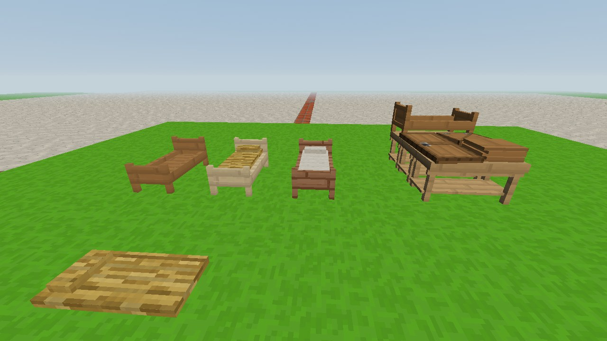

# Noc i sen: łóżka, pościel, wyspanie (0.98.0)

Pomysł Kamila. Trzecia część systemu z 0.94.0 (po [energii](energia.md)
i [skutkach](skutki.md)): gracz, który nie śpi, robi się senny, a noc
można przespać - tym lepiej, im wygodniej się leży.

## Wyspanie

Oprócz energii gracz ma **wyspanie**. Ubywa go, gdy gracz nie śpi
(cały dzień na nogach zjada większość zapasu), a **nocą ubywa szybciej**.
Wraca tylko we śnie.

| Stan | Skutki |
|---|---|
| **Wypoczęty** | brak |
| **W normie** | brak |
| **Senny** | trochę wolniejszy bieg i kopanie; przy sercu pojawia się mały księżyc |
| **Niewyspany** | dużo wolniejszy bieg, wolniejsze kopanie, ciemnieją brzegi obrazu |

Skutki niewyspania mnożą się ze skutkami głodu - senny i zmęczony gracz
jest wolniejszy niż tylko senny. Stan widać w oknie statusu (klawisz
**C**, wiersz *Sen*).

## Gdzie spać

Spać można **nocą, od 19:00 do 5:00**. Są trzy sposoby:

| Gdzie | Jak się położyć | Wyspanie | Premia |
|---|---|---|---|
| **Goła ziemia** | kucnij i kliknij PPM pustą ręką w ziemię | słabe - najwyżej „w normie", i to powoli | - |
| **Posłanie** | PPM na posłaniu | dobre - „wypoczęty" | - |
| **Pościelone łóżko** | PPM na łóżku | pełne | wygoda na następny dzień |

**Premia za wygodę** działa przez większość następnego dnia, jeśli
gracz przespał w łóżku co najmniej 4 godziny:

| Pościel | Premia |
|---|---|
| słomiana - *wygodny sen* | praca szybsza o 5%, energia ubywa o 10% wolniej |
| lniana - *bardzo wygodny sen* | praca szybsza o 10%, energia ubywa o 20% wolniej |

Gdy gracz się kładzie, obraz gaśnie. W grze dla jednego gracza noc od
razu **przeskakuje do 6:00**. Wcześniej można wstać ruchem albo
kliknięciem - wtedy liczy się tylko czas, który faktycznie minął.
Sen prawie nie zużywa energii, ale rano żołądek jest pusty.

## Łóżko: stelaż i pościel osobno

Łóżko to dwie osobne rzeczy - drewniany **stelaż** i **pościel**:

1. **Stelaż** powstaje na **potrójnym warsztacie**: trzy stoły stolarskie
   jeden za drugim (jak podwójny warsztat, tylko o stół dłuższy). Deski
   kładzie się na jeden stół; na trzecim pojawia się wtedy stelaż
   w prawdziwym rozmiarze. PPM w stelaż zabiera go - **8 desek na jeden
   stelaż**. Kolor zależy od desek, więc jest 20 rodzajów łóżek.
   Drzwi i klapa leżą na stole obok desek jak dotąd.
2. Stelaż stawia się na ziemi (PPM): zajmuje dwa bloki, nogi przy
   graczu, wezgłowie dalej. Na samym stelażu nie da się spać.
3. **Pościel** kładzie się na stelaż: PPM z pościelą w ręce. W stelażu
   pojawia się materac i poduszka.

| Pościel | Przepis |
|---|---|
| **Słoma** | 2 dowolne trawy (niska, wysoka) → 1 słoma |
| **Słomiana pościel** | 4 wiązki słomy w kwadracie 2 × 2 |
| **Lniana pościel** | 4 wiązki lnu w kwadracie 2 × 2 (len rośnie na halach i łąkach; przekwitły zbiera się PPM) |

Ta sama pościel położona **na ziemi** (PPM w ziemię) to **posłanie** -
dwa bloki długości, bez stelaża. Rodzaj pościeli nie ma wtedy znaczenia:
posłanie nie daje premii za wygodę.

**Napar na sen** (od 0.98.1, [ziola.md](ziola.md)) wypity przed
położeniem się sprawia, że sen jest głębszy: na posłaniu wysypiasz się
do pełna, a nawet na gołej ziemi budzisz się wypoczęty.

Rozbite łóżko oddaje **stelaż i pościel osobno**, posłanie - pościel.
Na łóżko wchodzi się bez skoku, posłanie nie przeszkadza w chodzeniu.

## Gra ze znajomymi

Każdy ma własne wyspanie. Noc przeskakuje dopiero wtedy, gdy **śpią
wszyscy gracze** - robi to gospodarz. Dopóki ktoś nie śpi, czas płynie
zwyczajnie, a śpiący czekają (na ekranie jest o tym napis) i rano budzą
się sami. Inni gracze widzą śpiącego, jak leży.

## Tryby gry

W trybie kreatywnym i programisty wyspania nie ma (jak energii), ale
łóżko działa - sen przesuwa noc do rana.

## Do testów

- `/energia sen 20` - senny, `/energia sen 5` - niewyspany,
  `/energia sen 100` - wypoczęty; `/energia` wypisuje też wyspanie,
- `/czas ustaw noc` - noc, żeby dało się położyć,
- `/daj oak_bed`, `/daj straw_bedding`, `/daj linen_bedding`,
  `/daj straw 4`, `/daj len_wiazka 4`.

## Dla programisty

- `src/game/Wellbeing.js` - wyspanie (`rest`), stany (`REST_STATES`),
  miejsca do spania (`SLEEP_PLACES`), premia (`COMFORT`), `sleep()`,
  `isNight()`; liczby na początku pliku (`REST_*`, `NIGHT_*`).
- `src/game/Sleep.js` - przebieg snu: kładzenie się, przeskok nocy
  (`nextWake`, `canSkip`), pobudka.
- `src/game/Beds.js` - stawianie stelaża i posłania (dwa bloki),
  ścielenie (`make`), miejsce do spania (`sleepSpot`).
- `src/blocks/woodShapes.js` - bloki łóżek (`kind: 'bed'`, numery
  11820-12459: kierunek × część × pościel); `src/blocks/bedding.js` -
  rodzaje pościeli (`BEDDINGS`) i posłania (12460-12491).
  **Nowa pościel:** wpis w `BEDDINGS`, nazwa w `BED_BEDDINGS`
  (zostało jedno wolne miejsce na łóżko), tekstura `bedding_<nazwa>`
  i przepis.
- `src/world/ShapeBoxes.js` - pudełka stelaża (`BED_FRAME`), pościeli
  (`BED_BEDDING`, osobna tekstura - siódma liczba pudełka to numer
  tekstury z `shapeTextures`) i posłania (`MAT`).
- `src/game/CarpenterTables.js` - potrójny warsztat (`row`, `triple`,
  `bench().bed`), wyrób `BENCH_PRODUCTS.bed`.
- `src/player/Player.js` (`lying`, kamera nad poduszką),
  `src/player/PlayerModel.js` (leżąca postać), `src/net/protocol.js`
  (flaga „śpi" w stanie gracza).
- `src/ui/StatusPanel.js`, `src/ui/hud.css` - napis na czarnym ekranie
  (`#blackout-text`), księżyc przy sercu (`.heart-sleepy`), wiersz *Sen*.
- Test: `node tools/sprawdz_sen.mjs`.
