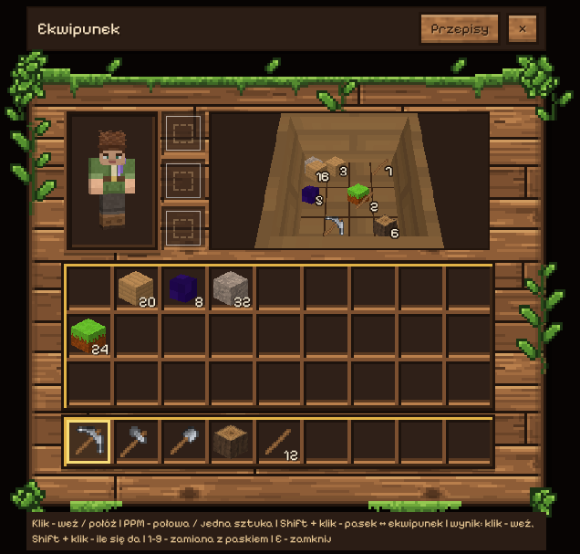
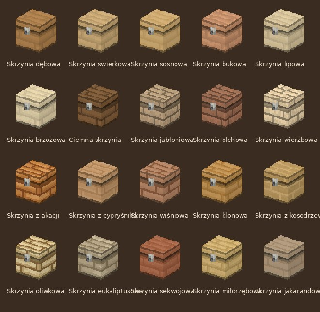

# Skrzynia (0.81.0)

Pomysł Kamila: zamiast osobnego okna skrzyni otwiera się zwykły ekwipunek,
a w strefie rzemieślniczej (prawe górne okno) widać samą skrzynię -
z otwierającym się wiekiem i przedmiotami leżącymi w środku. Gracz ma
wrażenie, że naprawdę wkłada rzeczy do skrzyni.

**Od 0.89.0 skrzynia z każdego rodzaju desek.** 4 deski jednego drzewa
dają skrzynię z tego drewna. Jest 20 rodzajów: dębowa (dawna
„Skrzynia”, te same numery w zapisach), świerkowa, sosnowa, bukowa,
lipowa, brzozowa, ciemna, jabłoniowa, olchowa, wierzbowa, z akacji,
z cypryśnika, wiśniowa, klonowa, z kosodrzewiny, oliwkowa,
eukaliptusowa, sekwojowa, miłorzębowa i jakarandowa. Model, przegródki
i zasady są wspólne, a różnią się tylko tekstury. Deski i rama mają
kolory tego drewna, a żelazny zamek jest ten sam. Z mieszanych desek
nie da się już zrobić skrzyni, bo nie wiadomo, z jakiego byłaby
drewna. Wcześniej z dowolnych desek wychodziła dębowa.

## W grze

- **Przepis:** 4 deski jednego drzewa (siatka 2 × 2) → skrzynia z tego drewna.
  Stawia się przodem do gracza (cztery kierunki).
- **PPM na skrzyni** otwiera ekwipunek. W świecie i w oknie unosi się
  wieko. Z Shiftem i blokiem w ręce stawia się blok obok, jak zwykle.
- **4 × 3 przegródki, w każdej dwie warstwy** (spód i wierzch):
  - klik bierze to, co leży na wierzchu (PPM - połowę stosu),
  - stos na pustą przegródkę trafia na spód, ten sam przedmiot dokłada
    się do stosu, a inny kładzie się na wierzch tego ze spodu,
  - żeby wyjąć coś ze spodu, najpierw trzeba zdjąć wierzch. Po
    najechaniu podpowiedź mówi, co leży pod spodem,
  - Shift + klik w skrzyni przenosi do ekwipunku, a Shift + klik
    w ekwipunku do skrzyni (najpierw do takich samych stosów, potem na
    puste przegródki, na końcu na wierzch).
- **Skrzynię z czymś w środku najpierw trzeba opróżnić**, żeby ją
  rozbić (napis *Najpierw opróżnij skrzynię*), więc nic nie ginie. Pusta
  daje skrzynię.
- Zawartość zapisuje się razem ze światem (`worldInfo.chests`).

## Pliki

| Plik | Co robi |
| --- | --- |
| `src/blocks/chest.js` | bloki (dębowa: ID 10095-10098; z innych desek: 10200-10275, po 4 na drewno - `WOOD_CHESTS`, tylko dopisywać), przód N/E/S/W, kierunek przy stawianiu, tekstura i deski (`chestTexture`, `chestPlanks`) |
| `src/game/ChestState.js` | zawartość i zasady warstw (bez rysowania) |
| `src/game/Chests.js` | skrzynie świata: zapis, PPM, blokada rozbicia |
| `src/rendering/ChestGeometry.js` | model (ścianki, dno, wieko, zamek) i przegródki |
| `src/rendering/ChestRenderer.js` | skrzynie w świecie, wieko na zawiasie |
| `src/ui/ChestView.js` | okno skrzyni w ekwipunku: kamera, karty przedmiotów, klik |
| obszary `chest` i `chest_<drewno>` w `assets/textures/drzewa.png` | tekstury 32 × 32 z desek danego drewna (`tools/skrzynia_tekstura.py`, `tools/atlasy.py export chest_spruce`); kafelki 2 × 2 w osobnych wierszach atlasu na dole |

Okno skrzyni rysuje ten sam renderer co podgląd postaci, czyli jeden
kontekst WebGL na całe okno ekwipunku. Scena trafia do fragmentu płótna
poza stroną, a jej kopia na płótno w strefie.

## Sprawdzanie

- `node tools/sprawdz_skrzynie.mjs` (w `npm test`) - warstwy,
  wkładanie, zapis, kierunki, przepis, przegródki modelu.
- `node tools/sprawdz_motyw_gui_webgl.mjs` - okno skrzyni w ekwipunku:
  trafianie w przegródki, wierzch i spód, Shift + klik; zrzut
  `skrzynia.png`.

## Dalej

- Wieka i zawartość innych pojemników (beczka, piec z ogniem w środku).
- Miejsca na ubrania, plecaki i paski obok postaci (plecak może dawać
  więcej miejsca).
