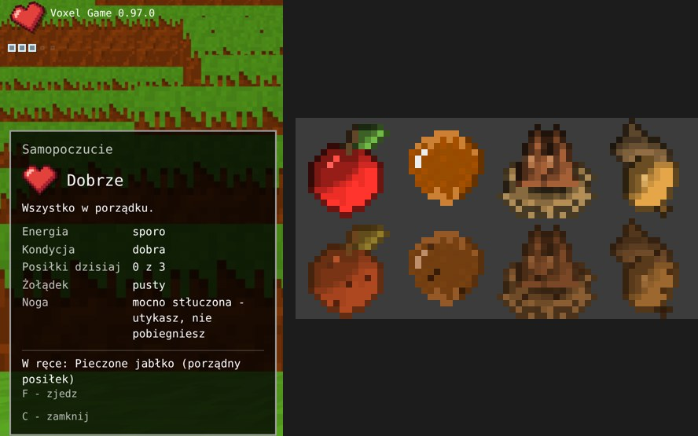

# Skutki zamiast śmierci: upadek, tonięcie, pieczenie (0.97.0)

Druga część pomysłu Kamila z 0.94.0: w grze nie da się zginąć, ale
nieuwaga kosztuje. Pierwsza część (energia, kondycja, serce) jest
w [energia.md](energia.md).

## Upadek z wysokości

Skok z kilku bloków nic nie robi. Upadek z około **7 bloków i więcej**
tłucze nogę: słychać głuche uderzenie, serce drga i zostaje
**przechylone**, a gracz przez jakiś czas **utyka**.

| Upadek | Utykanie |
|---|---|
| do ok. 6 bloków | nic |
| 7 bloków | 45 sekund |
| 10 bloków | ok. 1,5 minuty |
| 20 bloków | ok. 3,5 minuty |
| bardzo wysoki | najwyżej 5 minut |

Utykający gracz chodzi wolniej (60% prędkości) i **nie może biec**.
Kopać i budować może jak zwykle. Noga goi się sama:

- **odpoczynek** (stanie w miejscu) goi dwa razy szybciej niż chodzenie,
- **pełny żołądek** dodatkowo przyspiesza gojenie.

Lądowanie w wodzie nie tłucze nogi. Stan nogi widać w oknie statusu
(klawisz C) i zapisuje się ze światem.

## Tonięcie

Z głową pod wodą ubywa **oddechu** - starcza na 25 sekund. Pod sercem
pojawia się pięć bąbelków, które znikają po kolei; ostatni miga na
czerwono. Na powietrzu oddech wraca w kilka sekund.

Gdy oddech się skończy, gracz **traci przytomność**: obraz gaśnie,
a po chwili gracz **budzi się na brzegu** kawałek dalej - wyczerpany
(resztka energii, pusty żołądek). W grze dla jednego gracza mijają
przy tym dwie godziny. Nic z ekwipunku nie przepada.

Brzeg to najbliższe suche miejsce przy wodzie, 10-70 bloków od miejsca
utonięcia. Na otwartym morzu, gdzie lądu nie ma, gracz wynurza się
w tym samym miejscu.

## Pieczenie nad ogniskiem

Pierwszy **porządny posiłek**. Weź surowe jedzenie do ręki, wyceluj
w **płonące** (albo żarzące się) ognisko i **trzymaj PPM** przez
4 sekundy. Jedna sztuka zamienia się w pieczoną; trzymany dalej PPM
piecze następne.

| Surowe | Pieczone | Energia | Syci na |
|---|---|---|---|
| Jabłko (12) | Pieczone jabłko | 22 | 150 s |
| Orzech laskowy (10) | Prażone orzechy laskowe | 20 | 180 s |
| Orzeszki bukowe (7) | Prażone orzeszki bukowe | 18 | 160 s |
| Żołądź (4) | Prażony żołądź | 18 | 150 s |

Jedna pieczona sztuka **zalicza posiłek** (surowych trzeba zjeść
kilka pod rząd). Najwięcej zyskują żołędzie - surowe prawie nic nie
dają. Pieczonych rzeczy nie da się posadzić.

## Tryby gry

Wszystko działa w trybie przygody. W kreatywnym i programisty nie ma
utykania ani tonięcia (pieczenie działa, surowe nie znika). W grze ze
znajomymi każdy ma własną nogę i własny oddech; czas przy utracie
przytomności nie przeskakuje.

## Do testów

- `/energia noga 120` - stłuczona noga na 120 sekund (`0` - zdrowa),
- `/energia utoniecie` - utrata przytomności i pobudka na brzegu,
- `/daj jablon_jablko 5`, `/daj roasted_apple` - jedzenie do pieczenia
  i gotowe pieczone.

## Dla programisty

- `src/game/Wellbeing.js` - `fall`, `limping`, oddech (`breath`),
  `blackout`; liczby na początku pliku (`LIMP_*`, `BREATH_SECONDS`).
- `src/game/Blackout.js` - gaśnięcie obrazu, szukanie brzegu
  (`findShore`), pobudka.
- `src/game/GameInteraction.js` (`updateWellbeing`) - wykrywa twarde
  lądowanie i głowę pod wodą.
- `src/items/foods.js` - `ROASTS`, `ROAST_SECONDS`;
  `src/game/Campfires.js` - `updateRoast`.
- `src/ui/StatusPanel.js`, `src/ui/hud.css` - bąbelki (`#breath`),
  czarny ekran (`#blackout`), przechylone serce (`.heart-limp`).
- Dźwięki `assets/sounds/body/hurt_*.ogg`, `sizzle_*.ogg` (syntetyczne).
- Test: `node tools/sprawdz_skutki.mjs`.
