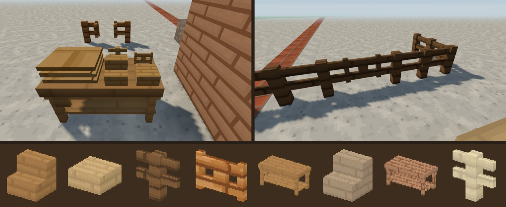
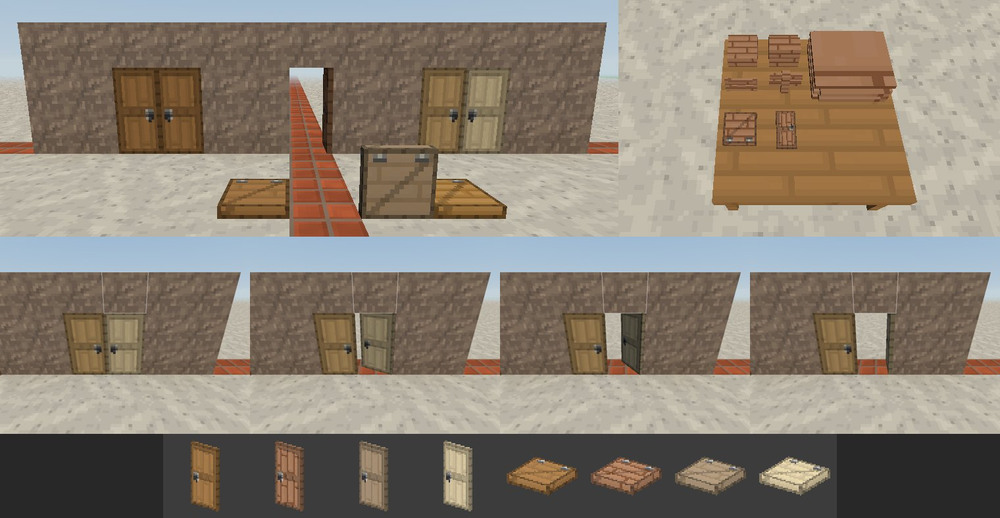

# Stół stolarski i wyroby z drewna (0.90.0, drzwi - 0.91.0)

Pomysł Kamila: stół stolarski długi na dwa bloki. Drewniane bloki robi
się na nim w świecie, prosto na blacie, bez osobnego okna. Wyroby są
z każdego z 20 rodzajów desek:

- **schody**,
- **półbloki**,
- **płoty i furtki**.

## W grze

- **Stół stolarski.**
  - Przepis: 2 deski nad 2 patykami (siatka 2 × 2). Wychodzi stół z tego
    drewna, np. *Stół stolarski klonowy*.
  - Stawia się przodem do gracza i zajmuje dwa bloki: ten wskazany i ten
    po prawej. Potrzebne jest wolne miejsce na oba.
  - Rozbicie jednej części zabiera cały stół (wypada jeden).
- **Praca przy stole.**
  - **PPM deskami w lewą część** kładzie deski na blat: cały stos z ręki,
    do 64. Na stole leży naraz jeden rodzaj desek, a im więcej desek, tym
    wyższy stos.
  - Na **prawej części** pojawiają się małe modele wyrobów z drewna
    leżącego na stole. Widać tylko te, na które starczy desek.
  - **PPM w wyrób** zabiera jedną partię do ekwipunku. **Shift + PPM**
    zabiera tyle partii, ile się da.

    | Miejsce na blacie (od przodu) | Wyrób | Deski → sztuki |
    | --- | --- | --- |
    | przód, lewa | schody | 3 → 2 |
    | przód, prawa | półblok | 1 → 2 |
    | tył, lewa | płot | 3 → 2 |
    | tył, prawa | furtka | 4 → 1 |

  - **PPM pustą ręką** (albo czymś innym niż deski) **w deski** zabiera
    je z powrotem.
  - Stołu z deskami na blacie nie da się rozbić. Pojawia się napis
    *Najpierw zabierz deski ze stołu*.
  - Deski na stołach zapisują się razem ze światem
    (`worldInfo.carpenterTables`).
  - Nowe osiągnięcie: *Stolarz*.
- **Schody.**
  - Wyższy stopień stoi po stronie, w którą patrzy gracz, więc idzie się
    po nich do przodu.
  - Kliknięcie w spód bloku albo w górną połowę ściany stawia schody do
    góry nogami.
  - Na schody i półbloki **wchodzi się bez skakania**: stopień do pół
    bloku. Na pełny blok nadal trzeba skoczyć.
- **Półbloki.**
  - Dolny albo górny, zależnie od kliknięcia: w górę bloku daje dolny,
    a w spód bloku albo górną połowę ściany daje górny.
  - Drugi półblok z tego samego drewna dopełnia pierwszy do pełnego
    bloku, który po rozbiciu daje dwa półbloki.
- **Płoty.**
  - Łączą się z płotami, z pełnymi blokami i z furtkami ustawionymi
    wzdłuż płotu.
  - Mają 1,5 bloku wysokości dla kolizji, więc nie da się ich
    przeskoczyć.
- **Furtki.**
  - Stoją w poprzek kierunku patrzenia.
  - PPM otwiera i zamyka. Otwierają się od gracza, a przez otwartą się
    przechodzi.
  - Z Shiftem i blokiem w ręce stawia się blok obok.
- **Wygląd.** Wyroby mają tekstury desek swojego drewna, a słoje biegną
  jak na deskach. W ekwipunku i w dłoni widać prawdziwy model (ten sam
  co w świecie).

## Drzwi, klapy i podwójny warsztat (0.91.0)

Pomysł Kamila: dwa stoły stolarskie postawione obok siebie tworzą
większe miejsce robocze (4 × 4 na blacie) i pokazują więcej wyrobów -
między innymi drzwi z każdego rodzaju desek. Model i animację drzwi
Kamil przygotował w Blockbench (`drzwi.bbmodel`).

- **Podwójny warsztat.**
  - Dwa stoły jeden za drugim, tak żeby ich blaty tworzyły kwadrat
    2 × 2 bloki (drugi stół może stać przodem albo tyłem do pierwszego).
  - Gdy na jednym stole leżą deski, a drugi jest pusty, na prawej części
    drugiego pojawiają się dodatkowe wyroby z tych desek:

    | Miejsce na blacie drugiego stołu (od przodu) | Wyrób | Deski → sztuki |
    | --- | --- | --- |
    | przód, lewa | drzwi | 6 → 3 |
    | przód, prawa | klapa | 3 → 1 |

  - PPM w wyrób zabiera partię (Shift - ile się da), deski schodzą
    z pierwszego stołu. Zwykłe wyroby (schody, półbloki, płoty, furtki)
    zostają na pierwszym stole.
- **Drzwi.**
  - Z każdego z 20 rodzajów desek, np. *Drzwi dębowe*, *Drzwi z akacji*.
    Tekstura: rama, pionowe deski i dwie płyciny w kolorach desek,
    żelazna klamka.
  - Zajmują dwa bloki wysokości. Potrzebne jest wolne miejsce na obie
    części i coś stałego pod spodem.
  - Stają na dalszym brzegu bloku (patrząc od gracza), zawias po lewej.
    Drugie drzwi postawione po prawej stronie pierwszych dostają zawias
    po prawej - wychodzą **drzwi dwuskrzydłowe** z klamkami na środku.
  - **PPM** (w górną albo dolną część) otwiera i zamyka całe drzwi.
    Otwieranie ma animację z modelu Kamila: 90° w ćwierć sekundy, lekkie
    odbicie do 95°, powrót i spokój na 90°. Zamykanie - ta sama krzywa
    wstecz. Przez otwarte drzwi się przechodzi, zamknięte zatrzymują.
  - Rozbicie jednej części zabiera całe drzwi (wypadają jedne).
- **Klapy.**
  - Z każdego rodzaju desek, np. *Klapa wiśniowa*. Płyta 3 px z ramą,
    ukośną listwą i żelaznymi zawiasami.
  - Na ścianie zawias jest przy klikniętej ścianie, na podłodze -
    od strony gracza. Kliknięcie w spód bloku albo w górną połowę ściany
    stawia klapę u góry bloku.
  - PPM otwiera i zamyka. Na zamkniętą klapę wchodzi się jak na stopień.

## Jak to działa

| Plik | Co robi |
| --- | --- |
| `src/blocks/woods.js` | 20 rodzajów desek, polskie nazwy wyrobów (`woodName`) |
| `src/blocks/woodShapes.js` | bloki 10300-10859 (po 28 na drewno - tylko dopisywać), `shapeInfo`, `shapeId`, kierunki |
| `src/world/ShapeBoxes.js` | pudełka: wygląd, kolizje (płot 1,5), celownik; łączenie płotów (`connectMask`) |
| `src/rendering/ChunkMesher.js` | `addShape` - pudełka z UV pełnej ściany, cienie w rogach na brzegu komórki, łączenie płotów przez `padConnect` |
| `src/player/Player.js` | kolizje z pudełkami (`collisionExtent`), wchodzenie na stopień do pół bloku |
| `src/interaction/VoxelRaycast.js` | celownik trafia w pudełka (i podaje punkt trafienia) |
| `src/interaction/BlockPlacer.js` | kierunek schodów i furtek, górna/dolna połowa, dwa półbloki w jeden |
| `src/game/CarpenterTables.js` | stół: stawianie dwóch części, deski na blacie, wyroby, zapis, furtki |
| `src/rendering/CarpenterTableRenderer.js` | stos desek i miniatury wyrobów na blacie |
| `src/rendering/ShapeGeometry.js` | modele do ikonek, dłoni i miniatur; płyta drzwi (`doorFaces`) |
| `src/rendering/DoorRenderer.js` | drzwi w świecie: model na zawiasie i animacja otwierania (`doorOpening`, klatki z `drzwi.bbmodel`) |
| `tools/drzwi_tekstury.py` | tekstury `door_<drewno>` (16 × 32) i `trapdoor_<drewno>` z desek danego drewna |

Drzwi i klapy mają numery 10860-11819 (po 48 na drewno: drzwi -
kierunek × część × zawias × otwarte, klapy - kierunek × góra/dół ×
otwarta). Klapy rysuje ChunkMesher (pudełka), drzwi - `DoorRenderer`
(chunk indeksuje je razem z pochodniami, mesher ich nie rysuje).
Podwójny warsztat to `CarpenterTables.partnerOf` i `supplierOf`.

Wyroby nie zasłaniają światła (jak liście), ale woda przez nie nie
przepływa.

## Sprawdzanie

`node tools/sprawdz_stolarstwo.mjs` (w `npm test`, 619 sprawdzeń)
sprawdza:

- numery i nazwy bloków oraz przepisy na stół;
- kształty i łączenie płotów;
- kolizje: wejście na półblok i schody bez skoku, pełny blok tylko ze
  skokiem, płot nie do przeskoczenia, zamknięta i otwarta furtka;
- stawianie, w tym dwa półbloki w jeden;
- stół we wszystkich kierunkach: deski, wyroby, Shift, za mało desek,
  jeden rodzaj desek, zabieranie desek, blokada rozbicia, druga część,
  zapis;
- drzwi i klapy (0.91.0): numery, nazwy, kształty, kolizje zamkniętych
  i otwartych, stawianie (dwie części, zawias, drzwi dwuskrzydłowe,
  brak miejsca), otwieranie obu części, rozbicie, klapa przy ścianie
  i na podłodze, krzywa animacji z modelu Kamila;
- podwójny warsztat: stoły obok siebie i tyłem do siebie, przesunięte
  nie, drzwi i klapa z desek pierwszego stołu, Shift, za mało desek.
