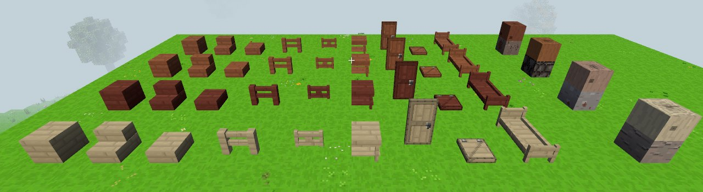
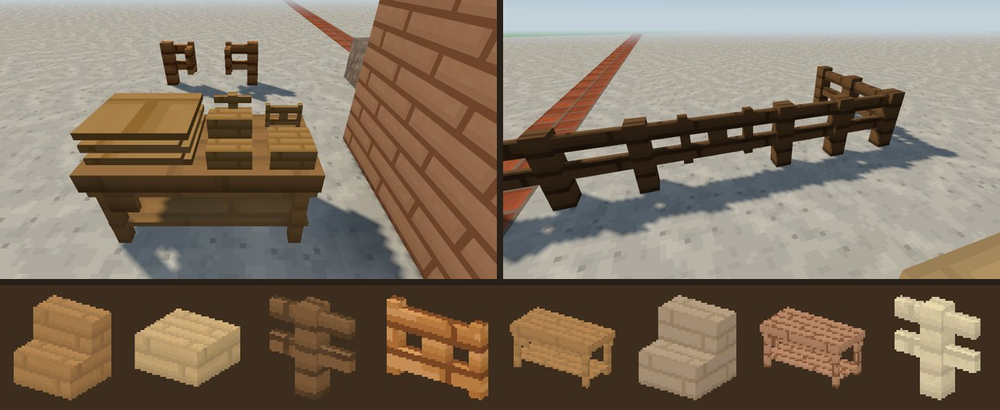
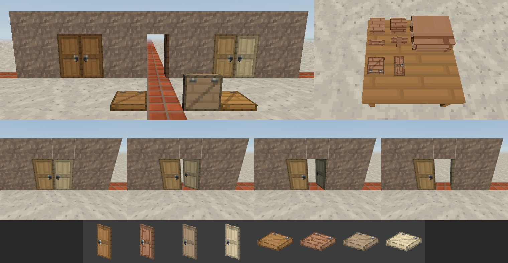
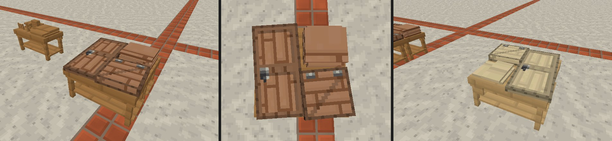
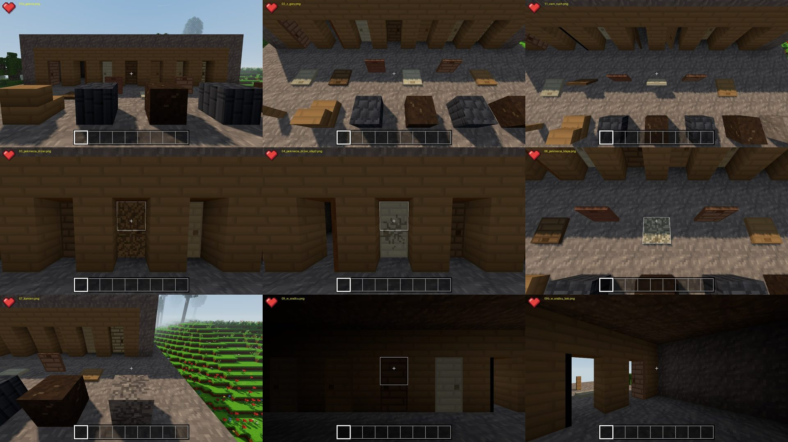

# Stół stolarski i wyroby z drewna (0.90.0, drzwi - 0.91.0)

Pomysł Kamila: stół stolarski długi na dwa bloki. Drewniane bloki robi
się na nim w świecie, prosto na blacie, bez osobnego okna. Wyroby są
z każdego z 33 rodzajów desek (20 z 0.90.0 i trzynaście drzew z 1.8.0 - od 1.9.0):

- **schody**,
- **półbloki**,
- **płoty i furtki**.

## W grze

- **Stół stolarski.**
  - Przepis: 2 deski nad 2 patykami (siatka 2 × 2). Wychodzi stół z tego
    drewna, np. *Stół stolarski klonowy*.
  - Stawia się przodem do gracza i zajmuje dwa bloki: ten wskazany i ten
    po prawej. Potrzebne jest wolne miejsce na oba.
  - Rozbicie jednej części zabiera cały stół (wypada jeden).
- **Praca przy stole.**
  - **PPM deskami w lewą część** kładzie na blat jedną deskę. Z kucaniem
    (Shift) idzie cały stos z ręki (od 0.93.0). Na stole mieści się 64,
    naraz jeden rodzaj desek, a im więcej desek, tym wyższy stos.
  - PPM pustą ręką w deski zabiera je z powrotem.
  - Na **prawej części** pojawiają się małe modele wyrobów z drewna
    leżącego na stole. Widać tylko te, na które starczy desek.
  - **PPM w wyrób** zabiera jedną partię do ekwipunku. **Shift + PPM**
    zabiera tyle partii, ile się da.

    | Miejsce na blacie (od przodu) | Wyrób | Deski → sztuki |
    | --- | --- | --- |
    | przód, lewa | schody | 3 → 2 |
    | przód, prawa | półblok | 1 → 2 |
    | tył, lewa | płot | 3 → 2 |
    | tył, prawa | furtka | 4 → 1 |

  - **PPM pustą ręką** (albo czymś innym niż deski) **w deski** zabiera
    je z powrotem.
  - Stołu z deskami na blacie nie da się rozbić. Pojawia się napis
    *Najpierw zabierz deski ze stołu*.
  - Deski na stołach zapisują się razem ze światem
    (`worldInfo.carpenterTables`).
  - Nowe osiągnięcie: *Stolarz*.
- **Schody.**
  - Wyższy stopień stoi po stronie, w którą patrzy gracz, więc idzie się
    po nich do przodu.
  - Kliknięcie w spód bloku albo w górną połowę ściany stawia schody do
    góry nogami.
  - Na schody i półbloki **wchodzi się bez skakania**: stopień do pół
    bloku. Na pełny blok nadal trzeba skoczyć.
- **Półbloki.**
  - Dolny albo górny, zależnie od kliknięcia: w górę bloku daje dolny,
    a w spód bloku albo górną połowę ściany daje górny.
  - Drugi półblok z tego samego drewna dopełnia pierwszy do pełnego
    bloku, który po rozbiciu daje dwa półbloki.
- **Płoty.**
  - Łączą się z płotami, z pełnymi blokami i z furtkami ustawionymi
    wzdłuż płotu.
  - Mają 1,5 bloku wysokości dla kolizji, więc nie da się ich
    przeskoczyć.
- **Furtki.**
  - Stoją w poprzek kierunku patrzenia.
  - PPM otwiera i zamyka. Otwierają się od gracza, a przez otwartą się
    przechodzi.
  - Z Shiftem i blokiem w ręce stawia się blok obok.
- **Wygląd.** Wyroby mają tekstury desek swojego drewna, a słoje biegną
  jak na deskach. W ekwipunku i w dłoni widać prawdziwy model (ten sam
  co w świecie).

## Drzwi, klapy i podwójny warsztat (0.91.0)

Pomysł Kamila: dwa stoły stolarskie postawione obok siebie tworzą
większe miejsce robocze (4 × 4 na blacie) i pokazują więcej wyrobów -
między innymi drzwi z każdego rodzaju desek. Model i animację drzwi
Kamil przygotował w Blockbench (`drzwi.bbmodel`).

- **Podwójny warsztat.**
  - Dwa stoły jeden za drugim, tak żeby ich blaty tworzyły kwadrat
    2 × 2 bloki (drugi stół może stać przodem albo tyłem do pierwszego).
  - Gdy na jednym stole leżą deski, a drugi jest pusty, cały blat służy
    drzwiom i klapom. Zwykłych wyrobów (schody, półbloki, płoty, furtki)
    wtedy nie ma (układ od 0.93.0):

    

    | Blok blatu | Co na nim leży | Deski → sztuki |
    | --- | --- | --- |
    | lewa część stołu z deskami | stos desek | – |
    | blok drugiego stołu obok desek | klapa w prawdziwym rozmiarze (1 blok) | 3 → 1 |
    | dwa pozostałe bloki | drzwi w prawdziwym rozmiarze (leżą, 1 × 2 bloki) | 6 → 3 |

  - Drzwi i klapa leżą lekko przekręcone i uniesione z jednej strony,
    żeby nie zlewały się z blatem. Widać je, gdy starczy na nie desek.
  - PPM w drzwi albo klapę zabiera partię (Shift - ile się da).
  - Gdy deski leżą na obu stołach naraz, każdy stół działa osobno, ze
    zwykłymi wyrobami.
- **Drzwi.**
  - Z każdego z 33 rodzajów desek, np. *Drzwi dębowe*, *Drzwi z akacji*, *Drzwi cedrowe*.
    Tekstura (od 1.16.0): poziome deski z ciemną klamką - rysunek Kamila
    w kolorach desek danego drewna; przód i tył to osobne rysunki.
  - Zajmują dwa bloki wysokości. Potrzebne jest wolne miejsce na obie
    części i coś stałego pod spodem.
  - Stają na dalszym brzegu bloku (patrząc od gracza), zawias po lewej.
    Drugie drzwi postawione po prawej stronie pierwszych dostają zawias
    po prawej - wychodzą **drzwi dwuskrzydłowe** z klamkami na środku.
  - **PPM** (w górną albo dolną część) otwiera i zamyka całe drzwi.
    Otwieranie ma animację z modelu Kamila: 90° w ćwierć sekundy, lekkie
    odbicie do 95°, powrót i spokój na 90°. Zamykanie - ta sama krzywa
    wstecz. Przez otwarte drzwi się przechodzi, zamknięte zatrzymują.
  - Rozbicie jednej części zabiera całe drzwi (wypadają jedne).
- **Klapy.**
  - Z każdego rodzaju desek, np. *Klapa wiśniowa*. Płyta 2 px (do 1.15
    3 px) z desek, z ciemnym uchwytem naprzeciw zawiasu.
  - Na ścianie zawias jest przy klikniętej ścianie, na podłodze -
    od strony gracza. Kliknięcie w spód bloku albo w górną połowę ściany
    stawia klapę u góry bloku.
  - PPM otwiera i zamyka. Na zamkniętą klapę wchodzi się jak na stopień.
  - Od 1.16.0 klapa otwiera się z animacją (jak drzwi): dolna wstaje,
    górna opada.

## Drzwi i klapy od 1.16.0

Kamil przygotował nowy model (`drzwi i zapadnia.bbmodel`), nowy wygląd
drzwi i klapy oraz nowe pęknięcia kopanych bloków.

- **Wygląd.** Wzorcem są drzwi i klapa narysowane na deskach wiśni
  (`tools/wzorce/drzwi.png`, `zapadnia.png`). `tools/drzwi_tekstury.py`
  przenosi ten sam rysunek na pozostałe 32 rodzaje drewna: bierze cztery
  tony desek gatunku (szpara, cień, deska, połysk), a drugi kolor szpary
  i dwa kolory klamki liczy z nich w tej samej proporcji co we wzorcu.
  Wiśnia wychodzi co do piksela jak rysunek Kamila. Każde drewno ma sześć
  obrazków: `door_<drewno>` (przód), `_back` (tył), `_edge` (krawędzie),
  `trapdoor_<drewno>` (wierzch), `_bottom` (spód), `_edge`.
- **Animacja klapy.** Z pliku: 90° w 0,25 s, odbicie do 92,5°, powrót,
  87,5° i spokój na 90° (drzwi: bez zmian, odbicie do 95°). Plik zapętla
  animację co 1,33 s - gra odtwarza ją raz, a zamykanie to ta sama krzywa
  wstecz.
- **Kolizja od razu.** Po kliknięciu blok od razu zmienia stan: przez
  otwierane drzwi da się przejść natychmiast, a na zamykaną klapę od razu
  stanąć. Animacja jest tylko obrazem - dzięki temu postać nie podskakuje
  na płycie w ruchu.
- **Światło.** Drzwi i klapa zasłaniają światło swoją płytą, a nie
  napisem „otwarte / zamknięte”: światło nie przechodzi przez tę ścianę
  komórki, przy której płyta naprawdę stoi (`lightFaceMask`
  w `ShapeBoxes.js`, `FACE_BLOCK` w `Light.js`). Zamknięte drzwi
  w wejściu odcinają pokój od słońca i lamp; otwarte przepuszczają; drzwi
  wstawione bokiem do korytarza zasłaniają go wtedy, gdy są „otwarte”.
  Klapa w dachu zasłania niebo. Przy zamykaniu światło bloków przełącza
  się raz, gdy płyta dojdzie na miejsce (po 0,25 s); przy otwieraniu - od
  razu.
- **Cień słońca.** Płyta rzuca cień do bliskiej mapy cieni i cień idzie
  razem z animacją (`World.modelShadowScene`, `Shadows.markModel`). Do
  1.15 drzwi nie rzucały cienia wcale.
- **Pęknięcia.** Drzwi i klapy pękają przy kopaniu; nakładka jest
  przypięta do płyty, więc porusza się razem z nią. Drzwi mają własny,
  wysoki rysunek na dwa bloki. Opis nowych pęknięć: [gracz.md](gracz.md).
- **Dźwięk.** Otwieranie to skrzypnięcie zawiasu i lekki stuk, zamykanie -
  skrzypnięcie i trzaśnięcie; klapa ma własną, krótszą wersję. Każde
  drewno brzmi inaczej: im cięższe w naturze, tym niżej, wolniej i trochę
  głośniej (`src/audio/doorSounds.js`, gęstości w kg/m³ - np. baobab 250,
  świerk 450, dąb 710, oliwka 950, namorzyn 1000). Dźwięki są syntetyczne
  (`tools/dzwieki.py`, grupa `drzwi`) i można je podmienić nagraniami.

Czego jeszcze nie ma (stan na 1.16.0):

- światło bloków jest liczone co komórkę, więc przełącza się skokiem (raz
  na otwarcie / zamknięcie), a nie płynnie z kątem płyty,
- płyta nie rzuca cienia w dalekich mapach cieni (ponad 64 bloki od
  gracza), w świetle ogniska ani w smugach światła,
- cała płyta ma jedno światło naraz: z komórki po tej stronie, z której
  patrzy kamera (zamknięte drzwi z ciemnego pokoju są ciemne, z dworu
  jasne). Dwóch graczy po dwóch stronach drzwi widzi je więc różnie,
  a obie strony płyty w jednym kadrze (drzwi w połowie ruchu) mają to
  samo światło,
- gość w grze wieloosobowej widzi przełączenie światła od razu (bez
  czekania na koniec zamykania),
- dźwięków nie dało się odsłuchać w środowisku testowym - są policzone
  i sprawdzone tylko liczbowo.

## Jak to działa

| Plik | Co robi |
| --- | --- |
| `src/blocks/woods.js` | 33 rodzaje desek, polskie nazwy wyrobów (`woodName`) |
| `src/blocks/woodShapes.js` | bloki 10300-10859 (po 28 na drewno, 20 pierwszych rodzajów), od 1.9.0 kolejne rodzaje drewna we wspólnych blokach po 128 numerów od 12544 (`shapeFirstId`, `doorFirstId`, `bedFirstId`); `shapeInfo`, `shapeId`, kierunki |
| `src/world/ShapeBoxes.js` | pudełka: wygląd, kolizje (płot 1,5), celownik; łączenie płotów (`connectMask`) |
| `src/rendering/ChunkMesher.js` | `addShape` - pudełka z UV pełnej ściany, cienie w rogach na brzegu komórki, łączenie płotów przez `padConnect` |
| `src/player/Player.js` | kolizje z pudełkami (`collisionExtent`), wchodzenie na stopień do pół bloku |
| `src/interaction/VoxelRaycast.js` | celownik trafia w pudełka (i podaje punkt trafienia) |
| `src/interaction/BlockPlacer.js` | kierunek schodów i furtek, górna/dolna połowa, dwa półbloki w jeden |
| `src/game/CarpenterTables.js` | stół: stawianie dwóch części, deski na blacie, wyroby, zapis, furtki |
| `src/rendering/CarpenterTableRenderer.js` | stos desek i miniatury wyrobów na blacie |
| `src/rendering/ShapeGeometry.js` | modele do ikonek, dłoni i miniatur; płyta drzwi (`doorFaces`) |
| `src/rendering/DoorRenderer.js` | drzwi i (od 1.16.0) klapy w świecie: model na zawiasie, animacja (`doorOpening`, `trapdoorOpening`), kopia do mapy cieni |
| `tools/drzwi_tekstury.py` | tekstury drzwi i klap z desek danego drewna według wzorca z `tools/wzorce/` |
| `src/audio/doorSounds.js` | wysokość i głośność dźwięku drzwi według gęstości drewna |

Drzwi i klapy mają numery 10860-11819 (po 48 na drewno: drzwi -
kierunek × część × zawias × otwarte, klapy - kierunek × góra/dół ×
otwarta). Drzwi i (od 1.16.0) klapy rysuje `DoorRenderer`
(chunk indeksuje je razem z pochodniami, mesher ich nie rysuje).
Podwójny warsztat to `CarpenterTables.partnerOf` i `bench` (układ blatu).

## Potrójny warsztat i stelaż łóżka (0.98.0)

Trzy stoły jeden za drugim (blat 2 × 3 bloki), deski na jednym z nich.
Stół obok desek działa jak w podwójnym warsztacie (drzwi i klapa),
a na **trzecim** leży w prawdziwym rozmiarze **stelaż łóżka** - PPM
zabiera go za **8 desek** (Shift - ile się da). Gdy deski leżą na
środkowym stole, drzwi i klapa są po jednej stronie, a stelaż po
drugiej. Łóżka mają numery 11820-12459 (po 32 na drewno: kierunek ×
część × pościel). Układ liczą `CarpenterTables.row`, `triple` i `bench`
(pole `bed`); sen, pościel i posłania opisuje [sen.md](sen.md),
a sprawdza `node tools/sprawdz_sen.mjs`.

Wyroby nie zasłaniają światła (jak liście), ale woda przez nie nie
przepływa.

## Sprawdzanie

`node tools/sprawdz_stolarstwo.mjs` (w `npm test`, 689 sprawdzeń)
sprawdza:

- numery i nazwy bloków oraz przepisy na stół;
- kształty i łączenie płotów;
- kolizje: wejście na półblok i schody bez skoku, pełny blok tylko ze
  skokiem, płot nie do przeskoczenia, zamknięta i otwarta furtka;
- stawianie, w tym dwa półbloki w jeden;
- stół we wszystkich kierunkach: deski, wyroby, Shift, za mało desek,
  jeden rodzaj desek, zabieranie desek, blokada rozbicia, druga część,
  zapis;
- drzwi i klapy (0.91.0): numery, nazwy, kształty, kolizje zamkniętych
  i otwartych, stawianie (dwie części, zawias, drzwi dwuskrzydłowe,
  brak miejsca), otwieranie obu części, rozbicie, klapa przy ścianie
  i na podłodze, krzywa animacji z modelu Kamila;
- podwójny warsztat: stoły obok siebie i tyłem do siebie, przesunięte
  nie, drzwi i klapa z desek pierwszego stołu, Shift, za mało desek.
