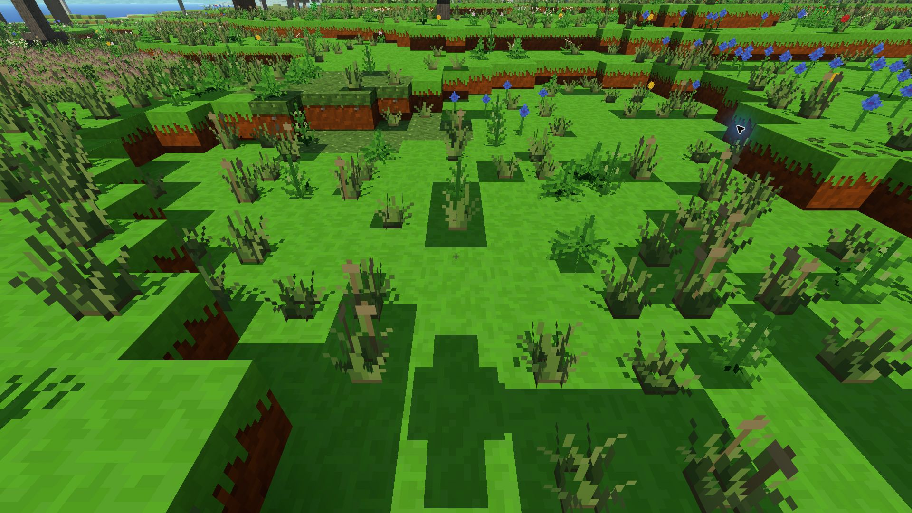

# Trawa kępiasta — eksperyment 0.29.0

PR #57. Opcja zmienia modele `short_grass` i `tall_grass` w świecie.
Włączenie: przy tworzeniu świata albo **Pauza → Dodatki świata →
Trawa kępiasta**. Domyślnie wyłączona; wybór należy do zapisu świata,
nie do globalnych ustawień grafiki. Wyłączenie przywraca zwykłą trawę.

## Wygląd i koszt

Osiem wariantów dla każdej wysokości: cztery przesunięte wachlarze
schodkowych liści, ciemniejsze podstawy i pojedyncze jasne kłosy.
Płaszczyzny są dwustronne, z krawędziami na siatce 1/16 bloku.
Obrót o ćwierć obrotu i przesunięcie również zachowują tę siatkę.
Kolor reaguje na biom; roślina korzysta ze zwykłego wiatru i światła.

Odległość liczona jest między chunkami. Modele mają trzy poziomy
szczegółów: nominalnie 48 i 96 bloków, z histerezą ±8 bloków.
Maksimum to 124/68/48 dwustronnie zapisanych powierzchni na kępkę.
Z daleka zostaje część tych samych liści i kłosów. Szablony są
buforowane, prostokąty pikseli łączone, a modele trafiają do istniejącej
grupy roślin chunka. Zasięg roślin pozostaje dotychczasowy (128 bloków);
daleki teren i jego oświetlenie nie są zmieniane.

Nie zmieniają się identyfikatory bloków, generacja, gęstość trawy,
kolizje ani łupy. Ikony i model przedmiotu w ręce pozostają dotychczasowe.

## Pomiar na komputerze Kamila

RTX 3050 Laptop, zasilacz, natywny Electron 44.4.5 / ANGLE D3D11,
1920 × 1080, skala 100%, cienie 3, oświetlenie atmosferyczne,
daleki teren 8192. Seed `2138286349`, pozycja `198, 62, -261`,
yaw `2.297439`, pitch `-0.4827`, nieruchoma kamera i południe.
Każda próba: 10 sekund rozgrzewki + 30 sekund pomiaru.
Limit gry wyłączony; monitor ogranicza wynik do około 144 FPS.

| Pełne bloki | Trawa | Średnie FPS | 1% najwolniejszych | GPU średnio | CPU render średnio |
|---|---|---:|---:|---:|---:|
| 48 | zwykła | 143,3 | 90,9 | 3,61 ms | 4,05 ms |
| 48 | kępiasta | 142,1 | 74,3 | 4,13 ms | 4,44 ms |
| 192 | zwykła | 80,4 | 46,3 | 6,76 ms | 10,88 ms |
| 192 | kępiasta | 80,3 | 36,9 | 7,49 ms | 10,86 ms |

Liczba wywołań rysowania nie wzrosła: 348 przy 48 blokach,
1302 przy 192. GPU kosztowało dodatkowo około 0,52–0,73 ms.
W próbie 192 bloków wystąpiły krótkie przycięcia także bez dodatku;
nie jest to dowód stabilnych 60 FPS dla wszystkich ustawień i miejsc.
Próby są statyczne i nie obejmują szybkiego generowania nowego terenu.
Przy 48 blokach obie próby nie miały klatek powyżej 33,34 ms.
Panel diagnostyczny był ukrywany podczas pomiarów; w pierwszej próbie
przywrócono go przed końcem, dlatego małe różnice CPU nie są miarodajne.

Pełne próbki podsumowujące, ustawienia oraz testy materiałów:
[`rtx3050.json`](pomiary/trawa-kepiasta-0.29.0/rtx3050.json).
[`qa.js`](pomiary/trawa-kepiasta-0.29.0/qa.js) jest lokalnym panelem
pomiarowym użytym zamiast importu `src/main.js` na oddzielnym serwerze
HTTP, w osobnym profilu gry. Wynik wysyła do lokalnego `/river-report`.
Nie jest importowany przez normalną grę i nie należy włączać go do
zainstalowanego profilu. Zdjęcie wykonano już po pomiarach, po ukryciu HUD.

## Sprawdzenia

- `npm test`, w tym test opcji, zapisu i odtworzenia świata,
  byte-identycznej geometrii po wyłączeniu, niezmienionych bloków,
  wody i terenu, siatki 1/16, budżetu geometrii i histerezy.
- Natywna gra: utworzenie świata z opcją wyłączoną; włączenie,
  zapis i wyłączenie przez menu; oględziny kępek z bliska i przy
  większym zasięgu; celowanie i zniszczenie kępki przyciskiem Kop;
  ponowne uruchomienie gry i wczytanie zapisanego świata z opcją włączoną.
- Test materiałów GPU: 34 programy, WebGL2 oraz warianty WebGL1,
  klasyczne/atmosferyczne światło, cienie i tryb ziemniaka — passed.
- Próbne kompilacje Windowsa i Androida oraz Laboratorium światła
  przeszły dla kodu `e060bce`; kolejne uzupełnienie dotyczy dokumentacji.

Wersja jest przygotowana w PR, nie opublikowana. Równoległy PR #56
rezerwuje 0.28.0; zalecana kolejność scalania: #56, aktualizacja #57
z zachowaniem obu funkcji i testami, następnie #57 / 0.29.0.
