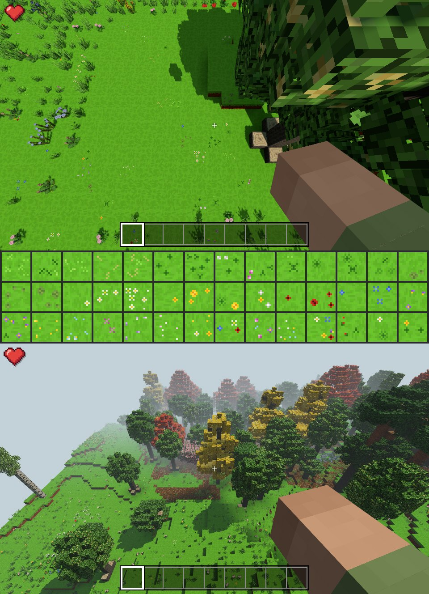
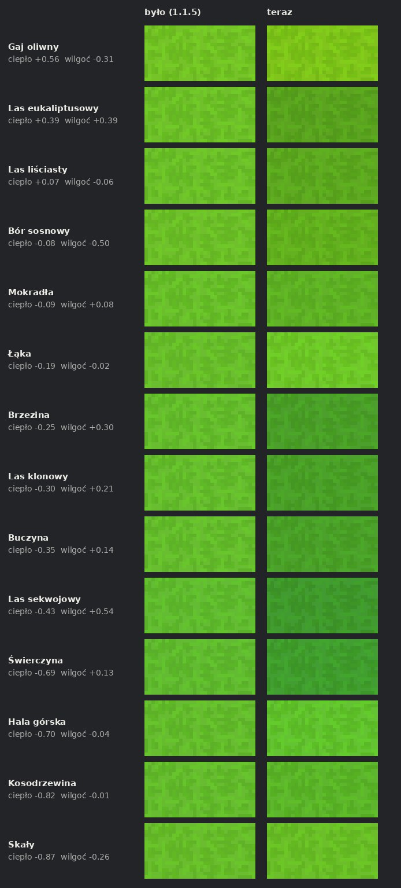
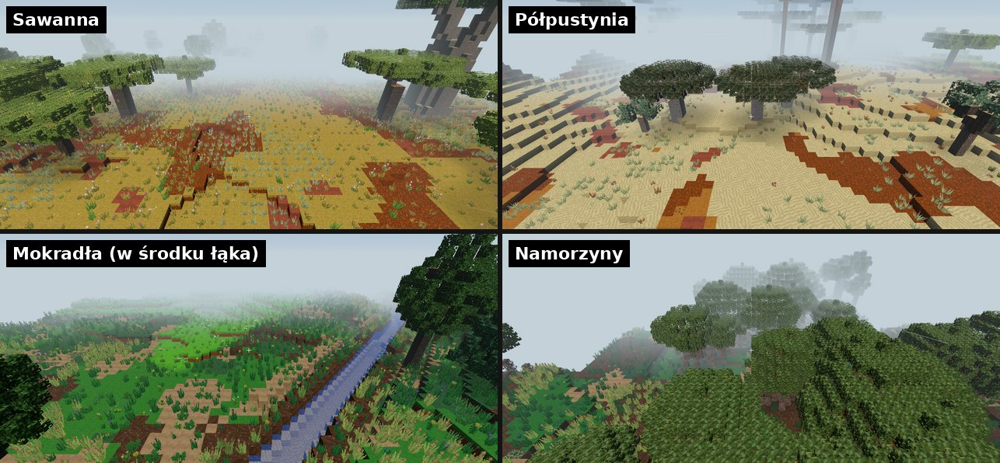
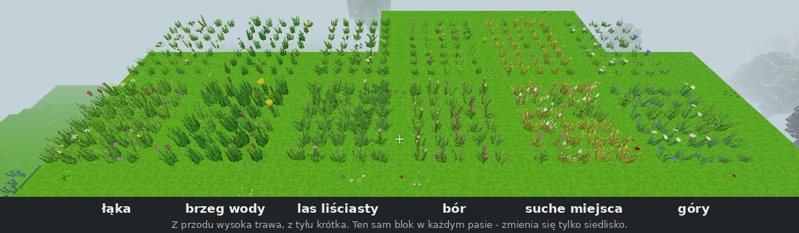
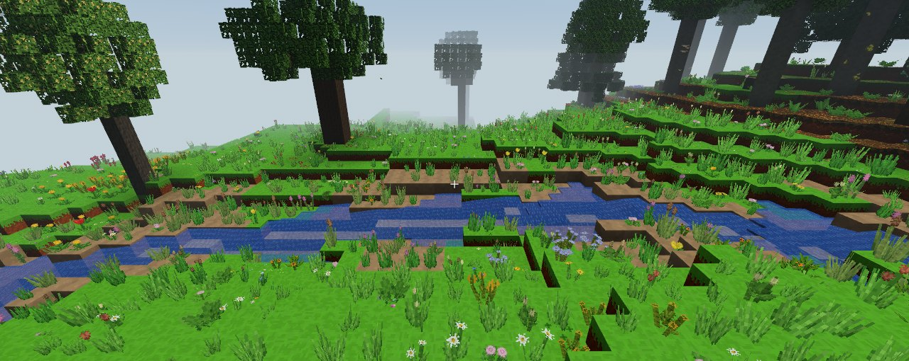

# Trawa: wierzch z kwiatkami, kolory biomów i kępki zależne od miejsca

Od wersji 1.2.0, kępki od 1.3.0 (pomysły Kamila).

## Wierzch bloku trawy z dodatkami

Co dziewiąty blok trawy ma na wierzchu płaski dodatek: kępki trawy,
koniczynę, rozetę liści, mech, stokrotki, mlecze, dmuchawce, maki,
chabry, fiołki, jaskry, niezapominajki, wrzos, krokusy, opadłe płatki,
poziomki albo mieszankę kwiatów. Razem **42 warianty**; z losowym
obrotem wierzchu każdy ma cztery ułożenia.

- To dalej zwykły blok trawy: ten sam przedmiot, te same zasady, ten sam
  zapis. Zmienia się tylko obrazek na wierzchu.
- Wariant zależy od miejsca bloku w świecie - w tym samym miejscu zawsze
  ten sam. Blok trawy postawiony w innym miejscu może mieć inny wierzch.
- Losowanie jest równe (bez plam): średnio jeden na dziewięć bloków.
- Wśród wariantów częściej trafia się sama zieleń (kępki, koniczyna),
  rzadziej kwiaty, najrzadziej całe łany (wagi w
  `src/rendering/SurfaceTextureVariants.js`).
- Bez grzybów, prześwitów ziemi i kamyków - same kwiatki i roślinki.
- Dodatek nie dotyka brzegu bloku, więc nic nie jest ucinane na styku.

**Kolor klimatu a kwiaty.** Trawa zmienia odcień z klimatem. Zmieniają
go tylko zielone piksele (trawa, liście, mech, łodygi); płatki - żółte,
białe, różowe, niebieskie, czerwone - zostają w swoim kolorze. Gra
robiła tak już wcześniej dla roślin; tekstury wariantów są narysowane
tak, żeby każdy piksel był wyraźnie zielony albo wyraźnie nie.

## Kolory trawy w biomach

Dotąd różnice koloru trawy między biomami były ledwo widoczne. Teraz
wejście do innego biomu widać po trawie:

Trzy składniki:

- **klimat** - w cieple i suchu trawa jest żółtozielona (gaj oliwny),
  w chłodzie i wilgoci sinawa (świerczyna, las sekwojowy); ponad dwa
  razy mocniej niż wcześniej;
- **las** - w lesie trawa jest ciemniejsza i głębiej zielona, na
  otwartej łące i hali jasna; przejście na skraju lasu jest płynne;
- **góry** - wysoko trawa blednie i żółknie.

- **biom** (od 1.9.0) - w suchych biomach trawa jest wypalona słońcem:
  na **sawannie** płowozłota, na **półpustyni** ciepło pomarańczowa
  (lekko złoci się też w gaju oliwnym); w mokrych - **mokradła,
  namorzyny, las deszczowy** (słabiej las eukaliptusowy) - ciemna,
  nasycona zieleń. Pola `dry` i `wet` biomu w `Biomes.js`, docelowe
  kolory `gold`, `orange`, `lush` w `GRASS_TINT`.

Ten sam kolor dostają kępki trawy i rośliny barwione jak trawa (mech,
paprocie, koniczyna), więc w suchym biomie żółknie cała niska roślinność,
a w mokrym ciemnieje. Liście drzew zostają w swoich kolorach.

Kolor z biomu liczy się w rogach kolumn ze średniej czterech kolumn
wokół (woda się nie liczy - brzeg bierze kolor z lądu), także tych
z sąsiedniego chunka, więc na granicy chunków nie ma szwu, a granica
biomu jest miękka na szerokość bloku. Daleki teren ma dwa dodatkowe
odcienie trawy: `grass_arid` i `grass_lush`.

## Kępki trawy zależne od miejsca (1.3.0)

Krótka i wysoka trawa wyglądają inaczej zależnie od tego, gdzie rosną.
Na szerokiej łące rośnie inny zestaw kępek niż nad rzeką, w lesie,
w borze, na suchym piasku i w górach - razem **41 nowych wyglądów**
(21 krótkiej trawy, 20 wysokiej).

W świecie - łąka nad rzeką (przy wodzie ciemniejsze sitowie i szuwar,
dalej zwykła trawa ze stokrotkami i koniczyną):

- To dalej ten sam blok (krótka trawa, wysoka trawa): ten sam przedmiot,
  ten sam zbiór, ten sam zapis świata. Zmienia się tylko rysunek.
- Każde siedlisko ma **własną trawę** (najczęstszą) i kilka dodatków:
  kępki z kwiatami, kłosami albo liśćmi. Zwykła trawa rośnie wszędzie,
  ale poza łąką jest w mniejszości.
- Wygląd zależy od miejsca rośliny w świecie - w tym samym miejscu
  zawsze ten sam. Trawa posadzona przez gracza też dostaje wygląd
  siedliska, w którym stoi.
- Klimat barwi zieleń jak dotąd; kwiaty, kłosy i słoma zostają w swoim
  kolorze.
- Działa w istniejących światach (siedlisko liczy się z terenu, nie
  z zapisu).

### Siedliska

| Siedlisko | Gdzie |
|---|---|
| łąka | biom łąki; także świat płaski i każdy bez biomów |
| brzeg wody i mokradła | do 3 bloków od rzeki albo jeziora zawsze, do 7 coraz rzadziej (postrzępiona granica); całe mokradła |
| las liściasty | las dębowy, bukowy, brzozowy, klonowy, eukaliptusowy, sekwojowy |
| bór iglasty | bór sosnowy i świerkowy |
| suche miejsca | plaża i wydmy, gaj oliwny |
| góry | hale, skały, śnieg, kosodrzewina |

Siedlisko pod graczem pokazuje `/biom` (dopisek „Trawa: ...”).

### Krótka trawa

| Siedlisko | Wyglądy (udział) |
|---|---|
| łąka | zwykła 68%, ze stokrotkami 10%, z jaskrami 7%, z koniczyną 7%, z kłoskami 7% |
| brzeg wody i mokradła | sitowie 45%, zwykła 20%, turzyca z kłosem 15%, z kaczeńcami 10%, z niezapominajkami 10% |
| las liściasty | leśna 45%, zwykła 20%, z paprotką 15%, z zawilcami 10%, z fiołkami 10% |
| bór iglasty | borowa 45%, przeschnięta 25%, zwykła 15%, z wrzoścem 15% |
| suche miejsca | sucha murawa 55%, ze złotymi kłosami 20%, z macierzanką 15%, zwykła 10% |
| góry | górska murawa 60%, zwykła 15%, z szarotką 15%, z goryczką 10% |

### Wysoka trawa

| Siedlisko | Wyglądy (udział) |
|---|---|
| łąka | zwykła 67%, z kłosami 12%, z margerytkami 7%, z dzwonkami 7%, ze szczawiem 7% |
| brzeg wody i mokradła | szuwar 45%, z brązowymi kłosami 20%, zwykła 15%, z krwawnicą 10%, z kosaćcem 10% |
| las liściasty | leśna 47%, zwykła 21%, z liśćmi paproci 21%, z naparstnicą 11% |
| bór iglasty | borowa 47%, z wiechami 21%, zwykła 16%, z wrzosem 16% |
| suche miejsca | sucha 53%, z piórkami ostnicy 26%, zwykła 11%, z ostem 11% |
| góry | górska 58%, zwykła 16%, z wełnianką 16%, z goryczką 11% |

### Poziomy modeli roślin

| Poziom (Ustawienia → Modele) | Warianty |
|---|---|
| Półrealistyczne (domyślne) | tak - model z kart: źdźbła, łodygi, kwiaty |
| Proste | tak - obrazek na skrzyżowanych płaszczyznach |
| Szczegółowe | nie - zwykła trawa wszędzie (modele z pikseli i ich animacje zostają bez zmian) |

Dalekie chunki (uproszczone rośliny) pokazują ten sam wariant w prostszej
wersji, więc łąka nie zmienia się przy podchodzeniu.

### Jak dodać albo zmienić wariant

Wszystko jest w `assets/models/rosliny/krotka-trawa/model.json`
i `wysoka-trawa/model.json`:

- `"warianty"` - wygląd: `"arkusz"` (z jakiego liścia i kwiatu rysować
  teksturę), `"kolory"` i `"polrealistyczny"` (kształt: ile źdźbeł, jak
  długie, ile łodyg, jaki kwiat),
- `"siedliska"` - które wyglądy rosną gdzie i jak często (wagi;
  `"zwykla"` to zwykła trawa).

Po zmianie: `python3 tools/modele_roslin.py` (rysuje tekstury
`wariant-<nazwa>` i `wariant-<nazwa>-prosty`), potem
`node tools/sprawdz_warianty_kepek.mjs`.

## Wydajność

Sprawdzone przy składaniu całości (prośba Kamila):

| Co | Koszt |
|---|---|
| rysowanie | **zero**: ten sam blok, te same trójkąty, ten sam materiał i to samo polecenie rysowania - zmienia się tylko, który kafelek atlasu jest na wierzchu |
| budowanie chunka | wybór wariantu to kilka mnożeń: ok. 30 ns na blok trawy, czyli ok. 0,01 ms na chunk |
| generowanie terenu | 1.2.0 bez zmian: kolor trawy liczy się z tych samych gładkich pól klimatu co dotąd (pole lasów było już pod ręką). Od 1.9.0 dochodzi biom 68 kolumn ramki chunka (teren ramki był już policzony): ok. 0,05 ms na chunk, czyli ok. 1% |
| pamięć | atlas tekstur wyższy o 3 wiersze kafelków (800 → 848 pikseli wysokości przed powiększeniem) |

Rozważone i odrzucone jako droższe: osobny blok na każdy wariant (więcej
rodzajów bloków, zmiana zapisu), nakładana druga warstwa z kwiatkami
(dodatkowe trójkąty na każdym bloku trawy) i kolor trawy z rodzaju biomu
(wymagałby liczenia terenu w wielu punktach każdego chunka - w 1.9.0
wszedł w tańszej postaci: biom z kolumn, których teren i tak jest liczony).

### Wydajność kępek (1.3.0)

| Co | Koszt |
|---|---|
| polecenia rysowania | **bez zmian**: ta sama siatka roślin chunka, ten sam materiał |
| trójkąty trawy | kępki z kwiatami mają łodygi i główki, więc trawa ma więcej trójkątów: na łące o ok. 22%, w innych siedliskach od 2% do 38% (reszta roślin, drzewa i teren bez zmian) |
| budowanie chunka | rośliny chunka z ok. 115 kępkami trawy: ok. 1,1 → 1,3-1,5 ms (pomiar w Node, jednorazowo przy budowaniu chunka, nie co klatkę) |
| generowanie terenu | jedna liczba na kolumnę z danych, które generator i tak ma (biom, odległość do wody) |
| pamięć | 82 kafelki atlasu (6 wierszy), 256 bajtów na chunk |

Żeby utrzymać koszt, kępki z kwiatami mają mniej źdźbeł, a łodyga to
jedna karta zamiast kilku skrzyżowanych (`"cienkie"`). Pamięć podręczna
gotowych modeli roślin urosła z 512 do 2048 wpisów - przy 512 modele
kilku siedlisk naraz wypychały się nawzajem i budowanie chunka trwało
dwa razy dłużej.

## Znane ograniczenia

- Kępki zależne od miejsca nie działają w poziomie modeli
  „Szczegółowe” (tam trawa wygląda wszędzie tak samo).
- Paczka tekstur gracza z własną trawą, ale bez wariantów, pokazuje
  na wszystkich blokach swoją zwykłą trawę (bez kwiatków). Wariant
  można podmienić w paczce jak każdy kafelek (`grass_top_<nazwa>`).

- Daleki teren (poza prawdziwymi chunkami) ma trawę w czterech
  uśrednionych kolorach, bez przyciemnienia w lesie - z daleka las
  i tak zakrywają korony.
- Kolory widać od razu także w istniejących światach (kolor liczy się
  przy wczytaniu, nie jest zapisany).

## Dla programisty

- `tools/tekstury_trawy.py` - rysuje warianty (pieczątki z kolorami
  roślin gry na prawdziwej teksturze `grass_top`) i dopisuje je do
  atlasu.
- `src/rendering/SurfaceTextureVariants.js` - `GRASS_TOP_VARIANTS`
  (nazwy i wagi), `GRASS_VARIANT_ONE_IN`, `grassTopVariant(x, y, z)`.
- `src/rendering/BlockRenderData.js` - `grassTopVariants`: zestawy UV
  różniące się tylko wierzchem; `ChunkMesher.js` wybiera zestaw.
- `src/world/terrain/Biomes.js` - `GRASS_TINT` i `grassTint`
  (klimat, las, góry).
- **Nowy wariant:** pieczątka i wpis w `V` w `tekstury_trawy.py`, ten sam
  wpis w `GRASS_TOP_VARIANTS`, uruchomić skrypt. Kolory dodatku muszą być
  wyraźnie zielone (barwione) albo wyraźnie nie.
- Test: `node tools/sprawdz_warianty_trawy.mjs`.

Kępki zależne od miejsca (1.3.0):

- `src/blocks/plantHabitats.js` - lista siedlisk, biom → siedlisko,
  `plantHabitat(biom, odległość do wody, x, z)`.
- `src/world/terrain/RealisticGenerator.js` - `chunk.habitats` (numer
  siedliska każdej kolumny; także dla chunka wczytanego z zapisu).
- `src/blocks/plantModels.js` - czyta `"warianty"` i `"siedliska"`
  z `model.json` (`model.variants`, `model.habitats`).
- `src/rendering/PlantRegionalVariants.js` - zestawy wyglądów w danych
  rysowania (`regional`) i wybór (`pickRegionalPlant`);
  `ChunkMesher.js` wybiera wygląd z siedliska i miejsca rośliny.
- `tools/modele_roslin.py` - rysuje tekstury wariantów i dopisuje je do
  atlasu.
- Test: `node tools/sprawdz_warianty_kepek.mjs`.
