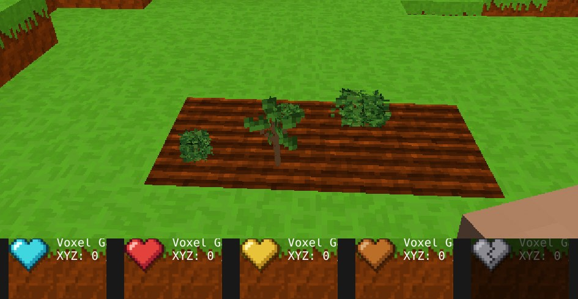

# Rozgrzebana ziemia i sadzenie (0.95.0)

Pomysł Kamila: owoce są do jedzenia, a żeby coś posadzić, trzeba
najpierw przygotować ziemię.

## Jak to działa

1. Weź **łopatę** i kliknij **PPM** na ziemi albo bloku trawy. Powstaje
   **rozgrzebana ziemia** - prymitywne pole z bruzdami. Trawa i kwiaty
   rosnące na bloku znikają. Nad blokiem musi być wolno.
2. Weź owoc albo nasiono i kliknij **PPM na rozgrzebanej ziemi**.
   Staje na niej sadzonka (w trybie przygody zużywa jedną sztukę).
3. Sadzonka rośnie jak dotąd: krzak etapami, drzewo po kilku minutach.

Gdzie indziej PPM z owocem w ręce **zjada go** (tryb przygody; tak samo
jak klawisz F). Szyszki, bazie i kwiat lipy, których się nie je,
podpowiadają: *Najpierw rozgrzeb ziemię łopatą*.

| W ręce | PPM na rozgrzebanej ziemi | PPM gdzie indziej |
|---|---|---|
| owoc, orzech, żołądź | sadzi | zjada |
| szyszka, bazie, kwiat lipy | sadzi | podpowiedź |
| gotowa sadzonka (blok) | stawia | stawia, jak dotąd |
| łopata | nic | na ziemi i trawie - rozgrzebuje |

## Szczegóły

- **Puste pole zarasta.** Rozgrzebana ziemia, na której nic nie rośnie
  ani nie stoi, po średnio 15 minutach wraca do zwykłej ziemi. Pole
  z rośliną zostaje polem.
- **Wykopana** rozgrzebana ziemia daje zwykłą ziemię.
- Rośliny już rosnące w świecie (dzikie krzaki, drzewa) i gotowe
  sadzonki nie potrzebują pola.
- Działa tak samo w trybie kreatywnym (tam nic się nie zużywa i nie je).
- Na telefonie: stuknięcie w ziemię z łopatą w ręce rozgrzebuje,
  stuknięcie w pole z owocem sadzi.

## Dla programisty

- Blok `tilled_dirt` (numer 256) i pola `tills` (trawa, ziemia)
  w `src/blocks/BlockRegistry.js`; `getTill`, `FIELD_BLOCK`.
- `src/game/Game.js`: `tillTarget` (łopata), `canPlantAt` (czy sadzonka
  stanie na polu) i gałąź PPM z owocem.
- Zarastanie: pole `grows: { into: 'dirt', empty: true }`,
  `src/game/PlantGrowth.js`.
- Tekstura `tilled_dirt` w `assets/textures/teren.png`.
- Test: `node tools/sprawdz_uprawe.mjs`.
