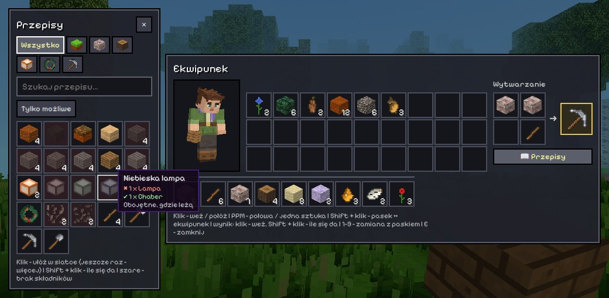

# Voxel Game - wiki

Klockowa gra w przeglądarce, na komputerze (Windows) i na telefonie
(Android). Nieskończony świat z prawdziwymi formami terenu i skałami,
lasy sześciu gatunków drzew, krzaki owocowe, woda, dzień i noc
z fazami księżyca, meteoryty, kopanie, wytwarzanie - i jeden sekret
wysoko nad chmurami.

**Strony wiki:** [Historia zmian](../../CHANGELOG.md) ·
[Bloki](bloki.md) · [Przedmioty](przedmioty.md) ·
[Przepisy](przepisy.md) · [Osiągnięcia](osiagniecia.md)

Strony *Bloki*, *Przedmioty*, *Przepisy* i *Osiągnięcia* (i plik
`index.html` - całe wiki jako jedna strona) generuje
`python tools/wiki.py` prosto z kodu gry, więc zawsze pasują do
aktualnej wersji. Tę stronę i historię zmian pisze się ręcznie.

## Jak zacząć

1. **Nowy świat** na ekranie tytułowym: nazwa, seed (puste = losowy),
   *Teren: Realistyczny* i *Tryb gry: Przygoda*.
2. Rozejrzyj się i wykop kilka bloków ziemi - **trzymaj LPM**, blok
   pęka i po chwili wpada do ekwipunku.
3. Znajdź drzewo i zetnij pień. W ekwipunku (**E**) połóż pień w siatce
   wytwarzania - powstaną **deski**, z desek **patyki**, a z patyków
   i kamieni **kilof**, **łopata** i **siekiera**.
4. Nocą robi się ciemno - lampę zrobisz z **lepidolitu** (fioletowe
   żyły w granicie), **żywicy** z sosny i **kory brzozowej**.

Przycisk 📖 *Przepisy* w ekwipunku i komenda `/przepisy` podpowiadają,
co z czego zrobić.

## Sterowanie

| Klawisz | Co robi |
|---|---|
| WASD | chodzenie |
| Spacja | skok; w wodzie - w górę; 2 x Spacja - latanie (kreatywny) |
| Shift | kucanie (nie spadasz z krawędzi); w wodzie - nurkowanie |
| 2 x W albo R | bieg |
| LPM (trzymany) | kopanie bloku |
| PPM | stawianie bloku, zbieranie owoców, sadzenie, siekierą - okorowanie pnia |
| środkowy przycisk | weź blok, na który patrzysz |
| 1-9, kółko | miejsce na pasku |
| E | ekwipunek i wytwarzanie |
| F5 | widok: z oczu / zza pleców / z przodu |
| T albo / | czat i komendy (`/pomoc`) |
| M | mapa terenu |
| L | księga osiągnięć |
| ESC | pauza i ustawienia |

**Na telefonie:** lewa część ekranu - joystick, reszta - rozglądanie
palcem, stuknięcie - postaw, przytrzymanie - kop; przyciski skoku,
kucania, kopania i stawiania, u góry ekwipunek, czat, mapa i inne.

## Tryby gry

- **Przygoda** - zaczynasz z niczym. Bloki trzeba wykopać (czas zależy
  od materiału, narzędzie przyspiesza 3 razy), trafiają do ekwipunku,
  a stawianie je zużywa. Z liści czasem wypadają sadzonki i nasiona.
- **Kreatywny** - wszystkie bloki pod **E**, bloki znikają od razu,
  nic się nie zużywa, **2 x Spacja** - latanie.

Zmiana w trakcie gry: `/tryb przygoda` albo `/tryb kreatywny`.

## Świat

- **Teren realistyczny** - morze, wybrzeża, niziny, wyżyny i góry,
  a w nich doliny, wąwozy, turnie, płaskowyże. Pod ziemią warstwy skał:
  bazalt, granit, kamień, piaskowiec, wapień i łupek, a w granicie
  rzadkie żyły **lepidolitu**. Świat ma 128 bloków wysokości i ciągnie
  się 30 000 bloków w każdą stronę.
- **Lasy** - świerk, sosna, buk, lipa, dąb i brzoza, każdy tam, gdzie
  pasuje mu klimat. Łąki z kwiatami i dzikie **krzaki owocowe**
  (truskawki, jeżyny, papryczki chili, leszczyna).
- **Woda** - przezroczysta, z falami; można pływać i nurkować.
- **Niebo** - doba trwa 20 minut, księżyc ma fazy (pełnia - jasna noc,
  nów - Droga Mleczna), czasem zaćmienie słońca, spadające gwiazdy
  i **meteoryty**, które robią kratery.
- **Daleki teren** - góry widać aż po horyzont.

## Rozgrywka

- **Kopanie** - blok pęka w 10 etapach, lecą odłamki; siekiera
  przyspiesza drewno, kilof skały, łopata ziemię i piasek.
- **Wytwarzanie** - siatka 2 x 2 w ekwipunku i księga przepisów.
- **Sadzenie** - owoce, orzechy, szyszki, żołędzie i kwiat lipy
  posadzone na ziemi wyrastają w krzak albo drzewo.
- **Zbieranie** - PPM na krzaku z owocami, na pniu sosny z żywicą,
  na kwitnącej lipie.
- **Osiągnięcia** - 28 osiągnięć w czterech rangach (klawisz L).

## Ustawienia i komendy

W *Ustawieniach* (ESC) są zakładki: Obraz (zasięg widzenia, daleki
teren, tryb ziemniaka dla słabych komputerów, liście...), Sterowanie,
Gracz (skórka, ręka w widoku z oczu, kołysanie), Dźwięk i Inne.

Najważniejsze komendy: `/pomoc`, `/przepisy`, `/kopanie`, `/daj`,
`/tryb`, `/czas ustaw noc`, `/tp`, `/drzewa`, `/krzaki`, `/mapa`,
`/teren`, `/osiagniecia`. Pełna lista: [docs/komendy.md](../komendy.md).

## Dla twórców gry

Opisy techniczne poszczególnych części gry są w `docs/`:
[gracz](../gracz.md), [drzewa](../drzewa.md),
[generator terenu](../generator-terenu.md),
[niebo i światło](../niebo-i-swiatlo.md), [kosmos](../kosmos.md),
[osiągnięcia](../osiagniecia.md), [telefon](../telefon.md),
[aplikacja](../aplikacja.md). Jak dodać blok, przedmiot albo przepis -
w głównym [README](../../README.md).
