# Bloki

> Ta strona jest generowana z kodu gry (`python tools/wiki.py`) - nie zmieniaj jej ręcznie, zmiany przepadną przy następnym generowaniu.

Wersja gry **0.90.0** - 381 bloków (do tego 619 odmian, których nie ma w ekwipunku, np. wieniec zawieszony na boku bloku). Czas kopania dotyczy trybu przygody; w kreatywnym bloki znikają od razu.

[Ziemia](#ziemia) · [Skały](#skały) · [Drewno](#drewno) · [Budulec](#budulec) · [Rośliny](#rośliny) · [Światło](#światło) · [Ozdoby](#ozdoby)

## Ziemia

| | Nazwa | W komendach | Najważniejsze |
|---|---|---|---|
| 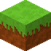 | **Blok trawy** | `grass` | **Kopanie:** 0,6 s (łopatą 0,2 s) **Daje:** Ziemia |
|  | **Ziemia** | `dirt` | **Kopanie:** 0,6 s (łopatą 0,2 s) **Skąd:** zniszczony blok: Blok trawy **Przydaje się do:** Ziemia kamienista, Czarnoziem, Ściółka leśna |
|  | **Piasek** | `sand` | **Kopanie:** 0,55 s (łopatą 0,18 s) **Przydaje się do:** Piaskowiec, Tynk wapienny |
|  | **Woda** | `water` | - |
|  | **Czarnoziem** | `humus` | **Kopanie:** 0,6 s (łopatą 0,2 s) **Przepis:** Czarnoziem |
|  | **Ziemia kamienista** | `coarse_dirt` | **Kopanie:** 0,7 s (łopatą 0,23 s) **Przepis:** Ziemia kamienista x4 |
|  | **Ściółka leśna** | `forest_floor` | **Kopanie:** 0,6 s (łopatą 0,2 s) **Przepis:** Ściółka leśna |
|  | **Błoto** | `mud` | **Kopanie:** 0,6 s (łopatą 0,2 s) |
|  | **Glina** | `clay` | **Kopanie:** 0,6 s (łopatą 0,2 s) **Przydaje się do:** Tynk ochrowy, Terakota |
| 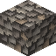 | **Żwir** | `gravel` | **Kopanie:** 0,7 s (łopatą 0,23 s) **Przydaje się do:** Ziemia kamienista |
|  | **Śnieg** | `snow` | **Kopanie:** 0,4 s (łopatą 0,13 s) **Przepis:** Śnieg **Przydaje się do:** Warstwa śniegu |
|  | **Warstwa śniegu** | `snow_layer` | **Kopanie:** 0,4 s (łopatą 0,13 s) **Przepis:** Warstwa śniegu x4 **Przydaje się do:** Śnieg |
|  | **Mech** | `moss` | **Kopanie:** 0,6 s (łopatą 0,2 s) **Przepis:** Mech **Przydaje się do:** Kępki mchu |

## Skały

| | Nazwa | W komendach | Najważniejsze |
|---|---|---|---|
| 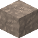 | **Kamień** | `stone` | **Kopanie:** 2,2 s (kilofem 0,73 s) **Przydaje się do:** Polerowany kamień, Siekiera, Kilof, Łopata |
|  | **Lepidolit** | `lepidolite` | **Kopanie:** 2,5 s (kilofem 0,83 s) **Przydaje się do:** Lampa |
| 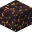 | **Meteoryt** | `meteorite` | **Kopanie:** 4,5 s (kilofem 1,5 s) **Świeci:** 7 / 15 |
| 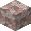 | **Granit** | `granite` | **Kopanie:** 2,8 s (kilofem 0,93 s) **Przydaje się do:** Siekiera, Kilof, Łopata |
|  | **Wapień** | `limestone` | **Kopanie:** 1,8 s (kilofem 0,6 s) **Przydaje się do:** Tynk wapienny, Siekiera, Kilof, Łopata |
|  | **Piaskowiec** | `sandstone` | **Kopanie:** 1,8 s (kilofem 0,6 s) **Przepis:** Piaskowiec **Przydaje się do:** Siekiera, Kilof, Łopata |
|  | **Łupek** | `slate` | **Kopanie:** 2,2 s (kilofem 0,73 s) **Przydaje się do:** Siekiera, Kilof, Łopata |
| 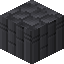 | **Bazalt** | `basalt` | **Kopanie:** 2,8 s (kilofem 0,93 s) **Przydaje się do:** Ciemne deski, Siekiera, Kilof, Łopata |

## Drewno

| | Nazwa | W komendach | Najważniejsze |
|---|---|---|---|
|  | **Skrzynia dębowa** | `chest` | **Kopanie:** 1,2 s (siekierą 0,4 s) **Skąd:** zniszczony blok: Skrzynia dębowa **Przepis:** Skrzynia dębowa |
|  | **Skrzynia świerkowa** | `spruce_chest` | **Kopanie:** 1,2 s (siekierą 0,4 s) **Skąd:** zniszczony blok: Skrzynia świerkowa **Przepis:** Skrzynia świerkowa |
| 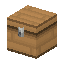 | **Skrzynia sosnowa** | `pine_chest` | **Kopanie:** 1,2 s (siekierą 0,4 s) **Skąd:** zniszczony blok: Skrzynia sosnowa **Przepis:** Skrzynia sosnowa |
|  | **Skrzynia bukowa** | `beech_chest` | **Kopanie:** 1,2 s (siekierą 0,4 s) **Skąd:** zniszczony blok: Skrzynia bukowa **Przepis:** Skrzynia bukowa |
|  | **Skrzynia lipowa** | `linden_chest` | **Kopanie:** 1,2 s (siekierą 0,4 s) **Skąd:** zniszczony blok: Skrzynia lipowa **Przepis:** Skrzynia lipowa |
|  | **Skrzynia brzozowa** | `birch_chest` | **Kopanie:** 1,2 s (siekierą 0,4 s) **Skąd:** zniszczony blok: Skrzynia brzozowa **Przepis:** Skrzynia brzozowa |
|  | **Ciemna skrzynia** | `dark_chest` | **Kopanie:** 1,2 s (siekierą 0,4 s) **Skąd:** zniszczony blok: Ciemna skrzynia **Przepis:** Ciemna skrzynia |
|  | **Skrzynia jabłoniowa** | `jablon_chest` | **Kopanie:** 1,2 s (siekierą 0,4 s) **Skąd:** zniszczony blok: Skrzynia jabłoniowa **Przepis:** Skrzynia jabłoniowa |
|  | **Skrzynia olchowa** | `olcha_chest` | **Kopanie:** 1,2 s (siekierą 0,4 s) **Skąd:** zniszczony blok: Skrzynia olchowa **Przepis:** Skrzynia olchowa |
|  | **Skrzynia wierzbowa** | `wierzba_chest` | **Kopanie:** 1,2 s (siekierą 0,4 s) **Skąd:** zniszczony blok: Skrzynia wierzbowa **Przepis:** Skrzynia wierzbowa |
|  | **Skrzynia z akacji** | `acacia_chest` | **Kopanie:** 1,2 s (siekierą 0,4 s) **Skąd:** zniszczony blok: Skrzynia z akacji **Przepis:** Skrzynia z akacji |
|  | **Skrzynia z cypryśnika** | `bald_cypress_chest` | **Kopanie:** 1,2 s (siekierą 0,4 s) **Skąd:** zniszczony blok: Skrzynia z cypryśnika **Przepis:** Skrzynia z cypryśnika |
|  | **Skrzynia wiśniowa** | `cherry_chest` | **Kopanie:** 1,2 s (siekierą 0,4 s) **Skąd:** zniszczony blok: Skrzynia wiśniowa **Przepis:** Skrzynia wiśniowa |
|  | **Skrzynia klonowa** | `maple_chest` | **Kopanie:** 1,2 s (siekierą 0,4 s) **Skąd:** zniszczony blok: Skrzynia klonowa **Przepis:** Skrzynia klonowa |
|  | **Skrzynia z kosodrzewiny** | `mugo_chest` | **Kopanie:** 1,2 s (siekierą 0,4 s) **Skąd:** zniszczony blok: Skrzynia z kosodrzewiny **Przepis:** Skrzynia z kosodrzewiny |
|  | **Skrzynia oliwkowa** | `olive_chest` | **Kopanie:** 1,2 s (siekierą 0,4 s) **Skąd:** zniszczony blok: Skrzynia oliwkowa **Przepis:** Skrzynia oliwkowa |
|  | **Skrzynia eukaliptusowa** | `rainbow_eucalyptus_chest` | **Kopanie:** 1,2 s (siekierą 0,4 s) **Skąd:** zniszczony blok: Skrzynia eukaliptusowa **Przepis:** Skrzynia eukaliptusowa |
|  | **Skrzynia sekwojowa** | `sequoia_chest` | **Kopanie:** 1,2 s (siekierą 0,4 s) **Skąd:** zniszczony blok: Skrzynia sekwojowa **Przepis:** Skrzynia sekwojowa |
|  | **Skrzynia miłorzębowa** | `ginkgo_chest` | **Kopanie:** 1,2 s (siekierą 0,4 s) **Skąd:** zniszczony blok: Skrzynia miłorzębowa **Przepis:** Skrzynia miłorzębowa |
|  | **Skrzynia jakarandowa** | `jacaranda_chest` | **Kopanie:** 1,2 s (siekierą 0,4 s) **Skąd:** zniszczony blok: Skrzynia jakarandowa **Przepis:** Skrzynia jakarandowa |
|  | **Schody świerkowe** | `spruce_stairs` | **Kopanie:** 1,2 s (siekierą 0,4 s) **Skąd:** zniszczony blok: Schody świerkowe |
| 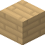 | **Półblok świerkowy** | `spruce_slab` | **Kopanie:** 1,2 s (siekierą 0,4 s) **Skąd:** zniszczony blok: Półblok świerkowy |
|  | **Płot świerkowy** | `spruce_fence` | **Kopanie:** 1,2 s (siekierą 0,4 s) |
|  | **Furtka świerkowa** | `spruce_fence_gate` | **Kopanie:** 1,2 s (siekierą 0,4 s) **Skąd:** zniszczony blok: Furtka świerkowa |
|  | **Stół stolarski świerkowy** | `spruce_carpenter_table` | **Kopanie:** 1,2 s (siekierą 0,4 s) **Skąd:** zniszczony blok: Stół stolarski świerkowy **Przepis:** Stół stolarski świerkowy |
|  | **Schody sosnowe** | `pine_stairs` | **Kopanie:** 1,2 s (siekierą 0,4 s) **Skąd:** zniszczony blok: Schody sosnowe |
|  | **Półblok sosnowy** | `pine_slab` | **Kopanie:** 1,2 s (siekierą 0,4 s) **Skąd:** zniszczony blok: Półblok sosnowy |
| 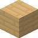 | **Płot sosnowy** | `pine_fence` | **Kopanie:** 1,2 s (siekierą 0,4 s) |
|  | **Furtka sosnowa** | `pine_fence_gate` | **Kopanie:** 1,2 s (siekierą 0,4 s) **Skąd:** zniszczony blok: Furtka sosnowa |
|  | **Stół stolarski sosnowy** | `pine_carpenter_table` | **Kopanie:** 1,2 s (siekierą 0,4 s) **Skąd:** zniszczony blok: Stół stolarski sosnowy **Przepis:** Stół stolarski sosnowy |
|  | **Schody bukowe** | `beech_stairs` | **Kopanie:** 1,2 s (siekierą 0,4 s) **Skąd:** zniszczony blok: Schody bukowe |
| 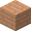 | **Półblok bukowy** | `beech_slab` | **Kopanie:** 1,2 s (siekierą 0,4 s) **Skąd:** zniszczony blok: Półblok bukowy |
|  | **Płot bukowy** | `beech_fence` | **Kopanie:** 1,2 s (siekierą 0,4 s) |
|  | **Furtka bukowa** | `beech_fence_gate` | **Kopanie:** 1,2 s (siekierą 0,4 s) **Skąd:** zniszczony blok: Furtka bukowa |
| 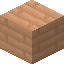 | **Stół stolarski bukowy** | `beech_carpenter_table` | **Kopanie:** 1,2 s (siekierą 0,4 s) **Skąd:** zniszczony blok: Stół stolarski bukowy **Przepis:** Stół stolarski bukowy |
|  | **Schody lipowe** | `linden_stairs` | **Kopanie:** 1,2 s (siekierą 0,4 s) **Skąd:** zniszczony blok: Schody lipowe |
| 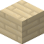 | **Półblok lipowy** | `linden_slab` | **Kopanie:** 1,2 s (siekierą 0,4 s) **Skąd:** zniszczony blok: Półblok lipowy |
|  | **Płot lipowy** | `linden_fence` | **Kopanie:** 1,2 s (siekierą 0,4 s) |
|  | **Furtka lipowa** | `linden_fence_gate` | **Kopanie:** 1,2 s (siekierą 0,4 s) **Skąd:** zniszczony blok: Furtka lipowa |
|  | **Stół stolarski lipowy** | `linden_carpenter_table` | **Kopanie:** 1,2 s (siekierą 0,4 s) **Skąd:** zniszczony blok: Stół stolarski lipowy **Przepis:** Stół stolarski lipowy |
|  | **Schody dębowe** | `oak_stairs` | **Kopanie:** 1,2 s (siekierą 0,4 s) **Skąd:** zniszczony blok: Schody dębowe |
| 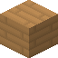 | **Półblok dębowy** | `oak_slab` | **Kopanie:** 1,2 s (siekierą 0,4 s) **Skąd:** zniszczony blok: Półblok dębowy |
|  | **Płot dębowy** | `oak_fence` | **Kopanie:** 1,2 s (siekierą 0,4 s) |
|  | **Furtka dębowa** | `oak_fence_gate` | **Kopanie:** 1,2 s (siekierą 0,4 s) **Skąd:** zniszczony blok: Furtka dębowa |
|  | **Stół stolarski dębowy** | `oak_carpenter_table` | **Kopanie:** 1,2 s (siekierą 0,4 s) **Skąd:** zniszczony blok: Stół stolarski dębowy **Przepis:** Stół stolarski dębowy |
| 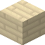 | **Schody brzozowe** | `birch_stairs` | **Kopanie:** 1,2 s (siekierą 0,4 s) **Skąd:** zniszczony blok: Schody brzozowe |
| 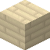 | **Półblok brzozowy** | `birch_slab` | **Kopanie:** 1,2 s (siekierą 0,4 s) **Skąd:** zniszczony blok: Półblok brzozowy |
|  | **Płot brzozowy** | `birch_fence` | **Kopanie:** 1,2 s (siekierą 0,4 s) |
|  | **Furtka brzozowa** | `birch_fence_gate` | **Kopanie:** 1,2 s (siekierą 0,4 s) **Skąd:** zniszczony blok: Furtka brzozowa |
|  | **Stół stolarski brzozowy** | `birch_carpenter_table` | **Kopanie:** 1,2 s (siekierą 0,4 s) **Skąd:** zniszczony blok: Stół stolarski brzozowy **Przepis:** Stół stolarski brzozowy |
| 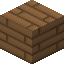 | **Schody z ciemnego drewna** | `dark_stairs` | **Kopanie:** 1,2 s (siekierą 0,4 s) **Skąd:** zniszczony blok: Schody z ciemnego drewna |
|  | **Półblok z ciemnego drewna** | `dark_slab` | **Kopanie:** 1,2 s (siekierą 0,4 s) **Skąd:** zniszczony blok: Półblok z ciemnego drewna |
| 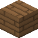 | **Płot z ciemnego drewna** | `dark_fence` | **Kopanie:** 1,2 s (siekierą 0,4 s) |
|  | **Furtka z ciemnego drewna** | `dark_fence_gate` | **Kopanie:** 1,2 s (siekierą 0,4 s) **Skąd:** zniszczony blok: Furtka z ciemnego drewna |
|  | **Stół stolarski z ciemnego drewna** | `dark_carpenter_table` | **Kopanie:** 1,2 s (siekierą 0,4 s) **Skąd:** zniszczony blok: Stół stolarski z ciemnego drewna **Przepis:** Stół stolarski z ciemnego drewna |
| 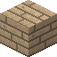 | **Schody jabłoniowe** | `jablon_stairs` | **Kopanie:** 1,2 s (siekierą 0,4 s) **Skąd:** zniszczony blok: Schody jabłoniowe |
| 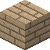 | **Półblok jabłoniowy** | `jablon_slab` | **Kopanie:** 1,2 s (siekierą 0,4 s) **Skąd:** zniszczony blok: Półblok jabłoniowy |
| 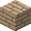 | **Płot jabłoniowy** | `jablon_fence` | **Kopanie:** 1,2 s (siekierą 0,4 s) |
|  | **Furtka jabłoniowa** | `jablon_fence_gate` | **Kopanie:** 1,2 s (siekierą 0,4 s) **Skąd:** zniszczony blok: Furtka jabłoniowa |
| 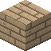 | **Stół stolarski jabłoniowy** | `jablon_carpenter_table` | **Kopanie:** 1,2 s (siekierą 0,4 s) **Skąd:** zniszczony blok: Stół stolarski jabłoniowy **Przepis:** Stół stolarski jabłoniowy |
| 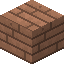 | **Schody olchowe** | `olcha_stairs` | **Kopanie:** 1,2 s (siekierą 0,4 s) **Skąd:** zniszczony blok: Schody olchowe |
|  | **Półblok olchowy** | `olcha_slab` | **Kopanie:** 1,2 s (siekierą 0,4 s) **Skąd:** zniszczony blok: Półblok olchowy |
|  | **Płot olchowy** | `olcha_fence` | **Kopanie:** 1,2 s (siekierą 0,4 s) |
|  | **Furtka olchowa** | `olcha_fence_gate` | **Kopanie:** 1,2 s (siekierą 0,4 s) **Skąd:** zniszczony blok: Furtka olchowa |
| 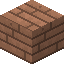 | **Stół stolarski olchowy** | `olcha_carpenter_table` | **Kopanie:** 1,2 s (siekierą 0,4 s) **Skąd:** zniszczony blok: Stół stolarski olchowy **Przepis:** Stół stolarski olchowy |
| 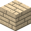 | **Schody wierzbowe** | `wierzba_stairs` | **Kopanie:** 1,2 s (siekierą 0,4 s) **Skąd:** zniszczony blok: Schody wierzbowe |
|  | **Półblok wierzbowy** | `wierzba_slab` | **Kopanie:** 1,2 s (siekierą 0,4 s) **Skąd:** zniszczony blok: Półblok wierzbowy |
|  | **Płot wierzbowy** | `wierzba_fence` | **Kopanie:** 1,2 s (siekierą 0,4 s) |
|  | **Furtka wierzbowa** | `wierzba_fence_gate` | **Kopanie:** 1,2 s (siekierą 0,4 s) **Skąd:** zniszczony blok: Furtka wierzbowa |
|  | **Stół stolarski wierzbowy** | `wierzba_carpenter_table` | **Kopanie:** 1,2 s (siekierą 0,4 s) **Skąd:** zniszczony blok: Stół stolarski wierzbowy **Przepis:** Stół stolarski wierzbowy |
| 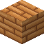 | **Schody z akacji** | `acacia_stairs` | **Kopanie:** 1,2 s (siekierą 0,4 s) **Skąd:** zniszczony blok: Schody z akacji |
| 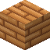 | **Półblok z akacji** | `acacia_slab` | **Kopanie:** 1,2 s (siekierą 0,4 s) **Skąd:** zniszczony blok: Półblok z akacji |
|  | **Płot z akacji** | `acacia_fence` | **Kopanie:** 1,2 s (siekierą 0,4 s) |
| 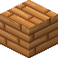 | **Furtka z akacji** | `acacia_fence_gate` | **Kopanie:** 1,2 s (siekierą 0,4 s) **Skąd:** zniszczony blok: Furtka z akacji |
|  | **Stół stolarski z akacji** | `acacia_carpenter_table` | **Kopanie:** 1,2 s (siekierą 0,4 s) **Skąd:** zniszczony blok: Stół stolarski z akacji **Przepis:** Stół stolarski z akacji |
|  | **Schody z cypryśnika** | `bald_cypress_stairs` | **Kopanie:** 1,2 s (siekierą 0,4 s) **Skąd:** zniszczony blok: Schody z cypryśnika |
|  | **Półblok z cypryśnika** | `bald_cypress_slab` | **Kopanie:** 1,2 s (siekierą 0,4 s) **Skąd:** zniszczony blok: Półblok z cypryśnika |
|  | **Płot z cypryśnika** | `bald_cypress_fence` | **Kopanie:** 1,2 s (siekierą 0,4 s) |
|  | **Furtka z cypryśnika** | `bald_cypress_fence_gate` | **Kopanie:** 1,2 s (siekierą 0,4 s) **Skąd:** zniszczony blok: Furtka z cypryśnika |
| 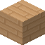 | **Stół stolarski z cypryśnika** | `bald_cypress_carpenter_table` | **Kopanie:** 1,2 s (siekierą 0,4 s) **Skąd:** zniszczony blok: Stół stolarski z cypryśnika **Przepis:** Stół stolarski z cypryśnika |
| 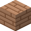 | **Schody wiśniowe** | `cherry_stairs` | **Kopanie:** 1,2 s (siekierą 0,4 s) **Skąd:** zniszczony blok: Schody wiśniowe |
|  | **Półblok wiśniowy** | `cherry_slab` | **Kopanie:** 1,2 s (siekierą 0,4 s) **Skąd:** zniszczony blok: Półblok wiśniowy |
|  | **Płot wiśniowy** | `cherry_fence` | **Kopanie:** 1,2 s (siekierą 0,4 s) |
|  | **Furtka wiśniowa** | `cherry_fence_gate` | **Kopanie:** 1,2 s (siekierą 0,4 s) **Skąd:** zniszczony blok: Furtka wiśniowa |
|  | **Stół stolarski wiśniowy** | `cherry_carpenter_table` | **Kopanie:** 1,2 s (siekierą 0,4 s) **Skąd:** zniszczony blok: Stół stolarski wiśniowy **Przepis:** Stół stolarski wiśniowy |
|  | **Schody klonowe** | `maple_stairs` | **Kopanie:** 1,2 s (siekierą 0,4 s) **Skąd:** zniszczony blok: Schody klonowe |
|  | **Półblok klonowy** | `maple_slab` | **Kopanie:** 1,2 s (siekierą 0,4 s) **Skąd:** zniszczony blok: Półblok klonowy |
|  | **Płot klonowy** | `maple_fence` | **Kopanie:** 1,2 s (siekierą 0,4 s) |
|  | **Furtka klonowa** | `maple_fence_gate` | **Kopanie:** 1,2 s (siekierą 0,4 s) **Skąd:** zniszczony blok: Furtka klonowa |
|  | **Stół stolarski klonowy** | `maple_carpenter_table` | **Kopanie:** 1,2 s (siekierą 0,4 s) **Skąd:** zniszczony blok: Stół stolarski klonowy **Przepis:** Stół stolarski klonowy |
| 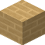 | **Schody z kosodrzewiny** | `mugo_stairs` | **Kopanie:** 1,2 s (siekierą 0,4 s) **Skąd:** zniszczony blok: Schody z kosodrzewiny |
| 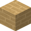 | **Półblok z kosodrzewiny** | `mugo_slab` | **Kopanie:** 1,2 s (siekierą 0,4 s) **Skąd:** zniszczony blok: Półblok z kosodrzewiny |
| 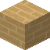 | **Płot z kosodrzewiny** | `mugo_fence` | **Kopanie:** 1,2 s (siekierą 0,4 s) |
|  | **Furtka z kosodrzewiny** | `mugo_fence_gate` | **Kopanie:** 1,2 s (siekierą 0,4 s) **Skąd:** zniszczony blok: Furtka z kosodrzewiny |
|  | **Stół stolarski z kosodrzewiny** | `mugo_carpenter_table` | **Kopanie:** 1,2 s (siekierą 0,4 s) **Skąd:** zniszczony blok: Stół stolarski z kosodrzewiny **Przepis:** Stół stolarski z kosodrzewiny |
| 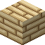 | **Schody oliwkowe** | `olive_stairs` | **Kopanie:** 1,2 s (siekierą 0,4 s) **Skąd:** zniszczony blok: Schody oliwkowe |
|  | **Półblok oliwkowy** | `olive_slab` | **Kopanie:** 1,2 s (siekierą 0,4 s) **Skąd:** zniszczony blok: Półblok oliwkowy |
|  | **Płot oliwkowy** | `olive_fence` | **Kopanie:** 1,2 s (siekierą 0,4 s) |
|  | **Furtka oliwkowa** | `olive_fence_gate` | **Kopanie:** 1,2 s (siekierą 0,4 s) **Skąd:** zniszczony blok: Furtka oliwkowa |
|  | **Stół stolarski oliwkowy** | `olive_carpenter_table` | **Kopanie:** 1,2 s (siekierą 0,4 s) **Skąd:** zniszczony blok: Stół stolarski oliwkowy **Przepis:** Stół stolarski oliwkowy |
| 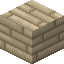 | **Schody eukaliptusowe** | `rainbow_eucalyptus_stairs` | **Kopanie:** 1,2 s (siekierą 0,4 s) **Skąd:** zniszczony blok: Schody eukaliptusowe |
|  | **Półblok eukaliptusowy** | `rainbow_eucalyptus_slab` | **Kopanie:** 1,2 s (siekierą 0,4 s) **Skąd:** zniszczony blok: Półblok eukaliptusowy |
|  | **Płot eukaliptusowy** | `rainbow_eucalyptus_fence` | **Kopanie:** 1,2 s (siekierą 0,4 s) |
| 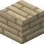 | **Furtka eukaliptusowa** | `rainbow_eucalyptus_fence_gate` | **Kopanie:** 1,2 s (siekierą 0,4 s) **Skąd:** zniszczony blok: Furtka eukaliptusowa |
| 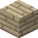 | **Stół stolarski eukaliptusowy** | `rainbow_eucalyptus_carpenter_table` | **Kopanie:** 1,2 s (siekierą 0,4 s) **Skąd:** zniszczony blok: Stół stolarski eukaliptusowy **Przepis:** Stół stolarski eukaliptusowy |
| 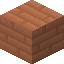 | **Schody sekwojowe** | `sequoia_stairs` | **Kopanie:** 1,2 s (siekierą 0,4 s) **Skąd:** zniszczony blok: Schody sekwojowe |
| 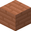 | **Półblok sekwojowy** | `sequoia_slab` | **Kopanie:** 1,2 s (siekierą 0,4 s) **Skąd:** zniszczony blok: Półblok sekwojowy |
|  | **Płot sekwojowy** | `sequoia_fence` | **Kopanie:** 1,2 s (siekierą 0,4 s) |
|  | **Furtka sekwojowa** | `sequoia_fence_gate` | **Kopanie:** 1,2 s (siekierą 0,4 s) **Skąd:** zniszczony blok: Furtka sekwojowa |
|  | **Stół stolarski sekwojowy** | `sequoia_carpenter_table` | **Kopanie:** 1,2 s (siekierą 0,4 s) **Skąd:** zniszczony blok: Stół stolarski sekwojowy **Przepis:** Stół stolarski sekwojowy |
|  | **Schody miłorzębowe** | `ginkgo_stairs` | **Kopanie:** 1,2 s (siekierą 0,4 s) **Skąd:** zniszczony blok: Schody miłorzębowe |
| 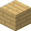 | **Półblok miłorzębowy** | `ginkgo_slab` | **Kopanie:** 1,2 s (siekierą 0,4 s) **Skąd:** zniszczony blok: Półblok miłorzębowy |
| 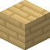 | **Płot miłorzębowy** | `ginkgo_fence` | **Kopanie:** 1,2 s (siekierą 0,4 s) |
| 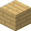 | **Furtka miłorzębowa** | `ginkgo_fence_gate` | **Kopanie:** 1,2 s (siekierą 0,4 s) **Skąd:** zniszczony blok: Furtka miłorzębowa |
| 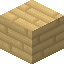 | **Stół stolarski miłorzębowy** | `ginkgo_carpenter_table` | **Kopanie:** 1,2 s (siekierą 0,4 s) **Skąd:** zniszczony blok: Stół stolarski miłorzębowy **Przepis:** Stół stolarski miłorzębowy |
| 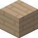 | **Schody jakarandowe** | `jacaranda_stairs` | **Kopanie:** 1,2 s (siekierą 0,4 s) **Skąd:** zniszczony blok: Schody jakarandowe |
| 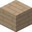 | **Półblok jakarandowy** | `jacaranda_slab` | **Kopanie:** 1,2 s (siekierą 0,4 s) **Skąd:** zniszczony blok: Półblok jakarandowy |
|  | **Płot jakarandowy** | `jacaranda_fence` | **Kopanie:** 1,2 s (siekierą 0,4 s) |
| 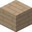 | **Furtka jakarandowa** | `jacaranda_fence_gate` | **Kopanie:** 1,2 s (siekierą 0,4 s) **Skąd:** zniszczony blok: Furtka jakarandowa |
|  | **Stół stolarski jakarandowy** | `jacaranda_carpenter_table` | **Kopanie:** 1,2 s (siekierą 0,4 s) **Skąd:** zniszczony blok: Stół stolarski jakarandowy **Przepis:** Stół stolarski jakarandowy |
| 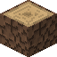 | **Pień świerka** | `spruce_log` | **Kopanie:** 2 s (siekierą 0,67 s) **Siekierą (PPM):** Okorowany pień świerka **Przydaje się do:** Opał — świerk, Deski świerkowe |
|  | **Okorowany pień świerka** | `spruce_log_stripped` | **Kopanie:** 2 s (siekierą 0,67 s) **Skąd:** siekierą (PPM) z bloku: Pień świerka **Przydaje się do:** Opał — świerk, Deski świerkowe |
|  | **Deski świerkowe** | `spruce_planks` | **Kopanie:** 2 s (siekierą 0,67 s) **Przepis:** Deski świerkowe x4 **Przydaje się do:** Skrzynia świerkowa, Stół stolarski świerkowy, Ciemne deski, Tratwa, Patyk |
|  | **Pień sosny** | `pine_log` | **Kopanie:** 2 s (siekierą 0,67 s) **Siekierą (PPM):** Okorowany pień sosny **Skąd:** zniszczony blok: Pień sosny z żywicą **Przydaje się do:** Opał — sosna, Deski sosnowe |
|  | **Pień sosny (górny)** | `pine_log_upper` | **Kopanie:** 2 s (siekierą 0,67 s) **Siekierą (PPM):** Okorowany pień sosny **Przydaje się do:** Opał — sosna, Deski sosnowe |
|  | **Pień sosny z żywicą** | `pine_log_resin` | **Kopanie:** 2 s (siekierą 0,67 s) **Daje:** Pień sosny **Zbiór (PPM):** Żywica 1-2 **Siekierą (PPM):** Okorowany pień sosny **Przydaje się do:** Opał — sosna, Deski sosnowe |
|  | **Okorowany pień sosny** | `pine_log_stripped` | **Kopanie:** 2 s (siekierą 0,67 s) **Skąd:** siekierą (PPM) z bloku: Pień sosny; siekierą (PPM) z bloku: Pień sosny (górny); siekierą (PPM) z bloku: Pień sosny z żywicą **Przydaje się do:** Opał — sosna, Deski sosnowe |
|  | **Deski sosnowe** | `pine_planks` | **Kopanie:** 2 s (siekierą 0,67 s) **Przepis:** Deski sosnowe x4 **Przydaje się do:** Skrzynia sosnowa, Stół stolarski sosnowy, Ciemne deski, Tratwa, Patyk |
|  | **Pień buka** | `beech_log` | **Kopanie:** 2 s (siekierą 0,67 s) **Siekierą (PPM):** Okorowany pień buka **Przydaje się do:** Opał — buk, Deski bukowe |
|  | **Okorowany pień buka** | `beech_log_stripped` | **Kopanie:** 2 s (siekierą 0,67 s) **Skąd:** siekierą (PPM) z bloku: Pień buka **Przydaje się do:** Opał — buk, Deski bukowe |
|  | **Deski bukowe** | `beech_planks` | **Kopanie:** 2 s (siekierą 0,67 s) **Przepis:** Deski bukowe x4 **Przydaje się do:** Skrzynia bukowa, Stół stolarski bukowy, Ciemne deski, Tratwa, Patyk |
|  | **Pień lipy** | `linden_log` | **Kopanie:** 2 s (siekierą 0,67 s) **Siekierą (PPM):** Okorowany pień lipy **Przydaje się do:** Opał — lipa, Deski lipowe |
|  | **Okorowany pień lipy** | `linden_log_stripped` | **Kopanie:** 2 s (siekierą 0,67 s) **Skąd:** siekierą (PPM) z bloku: Pień lipy **Przydaje się do:** Opał — lipa, Deski lipowe |
|  | **Deski lipowe** | `linden_planks` | **Kopanie:** 2 s (siekierą 0,67 s) **Przepis:** Deski lipowe x4 **Przydaje się do:** Skrzynia lipowa, Stół stolarski lipowy, Ciemne deski, Tratwa, Patyk |
| 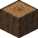 | **Pień dębu** | `oak_log` | **Kopanie:** 2 s (siekierą 0,67 s) **Siekierą (PPM):** Okorowany pień dębu **Przydaje się do:** Opał — dąb, Deski dębowe |
|  | **Okorowany pień dębu** | `oak_log_stripped` | **Kopanie:** 2 s (siekierą 0,67 s) **Skąd:** siekierą (PPM) z bloku: Pień dębu **Przydaje się do:** Opał — dąb, Deski dębowe |
| 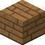 | **Deski dębowe** | `oak_planks` | **Kopanie:** 2 s (siekierą 0,67 s) **Przepis:** Deski dębowe x4 **Przydaje się do:** Skrzynia dębowa, Stół stolarski dębowy, Ciemne deski, Tratwa, Patyk |
|  | **Pień brzozy** | `birch_log` | **Kopanie:** 2 s (siekierą 0,67 s) **Siekierą (PPM):** Okorowany pień brzozy + Kora brzozowa **Przydaje się do:** Opał — brzoza, Deski brzozowe |
|  | **Okorowany pień brzozy** | `birch_log_stripped` | **Kopanie:** 2 s (siekierą 0,67 s) **Skąd:** siekierą (PPM) z bloku: Pień brzozy **Przydaje się do:** Opał — brzoza, Deski brzozowe |
|  | **Deski brzozowe** | `birch_planks` | **Kopanie:** 2 s (siekierą 0,67 s) **Przepis:** Deski brzozowe x4 **Przydaje się do:** Skrzynia brzozowa, Stół stolarski brzozowy, Ciemne deski, Tratwa, Patyk |
|  | **Pień jabłoni** | `jablon_log` | **Kopanie:** 2 s (siekierą 0,67 s) **Siekierą (PPM):** Okorowany pień jabłoni **Przydaje się do:** Opał — jabłoń, Deski jabłoniowe |
|  | **Okorowany pień jabłoni** | `jablon_log_stripped` | **Kopanie:** 2 s (siekierą 0,67 s) **Skąd:** siekierą (PPM) z bloku: Pień jabłoni **Przydaje się do:** Opał — jabłoń, Deski jabłoniowe |
|  | **Deski jabłoniowe** | `jablon_planks` | **Kopanie:** 2 s (siekierą 0,67 s) **Przepis:** Deski jabłoniowe x4 **Przydaje się do:** Skrzynia jabłoniowa, Stół stolarski jabłoniowy, Ciemne deski, Tratwa, Patyk |
|  | **Pień olchy** | `olcha_log` | **Kopanie:** 2 s (siekierą 0,67 s) **Siekierą (PPM):** Okorowany pień olchy **Przydaje się do:** Opał — olcha, Deski olchowe |
|  | **Okorowany pień olchy** | `olcha_log_stripped` | **Kopanie:** 2 s (siekierą 0,67 s) **Skąd:** siekierą (PPM) z bloku: Pień olchy **Przydaje się do:** Opał — olcha, Deski olchowe |
|  | **Deski olchowe** | `olcha_planks` | **Kopanie:** 2 s (siekierą 0,67 s) **Przepis:** Deski olchowe x4 **Przydaje się do:** Skrzynia olchowa, Stół stolarski olchowy, Ciemne deski, Tratwa, Patyk |
|  | **Pień wierzby** | `wierzba_log` | **Kopanie:** 2 s (siekierą 0,67 s) **Siekierą (PPM):** Okorowany pień wierzby **Przydaje się do:** Opał — wierzba, Deski wierzbowe |
|  | **Okorowany pień wierzby** | `wierzba_log_stripped` | **Kopanie:** 2 s (siekierą 0,67 s) **Skąd:** siekierą (PPM) z bloku: Pień wierzby **Przydaje się do:** Opał — wierzba, Deski wierzbowe |
|  | **Deski wierzbowe** | `wierzba_planks` | **Kopanie:** 2 s (siekierą 0,67 s) **Przepis:** Deski wierzbowe x4 **Przydaje się do:** Skrzynia wierzbowa, Stół stolarski wierzbowy, Ciemne deski, Tratwa, Patyk |
| 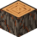 | **Pień akacji** | `acacia_log` | **Kopanie:** 2 s (siekierą 0,67 s) **Siekierą (PPM):** Okorowany pień akacji **Przydaje się do:** Opał — akacja, Deski akacji |
| 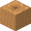 | **Okorowany pień akacji** | `acacia_log_stripped` | **Kopanie:** 2 s (siekierą 0,67 s) **Skąd:** siekierą (PPM) z bloku: Pień akacji **Przydaje się do:** Opał — akacja, Deski akacji |
|  | **Deski akacji** | `acacia_planks` | **Kopanie:** 2 s (siekierą 0,67 s) **Przepis:** Deski akacji x4 **Przydaje się do:** Skrzynia z akacji, Stół stolarski z akacji, Ciemne deski, Tratwa, Patyk |
|  | **Pień cypryśnika** | `bald_cypress_log` | **Kopanie:** 2 s (siekierą 0,67 s) **Siekierą (PPM):** Okorowany pień cypryśnika **Przydaje się do:** Opał — cypryśnik, Deski cypryśnika |
|  | **Okorowany pień cypryśnika** | `bald_cypress_log_stripped` | **Kopanie:** 2 s (siekierą 0,67 s) **Skąd:** siekierą (PPM) z bloku: Pień cypryśnika **Przydaje się do:** Opał — cypryśnik, Deski cypryśnika |
|  | **Deski cypryśnika** | `bald_cypress_planks` | **Kopanie:** 2 s (siekierą 0,67 s) **Przepis:** Deski cypryśnika x4 **Przydaje się do:** Skrzynia z cypryśnika, Stół stolarski z cypryśnika, Ciemne deski, Tratwa, Patyk |
|  | **Pień wiśni** | `cherry_log` | **Kopanie:** 2 s (siekierą 0,67 s) **Siekierą (PPM):** Okorowany pień wiśni **Przydaje się do:** Opał — wiśnia, Deski wiśni |
|  | **Okorowany pień wiśni** | `cherry_log_stripped` | **Kopanie:** 2 s (siekierą 0,67 s) **Skąd:** siekierą (PPM) z bloku: Pień wiśni **Przydaje się do:** Opał — wiśnia, Deski wiśni |
|  | **Deski wiśni** | `cherry_planks` | **Kopanie:** 2 s (siekierą 0,67 s) **Przepis:** Deski wiśni x4 **Przydaje się do:** Skrzynia wiśniowa, Stół stolarski wiśniowy, Ciemne deski, Tratwa, Patyk |
|  | **Pień klonu** | `maple_log` | **Kopanie:** 2 s (siekierą 0,67 s) **Siekierą (PPM):** Okorowany pień klonu **Przydaje się do:** Opał — klon, Deski klonowe |
|  | **Okorowany pień klonu** | `maple_log_stripped` | **Kopanie:** 2 s (siekierą 0,67 s) **Skąd:** siekierą (PPM) z bloku: Pień klonu **Przydaje się do:** Opał — klon, Deski klonowe |
|  | **Deski klonowe** | `maple_planks` | **Kopanie:** 2 s (siekierą 0,67 s) **Przepis:** Deski klonowe x4 **Przydaje się do:** Skrzynia klonowa, Stół stolarski klonowy, Ciemne deski, Tratwa, Patyk |
|  | **Pień kosodrzewiny** | `mugo_log` | **Kopanie:** 2 s (siekierą 0,67 s) **Siekierą (PPM):** Okorowany pień kosodrzewiny **Przydaje się do:** Opał — kosodrzewina, Deski z kosodrzewiny |
|  | **Okorowany pień kosodrzewiny** | `mugo_log_stripped` | **Kopanie:** 2 s (siekierą 0,67 s) **Skąd:** siekierą (PPM) z bloku: Pień kosodrzewiny **Przydaje się do:** Opał — kosodrzewina, Deski z kosodrzewiny |
|  | **Deski z kosodrzewiny** | `mugo_planks` | **Kopanie:** 2 s (siekierą 0,67 s) **Przepis:** Deski z kosodrzewiny x4 **Przydaje się do:** Skrzynia z kosodrzewiny, Stół stolarski z kosodrzewiny, Ciemne deski, Tratwa, Patyk |
|  | **Pień oliwki** | `olive_log` | **Kopanie:** 2 s (siekierą 0,67 s) **Siekierą (PPM):** Okorowany pień oliwki **Przydaje się do:** Opał — oliwka, Deski oliwkowe |
|  | **Okorowany pień oliwki** | `olive_log_stripped` | **Kopanie:** 2 s (siekierą 0,67 s) **Skąd:** siekierą (PPM) z bloku: Pień oliwki **Przydaje się do:** Opał — oliwka, Deski oliwkowe |
|  | **Deski oliwkowe** | `olive_planks` | **Kopanie:** 2 s (siekierą 0,67 s) **Przepis:** Deski oliwkowe x4 **Przydaje się do:** Skrzynia oliwkowa, Stół stolarski oliwkowy, Ciemne deski, Tratwa, Patyk |
|  | **Pień eukaliptusa** | `rainbow_eucalyptus_log` | **Kopanie:** 2 s (siekierą 0,67 s) **Siekierą (PPM):** Okorowany pień eukaliptusa **Przydaje się do:** Opał — eukaliptus, Deski eukaliptusowe |
|  | **Okorowany pień eukaliptusa** | `rainbow_eucalyptus_log_stripped` | **Kopanie:** 2 s (siekierą 0,67 s) **Skąd:** siekierą (PPM) z bloku: Pień eukaliptusa **Przydaje się do:** Opał — eukaliptus, Deski eukaliptusowe |
|  | **Deski eukaliptusowe** | `rainbow_eucalyptus_planks` | **Kopanie:** 2 s (siekierą 0,67 s) **Przepis:** Deski eukaliptusowe x4 **Przydaje się do:** Skrzynia eukaliptusowa, Stół stolarski eukaliptusowy, Ciemne deski, Tratwa, Patyk |
|  | **Pień sekwoi** | `sequoia_log` | **Kopanie:** 2 s (siekierą 0,67 s) **Siekierą (PPM):** Okorowany pień sekwoi **Przydaje się do:** Opał — sekwoja, Deski sekwojowe |
|  | **Okorowany pień sekwoi** | `sequoia_log_stripped` | **Kopanie:** 2 s (siekierą 0,67 s) **Skąd:** siekierą (PPM) z bloku: Pień sekwoi **Przydaje się do:** Opał — sekwoja, Deski sekwojowe |
|  | **Deski sekwojowe** | `sequoia_planks` | **Kopanie:** 2 s (siekierą 0,67 s) **Przepis:** Deski sekwojowe x4 **Przydaje się do:** Skrzynia sekwojowa, Stół stolarski sekwojowy, Ciemne deski, Tratwa, Patyk |
|  | **Pień miłorzębu** | `ginkgo_log` | **Kopanie:** 2 s (siekierą 0,67 s) **Siekierą (PPM):** Okorowany pień miłorzębu **Przydaje się do:** Opał — miłorząb, Deski miłorzębowe |
|  | **Okorowany pień miłorzębu** | `ginkgo_log_stripped` | **Kopanie:** 2 s (siekierą 0,67 s) **Skąd:** siekierą (PPM) z bloku: Pień miłorzębu **Przydaje się do:** Opał — miłorząb, Deski miłorzębowe |
|  | **Deski miłorzębowe** | `ginkgo_planks` | **Kopanie:** 2 s (siekierą 0,67 s) **Przepis:** Deski miłorzębowe x4 **Przydaje się do:** Skrzynia miłorzębowa, Stół stolarski miłorzębowy, Ciemne deski, Tratwa, Patyk |
|  | **Pień jakarandy** | `jacaranda_log` | **Kopanie:** 2 s (siekierą 0,67 s) **Siekierą (PPM):** Okorowany pień jakarandy **Przydaje się do:** Opał — jakaranda, Deski jakarandowe |
|  | **Okorowany pień jakarandy** | `jacaranda_log_stripped` | **Kopanie:** 2 s (siekierą 0,67 s) **Skąd:** siekierą (PPM) z bloku: Pień jakarandy **Przydaje się do:** Opał — jakaranda, Deski jakarandowe |
|  | **Deski jakarandowe** | `jacaranda_planks` | **Kopanie:** 2 s (siekierą 0,67 s) **Przepis:** Deski jakarandowe x4 **Przydaje się do:** Skrzynia jakarandowa, Stół stolarski jakarandowy, Ciemne deski, Tratwa, Patyk |

## Budulec

| | Nazwa | W komendach | Najważniejsze |
|---|---|---|---|
|  | **Tynk wapienny** | `lime_plaster` | **Kopanie:** 2,2 s (kilofem 0,73 s) **Przepis:** Tynk wapienny x4 **Przydaje się do:** Tynk ochrowy |
|  | **Tynk ochrowy** | `ochre_plaster` | **Kopanie:** 2,2 s (kilofem 0,73 s) **Przepis:** Tynk ochrowy x4 |
|  | **Terakota** | `terracotta` | **Kopanie:** 2,2 s (kilofem 0,73 s) **Przepis:** Terakota x4 |
|  | **Polerowany kamień** | `polished_stone` | **Kopanie:** 2,2 s (kilofem 0,73 s) **Przepis:** Polerowany kamień x4 |
|  | **Ciemne deski** | `dark_planks` | **Kopanie:** 2 s (siekierą 0,67 s) **Przepis:** Ciemne deski x3 **Przydaje się do:** Ciemna skrzynia, Stół stolarski z ciemnego drewna |

## Rośliny

| | Nazwa | W komendach | Najważniejsze |
|---|---|---|---|
|  | **Krótka trawa** | `short_grass` | **Kopanie:** od razu |
|  | **Wysoka trawa** | `tall_grass` | **Kopanie:** od razu |
|  | **Paproć** | `fern` | **Kopanie:** od razu **Przydaje się do:** Zielona lampa, Barwnik zielony |
|  | **Koniczyna** | `clover` | **Kopanie:** od razu **Przydaje się do:** Zielona lampa, Barwnik zielony |
|  | **Pokrzywa** | `nettle` | **Kopanie:** od razu **Przydaje się do:** Zielona lampa, Barwnik zielony |
|  | **Babka zwyczajna** | `plantain` | **Kopanie:** od razu |
|  | **Mak** | `poppy` | **Kopanie:** od razu **Przydaje się do:** Czerwona lampa, Barwnik czerwony |
|  | **Chaber** | `cornflower` | **Kopanie:** od razu **Przydaje się do:** Niebieska lampa, Barwnik niebieski |
|  | **Rumianek** | `chamomile` | **Kopanie:** od razu **Przydaje się do:** Barwnik biały |
|  | **Mniszek** | `dandelion` | **Kopanie:** od razu **Przydaje się do:** Barwnik żółty |
|  | **Kępki mchu** | `moss_carpet` | **Kopanie:** od razu **Przepis:** Kępki mchu x4 **Przydaje się do:** Mech |
|  | **Trzcina** | `reed` | **Kopanie:** od razu |
|  | **Wrzos** | `heather` | **Kopanie:** od razu **Przydaje się do:** Fioletowa lampa, Barwnik fioletowy |
|  | **Krokus** | `crocus` | **Kopanie:** od razu **Przydaje się do:** Fioletowa lampa, Barwnik fioletowy |
|  | **Piaskownica (trawa wydmowa)** | `dune_grass` | **Kopanie:** od razu |
|  | **Sadzonka truskawki** | `strawberry_sapling` | **Kopanie:** od razu **Rośnie:** w: Krzak truskawki **Skąd:** zniszczony blok: Krzak truskawki; zniszczony blok: Krzak truskawki (kilka owoców); zniszczony blok: Krzak truskawki (pełen owoców); posadzony przedmiot: Truskawki |
|  | **Krzak truskawki** | `strawberry_bush` | **Kopanie:** od razu **Daje:** Sadzonka truskawki **Rośnie:** w: Krzak truskawki (kilka owoców) **Skąd:** wyrasta z: Sadzonka truskawki |
|  | **Krzak truskawki (kilka owoców)** | `strawberry_bush_few` | **Kopanie:** od razu **Daje:** Sadzonka truskawki **Zbiór (PPM):** Truskawki 1-2 **Rośnie:** w: Krzak truskawki (pełen owoców) **Skąd:** wyrasta z: Krzak truskawki |
|  | **Krzak truskawki (pełen owoców)** | `strawberry_bush_full` | **Kopanie:** od razu **Daje:** Sadzonka truskawki **Zbiór (PPM):** Truskawki 2-4 **Skąd:** wyrasta z: Krzak truskawki (kilka owoców) |
|  | **Sadzonka jeżyny** | `blackberry_sapling` | **Kopanie:** od razu **Rośnie:** w: Krzak jeżyny **Skąd:** zniszczony blok: Krzak jeżyny; zniszczony blok: Krzak jeżyny (kilka owoców); zniszczony blok: Krzak jeżyny (pełen owoców); posadzony przedmiot: Jeżyny |
|  | **Krzak jeżyny** | `blackberry_bush` | **Kopanie:** od razu **Daje:** Sadzonka jeżyny **Rośnie:** w: Krzak jeżyny (kilka owoców) **Skąd:** wyrasta z: Sadzonka jeżyny |
|  | **Krzak jeżyny (kilka owoców)** | `blackberry_bush_few` | **Kopanie:** od razu **Daje:** Sadzonka jeżyny **Zbiór (PPM):** Jeżyny 1-2 **Rośnie:** w: Krzak jeżyny (pełen owoców) **Skąd:** wyrasta z: Krzak jeżyny |
|  | **Krzak jeżyny (pełen owoców)** | `blackberry_bush_full` | **Kopanie:** od razu **Daje:** Sadzonka jeżyny **Zbiór (PPM):** Jeżyny 2-4 **Skąd:** wyrasta z: Krzak jeżyny (kilka owoców) |
|  | **Sadzonka papryczki chili** | `chili_sapling` | **Kopanie:** od razu **Rośnie:** w: Krzak papryczki chili **Skąd:** zniszczony blok: Krzak papryczki chili; zniszczony blok: Krzak papryczki chili (kilka papryczek); zniszczony blok: Krzak papryczki chili (pełen papryczek); posadzony przedmiot: Papryczki chili |
|  | **Krzak papryczki chili** | `chili_bush` | **Kopanie:** od razu **Daje:** Sadzonka papryczki chili **Rośnie:** w: Krzak papryczki chili (kilka papryczek) **Skąd:** wyrasta z: Sadzonka papryczki chili |
|  | **Krzak papryczki chili (kilka papryczek)** | `chili_bush_few` | **Kopanie:** od razu **Daje:** Sadzonka papryczki chili **Zbiór (PPM):** Papryczki chili 1-2 **Rośnie:** w: Krzak papryczki chili (pełen papryczek) **Skąd:** wyrasta z: Krzak papryczki chili |
|  | **Krzak papryczki chili (pełen papryczek)** | `chili_bush_full` | **Kopanie:** od razu **Daje:** Sadzonka papryczki chili **Zbiór (PPM):** Papryczki chili 2-4 **Skąd:** wyrasta z: Krzak papryczki chili (kilka papryczek) |
|  | **Sadzonka leszczyny** | `hazel_sapling` | **Kopanie:** od razu **Rośnie:** w: Leszczyna **Skąd:** zniszczony blok: Leszczyna; zniszczony blok: Leszczyna (kilka orzechów); zniszczony blok: Leszczyna (pełna orzechów); posadzony przedmiot: Orzech laskowy |
|  | **Leszczyna** | `hazel_bush` | **Kopanie:** od razu **Daje:** Sadzonka leszczyny **Rośnie:** w: Leszczyna (kilka orzechów) **Skąd:** wyrasta z: Sadzonka leszczyny |
|  | **Leszczyna (kilka orzechów)** | `hazel_bush_few` | **Kopanie:** od razu **Daje:** Sadzonka leszczyny **Zbiór (PPM):** Orzech laskowy 1-2 **Rośnie:** w: Leszczyna (pełna orzechów) **Skąd:** wyrasta z: Leszczyna |
|  | **Leszczyna (pełna orzechów)** | `hazel_bush_full` | **Kopanie:** od razu **Daje:** Sadzonka leszczyny **Zbiór (PPM):** Orzech laskowy 2-3 **Skąd:** wyrasta z: Leszczyna (kilka orzechów) |
|  | **Sadzonka borówki** | `blueberry_sapling` | **Kopanie:** od razu **Rośnie:** w: Krzak borówki (kilka owoców) **Skąd:** zniszczony blok: Krzak borówki (po zbiorze); zniszczony blok: Krzak borówki (kilka owoców); zniszczony blok: Krzak borówki (pełen owoców); posadzony przedmiot: Borówki |
|  | **Krzak borówki (po zbiorze)** | `blueberry_bush` | **Kopanie:** od razu **Daje:** Sadzonka borówki **Rośnie:** w: Krzak borówki (kilka owoców) |
|  | **Krzak borówki (kilka owoców)** | `blueberry_bush_few` | **Kopanie:** od razu **Daje:** Sadzonka borówki **Zbiór (PPM):** Borówki 1-3 **Rośnie:** w: Krzak borówki (pełen owoców) **Skąd:** wyrasta z: Sadzonka borówki; wyrasta z: Krzak borówki (po zbiorze) |
|  | **Krzak borówki (pełen owoców)** | `blueberry_bush_full` | **Kopanie:** od razu **Daje:** Sadzonka borówki **Zbiór (PPM):** Borówki 3-5 **Skąd:** wyrasta z: Krzak borówki (kilka owoców) |
|  | **Igliwie świerka** | `spruce_leaves` | **Kopanie:** 0,35 s **Czasem wypada:** Sadzonka świerka (5%), Szyszka świerka (8%) **Przydaje się do:** Ściółka leśna, Wieniec świerkowy |
|  | **Sadzonka świerka** | `spruce_sapling` | **Kopanie:** od razu **Rośnie:** w drzewo, średnio po 5 min **Skąd:** czasem z bloku: Igliwie świerka (5%); posadzony przedmiot: Szyszka świerka |
|  | **Igliwie sosny** | `pine_leaves` | **Kopanie:** 0,35 s **Czasem wypada:** Sadzonka sosny (5%), Szyszka sosny (8%) **Przydaje się do:** Ściółka leśna |
|  | **Sadzonka sosny** | `pine_sapling` | **Kopanie:** od razu **Rośnie:** w drzewo, średnio po 5 min **Skąd:** czasem z bloku: Igliwie sosny (5%); posadzony przedmiot: Szyszka sosny |
|  | **Liście buka** | `beech_leaves` | **Kopanie:** 0,35 s **Czasem wypada:** Sadzonka buka (5%), Orzeszki bukowe (8%) **Przydaje się do:** Opadłe liście buka |
|  | **Sadzonka buka** | `beech_sapling` | **Kopanie:** od razu **Rośnie:** w drzewo, średnio po 5 min **Skąd:** czasem z bloku: Liście buka (5%); posadzony przedmiot: Orzeszki bukowe |
|  | **Liście lipy** | `linden_leaves` | **Kopanie:** 0,35 s **Czasem wypada:** Sadzonka lipy (6%) **Skąd:** zniszczony blok: Kwitnące liście lipy |
|  | **Kwitnące liście lipy** | `linden_leaves_flowering` | **Kopanie:** 0,35 s **Daje:** Liście lipy **Czasem wypada:** Sadzonka lipy (6%) **Zbiór (PPM):** Kwiat lipy 1-2 |
|  | **Sadzonka lipy** | `linden_sapling` | **Kopanie:** od razu **Rośnie:** w drzewo, średnio po 5 min **Skąd:** czasem z bloku: Liście lipy (6%); czasem z bloku: Kwitnące liście lipy (6%); posadzony przedmiot: Kwiat lipy |
|  | **Liście dębu** | `oak_leaves` | **Kopanie:** 0,35 s **Czasem wypada:** Sadzonka dębu (5%), Żołądź (10%) **Przydaje się do:** Opadłe liście dębu |
|  | **Sadzonka dębu** | `oak_sapling` | **Kopanie:** od razu **Rośnie:** w drzewo, średnio po 5 min **Skąd:** czasem z bloku: Liście dębu (5%); posadzony przedmiot: Żołądź |
|  | **Liście brzozy** | `birch_leaves` | **Kopanie:** 0,35 s **Czasem wypada:** Sadzonka brzozy (7%) |
|  | **Sadzonka brzozy** | `birch_sapling` | **Kopanie:** od razu **Rośnie:** w drzewo, średnio po 5 min **Skąd:** czasem z bloku: Liście brzozy (7%) |
|  | **Liście jabłoni** | `jablon_leaves` | **Kopanie:** 0,35 s **Czasem wypada:** Sadzonka jabłoni (5%), Jabłko (5%) **Skąd:** zniszczony blok: Liście jabłoni z jabłkami; zniszczony blok: Liście jabłoni (jabłka odrastają) **Przydaje się do:** Opadłe liście jabłoni |
|  | **Liście jabłoni z jabłkami** | `jablon_leaves_jablka` | **Kopanie:** 0,35 s **Daje:** Liście jabłoni **Czasem wypada:** Sadzonka jabłoni (5%), Jabłko (5%) **Zbiór (PPM):** Jabłko 1-2 **Skąd:** wyrasta z: Liście jabłoni (jabłka odrastają) |
|  | **Sadzonka jabłoni** | `jablon_sapling` | **Kopanie:** od razu **Rośnie:** w drzewo, średnio po 5 min **Skąd:** czasem z bloku: Liście jabłoni (5%); czasem z bloku: Liście jabłoni z jabłkami (5%); czasem z bloku: Liście jabłoni (jabłka odrastają) (5%); posadzony przedmiot: Jabłko |
|  | **Liście olchy** | `olcha_leaves` | **Kopanie:** 0,35 s **Czasem wypada:** Sadzonka olchy (4%), Szyszeczki olchy (6%) **Przydaje się do:** Opadłe liście olchy |
|  | **Sadzonka olchy** | `olcha_sapling` | **Kopanie:** od razu **Rośnie:** w drzewo, średnio po 5 min **Skąd:** czasem z bloku: Liście olchy (4%); posadzony przedmiot: Szyszeczki olchy |
|  | **Liście wierzby** | `wierzba_leaves` | **Kopanie:** 0,35 s **Czasem wypada:** Sadzonka wierzby (4%), Bazie (6%) **Przydaje się do:** Opadłe liście wierzby |
|  | **Sadzonka wierzby** | `wierzba_sapling` | **Kopanie:** od razu **Rośnie:** w drzewo, średnio po 5 min **Skąd:** czasem z bloku: Liście wierzby (4%); posadzony przedmiot: Bazie |
|  | **Liście akacji** | `acacia_leaves` | **Kopanie:** 0,35 s **Czasem wypada:** Sadzonka akacji (5%) **Skąd:** zniszczony blok: Kwitnące liście akacji |
|  | **Kwitnące liście akacji** | `acacia_leaves_kwitnace` | **Kopanie:** 0,35 s **Daje:** Liście akacji **Czasem wypada:** Sadzonka akacji (5%) |
|  | **Sadzonka akacji** | `acacia_sapling` | **Kopanie:** od razu **Rośnie:** w drzewo, średnio po 5 min **Skąd:** czasem z bloku: Liście akacji (5%); czasem z bloku: Kwitnące liście akacji (5%) |
|  | **Igliwie cypryśnika** | `bald_cypress_leaves` | **Kopanie:** 0,35 s **Czasem wypada:** Sadzonka cypryśnika (5%) **Skąd:** zniszczony blok: Jesienne igliwie cypryśnika |
|  | **Jesienne igliwie cypryśnika** | `bald_cypress_leaves_jesienne` | **Kopanie:** 0,35 s **Daje:** Igliwie cypryśnika **Czasem wypada:** Sadzonka cypryśnika (5%) |
|  | **Sadzonka cypryśnika** | `bald_cypress_sapling` | **Kopanie:** od razu **Rośnie:** w drzewo, średnio po 5 min **Skąd:** czasem z bloku: Igliwie cypryśnika (5%); czasem z bloku: Jesienne igliwie cypryśnika (5%) |
|  | **Liście wiśni** | `cherry_leaves` | **Kopanie:** 0,35 s **Czasem wypada:** Sadzonka wiśni (5%) **Skąd:** zniszczony blok: Liście wiśni — rzadsze kwiaty |
|  | **Liście wiśni — rzadsze kwiaty** | `cherry_leaves_rzadsze_kwiaty` | **Kopanie:** 0,35 s **Daje:** Liście wiśni **Czasem wypada:** Sadzonka wiśni (5%) |
|  | **Sadzonka wiśni** | `cherry_sapling` | **Kopanie:** od razu **Rośnie:** w drzewo, średnio po 5 min **Skąd:** czasem z bloku: Liście wiśni (5%); czasem z bloku: Liście wiśni — rzadsze kwiaty (5%) |
|  | **Liście klonu** | `maple_leaves` | **Kopanie:** 0,35 s **Czasem wypada:** Sadzonka klonu (5%) **Skąd:** zniszczony blok: Złote liście klonu **Przydaje się do:** Opadłe liście klonu |
|  | **Złote liście klonu** | `maple_leaves_zlote` | **Kopanie:** 0,35 s **Daje:** Liście klonu **Czasem wypada:** Sadzonka klonu (5%) |
|  | **Sadzonka klonu** | `maple_sapling` | **Kopanie:** od razu **Rośnie:** w drzewo, średnio po 5 min **Skąd:** czasem z bloku: Liście klonu (5%); czasem z bloku: Złote liście klonu (5%) |
|  | **Igliwie kosodrzewiny** | `mugo_leaves` | **Kopanie:** 0,35 s **Czasem wypada:** Sadzonka kosodrzewiny (4%), Szyszka kosodrzewiny (7%) **Skąd:** zniszczony blok: Igliwie kosodrzewiny z młodymi pędami |
|  | **Igliwie kosodrzewiny z młodymi pędami** | `mugo_leaves_mlode` | **Kopanie:** 0,35 s **Daje:** Igliwie kosodrzewiny **Czasem wypada:** Sadzonka kosodrzewiny (4%), Szyszka kosodrzewiny (7%) |
|  | **Sadzonka kosodrzewiny** | `mugo_sapling` | **Kopanie:** od razu **Rośnie:** w drzewo, średnio po 5 min **Skąd:** czasem z bloku: Igliwie kosodrzewiny (4%); czasem z bloku: Igliwie kosodrzewiny z młodymi pędami (4%); posadzony przedmiot: Szyszka kosodrzewiny |
|  | **Liście oliwki** | `olive_leaves` | **Kopanie:** 0,35 s **Czasem wypada:** Sadzonka oliwki (5%), Oliwki (5%) **Skąd:** zniszczony blok: Liście oliwki z oliwkami; zniszczony blok: Liście oliwki (oliwki odrastają) |
|  | **Liście oliwki z oliwkami** | `olive_leaves_oliwki` | **Kopanie:** 0,35 s **Daje:** Liście oliwki **Czasem wypada:** Sadzonka oliwki (5%), Oliwki (5%) **Zbiór (PPM):** Oliwki 1-3 **Skąd:** wyrasta z: Liście oliwki (oliwki odrastają) |
|  | **Sadzonka oliwki** | `olive_sapling` | **Kopanie:** od razu **Rośnie:** w drzewo, średnio po 5 min **Skąd:** czasem z bloku: Liście oliwki (5%); czasem z bloku: Liście oliwki z oliwkami (5%); czasem z bloku: Liście oliwki (oliwki odrastają) (5%); posadzony przedmiot: Oliwki |
|  | **Liście eukaliptusa** | `rainbow_eucalyptus_leaves` | **Kopanie:** 0,35 s **Czasem wypada:** Sadzonka eukaliptusa (5%) |
|  | **Sadzonka eukaliptusa** | `rainbow_eucalyptus_sapling` | **Kopanie:** od razu **Rośnie:** w drzewo, średnio po 5 min **Skąd:** czasem z bloku: Liście eukaliptusa (5%) |
|  | **Igliwie sekwoi** | `sequoia_leaves` | **Kopanie:** 0,35 s **Czasem wypada:** Sadzonka sekwoi (4%), Szyszka sekwoi (6%) **Skąd:** zniszczony blok: Igliwie sekwoi z szyszkami; zniszczony blok: Igliwie sekwoi (szyszki odrastają) |
|  | **Igliwie sekwoi z szyszkami** | `sequoia_leaves_szyszki` | **Kopanie:** 0,35 s **Daje:** Igliwie sekwoi **Czasem wypada:** Sadzonka sekwoi (4%), Szyszka sekwoi (6%) **Zbiór (PPM):** Szyszka sekwoi 1-2 **Skąd:** wyrasta z: Igliwie sekwoi (szyszki odrastają) |
|  | **Sadzonka sekwoi** | `sequoia_sapling` | **Kopanie:** od razu **Rośnie:** w drzewo, średnio po 5 min **Skąd:** czasem z bloku: Igliwie sekwoi (4%); czasem z bloku: Igliwie sekwoi z szyszkami (4%); czasem z bloku: Igliwie sekwoi (szyszki odrastają) (4%); posadzony przedmiot: Szyszka sekwoi |
|  | **Liście miłorzębu** | `ginkgo_leaves` | **Kopanie:** 0,35 s **Czasem wypada:** Sadzonka miłorzębu (5%) **Skąd:** zniszczony blok: Liście miłorzębu — jasne złoto |
|  | **Liście miłorzębu — jasne złoto** | `ginkgo_leaves_zlote` | **Kopanie:** 0,35 s **Daje:** Liście miłorzębu **Czasem wypada:** Sadzonka miłorzębu (5%) |
|  | **Sadzonka miłorzębu** | `ginkgo_sapling` | **Kopanie:** od razu **Rośnie:** w drzewo, średnio po 5 min **Skąd:** czasem z bloku: Liście miłorzębu (5%); czasem z bloku: Liście miłorzębu — jasne złoto (5%) |
|  | **Liście jakarandy** | `jacaranda_leaves` | **Kopanie:** 0,35 s **Czasem wypada:** Sadzonka jakarandy (5%) **Skąd:** zniszczony blok: Liście jakarandy — jasne kwiaty |
|  | **Liście jakarandy — jasne kwiaty** | `jacaranda_leaves_kwiaty` | **Kopanie:** 0,35 s **Daje:** Liście jakarandy **Czasem wypada:** Sadzonka jakarandy (5%) |
|  | **Sadzonka jakarandy** | `jacaranda_sapling` | **Kopanie:** od razu **Rośnie:** w drzewo, średnio po 5 min **Skąd:** czasem z bloku: Liście jakarandy (5%); czasem z bloku: Liście jakarandy — jasne kwiaty (5%) |
|  | **Turzyca rzeczna** | `river_sedge` | **Kopanie:** od razu |
|  | **Pałka wodna** | `cattail` | **Kopanie:** od razu **Skąd:** zniszczony blok: Pałka wodna (w wodzie) |
|  | **Krwawnica pospolita** | `purple_loosestrife` | **Kopanie:** od razu |
|  | **Wywłócznik** | `water_milfoil` | - |
|  | **Grzybień biały** | `water_lily` | - |
|  | **Rzęsa wodna** | `duckweed` | - |
|  | **Młody amarantus** | `amarantus_etap1` | **Kopanie:** od razu **Rośnie:** w: Amarantus (zawiązuje wiechy) **Skąd:** zniszczony blok: Amarantus (zawiązuje wiechy); zniszczony blok: Amarantus (dojrzałe wiechy) |
|  | **Amarantus (zawiązuje wiechy)** | `amarantus_etap2` | **Kopanie:** od razu **Daje:** Młody amarantus **Rośnie:** w: Amarantus (dojrzałe wiechy) **Skąd:** wyrasta z: Młody amarantus |
|  | **Amarantus (dojrzałe wiechy)** | `amarantus_etap3` | **Kopanie:** od razu **Daje:** Młody amarantus **Zbiór (PPM):** Wiecha amarantusa 1-3 **Skąd:** wyrasta z: Amarantus (zawiązuje wiechy) |
|  | **Młoda kocanka** | `kocanka_etap1` | **Kopanie:** od razu **Rośnie:** w: Kocanka (pąki) **Skąd:** zniszczony blok: Kocanka (pąki); zniszczony blok: Kocanka (kwitnie) |
|  | **Kocanka (pąki)** | `kocanka_etap2` | **Kopanie:** od razu **Daje:** Młoda kocanka **Rośnie:** w: Kocanka (kwitnie) **Skąd:** wyrasta z: Młoda kocanka |
|  | **Kocanka (kwitnie)** | `kocanka_etap3` | **Kopanie:** od razu **Daje:** Młoda kocanka **Zbiór (PPM):** Bukiet kocanki 1-2 **Skąd:** wyrasta z: Kocanka (pąki) |
|  | **Młoda lawenda** | `lawenda_etap1` | **Kopanie:** od razu **Rośnie:** w: Lawenda (pąki) **Skąd:** zniszczony blok: Lawenda (pąki); zniszczony blok: Lawenda (kwitnie) |
|  | **Lawenda (pąki)** | `lawenda_etap2` | **Kopanie:** od razu **Daje:** Młoda lawenda **Rośnie:** w: Lawenda (kwitnie) **Skąd:** wyrasta z: Młoda lawenda |
|  | **Lawenda (kwitnie)** | `lawenda_etap3` | **Kopanie:** od razu **Daje:** Młoda lawenda **Zbiór (PPM):** Bukiet lawendy 1-2 **Skąd:** wyrasta z: Lawenda (pąki) |
|  | **Młoda piwonia** | `piwonia_etap1` | **Kopanie:** od razu **Rośnie:** w: Piwonia (pąki) **Skąd:** zniszczony blok: Piwonia (pąki); zniszczony blok: Piwonia (kwitnie) |
|  | **Piwonia (pąki)** | `piwonia_etap2` | **Kopanie:** od razu **Daje:** Młoda piwonia **Rośnie:** w: Piwonia (kwitnie) **Skąd:** wyrasta z: Młoda piwonia |
|  | **Piwonia (kwitnie)** | `piwonia_etap3` | **Kopanie:** od razu **Daje:** Młoda piwonia **Zbiór (PPM):** Kwiat piwonii 1-2 **Skąd:** wyrasta z: Piwonia (pąki) |
|  | **Młody zawilec** | `zawilec_etap1` | **Kopanie:** od razu **Rośnie:** w: Zawilec (pąki) **Skąd:** zniszczony blok: Zawilec (pąki); zniszczony blok: Zawilec (kwitnie) |
|  | **Zawilec (pąki)** | `zawilec_etap2` | **Kopanie:** od razu **Daje:** Młody zawilec **Rośnie:** w: Zawilec (kwitnie) **Skąd:** wyrasta z: Młody zawilec |
|  | **Zawilec (kwitnie)** | `zawilec_etap3` | **Kopanie:** od razu **Daje:** Młody zawilec **Zbiór (PPM):** Kwiat zawilca 1-2 **Skąd:** wyrasta z: Zawilec (pąki) |
|  | **Młody dzwonek** | `dzwonek_etap1` | **Kopanie:** od razu **Rośnie:** w: Dzwonek (pąki) **Skąd:** zniszczony blok: Dzwonek (pąki); zniszczony blok: Dzwonek (kwitnie) |
|  | **Dzwonek (pąki)** | `dzwonek_etap2` | **Kopanie:** od razu **Daje:** Młody dzwonek **Rośnie:** w: Dzwonek (kwitnie) **Skąd:** wyrasta z: Młody dzwonek |
|  | **Dzwonek (kwitnie)** | `dzwonek_etap3` | **Kopanie:** od razu **Daje:** Młody dzwonek **Zbiór (PPM):** Kwiat dzwonka 1-3 **Skąd:** wyrasta z: Dzwonek (pąki) |
|  | **Młoda szałwia** | `szalwia_etap1` | **Kopanie:** od razu **Rośnie:** w: Szałwia (pąki) **Skąd:** zniszczony blok: Szałwia (pąki); zniszczony blok: Szałwia (kwitnie) |
|  | **Szałwia (pąki)** | `szalwia_etap2` | **Kopanie:** od razu **Daje:** Młoda szałwia **Rośnie:** w: Szałwia (kwitnie) **Skąd:** wyrasta z: Młoda szałwia |
|  | **Szałwia (kwitnie)** | `szalwia_etap3` | **Kopanie:** od razu **Daje:** Młoda szałwia **Zbiór (PPM):** Liście szałwii 1-3 **Skąd:** wyrasta z: Szałwia (pąki) |
|  | **Młody nagietek** | `nagietek_etap1` | **Kopanie:** od razu **Rośnie:** w: Nagietek (pąki) **Skąd:** zniszczony blok: Nagietek (pąki); zniszczony blok: Nagietek (kwitnie) |
|  | **Nagietek (pąki)** | `nagietek_etap2` | **Kopanie:** od razu **Daje:** Młody nagietek **Rośnie:** w: Nagietek (kwitnie) **Skąd:** wyrasta z: Młody nagietek |
|  | **Nagietek (kwitnie)** | `nagietek_etap3` | **Kopanie:** od razu **Daje:** Młody nagietek **Zbiór (PPM):** Kwiat nagietka 1-3 **Skąd:** wyrasta z: Nagietek (pąki) |
|  | **Młoda cynia** | `cynia_etap1` | **Kopanie:** od razu **Rośnie:** w: Cynia (pąki) **Skąd:** zniszczony blok: Cynia (pąki); zniszczony blok: Cynia (kwitnie) |
|  | **Cynia (pąki)** | `cynia_etap2` | **Kopanie:** od razu **Daje:** Młoda cynia **Rośnie:** w: Cynia (kwitnie) **Skąd:** wyrasta z: Młoda cynia |
|  | **Cynia (kwitnie)** | `cynia_etap3` | **Kopanie:** od razu **Daje:** Młoda cynia **Zbiór (PPM):** Kwiat cynii 1-2 **Skąd:** wyrasta z: Cynia (pąki) |
|  | **Młody mikołajek** | `mikolajek_etap1` | **Kopanie:** od razu **Rośnie:** w: Mikołajek (pąki) **Skąd:** zniszczony blok: Mikołajek (pąki); zniszczony blok: Mikołajek (kwitnie) |
|  | **Mikołajek (pąki)** | `mikolajek_etap2` | **Kopanie:** od razu **Daje:** Młody mikołajek **Rośnie:** w: Mikołajek (kwitnie) **Skąd:** wyrasta z: Młody mikołajek |
|  | **Mikołajek (kwitnie)** | `mikolajek_etap3` | **Kopanie:** od razu **Daje:** Młody mikołajek **Zbiór (PPM):** Kwiat mikołajka 1-2 **Skąd:** wyrasta z: Mikołajek (pąki) |
|  | **Młody barwinek** | `barwinek_etap1` | **Kopanie:** od razu **Rośnie:** w: Barwinek (pąki) **Skąd:** zniszczony blok: Barwinek (pąki); zniszczony blok: Barwinek (kwitnie) |
|  | **Barwinek (pąki)** | `barwinek_etap2` | **Kopanie:** od razu **Daje:** Młody barwinek **Rośnie:** w: Barwinek (kwitnie) **Skąd:** wyrasta z: Młody barwinek |
|  | **Barwinek (kwitnie)** | `barwinek_etap3` | **Kopanie:** od razu **Daje:** Młody barwinek **Zbiór (PPM):** Kwiat barwinka 1-2 **Skąd:** wyrasta z: Barwinek (pąki) |
|  | **Młody len** | `len_etap1` | **Kopanie:** od razu **Rośnie:** w: Len (kwitnie) **Skąd:** zniszczony blok: Len (kwitnie); zniszczony blok: Len (dojrzały, suchy) |
|  | **Len (kwitnie)** | `len_etap2` | **Kopanie:** od razu **Daje:** Młody len **Rośnie:** w: Len (dojrzały, suchy) **Skąd:** wyrasta z: Młody len |
|  | **Len (dojrzały, suchy)** | `len_etap3` | **Kopanie:** od razu **Daje:** Młody len **Zbiór (PPM):** Wiązka lnu 1-2 **Skąd:** wyrasta z: Len (kwitnie) |
|  | **Młoda gorczyca** | `gorczyca_etap1` | **Kopanie:** od razu **Rośnie:** w: Gorczyca (kwitnie) **Skąd:** zniszczony blok: Gorczyca (kwitnie); zniszczony blok: Gorczyca (strąki) |
|  | **Gorczyca (kwitnie)** | `gorczyca_etap2` | **Kopanie:** od razu **Daje:** Młoda gorczyca **Rośnie:** w: Gorczyca (strąki) **Skąd:** wyrasta z: Młoda gorczyca |
|  | **Gorczyca (strąki)** | `gorczyca_etap3` | **Kopanie:** od razu **Daje:** Młoda gorczyca **Zbiór (PPM):** Nasiona gorczycy 1-3 **Skąd:** wyrasta z: Gorczyca (kwitnie) |
|  | **Młody porost oliwkowy** | `porostoliwkowy_etap1` | **Kopanie:** od razu **Rośnie:** w: Porost oliwkowy **Skąd:** zniszczony blok: Porost oliwkowy; zniszczony blok: Porost oliwkowy (duża plecha) |
|  | **Porost oliwkowy** | `porostoliwkowy_etap2` | **Kopanie:** od razu **Daje:** Młody porost oliwkowy **Rośnie:** w: Porost oliwkowy (duża plecha) **Skąd:** wyrasta z: Młody porost oliwkowy |
|  | **Porost oliwkowy (duża plecha)** | `porostoliwkowy_etap3` | **Kopanie:** od razu **Daje:** Młody porost oliwkowy **Zbiór (PPM):** Plecha porostu oliwkowego 1-2 **Skąd:** wyrasta z: Porost oliwkowy |
|  | **Młody porost iglasty** | `porostiglasty_etap1` | **Kopanie:** od razu **Rośnie:** w: Porost iglasty **Skąd:** zniszczony blok: Porost iglasty; zniszczony blok: Porost iglasty (gęsty) |
|  | **Porost iglasty** | `porostiglasty_etap2` | **Kopanie:** od razu **Daje:** Młody porost iglasty **Rośnie:** w: Porost iglasty (gęsty) **Skąd:** wyrasta z: Młody porost iglasty |
|  | **Porost iglasty (gęsty)** | `porostiglasty_etap3` | **Kopanie:** od razu **Daje:** Młody porost iglasty **Zbiór (PPM):** Gałązki porostu iglastego 1-2 **Skąd:** wyrasta z: Porost iglasty |
|  | **Żółta ochra (kropki)** | `ochra_etap1` | **Kopanie:** od razu **Rośnie:** w: Żółta ochra **Skąd:** zniszczony blok: Żółta ochra; zniszczony blok: Żółta ochra (skorupa) |
|  | **Żółta ochra** | `ochra_etap2` | **Kopanie:** od razu **Daje:** Żółta ochra (kropki) **Rośnie:** w: Żółta ochra (skorupa) **Skąd:** wyrasta z: Żółta ochra (kropki) |
|  | **Żółta ochra (skorupa)** | `ochra_etap3` | **Kopanie:** od razu **Daje:** Żółta ochra (kropki) **Zbiór (PPM):** Grudka żółtej ochry 1-2 **Skąd:** wyrasta z: Żółta ochra |
|  | **Młoda huba** | `huba_etap1` | **Kopanie:** od razu **Rośnie:** w: Huba **Skąd:** zniszczony blok: Huba; zniszczony blok: Huba (stara, piętrowa) |
|  | **Huba** | `huba_etap2` | **Kopanie:** od razu **Daje:** Młoda huba **Rośnie:** w: Huba (stara, piętrowa) **Skąd:** wyrasta z: Młoda huba |
|  | **Huba (stara, piętrowa)** | `huba_etap3` | **Kopanie:** od razu **Daje:** Młoda huba **Zbiór (PPM):** Huba 1-2 **Skąd:** wyrasta z: Huba |
|  | **Młody indygowiec** | `indygowiec_etap1` | **Kopanie:** od razu **Rośnie:** w: Indygowiec **Skąd:** zniszczony blok: Indygowiec; zniszczony blok: Indygowiec (kwitnie) |
|  | **Indygowiec** | `indygowiec_etap2` | **Kopanie:** od razu **Daje:** Młody indygowiec **Rośnie:** w: Indygowiec (kwitnie) **Skąd:** wyrasta z: Młody indygowiec |
|  | **Indygowiec (kwitnie)** | `indygowiec_etap3` | **Kopanie:** od razu **Daje:** Młody indygowiec **Zbiór (PPM):** Liście indygowca 2-4 **Skąd:** wyrasta z: Indygowiec |
|  | **Młoda marzanna** | `marzanna_etap1` | **Kopanie:** od razu **Rośnie:** w: Marzanna (pąki) **Skąd:** zniszczony blok: Marzanna (pąki); zniszczony blok: Marzanna (kwitnie) |
|  | **Marzanna (pąki)** | `marzanna_etap2` | **Kopanie:** od razu **Daje:** Młoda marzanna **Rośnie:** w: Marzanna (kwitnie) **Skąd:** wyrasta z: Młoda marzanna |
|  | **Marzanna (kwitnie)** | `marzanna_etap3` | **Kopanie:** od razu **Daje:** Młoda marzanna **Zbiór (PPM):** Korzeń marzanny 1-3 **Skąd:** wyrasta z: Marzanna (pąki) |

## Światło

| | Nazwa | W komendach | Najważniejsze |
|---|---|---|---|
|  | **Pochodnia** | `torch` | **Kopanie:** 0,15 s (siekierą 0,05 s) **Świeci:** 14 / 15 **Skąd:** zniszczony blok: Pochodnia **Przepis:** Pochodnia x4 **Przydaje się do:** Pochodnia biała, Pochodnia pomarańczowa, Pochodnia purpurowa, Pochodnia jasnoniebieska, Pochodnia żółta, Pochodnia limonkowa, Pochodnia różowa, Pochodnia szara, Pochodnia jasnoszara, Pochodnia turkusowa, Pochodnia fioletowa, Pochodnia niebieska, Pochodnia brązowa, Pochodnia zielona, Pochodnia czerwona, Pochodnia czarna |
|  | **Pochodnia biała** | `torch_white` | **Kopanie:** 0,15 s (siekierą 0,05 s) **Świeci:** 14 / 15 **Skąd:** zniszczony blok: Pochodnia biała **Przepis:** Pochodnia biała **Przydaje się do:** Pochodnia biała, Pochodnia pomarańczowa, Pochodnia purpurowa, Pochodnia jasnoniebieska, Pochodnia żółta, Pochodnia limonkowa, Pochodnia różowa, Pochodnia szara, Pochodnia jasnoszara, Pochodnia turkusowa, Pochodnia fioletowa, Pochodnia niebieska, Pochodnia brązowa, Pochodnia zielona, Pochodnia czerwona, Pochodnia czarna |
|  | **Pochodnia pomarańczowa** | `torch_orange` | **Kopanie:** 0,15 s (siekierą 0,05 s) **Świeci:** 14 / 15 **Skąd:** zniszczony blok: Pochodnia pomarańczowa **Przepis:** Pochodnia pomarańczowa **Przydaje się do:** Pochodnia biała, Pochodnia pomarańczowa, Pochodnia purpurowa, Pochodnia jasnoniebieska, Pochodnia żółta, Pochodnia limonkowa, Pochodnia różowa, Pochodnia szara, Pochodnia jasnoszara, Pochodnia turkusowa, Pochodnia fioletowa, Pochodnia niebieska, Pochodnia brązowa, Pochodnia zielona, Pochodnia czerwona, Pochodnia czarna |
|  | **Pochodnia purpurowa** | `torch_magenta` | **Kopanie:** 0,15 s (siekierą 0,05 s) **Świeci:** 14 / 15 **Skąd:** zniszczony blok: Pochodnia purpurowa **Przepis:** Pochodnia purpurowa **Przydaje się do:** Pochodnia biała, Pochodnia pomarańczowa, Pochodnia purpurowa, Pochodnia jasnoniebieska, Pochodnia żółta, Pochodnia limonkowa, Pochodnia różowa, Pochodnia szara, Pochodnia jasnoszara, Pochodnia turkusowa, Pochodnia fioletowa, Pochodnia niebieska, Pochodnia brązowa, Pochodnia zielona, Pochodnia czerwona, Pochodnia czarna |
|  | **Pochodnia jasnoniebieska** | `torch_light_blue` | **Kopanie:** 0,15 s (siekierą 0,05 s) **Świeci:** 14 / 15 **Skąd:** zniszczony blok: Pochodnia jasnoniebieska **Przepis:** Pochodnia jasnoniebieska **Przydaje się do:** Pochodnia biała, Pochodnia pomarańczowa, Pochodnia purpurowa, Pochodnia jasnoniebieska, Pochodnia żółta, Pochodnia limonkowa, Pochodnia różowa, Pochodnia szara, Pochodnia jasnoszara, Pochodnia turkusowa, Pochodnia fioletowa, Pochodnia niebieska, Pochodnia brązowa, Pochodnia zielona, Pochodnia czerwona, Pochodnia czarna |
|  | **Pochodnia żółta** | `torch_yellow` | **Kopanie:** 0,15 s (siekierą 0,05 s) **Świeci:** 14 / 15 **Skąd:** zniszczony blok: Pochodnia żółta **Przepis:** Pochodnia żółta **Przydaje się do:** Pochodnia biała, Pochodnia pomarańczowa, Pochodnia purpurowa, Pochodnia jasnoniebieska, Pochodnia żółta, Pochodnia limonkowa, Pochodnia różowa, Pochodnia szara, Pochodnia jasnoszara, Pochodnia turkusowa, Pochodnia fioletowa, Pochodnia niebieska, Pochodnia brązowa, Pochodnia zielona, Pochodnia czerwona, Pochodnia czarna |
|  | **Pochodnia limonkowa** | `torch_lime` | **Kopanie:** 0,15 s (siekierą 0,05 s) **Świeci:** 14 / 15 **Skąd:** zniszczony blok: Pochodnia limonkowa **Przepis:** Pochodnia limonkowa **Przydaje się do:** Pochodnia biała, Pochodnia pomarańczowa, Pochodnia purpurowa, Pochodnia jasnoniebieska, Pochodnia żółta, Pochodnia limonkowa, Pochodnia różowa, Pochodnia szara, Pochodnia jasnoszara, Pochodnia turkusowa, Pochodnia fioletowa, Pochodnia niebieska, Pochodnia brązowa, Pochodnia zielona, Pochodnia czerwona, Pochodnia czarna |
|  | **Pochodnia różowa** | `torch_pink` | **Kopanie:** 0,15 s (siekierą 0,05 s) **Świeci:** 14 / 15 **Skąd:** zniszczony blok: Pochodnia różowa **Przepis:** Pochodnia różowa **Przydaje się do:** Pochodnia biała, Pochodnia pomarańczowa, Pochodnia purpurowa, Pochodnia jasnoniebieska, Pochodnia żółta, Pochodnia limonkowa, Pochodnia różowa, Pochodnia szara, Pochodnia jasnoszara, Pochodnia turkusowa, Pochodnia fioletowa, Pochodnia niebieska, Pochodnia brązowa, Pochodnia zielona, Pochodnia czerwona, Pochodnia czarna |
|  | **Pochodnia szara** | `torch_gray` | **Kopanie:** 0,15 s (siekierą 0,05 s) **Świeci:** 14 / 15 **Skąd:** zniszczony blok: Pochodnia szara **Przepis:** Pochodnia szara **Przydaje się do:** Pochodnia biała, Pochodnia pomarańczowa, Pochodnia purpurowa, Pochodnia jasnoniebieska, Pochodnia żółta, Pochodnia limonkowa, Pochodnia różowa, Pochodnia szara, Pochodnia jasnoszara, Pochodnia turkusowa, Pochodnia fioletowa, Pochodnia niebieska, Pochodnia brązowa, Pochodnia zielona, Pochodnia czerwona, Pochodnia czarna |
|  | **Pochodnia jasnoszara** | `torch_light_gray` | **Kopanie:** 0,15 s (siekierą 0,05 s) **Świeci:** 14 / 15 **Skąd:** zniszczony blok: Pochodnia jasnoszara **Przepis:** Pochodnia jasnoszara **Przydaje się do:** Pochodnia biała, Pochodnia pomarańczowa, Pochodnia purpurowa, Pochodnia jasnoniebieska, Pochodnia żółta, Pochodnia limonkowa, Pochodnia różowa, Pochodnia szara, Pochodnia jasnoszara, Pochodnia turkusowa, Pochodnia fioletowa, Pochodnia niebieska, Pochodnia brązowa, Pochodnia zielona, Pochodnia czerwona, Pochodnia czarna |
|  | **Pochodnia turkusowa** | `torch_cyan` | **Kopanie:** 0,15 s (siekierą 0,05 s) **Świeci:** 14 / 15 **Skąd:** zniszczony blok: Pochodnia turkusowa **Przepis:** Pochodnia turkusowa **Przydaje się do:** Pochodnia biała, Pochodnia pomarańczowa, Pochodnia purpurowa, Pochodnia jasnoniebieska, Pochodnia żółta, Pochodnia limonkowa, Pochodnia różowa, Pochodnia szara, Pochodnia jasnoszara, Pochodnia turkusowa, Pochodnia fioletowa, Pochodnia niebieska, Pochodnia brązowa, Pochodnia zielona, Pochodnia czerwona, Pochodnia czarna |
|  | **Pochodnia fioletowa** | `torch_purple` | **Kopanie:** 0,15 s (siekierą 0,05 s) **Świeci:** 14 / 15 **Skąd:** zniszczony blok: Pochodnia fioletowa **Przepis:** Pochodnia fioletowa **Przydaje się do:** Pochodnia biała, Pochodnia pomarańczowa, Pochodnia purpurowa, Pochodnia jasnoniebieska, Pochodnia żółta, Pochodnia limonkowa, Pochodnia różowa, Pochodnia szara, Pochodnia jasnoszara, Pochodnia turkusowa, Pochodnia fioletowa, Pochodnia niebieska, Pochodnia brązowa, Pochodnia zielona, Pochodnia czerwona, Pochodnia czarna |
|  | **Pochodnia niebieska** | `torch_blue` | **Kopanie:** 0,15 s (siekierą 0,05 s) **Świeci:** 14 / 15 **Skąd:** zniszczony blok: Pochodnia niebieska **Przepis:** Pochodnia niebieska **Przydaje się do:** Pochodnia biała, Pochodnia pomarańczowa, Pochodnia purpurowa, Pochodnia jasnoniebieska, Pochodnia żółta, Pochodnia limonkowa, Pochodnia różowa, Pochodnia szara, Pochodnia jasnoszara, Pochodnia turkusowa, Pochodnia fioletowa, Pochodnia niebieska, Pochodnia brązowa, Pochodnia zielona, Pochodnia czerwona, Pochodnia czarna |
|  | **Pochodnia brązowa** | `torch_brown` | **Kopanie:** 0,15 s (siekierą 0,05 s) **Świeci:** 14 / 15 **Skąd:** zniszczony blok: Pochodnia brązowa **Przepis:** Pochodnia brązowa **Przydaje się do:** Pochodnia biała, Pochodnia pomarańczowa, Pochodnia purpurowa, Pochodnia jasnoniebieska, Pochodnia żółta, Pochodnia limonkowa, Pochodnia różowa, Pochodnia szara, Pochodnia jasnoszara, Pochodnia turkusowa, Pochodnia fioletowa, Pochodnia niebieska, Pochodnia brązowa, Pochodnia zielona, Pochodnia czerwona, Pochodnia czarna |
|  | **Pochodnia zielona** | `torch_green` | **Kopanie:** 0,15 s (siekierą 0,05 s) **Świeci:** 14 / 15 **Skąd:** zniszczony blok: Pochodnia zielona **Przepis:** Pochodnia zielona **Przydaje się do:** Pochodnia biała, Pochodnia pomarańczowa, Pochodnia purpurowa, Pochodnia jasnoniebieska, Pochodnia żółta, Pochodnia limonkowa, Pochodnia różowa, Pochodnia szara, Pochodnia jasnoszara, Pochodnia turkusowa, Pochodnia fioletowa, Pochodnia niebieska, Pochodnia brązowa, Pochodnia zielona, Pochodnia czerwona, Pochodnia czarna |
|  | **Pochodnia czerwona** | `torch_red` | **Kopanie:** 0,15 s (siekierą 0,05 s) **Świeci:** 14 / 15 **Skąd:** zniszczony blok: Pochodnia czerwona **Przepis:** Pochodnia czerwona **Przydaje się do:** Pochodnia biała, Pochodnia pomarańczowa, Pochodnia purpurowa, Pochodnia jasnoniebieska, Pochodnia żółta, Pochodnia limonkowa, Pochodnia różowa, Pochodnia szara, Pochodnia jasnoszara, Pochodnia turkusowa, Pochodnia fioletowa, Pochodnia niebieska, Pochodnia brązowa, Pochodnia zielona, Pochodnia czerwona, Pochodnia czarna |
|  | **Pochodnia czarna** | `torch_black` | **Kopanie:** 0,15 s (siekierą 0,05 s) **Świeci:** 14 / 15 **Skąd:** zniszczony blok: Pochodnia czarna **Przepis:** Pochodnia czarna **Przydaje się do:** Pochodnia biała, Pochodnia pomarańczowa, Pochodnia purpurowa, Pochodnia jasnoniebieska, Pochodnia żółta, Pochodnia limonkowa, Pochodnia różowa, Pochodnia szara, Pochodnia jasnoszara, Pochodnia turkusowa, Pochodnia fioletowa, Pochodnia niebieska, Pochodnia brązowa, Pochodnia zielona, Pochodnia czerwona, Pochodnia czarna |
|  | **Lampa** | `lamp` | **Kopanie:** 0,45 s **Świeci:** 15 / 15 **Przepis:** Lampa x2, Lampa **Przydaje się do:** Czerwona lampa, Zielona lampa, Niebieska lampa, Fioletowa lampa, Czerwona lampa |
|  | **Czerwona lampa** | `lamp_red` | **Kopanie:** 0,45 s **Świeci:** 15 / 15 **Przepis:** Czerwona lampa, Czerwona lampa |
|  | **Zielona lampa** | `lamp_green` | **Kopanie:** 0,45 s **Świeci:** 15 / 15 **Przepis:** Zielona lampa |
|  | **Niebieska lampa** | `lamp_blue` | **Kopanie:** 0,45 s **Świeci:** 15 / 15 **Przepis:** Niebieska lampa **Przydaje się do:** Lampa |
|  | **Fioletowa lampa** | `lamp_purple` | **Kopanie:** 0,45 s **Świeci:** 15 / 15 **Przepis:** Fioletowa lampa |

## Ozdoby

| | Nazwa | W komendach | Najważniejsze |
|---|---|---|---|
|  | **Wieniec świerkowy** | `spruce_wreath` | **Kopanie:** od razu **Skąd:** zniszczony blok: Wieniec świerkowy **Przepis:** Wieniec świerkowy |
|  | **Opadłe liście buka** | `beech_leaf_litter` | **Kopanie:** od razu **Przepis:** Opadłe liście buka x2 **Przydaje się do:** Czarnoziem |
|  | **Opadłe liście dębu** | `oak_leaf_litter` | **Kopanie:** od razu **Przepis:** Opadłe liście dębu x2 **Przydaje się do:** Czarnoziem |
|  | **Opadłe liście jabłoni** | `jablon_leaf_litter` | **Kopanie:** od razu **Przepis:** Opadłe liście jabłoni x2 **Przydaje się do:** Czarnoziem |
|  | **Opadłe liście olchy** | `olcha_leaf_litter` | **Kopanie:** od razu **Przepis:** Opadłe liście olchy x2 **Przydaje się do:** Czarnoziem |
|  | **Opadłe liście wierzby** | `wierzba_leaf_litter` | **Kopanie:** od razu **Przepis:** Opadłe liście wierzby x2 **Przydaje się do:** Czarnoziem |
|  | **Opadłe liście klonu** | `maple_leaf_litter` | **Kopanie:** od razu **Przepis:** Opadłe liście klonu x2 **Przydaje się do:** Czarnoziem |
