# Bloki

> Ta strona jest generowana z kodu gry (`python tools/wiki.py`) - nie zmieniaj jej ręcznie, zmiany przepadną przy następnym generowaniu.

Wersja gry **1.15.0** - 657 bloków (do tego 3264 odmian, których nie ma w ekwipunku, np. wieniec zawieszony na boku bloku). Czas kopania dotyczy trybu przygody; w kreatywnym bloki znikają od razu.

[Ziemia](#ziemia) · [Skały](#skały) · [Drewno](#drewno) · [Budulec](#budulec) · [Rośliny](#rośliny) · [Światło](#światło) · [Meble i ozdoby](#meble-i-ozdoby)

## Ziemia

| | Nazwa | W komendach | Najważniejsze |
|---|---|---|---|
| 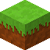 | **Blok trawy** | `grass` | **Kopanie:** 0,6 s (łopatą 0,2 s) **Daje:** Ziemia |
| 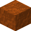 | **Ziemia** | `dirt` | **Kopanie:** 0,6 s (łopatą 0,2 s) **Skąd:** zniszczony blok: Blok trawy; zniszczony blok: Rozgrzebana ziemia; wyrasta z: Rozgrzebana ziemia **Przydaje się do:** Ziemia kamienista, Czarnoziem, Ściółka leśna |
| 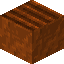 | **Rozgrzebana ziemia** | `tilled_dirt` | **Kopanie:** 0,6 s (łopatą 0,2 s) **Daje:** Ziemia **Rośnie:** w: Ziemia |
| 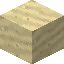 | **Piasek** | `sand` | **Kopanie:** 0,55 s (łopatą 0,18 s) **Przydaje się do:** Piaskowiec, Tynk wapienny |
|  | **Woda** | `water` | - |
| 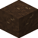 | **Czarnoziem** | `humus` | **Kopanie:** 0,6 s (łopatą 0,2 s) **Przepis:** Czarnoziem |
| 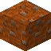 | **Ziemia kamienista** | `coarse_dirt` | **Kopanie:** 0,7 s (łopatą 0,23 s) **Przepis:** Ziemia kamienista x4 |
| 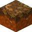 | **Ściółka leśna** | `forest_floor` | **Kopanie:** 0,6 s (łopatą 0,2 s) **Przepis:** Ściółka leśna |
| 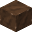 | **Błoto** | `mud` | **Kopanie:** 0,6 s (łopatą 0,2 s) |
| 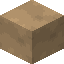 | **Glina** | `clay` | **Kopanie:** 0,6 s (łopatą 0,2 s) **Przydaje się do:** Tynk ochrowy, Terakota, Mokry kubek z gliny, Mokra cegła z gliny |
| 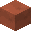 | **Czerwona glina** | `red_clay` | **Kopanie:** 0,6 s (łopatą 0,2 s) **Przydaje się do:** Mokry kubek z czerwonej gliny, Mokra cegła z czerwonej gliny |
| 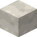 | **Biała glina** | `white_clay` | **Kopanie:** 0,6 s (łopatą 0,2 s) **Przydaje się do:** Mokry kubek z białej gliny, Mokra cegła z białej gliny |
| 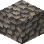 | **Żwir** | `gravel` | **Kopanie:** 0,7 s (łopatą 0,23 s) **Przydaje się do:** Ziemia kamienista |
| 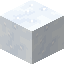 | **Śnieg** | `snow` | **Kopanie:** 0,4 s (łopatą 0,13 s) **Przepis:** Śnieg **Przydaje się do:** Warstwa śniegu |
|  | **Warstwa śniegu** | `snow_layer` | **Kopanie:** 0,4 s (łopatą 0,13 s) **Przepis:** Warstwa śniegu x4 **Przydaje się do:** Śnieg |
| 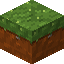 | **Mech** | `moss` | **Kopanie:** 0,6 s (łopatą 0,2 s) **Przepis:** Mech **Przydaje się do:** Kępki mchu |

## Skały

| | Nazwa | W komendach | Najważniejsze |
|---|---|---|---|
| 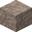 | **Kamień** | `stone` | **Kopanie:** 2,2 s (kilofem 0,73 s) **Przydaje się do:** Polerowany kamień, Siekiera, Kilof, Łopata, Nóż |
| 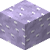 | **Lepidolit** | `lepidolite` | **Kopanie:** 2,5 s (kilofem 0,83 s) **Przydaje się do:** Lampa |
| 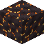 | **Meteoryt** | `meteorite` | **Kopanie:** 4,5 s (kilofem 1,5 s) **Świeci:** 7 / 15 |
| 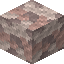 | **Granit** | `granite` | **Kopanie:** 2,8 s (kilofem 0,93 s) **Przydaje się do:** Siekiera, Kilof, Łopata, Nóż |
| 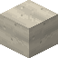 | **Wapień** | `limestone` | **Kopanie:** 1,8 s (kilofem 0,6 s) **Przydaje się do:** Tynk wapienny, Siekiera, Kilof, Łopata, Nóż |
| 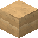 | **Piaskowiec** | `sandstone` | **Kopanie:** 1,8 s (kilofem 0,6 s) **Przepis:** Piaskowiec **Przydaje się do:** Siekiera, Kilof, Łopata, Nóż |
| 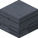 | **Łupek** | `slate` | **Kopanie:** 2,2 s (kilofem 0,73 s) **Przydaje się do:** Siekiera, Kilof, Łopata, Nóż |
| 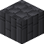 | **Bazalt** | `basalt` | **Kopanie:** 2,8 s (kilofem 0,93 s) **Przydaje się do:** Ciemne deski, Siekiera, Kilof, Łopata, Nóż |

## Drewno

| | Nazwa | W komendach | Najważniejsze |
|---|---|---|---|
| 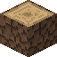 | **Pień świerka** | `spruce_log` | **Kopanie:** 2 s (siekierą 0,67 s) **Siekierą (PPM):** Okorowany pień świerka **Przydaje się do:** Opał — świerk, Deski świerkowe |
| 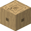 | **Okorowany pień świerka** | `spruce_log_stripped` | **Kopanie:** 2 s (siekierą 0,67 s) **Skąd:** siekierą (PPM) z bloku: Pień świerka **Przydaje się do:** Opał — świerk, Deski świerkowe |
| 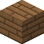 | **Deski świerkowe** | `spruce_planks` | **Kopanie:** 2 s (siekierą 0,67 s) **Przepis:** Deski świerkowe x4 **Przydaje się do:** Ciemne deski, Skrzynia świerkowa, Stół stolarski świerkowy, Tratwa, Patyk |
| 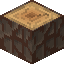 | **Pień sosny** | `pine_log` | **Kopanie:** 2 s (siekierą 0,67 s) **Siekierą (PPM):** Okorowany pień sosny **Skąd:** zniszczony blok: Pień sosny z żywicą **Przydaje się do:** Opał — sosna, Deski sosnowe |
| 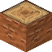 | **Pień sosny (górny)** | `pine_log_upper` | **Kopanie:** 2 s (siekierą 0,67 s) **Siekierą (PPM):** Okorowany pień sosny **Przydaje się do:** Opał — sosna, Deski sosnowe |
| 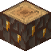 | **Pień sosny z żywicą** | `pine_log_resin` | **Kopanie:** 2 s (siekierą 0,67 s) **Daje:** Pień sosny **Zbiór (PPM):** Żywica 1-2 **Siekierą (PPM):** Okorowany pień sosny **Przydaje się do:** Opał — sosna, Deski sosnowe |
| 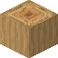 | **Okorowany pień sosny** | `pine_log_stripped` | **Kopanie:** 2 s (siekierą 0,67 s) **Skąd:** siekierą (PPM) z bloku: Pień sosny; siekierą (PPM) z bloku: Pień sosny (górny); siekierą (PPM) z bloku: Pień sosny z żywicą **Przydaje się do:** Opał — sosna, Deski sosnowe |
| 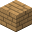 | **Deski sosnowe** | `pine_planks` | **Kopanie:** 2 s (siekierą 0,67 s) **Przepis:** Deski sosnowe x4 **Przydaje się do:** Ciemne deski, Skrzynia sosnowa, Stół stolarski sosnowy, Tratwa, Patyk |
| 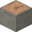 | **Pień buka** | `beech_log` | **Kopanie:** 2 s (siekierą 0,67 s) **Siekierą (PPM):** Okorowany pień buka **Przydaje się do:** Opał — buk, Deski bukowe |
| 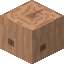 | **Okorowany pień buka** | `beech_log_stripped` | **Kopanie:** 2 s (siekierą 0,67 s) **Skąd:** siekierą (PPM) z bloku: Pień buka **Przydaje się do:** Opał — buk, Deski bukowe |
| 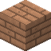 | **Deski bukowe** | `beech_planks` | **Kopanie:** 2 s (siekierą 0,67 s) **Przepis:** Deski bukowe x4 **Przydaje się do:** Ciemne deski, Skrzynia bukowa, Stół stolarski bukowy, Tratwa, Patyk |
| 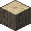 | **Pień lipy** | `linden_log` | **Kopanie:** 2 s (siekierą 0,67 s) **Siekierą (PPM):** Okorowany pień lipy **Przydaje się do:** Opał — lipa, Deski lipowe |
| 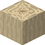 | **Okorowany pień lipy** | `linden_log_stripped` | **Kopanie:** 2 s (siekierą 0,67 s) **Skąd:** siekierą (PPM) z bloku: Pień lipy **Przydaje się do:** Opał — lipa, Deski lipowe |
| 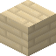 | **Deski lipowe** | `linden_planks` | **Kopanie:** 2 s (siekierą 0,67 s) **Przepis:** Deski lipowe x4 **Przydaje się do:** Ciemne deski, Skrzynia lipowa, Stół stolarski lipowy, Tratwa, Patyk |
| 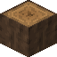 | **Pień dębu** | `oak_log` | **Kopanie:** 2 s (siekierą 0,67 s) **Siekierą (PPM):** Okorowany pień dębu **Przydaje się do:** Opał — dąb, Deski dębowe |
| 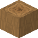 | **Okorowany pień dębu** | `oak_log_stripped` | **Kopanie:** 2 s (siekierą 0,67 s) **Skąd:** siekierą (PPM) z bloku: Pień dębu **Przydaje się do:** Opał — dąb, Deski dębowe |
| 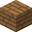 | **Deski dębowe** | `oak_planks` | **Kopanie:** 2 s (siekierą 0,67 s) **Przepis:** Deski dębowe x4 **Przydaje się do:** Ciemne deski, Skrzynia dębowa, Stół stolarski dębowy, Tratwa, Patyk |
| 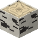 | **Pień brzozy** | `birch_log` | **Kopanie:** 2 s (siekierą 0,67 s) **Siekierą (PPM):** Okorowany pień brzozy + Kora brzozowa **Przydaje się do:** Opał — brzoza, Deski brzozowe |
| 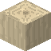 | **Okorowany pień brzozy** | `birch_log_stripped` | **Kopanie:** 2 s (siekierą 0,67 s) **Skąd:** siekierą (PPM) z bloku: Pień brzozy **Przydaje się do:** Opał — brzoza, Deski brzozowe |
| 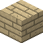 | **Deski brzozowe** | `birch_planks` | **Kopanie:** 2 s (siekierą 0,67 s) **Przepis:** Deski brzozowe x4 **Przydaje się do:** Ciemne deski, Skrzynia brzozowa, Stół stolarski brzozowy, Tratwa, Patyk |
| 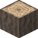 | **Pień jabłoni** | `jablon_log` | **Kopanie:** 2 s (siekierą 0,67 s) **Siekierą (PPM):** Okorowany pień jabłoni **Przydaje się do:** Opał — jabłoń, Deski jabłoniowe |
| 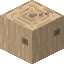 | **Okorowany pień jabłoni** | `jablon_log_stripped` | **Kopanie:** 2 s (siekierą 0,67 s) **Skąd:** siekierą (PPM) z bloku: Pień jabłoni **Przydaje się do:** Opał — jabłoń, Deski jabłoniowe |
| 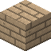 | **Deski jabłoniowe** | `jablon_planks` | **Kopanie:** 2 s (siekierą 0,67 s) **Przepis:** Deski jabłoniowe x4 **Przydaje się do:** Ciemne deski, Skrzynia jabłoniowa, Stół stolarski jabłoniowy, Tratwa, Patyk |
| 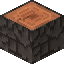 | **Pień olchy** | `olcha_log` | **Kopanie:** 2 s (siekierą 0,67 s) **Siekierą (PPM):** Okorowany pień olchy **Przydaje się do:** Opał — olcha, Deski olchowe |
| 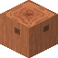 | **Okorowany pień olchy** | `olcha_log_stripped` | **Kopanie:** 2 s (siekierą 0,67 s) **Skąd:** siekierą (PPM) z bloku: Pień olchy **Przydaje się do:** Opał — olcha, Deski olchowe |
| 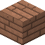 | **Deski olchowe** | `olcha_planks` | **Kopanie:** 2 s (siekierą 0,67 s) **Przepis:** Deski olchowe x4 **Przydaje się do:** Ciemne deski, Skrzynia olchowa, Stół stolarski olchowy, Tratwa, Patyk |
| 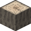 | **Pień wierzby** | `wierzba_log` | **Kopanie:** 2 s (siekierą 0,67 s) **Siekierą (PPM):** Okorowany pień wierzby **Przydaje się do:** Opał — wierzba, Deski wierzbowe |
| 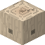 | **Okorowany pień wierzby** | `wierzba_log_stripped` | **Kopanie:** 2 s (siekierą 0,67 s) **Skąd:** siekierą (PPM) z bloku: Pień wierzby **Przydaje się do:** Opał — wierzba, Deski wierzbowe |
|  | **Deski wierzbowe** | `wierzba_planks` | **Kopanie:** 2 s (siekierą 0,67 s) **Przepis:** Deski wierzbowe x4 **Przydaje się do:** Ciemne deski, Skrzynia wierzbowa, Stół stolarski wierzbowy, Tratwa, Patyk |
|  | **Pień akacji** | `acacia_log` | **Kopanie:** 2 s (siekierą 0,67 s) **Siekierą (PPM):** Okorowany pień akacji **Przydaje się do:** Opał — akacja, Deski akacji |
|  | **Okorowany pień akacji** | `acacia_log_stripped` | **Kopanie:** 2 s (siekierą 0,67 s) **Skąd:** siekierą (PPM) z bloku: Pień akacji **Przydaje się do:** Opał — akacja, Deski akacji |
|  | **Deski akacji** | `acacia_planks` | **Kopanie:** 2 s (siekierą 0,67 s) **Przepis:** Deski akacji x4 **Przydaje się do:** Ciemne deski, Skrzynia z akacji, Stół stolarski z akacji, Tratwa, Patyk |
|  | **Pień cypryśnika** | `bald_cypress_log` | **Kopanie:** 2 s (siekierą 0,67 s) **Siekierą (PPM):** Okorowany pień cypryśnika **Przydaje się do:** Opał — cypryśnik, Deski cypryśnika |
|  | **Okorowany pień cypryśnika** | `bald_cypress_log_stripped` | **Kopanie:** 2 s (siekierą 0,67 s) **Skąd:** siekierą (PPM) z bloku: Pień cypryśnika **Przydaje się do:** Opał — cypryśnik, Deski cypryśnika |
|  | **Deski cypryśnika** | `bald_cypress_planks` | **Kopanie:** 2 s (siekierą 0,67 s) **Przepis:** Deski cypryśnika x4 **Przydaje się do:** Ciemne deski, Skrzynia z cypryśnika, Stół stolarski z cypryśnika, Tratwa, Patyk |
|  | **Pień wiśni** | `cherry_log` | **Kopanie:** 2 s (siekierą 0,67 s) **Siekierą (PPM):** Okorowany pień wiśni **Przydaje się do:** Opał — wiśnia, Deski wiśni |
|  | **Okorowany pień wiśni** | `cherry_log_stripped` | **Kopanie:** 2 s (siekierą 0,67 s) **Skąd:** siekierą (PPM) z bloku: Pień wiśni **Przydaje się do:** Opał — wiśnia, Deski wiśni |
|  | **Deski wiśni** | `cherry_planks` | **Kopanie:** 2 s (siekierą 0,67 s) **Przepis:** Deski wiśni x4 **Przydaje się do:** Ciemne deski, Skrzynia wiśniowa, Stół stolarski wiśniowy, Tratwa, Patyk |
|  | **Pień klonu** | `maple_log` | **Kopanie:** 2 s (siekierą 0,67 s) **Siekierą (PPM):** Okorowany pień klonu **Przydaje się do:** Opał — klon, Deski klonowe |
|  | **Okorowany pień klonu** | `maple_log_stripped` | **Kopanie:** 2 s (siekierą 0,67 s) **Skąd:** siekierą (PPM) z bloku: Pień klonu **Przydaje się do:** Opał — klon, Deski klonowe |
|  | **Deski klonowe** | `maple_planks` | **Kopanie:** 2 s (siekierą 0,67 s) **Przepis:** Deski klonowe x4 **Przydaje się do:** Ciemne deski, Skrzynia klonowa, Stół stolarski klonowy, Tratwa, Patyk |
|  | **Pień kosodrzewiny** | `mugo_log` | **Kopanie:** 2 s (siekierą 0,67 s) **Siekierą (PPM):** Okorowany pień kosodrzewiny **Przydaje się do:** Opał — kosodrzewina, Deski z kosodrzewiny |
|  | **Okorowany pień kosodrzewiny** | `mugo_log_stripped` | **Kopanie:** 2 s (siekierą 0,67 s) **Skąd:** siekierą (PPM) z bloku: Pień kosodrzewiny **Przydaje się do:** Opał — kosodrzewina, Deski z kosodrzewiny |
|  | **Deski z kosodrzewiny** | `mugo_planks` | **Kopanie:** 2 s (siekierą 0,67 s) **Przepis:** Deski z kosodrzewiny x4 **Przydaje się do:** Ciemne deski, Skrzynia z kosodrzewiny, Stół stolarski z kosodrzewiny, Tratwa, Patyk |
|  | **Pień oliwki** | `olive_log` | **Kopanie:** 2 s (siekierą 0,67 s) **Siekierą (PPM):** Okorowany pień oliwki **Przydaje się do:** Opał — oliwka, Deski oliwkowe |
|  | **Okorowany pień oliwki** | `olive_log_stripped` | **Kopanie:** 2 s (siekierą 0,67 s) **Skąd:** siekierą (PPM) z bloku: Pień oliwki **Przydaje się do:** Opał — oliwka, Deski oliwkowe |
|  | **Deski oliwkowe** | `olive_planks` | **Kopanie:** 2 s (siekierą 0,67 s) **Przepis:** Deski oliwkowe x4 **Przydaje się do:** Ciemne deski, Skrzynia oliwkowa, Stół stolarski oliwkowy, Tratwa, Patyk |
|  | **Pień eukaliptusa** | `rainbow_eucalyptus_log` | **Kopanie:** 2 s (siekierą 0,67 s) **Siekierą (PPM):** Okorowany pień eukaliptusa **Przydaje się do:** Opał — eukaliptus, Deski eukaliptusowe |
|  | **Okorowany pień eukaliptusa** | `rainbow_eucalyptus_log_stripped` | **Kopanie:** 2 s (siekierą 0,67 s) **Skąd:** siekierą (PPM) z bloku: Pień eukaliptusa **Przydaje się do:** Opał — eukaliptus, Deski eukaliptusowe |
|  | **Deski eukaliptusowe** | `rainbow_eucalyptus_planks` | **Kopanie:** 2 s (siekierą 0,67 s) **Przepis:** Deski eukaliptusowe x4 **Przydaje się do:** Ciemne deski, Skrzynia eukaliptusowa, Stół stolarski eukaliptusowy, Tratwa, Patyk |
|  | **Pień sekwoi** | `sequoia_log` | **Kopanie:** 2 s (siekierą 0,67 s) **Siekierą (PPM):** Okorowany pień sekwoi **Przydaje się do:** Opał — sekwoja, Deski sekwojowe |
|  | **Okorowany pień sekwoi** | `sequoia_log_stripped` | **Kopanie:** 2 s (siekierą 0,67 s) **Skąd:** siekierą (PPM) z bloku: Pień sekwoi **Przydaje się do:** Opał — sekwoja, Deski sekwojowe |
|  | **Deski sekwojowe** | `sequoia_planks` | **Kopanie:** 2 s (siekierą 0,67 s) **Przepis:** Deski sekwojowe x4 **Przydaje się do:** Ciemne deski, Skrzynia sekwojowa, Stół stolarski sekwojowy, Tratwa, Patyk |
|  | **Pień miłorzębu** | `ginkgo_log` | **Kopanie:** 2 s (siekierą 0,67 s) **Siekierą (PPM):** Okorowany pień miłorzębu **Przydaje się do:** Opał — miłorząb, Deski miłorzębowe |
|  | **Okorowany pień miłorzębu** | `ginkgo_log_stripped` | **Kopanie:** 2 s (siekierą 0,67 s) **Skąd:** siekierą (PPM) z bloku: Pień miłorzębu **Przydaje się do:** Opał — miłorząb, Deski miłorzębowe |
|  | **Deski miłorzębowe** | `ginkgo_planks` | **Kopanie:** 2 s (siekierą 0,67 s) **Przepis:** Deski miłorzębowe x4 **Przydaje się do:** Ciemne deski, Skrzynia miłorzębowa, Stół stolarski miłorzębowy, Tratwa, Patyk |
|  | **Pień jakarandy** | `jacaranda_log` | **Kopanie:** 2 s (siekierą 0,67 s) **Siekierą (PPM):** Okorowany pień jakarandy **Przydaje się do:** Opał — jakaranda, Deski jakarandowe |
|  | **Okorowany pień jakarandy** | `jacaranda_log_stripped` | **Kopanie:** 2 s (siekierą 0,67 s) **Skąd:** siekierą (PPM) z bloku: Pień jakarandy **Przydaje się do:** Opał — jakaranda, Deski jakarandowe |
|  | **Deski jakarandowe** | `jacaranda_planks` | **Kopanie:** 2 s (siekierą 0,67 s) **Przepis:** Deski jakarandowe x4 **Przydaje się do:** Ciemne deski, Skrzynia jakarandowa, Stół stolarski jakarandowy, Tratwa, Patyk |
|  | **Pień jodły** | `fir_log` | **Kopanie:** 2 s (siekierą 0,67 s) **Siekierą (PPM):** Okorowany pień jodły **Przydaje się do:** Opał — jodła, Deski jodłowe |
|  | **Okorowany pień jodły** | `fir_log_stripped` | **Kopanie:** 2 s (siekierą 0,67 s) **Skąd:** siekierą (PPM) z bloku: Pień jodły **Przydaje się do:** Opał — jodła, Deski jodłowe |
|  | **Deski jodłowe** | `fir_planks` | **Kopanie:** 2 s (siekierą 0,67 s) **Przepis:** Deski jodłowe x4 **Przydaje się do:** Ciemne deski, Skrzynia jodłowa, Stół stolarski jodłowy, Tratwa, Patyk |
|  | **Pień baobabu** | `baobab_log` | **Kopanie:** 2 s (siekierą 0,67 s) **Siekierą (PPM):** Okorowany pień baobabu **Przydaje się do:** Opał — baobab, Deski baobabowe |
|  | **Okorowany pień baobabu** | `baobab_log_stripped` | **Kopanie:** 2 s (siekierą 0,67 s) **Skąd:** siekierą (PPM) z bloku: Pień baobabu **Przydaje się do:** Opał — baobab, Deski baobabowe |
|  | **Deski baobabowe** | `baobab_planks` | **Kopanie:** 2 s (siekierą 0,67 s) **Przepis:** Deski baobabowe x4 **Przydaje się do:** Ciemne deski, Skrzynia baobabowa, Stół stolarski baobabowy, Tratwa, Patyk |
|  | **Pień palmy kokosowej** | `coconut_palm_log` | **Kopanie:** 2 s (siekierą 0,67 s) **Siekierą (PPM):** Okorowany pień palmy kokosowej **Przydaje się do:** Opał — palma kokosowa, Deski palmowe |
|  | **Okorowany pień palmy kokosowej** | `coconut_palm_log_stripped` | **Kopanie:** 2 s (siekierą 0,67 s) **Skąd:** siekierą (PPM) z bloku: Pień palmy kokosowej **Przydaje się do:** Opał — palma kokosowa, Deski palmowe |
|  | **Deski palmowe** | `coconut_palm_planks` | **Kopanie:** 2 s (siekierą 0,67 s) **Przepis:** Deski palmowe x4 **Przydaje się do:** Ciemne deski, Skrzynia palmowa, Stół stolarski palmowy, Tratwa, Patyk |
|  | **Pień modrzewia** | `larch_log` | **Kopanie:** 2 s (siekierą 0,67 s) **Siekierą (PPM):** Okorowany pień modrzewia **Przydaje się do:** Opał — modrzew, Deski modrzewiowe |
|  | **Okorowany pień modrzewia** | `larch_log_stripped` | **Kopanie:** 2 s (siekierą 0,67 s) **Skąd:** siekierą (PPM) z bloku: Pień modrzewia **Przydaje się do:** Opał — modrzew, Deski modrzewiowe |
|  | **Deski modrzewiowe** | `larch_planks` | **Kopanie:** 2 s (siekierą 0,67 s) **Przepis:** Deski modrzewiowe x4 **Przydaje się do:** Ciemne deski, Skrzynia modrzewiowa, Stół stolarski modrzewiowy, Tratwa, Patyk |
|  | **Pień namorzynu** | `mangrove_log` | **Kopanie:** 2 s (siekierą 0,67 s) **Siekierą (PPM):** Okorowany pień namorzynu **Przydaje się do:** Opał — namorzyn, Deski namorzynowe |
|  | **Okorowany pień namorzynu** | `mangrove_log_stripped` | **Kopanie:** 2 s (siekierą 0,67 s) **Skąd:** siekierą (PPM) z bloku: Pień namorzynu **Przydaje się do:** Opał — namorzyn, Deski namorzynowe |
|  | **Deski namorzynowe** | `mangrove_planks` | **Kopanie:** 2 s (siekierą 0,67 s) **Przepis:** Deski namorzynowe x4 **Przydaje się do:** Ciemne deski, Skrzynia namorzynowa, Stół stolarski namorzynowy, Tratwa, Patyk |
|  | **Pień puchowca** | `kapok_log` | **Kopanie:** 2 s (siekierą 0,67 s) **Siekierą (PPM):** Okorowany pień puchowca **Przydaje się do:** Opał — puchowiec, Deski z puchowca |
|  | **Okorowany pień puchowca** | `kapok_log_stripped` | **Kopanie:** 2 s (siekierą 0,67 s) **Skąd:** siekierą (PPM) z bloku: Pień puchowca **Przydaje się do:** Opał — puchowiec, Deski z puchowca |
|  | **Deski z puchowca** | `kapok_planks` | **Kopanie:** 2 s (siekierą 0,67 s) **Przepis:** Deski z puchowca x4 **Przydaje się do:** Ciemne deski, Skrzynia z puchowca, Stół stolarski z puchowca, Tratwa, Patyk |
|  | **Pień jukki** | `joshua_tree_log` | **Kopanie:** 2 s (siekierą 0,67 s) **Siekierą (PPM):** Okorowany pień jukki **Przydaje się do:** Opał — jukka, Deski z jukki |
|  | **Pień jukki (z suchymi liśćmi)** | `joshua_tree_log_shaggy` | **Kopanie:** 2 s (siekierą 0,67 s) **Siekierą (PPM):** Okorowany pień jukki **Przydaje się do:** Opał — jukka, Deski z jukki |
|  | **Okorowany pień jukki** | `joshua_tree_log_stripped` | **Kopanie:** 2 s (siekierą 0,67 s) **Skąd:** siekierą (PPM) z bloku: Pień jukki; siekierą (PPM) z bloku: Pień jukki (z suchymi liśćmi) **Przydaje się do:** Opał — jukka, Deski z jukki |
|  | **Deski z jukki** | `joshua_tree_planks` | **Kopanie:** 2 s (siekierą 0,67 s) **Przepis:** Deski z jukki x4 **Przydaje się do:** Ciemne deski, Skrzynia z jukki, Stół stolarski z jukki, Tratwa, Patyk |
|  | **Pień osiki** | `aspen_log` | **Kopanie:** 2 s (siekierą 0,67 s) **Siekierą (PPM):** Okorowany pień osiki **Przydaje się do:** Opał — osika, Deski osikowe |
|  | **Pień osiki (przy ziemi)** | `aspen_log_base` | **Kopanie:** 2 s (siekierą 0,67 s) **Siekierą (PPM):** Okorowany pień osiki **Przydaje się do:** Opał — osika, Deski osikowe |
|  | **Okorowany pień osiki** | `aspen_log_stripped` | **Kopanie:** 2 s (siekierą 0,67 s) **Skąd:** siekierą (PPM) z bloku: Pień osiki; siekierą (PPM) z bloku: Pień osiki (przy ziemi) **Przydaje się do:** Opał — osika, Deski osikowe |
|  | **Deski osikowe** | `aspen_planks` | **Kopanie:** 2 s (siekierą 0,67 s) **Przepis:** Deski osikowe x4 **Przydaje się do:** Ciemne deski, Skrzynia osikowa, Stół stolarski osikowy, Tratwa, Patyk |
|  | **Pień araukarii** | `araucaria_log` | **Kopanie:** 2 s (siekierą 0,67 s) **Siekierą (PPM):** Okorowany pień araukarii **Przydaje się do:** Opał — araukaria, Deski araukariowe |
|  | **Okorowany pień araukarii** | `araucaria_log_stripped` | **Kopanie:** 2 s (siekierą 0,67 s) **Skąd:** siekierą (PPM) z bloku: Pień araukarii **Przydaje się do:** Opał — araukaria, Deski araukariowe |
|  | **Deski araukariowe** | `araucaria_planks` | **Kopanie:** 2 s (siekierą 0,67 s) **Przepis:** Deski araukariowe x4 **Przydaje się do:** Ciemne deski, Skrzynia araukariowa, Stół stolarski araukariowy, Tratwa, Patyk |
|  | **Pień figowca** | `banyan_log` | **Kopanie:** 2 s (siekierą 0,67 s) **Siekierą (PPM):** Okorowany pień figowca **Przydaje się do:** Opał — figowiec, Deski figowcowe |
|  | **Okorowany pień figowca** | `banyan_log_stripped` | **Kopanie:** 2 s (siekierą 0,67 s) **Skąd:** siekierą (PPM) z bloku: Pień figowca **Przydaje się do:** Opał — figowiec, Deski figowcowe |
|  | **Deski figowcowe** | `banyan_planks` | **Kopanie:** 2 s (siekierą 0,67 s) **Przepis:** Deski figowcowe x4 **Przydaje się do:** Ciemne deski, Skrzynia figowcowa, Stół stolarski figowcowy, Tratwa, Patyk |
|  | **Pień draceny** | `dragon_tree_log` | **Kopanie:** 2 s (siekierą 0,67 s) **Siekierą (PPM):** Okorowany pień draceny **Przydaje się do:** Opał — dracena, Deski z draceny |
|  | **Okorowany pień draceny** | `dragon_tree_log_stripped` | **Kopanie:** 2 s (siekierą 0,67 s) **Skąd:** siekierą (PPM) z bloku: Pień draceny **Przydaje się do:** Opał — dracena, Deski z draceny |
|  | **Deski z draceny** | `dragon_tree_planks` | **Kopanie:** 2 s (siekierą 0,67 s) **Przepis:** Deski z draceny x4 **Przydaje się do:** Ciemne deski, Skrzynia z draceny, Stół stolarski z draceny, Tratwa, Patyk |
|  | **Pień cedru** | `cedar_log` | **Kopanie:** 2 s (siekierą 0,67 s) **Siekierą (PPM):** Okorowany pień cedru **Przydaje się do:** Opał — cedr, Deski cedrowe |
|  | **Okorowany pień cedru** | `cedar_log_stripped` | **Kopanie:** 2 s (siekierą 0,67 s) **Skąd:** siekierą (PPM) z bloku: Pień cedru **Przydaje się do:** Opał — cedr, Deski cedrowe |
|  | **Deski cedrowe** | `cedar_planks` | **Kopanie:** 2 s (siekierą 0,67 s) **Przepis:** Deski cedrowe x4 **Przydaje się do:** Ciemne deski, Skrzynia cedrowa, Stół stolarski cedrowy, Tratwa, Patyk |
|  | **Pień sosny ościstej** | `bristlecone_log` | **Kopanie:** 2 s (siekierą 0,67 s) **Siekierą (PPM):** Okorowany pień sosny ościstej **Przydaje się do:** Opał — sosna oścista, Deski z sosny ościstej |
|  | **Pień sosny ościstej (martwe drewno)** | `bristlecone_log_dead` | **Kopanie:** 2 s (siekierą 0,67 s) **Siekierą (PPM):** Okorowany pień sosny ościstej **Przydaje się do:** Opał — sosna oścista, Deski z sosny ościstej |
|  | **Okorowany pień sosny ościstej** | `bristlecone_log_stripped` | **Kopanie:** 2 s (siekierą 0,67 s) **Skąd:** siekierą (PPM) z bloku: Pień sosny ościstej; siekierą (PPM) z bloku: Pień sosny ościstej (martwe drewno) **Przydaje się do:** Opał — sosna oścista, Deski z sosny ościstej |
|  | **Deski z sosny ościstej** | `bristlecone_planks` | **Kopanie:** 2 s (siekierą 0,67 s) **Przepis:** Deski z sosny ościstej x4 **Przydaje się do:** Ciemne deski, Skrzynia z sosny ościstej, Stół stolarski z sosny ościstej, Tratwa, Patyk |

## Budulec

| | Nazwa | W komendach | Najważniejsze |
|---|---|---|---|
|  | **Schody świerkowe** | `spruce_stairs` | **Kopanie:** 1,2 s (siekierą 0,4 s) **Skąd:** zniszczony blok: Schody świerkowe; stół stolarski: Deski świerkowe (3 → 2 szt.) |
|  | **Półblok świerkowy** | `spruce_slab` | **Kopanie:** 1,2 s (siekierą 0,4 s) **Skąd:** zniszczony blok: Półblok świerkowy; stół stolarski: Deski świerkowe (1 → 2 szt.) |
|  | **Płot świerkowy** | `spruce_fence` | **Kopanie:** 1,2 s (siekierą 0,4 s) **Skąd:** stół stolarski: Deski świerkowe (3 → 2 szt.) |
|  | **Furtka świerkowa** | `spruce_fence_gate` | **Kopanie:** 1,2 s (siekierą 0,4 s) **Skąd:** zniszczony blok: Furtka świerkowa; stół stolarski: Deski świerkowe (4 → 1 szt.) |
|  | **Drzwi świerkowe** | `spruce_door` | **Kopanie:** 1,2 s (siekierą 0,4 s) **Skąd:** zniszczony blok: Drzwi świerkowe; podwójny warsztat: Deski świerkowe (6 → 3 szt.) |
|  | **Klapa świerkowa** | `spruce_trapdoor` | **Kopanie:** 1,2 s (siekierą 0,4 s) **Skąd:** zniszczony blok: Klapa świerkowa; podwójny warsztat: Deski świerkowe (3 → 1 szt.) |
|  | **Schody sosnowe** | `pine_stairs` | **Kopanie:** 1,2 s (siekierą 0,4 s) **Skąd:** zniszczony blok: Schody sosnowe; stół stolarski: Deski sosnowe (3 → 2 szt.) |
|  | **Półblok sosnowy** | `pine_slab` | **Kopanie:** 1,2 s (siekierą 0,4 s) **Skąd:** zniszczony blok: Półblok sosnowy; stół stolarski: Deski sosnowe (1 → 2 szt.) |
|  | **Płot sosnowy** | `pine_fence` | **Kopanie:** 1,2 s (siekierą 0,4 s) **Skąd:** stół stolarski: Deski sosnowe (3 → 2 szt.) |
|  | **Furtka sosnowa** | `pine_fence_gate` | **Kopanie:** 1,2 s (siekierą 0,4 s) **Skąd:** zniszczony blok: Furtka sosnowa; stół stolarski: Deski sosnowe (4 → 1 szt.) |
|  | **Drzwi sosnowe** | `pine_door` | **Kopanie:** 1,2 s (siekierą 0,4 s) **Skąd:** zniszczony blok: Drzwi sosnowe; podwójny warsztat: Deski sosnowe (6 → 3 szt.) |
|  | **Klapa sosnowa** | `pine_trapdoor` | **Kopanie:** 1,2 s (siekierą 0,4 s) **Skąd:** zniszczony blok: Klapa sosnowa; podwójny warsztat: Deski sosnowe (3 → 1 szt.) |
|  | **Schody bukowe** | `beech_stairs` | **Kopanie:** 1,2 s (siekierą 0,4 s) **Skąd:** zniszczony blok: Schody bukowe; stół stolarski: Deski bukowe (3 → 2 szt.) |
|  | **Półblok bukowy** | `beech_slab` | **Kopanie:** 1,2 s (siekierą 0,4 s) **Skąd:** zniszczony blok: Półblok bukowy; stół stolarski: Deski bukowe (1 → 2 szt.) |
|  | **Płot bukowy** | `beech_fence` | **Kopanie:** 1,2 s (siekierą 0,4 s) **Skąd:** stół stolarski: Deski bukowe (3 → 2 szt.) |
|  | **Furtka bukowa** | `beech_fence_gate` | **Kopanie:** 1,2 s (siekierą 0,4 s) **Skąd:** zniszczony blok: Furtka bukowa; stół stolarski: Deski bukowe (4 → 1 szt.) |
|  | **Drzwi bukowe** | `beech_door` | **Kopanie:** 1,2 s (siekierą 0,4 s) **Skąd:** zniszczony blok: Drzwi bukowe; podwójny warsztat: Deski bukowe (6 → 3 szt.) |
|  | **Klapa bukowa** | `beech_trapdoor` | **Kopanie:** 1,2 s (siekierą 0,4 s) **Skąd:** zniszczony blok: Klapa bukowa; podwójny warsztat: Deski bukowe (3 → 1 szt.) |
|  | **Schody lipowe** | `linden_stairs` | **Kopanie:** 1,2 s (siekierą 0,4 s) **Skąd:** zniszczony blok: Schody lipowe; stół stolarski: Deski lipowe (3 → 2 szt.) |
|  | **Półblok lipowy** | `linden_slab` | **Kopanie:** 1,2 s (siekierą 0,4 s) **Skąd:** zniszczony blok: Półblok lipowy; stół stolarski: Deski lipowe (1 → 2 szt.) |
|  | **Płot lipowy** | `linden_fence` | **Kopanie:** 1,2 s (siekierą 0,4 s) **Skąd:** stół stolarski: Deski lipowe (3 → 2 szt.) |
|  | **Furtka lipowa** | `linden_fence_gate` | **Kopanie:** 1,2 s (siekierą 0,4 s) **Skąd:** zniszczony blok: Furtka lipowa; stół stolarski: Deski lipowe (4 → 1 szt.) |
|  | **Drzwi lipowe** | `linden_door` | **Kopanie:** 1,2 s (siekierą 0,4 s) **Skąd:** zniszczony blok: Drzwi lipowe; podwójny warsztat: Deski lipowe (6 → 3 szt.) |
|  | **Klapa lipowa** | `linden_trapdoor` | **Kopanie:** 1,2 s (siekierą 0,4 s) **Skąd:** zniszczony blok: Klapa lipowa; podwójny warsztat: Deski lipowe (3 → 1 szt.) |
|  | **Schody dębowe** | `oak_stairs` | **Kopanie:** 1,2 s (siekierą 0,4 s) **Skąd:** zniszczony blok: Schody dębowe; stół stolarski: Deski dębowe (3 → 2 szt.) |
|  | **Półblok dębowy** | `oak_slab` | **Kopanie:** 1,2 s (siekierą 0,4 s) **Skąd:** zniszczony blok: Półblok dębowy; stół stolarski: Deski dębowe (1 → 2 szt.) |
|  | **Płot dębowy** | `oak_fence` | **Kopanie:** 1,2 s (siekierą 0,4 s) **Skąd:** stół stolarski: Deski dębowe (3 → 2 szt.) |
|  | **Furtka dębowa** | `oak_fence_gate` | **Kopanie:** 1,2 s (siekierą 0,4 s) **Skąd:** zniszczony blok: Furtka dębowa; stół stolarski: Deski dębowe (4 → 1 szt.) |
|  | **Drzwi dębowe** | `oak_door` | **Kopanie:** 1,2 s (siekierą 0,4 s) **Skąd:** zniszczony blok: Drzwi dębowe; podwójny warsztat: Deski dębowe (6 → 3 szt.) |
|  | **Klapa dębowa** | `oak_trapdoor` | **Kopanie:** 1,2 s (siekierą 0,4 s) **Skąd:** zniszczony blok: Klapa dębowa; podwójny warsztat: Deski dębowe (3 → 1 szt.) |
|  | **Schody brzozowe** | `birch_stairs` | **Kopanie:** 1,2 s (siekierą 0,4 s) **Skąd:** zniszczony blok: Schody brzozowe; stół stolarski: Deski brzozowe (3 → 2 szt.) |
|  | **Półblok brzozowy** | `birch_slab` | **Kopanie:** 1,2 s (siekierą 0,4 s) **Skąd:** zniszczony blok: Półblok brzozowy; stół stolarski: Deski brzozowe (1 → 2 szt.) |
|  | **Płot brzozowy** | `birch_fence` | **Kopanie:** 1,2 s (siekierą 0,4 s) **Skąd:** stół stolarski: Deski brzozowe (3 → 2 szt.) |
|  | **Furtka brzozowa** | `birch_fence_gate` | **Kopanie:** 1,2 s (siekierą 0,4 s) **Skąd:** zniszczony blok: Furtka brzozowa; stół stolarski: Deski brzozowe (4 → 1 szt.) |
|  | **Drzwi brzozowe** | `birch_door` | **Kopanie:** 1,2 s (siekierą 0,4 s) **Skąd:** zniszczony blok: Drzwi brzozowe; podwójny warsztat: Deski brzozowe (6 → 3 szt.) |
|  | **Klapa brzozowa** | `birch_trapdoor` | **Kopanie:** 1,2 s (siekierą 0,4 s) **Skąd:** zniszczony blok: Klapa brzozowa; podwójny warsztat: Deski brzozowe (3 → 1 szt.) |
|  | **Schody z ciemnego drewna** | `dark_stairs` | **Kopanie:** 1,2 s (siekierą 0,4 s) **Skąd:** zniszczony blok: Schody z ciemnego drewna; stół stolarski: Ciemne deski (3 → 2 szt.) |
|  | **Półblok z ciemnego drewna** | `dark_slab` | **Kopanie:** 1,2 s (siekierą 0,4 s) **Skąd:** zniszczony blok: Półblok z ciemnego drewna; stół stolarski: Ciemne deski (1 → 2 szt.) |
|  | **Płot z ciemnego drewna** | `dark_fence` | **Kopanie:** 1,2 s (siekierą 0,4 s) **Skąd:** stół stolarski: Ciemne deski (3 → 2 szt.) |
|  | **Furtka z ciemnego drewna** | `dark_fence_gate` | **Kopanie:** 1,2 s (siekierą 0,4 s) **Skąd:** zniszczony blok: Furtka z ciemnego drewna; stół stolarski: Ciemne deski (4 → 1 szt.) |
|  | **Drzwi z ciemnego drewna** | `dark_door` | **Kopanie:** 1,2 s (siekierą 0,4 s) **Skąd:** zniszczony blok: Drzwi z ciemnego drewna; podwójny warsztat: Ciemne deski (6 → 3 szt.) |
|  | **Klapa z ciemnego drewna** | `dark_trapdoor` | **Kopanie:** 1,2 s (siekierą 0,4 s) **Skąd:** zniszczony blok: Klapa z ciemnego drewna; podwójny warsztat: Ciemne deski (3 → 1 szt.) |
|  | **Schody jabłoniowe** | `jablon_stairs` | **Kopanie:** 1,2 s (siekierą 0,4 s) **Skąd:** zniszczony blok: Schody jabłoniowe; stół stolarski: Deski jabłoniowe (3 → 2 szt.) |
|  | **Półblok jabłoniowy** | `jablon_slab` | **Kopanie:** 1,2 s (siekierą 0,4 s) **Skąd:** zniszczony blok: Półblok jabłoniowy; stół stolarski: Deski jabłoniowe (1 → 2 szt.) |
|  | **Płot jabłoniowy** | `jablon_fence` | **Kopanie:** 1,2 s (siekierą 0,4 s) **Skąd:** stół stolarski: Deski jabłoniowe (3 → 2 szt.) |
|  | **Furtka jabłoniowa** | `jablon_fence_gate` | **Kopanie:** 1,2 s (siekierą 0,4 s) **Skąd:** zniszczony blok: Furtka jabłoniowa; stół stolarski: Deski jabłoniowe (4 → 1 szt.) |
|  | **Drzwi jabłoniowe** | `jablon_door` | **Kopanie:** 1,2 s (siekierą 0,4 s) **Skąd:** zniszczony blok: Drzwi jabłoniowe; podwójny warsztat: Deski jabłoniowe (6 → 3 szt.) |
|  | **Klapa jabłoniowa** | `jablon_trapdoor` | **Kopanie:** 1,2 s (siekierą 0,4 s) **Skąd:** zniszczony blok: Klapa jabłoniowa; podwójny warsztat: Deski jabłoniowe (3 → 1 szt.) |
|  | **Schody olchowe** | `olcha_stairs` | **Kopanie:** 1,2 s (siekierą 0,4 s) **Skąd:** zniszczony blok: Schody olchowe; stół stolarski: Deski olchowe (3 → 2 szt.) |
|  | **Półblok olchowy** | `olcha_slab` | **Kopanie:** 1,2 s (siekierą 0,4 s) **Skąd:** zniszczony blok: Półblok olchowy; stół stolarski: Deski olchowe (1 → 2 szt.) |
|  | **Płot olchowy** | `olcha_fence` | **Kopanie:** 1,2 s (siekierą 0,4 s) **Skąd:** stół stolarski: Deski olchowe (3 → 2 szt.) |
|  | **Furtka olchowa** | `olcha_fence_gate` | **Kopanie:** 1,2 s (siekierą 0,4 s) **Skąd:** zniszczony blok: Furtka olchowa; stół stolarski: Deski olchowe (4 → 1 szt.) |
|  | **Drzwi olchowe** | `olcha_door` | **Kopanie:** 1,2 s (siekierą 0,4 s) **Skąd:** zniszczony blok: Drzwi olchowe; podwójny warsztat: Deski olchowe (6 → 3 szt.) |
|  | **Klapa olchowa** | `olcha_trapdoor` | **Kopanie:** 1,2 s (siekierą 0,4 s) **Skąd:** zniszczony blok: Klapa olchowa; podwójny warsztat: Deski olchowe (3 → 1 szt.) |
|  | **Schody wierzbowe** | `wierzba_stairs` | **Kopanie:** 1,2 s (siekierą 0,4 s) **Skąd:** zniszczony blok: Schody wierzbowe; stół stolarski: Deski wierzbowe (3 → 2 szt.) |
|  | **Półblok wierzbowy** | `wierzba_slab` | **Kopanie:** 1,2 s (siekierą 0,4 s) **Skąd:** zniszczony blok: Półblok wierzbowy; stół stolarski: Deski wierzbowe (1 → 2 szt.) |
|  | **Płot wierzbowy** | `wierzba_fence` | **Kopanie:** 1,2 s (siekierą 0,4 s) **Skąd:** stół stolarski: Deski wierzbowe (3 → 2 szt.) |
|  | **Furtka wierzbowa** | `wierzba_fence_gate` | **Kopanie:** 1,2 s (siekierą 0,4 s) **Skąd:** zniszczony blok: Furtka wierzbowa; stół stolarski: Deski wierzbowe (4 → 1 szt.) |
|  | **Drzwi wierzbowe** | `wierzba_door` | **Kopanie:** 1,2 s (siekierą 0,4 s) **Skąd:** zniszczony blok: Drzwi wierzbowe; podwójny warsztat: Deski wierzbowe (6 → 3 szt.) |
|  | **Klapa wierzbowa** | `wierzba_trapdoor` | **Kopanie:** 1,2 s (siekierą 0,4 s) **Skąd:** zniszczony blok: Klapa wierzbowa; podwójny warsztat: Deski wierzbowe (3 → 1 szt.) |
|  | **Schody z akacji** | `acacia_stairs` | **Kopanie:** 1,2 s (siekierą 0,4 s) **Skąd:** zniszczony blok: Schody z akacji; stół stolarski: Deski akacji (3 → 2 szt.) |
|  | **Półblok z akacji** | `acacia_slab` | **Kopanie:** 1,2 s (siekierą 0,4 s) **Skąd:** zniszczony blok: Półblok z akacji; stół stolarski: Deski akacji (1 → 2 szt.) |
|  | **Płot z akacji** | `acacia_fence` | **Kopanie:** 1,2 s (siekierą 0,4 s) **Skąd:** stół stolarski: Deski akacji (3 → 2 szt.) |
|  | **Furtka z akacji** | `acacia_fence_gate` | **Kopanie:** 1,2 s (siekierą 0,4 s) **Skąd:** zniszczony blok: Furtka z akacji; stół stolarski: Deski akacji (4 → 1 szt.) |
|  | **Drzwi z akacji** | `acacia_door` | **Kopanie:** 1,2 s (siekierą 0,4 s) **Skąd:** zniszczony blok: Drzwi z akacji; podwójny warsztat: Deski akacji (6 → 3 szt.) |
|  | **Klapa z akacji** | `acacia_trapdoor` | **Kopanie:** 1,2 s (siekierą 0,4 s) **Skąd:** zniszczony blok: Klapa z akacji; podwójny warsztat: Deski akacji (3 → 1 szt.) |
|  | **Schody z cypryśnika** | `bald_cypress_stairs` | **Kopanie:** 1,2 s (siekierą 0,4 s) **Skąd:** zniszczony blok: Schody z cypryśnika; stół stolarski: Deski cypryśnika (3 → 2 szt.) |
|  | **Półblok z cypryśnika** | `bald_cypress_slab` | **Kopanie:** 1,2 s (siekierą 0,4 s) **Skąd:** zniszczony blok: Półblok z cypryśnika; stół stolarski: Deski cypryśnika (1 → 2 szt.) |
|  | **Płot z cypryśnika** | `bald_cypress_fence` | **Kopanie:** 1,2 s (siekierą 0,4 s) **Skąd:** stół stolarski: Deski cypryśnika (3 → 2 szt.) |
|  | **Furtka z cypryśnika** | `bald_cypress_fence_gate` | **Kopanie:** 1,2 s (siekierą 0,4 s) **Skąd:** zniszczony blok: Furtka z cypryśnika; stół stolarski: Deski cypryśnika (4 → 1 szt.) |
|  | **Drzwi z cypryśnika** | `bald_cypress_door` | **Kopanie:** 1,2 s (siekierą 0,4 s) **Skąd:** zniszczony blok: Drzwi z cypryśnika; podwójny warsztat: Deski cypryśnika (6 → 3 szt.) |
|  | **Klapa z cypryśnika** | `bald_cypress_trapdoor` | **Kopanie:** 1,2 s (siekierą 0,4 s) **Skąd:** zniszczony blok: Klapa z cypryśnika; podwójny warsztat: Deski cypryśnika (3 → 1 szt.) |
|  | **Schody wiśniowe** | `cherry_stairs` | **Kopanie:** 1,2 s (siekierą 0,4 s) **Skąd:** zniszczony blok: Schody wiśniowe; stół stolarski: Deski wiśni (3 → 2 szt.) |
|  | **Półblok wiśniowy** | `cherry_slab` | **Kopanie:** 1,2 s (siekierą 0,4 s) **Skąd:** zniszczony blok: Półblok wiśniowy; stół stolarski: Deski wiśni (1 → 2 szt.) |
|  | **Płot wiśniowy** | `cherry_fence` | **Kopanie:** 1,2 s (siekierą 0,4 s) **Skąd:** stół stolarski: Deski wiśni (3 → 2 szt.) |
|  | **Furtka wiśniowa** | `cherry_fence_gate` | **Kopanie:** 1,2 s (siekierą 0,4 s) **Skąd:** zniszczony blok: Furtka wiśniowa; stół stolarski: Deski wiśni (4 → 1 szt.) |
|  | **Drzwi wiśniowe** | `cherry_door` | **Kopanie:** 1,2 s (siekierą 0,4 s) **Skąd:** zniszczony blok: Drzwi wiśniowe; podwójny warsztat: Deski wiśni (6 → 3 szt.) |
|  | **Klapa wiśniowa** | `cherry_trapdoor` | **Kopanie:** 1,2 s (siekierą 0,4 s) **Skąd:** zniszczony blok: Klapa wiśniowa; podwójny warsztat: Deski wiśni (3 → 1 szt.) |
|  | **Schody klonowe** | `maple_stairs` | **Kopanie:** 1,2 s (siekierą 0,4 s) **Skąd:** zniszczony blok: Schody klonowe; stół stolarski: Deski klonowe (3 → 2 szt.) |
|  | **Półblok klonowy** | `maple_slab` | **Kopanie:** 1,2 s (siekierą 0,4 s) **Skąd:** zniszczony blok: Półblok klonowy; stół stolarski: Deski klonowe (1 → 2 szt.) |
|  | **Płot klonowy** | `maple_fence` | **Kopanie:** 1,2 s (siekierą 0,4 s) **Skąd:** stół stolarski: Deski klonowe (3 → 2 szt.) |
|  | **Furtka klonowa** | `maple_fence_gate` | **Kopanie:** 1,2 s (siekierą 0,4 s) **Skąd:** zniszczony blok: Furtka klonowa; stół stolarski: Deski klonowe (4 → 1 szt.) |
|  | **Drzwi klonowe** | `maple_door` | **Kopanie:** 1,2 s (siekierą 0,4 s) **Skąd:** zniszczony blok: Drzwi klonowe; podwójny warsztat: Deski klonowe (6 → 3 szt.) |
|  | **Klapa klonowa** | `maple_trapdoor` | **Kopanie:** 1,2 s (siekierą 0,4 s) **Skąd:** zniszczony blok: Klapa klonowa; podwójny warsztat: Deski klonowe (3 → 1 szt.) |
|  | **Schody z kosodrzewiny** | `mugo_stairs` | **Kopanie:** 1,2 s (siekierą 0,4 s) **Skąd:** zniszczony blok: Schody z kosodrzewiny; stół stolarski: Deski z kosodrzewiny (3 → 2 szt.) |
|  | **Półblok z kosodrzewiny** | `mugo_slab` | **Kopanie:** 1,2 s (siekierą 0,4 s) **Skąd:** zniszczony blok: Półblok z kosodrzewiny; stół stolarski: Deski z kosodrzewiny (1 → 2 szt.) |
|  | **Płot z kosodrzewiny** | `mugo_fence` | **Kopanie:** 1,2 s (siekierą 0,4 s) **Skąd:** stół stolarski: Deski z kosodrzewiny (3 → 2 szt.) |
|  | **Furtka z kosodrzewiny** | `mugo_fence_gate` | **Kopanie:** 1,2 s (siekierą 0,4 s) **Skąd:** zniszczony blok: Furtka z kosodrzewiny; stół stolarski: Deski z kosodrzewiny (4 → 1 szt.) |
|  | **Drzwi z kosodrzewiny** | `mugo_door` | **Kopanie:** 1,2 s (siekierą 0,4 s) **Skąd:** zniszczony blok: Drzwi z kosodrzewiny; podwójny warsztat: Deski z kosodrzewiny (6 → 3 szt.) |
|  | **Klapa z kosodrzewiny** | `mugo_trapdoor` | **Kopanie:** 1,2 s (siekierą 0,4 s) **Skąd:** zniszczony blok: Klapa z kosodrzewiny; podwójny warsztat: Deski z kosodrzewiny (3 → 1 szt.) |
|  | **Schody oliwkowe** | `olive_stairs` | **Kopanie:** 1,2 s (siekierą 0,4 s) **Skąd:** zniszczony blok: Schody oliwkowe; stół stolarski: Deski oliwkowe (3 → 2 szt.) |
|  | **Półblok oliwkowy** | `olive_slab` | **Kopanie:** 1,2 s (siekierą 0,4 s) **Skąd:** zniszczony blok: Półblok oliwkowy; stół stolarski: Deski oliwkowe (1 → 2 szt.) |
|  | **Płot oliwkowy** | `olive_fence` | **Kopanie:** 1,2 s (siekierą 0,4 s) **Skąd:** stół stolarski: Deski oliwkowe (3 → 2 szt.) |
|  | **Furtka oliwkowa** | `olive_fence_gate` | **Kopanie:** 1,2 s (siekierą 0,4 s) **Skąd:** zniszczony blok: Furtka oliwkowa; stół stolarski: Deski oliwkowe (4 → 1 szt.) |
|  | **Drzwi oliwkowe** | `olive_door` | **Kopanie:** 1,2 s (siekierą 0,4 s) **Skąd:** zniszczony blok: Drzwi oliwkowe; podwójny warsztat: Deski oliwkowe (6 → 3 szt.) |
|  | **Klapa oliwkowa** | `olive_trapdoor` | **Kopanie:** 1,2 s (siekierą 0,4 s) **Skąd:** zniszczony blok: Klapa oliwkowa; podwójny warsztat: Deski oliwkowe (3 → 1 szt.) |
|  | **Schody eukaliptusowe** | `rainbow_eucalyptus_stairs` | **Kopanie:** 1,2 s (siekierą 0,4 s) **Skąd:** zniszczony blok: Schody eukaliptusowe; stół stolarski: Deski eukaliptusowe (3 → 2 szt.) |
|  | **Półblok eukaliptusowy** | `rainbow_eucalyptus_slab` | **Kopanie:** 1,2 s (siekierą 0,4 s) **Skąd:** zniszczony blok: Półblok eukaliptusowy; stół stolarski: Deski eukaliptusowe (1 → 2 szt.) |
|  | **Płot eukaliptusowy** | `rainbow_eucalyptus_fence` | **Kopanie:** 1,2 s (siekierą 0,4 s) **Skąd:** stół stolarski: Deski eukaliptusowe (3 → 2 szt.) |
|  | **Furtka eukaliptusowa** | `rainbow_eucalyptus_fence_gate` | **Kopanie:** 1,2 s (siekierą 0,4 s) **Skąd:** zniszczony blok: Furtka eukaliptusowa; stół stolarski: Deski eukaliptusowe (4 → 1 szt.) |
|  | **Drzwi eukaliptusowe** | `rainbow_eucalyptus_door` | **Kopanie:** 1,2 s (siekierą 0,4 s) **Skąd:** zniszczony blok: Drzwi eukaliptusowe; podwójny warsztat: Deski eukaliptusowe (6 → 3 szt.) |
|  | **Klapa eukaliptusowa** | `rainbow_eucalyptus_trapdoor` | **Kopanie:** 1,2 s (siekierą 0,4 s) **Skąd:** zniszczony blok: Klapa eukaliptusowa; podwójny warsztat: Deski eukaliptusowe (3 → 1 szt.) |
|  | **Schody sekwojowe** | `sequoia_stairs` | **Kopanie:** 1,2 s (siekierą 0,4 s) **Skąd:** zniszczony blok: Schody sekwojowe; stół stolarski: Deski sekwojowe (3 → 2 szt.) |
|  | **Półblok sekwojowy** | `sequoia_slab` | **Kopanie:** 1,2 s (siekierą 0,4 s) **Skąd:** zniszczony blok: Półblok sekwojowy; stół stolarski: Deski sekwojowe (1 → 2 szt.) |
|  | **Płot sekwojowy** | `sequoia_fence` | **Kopanie:** 1,2 s (siekierą 0,4 s) **Skąd:** stół stolarski: Deski sekwojowe (3 → 2 szt.) |
|  | **Furtka sekwojowa** | `sequoia_fence_gate` | **Kopanie:** 1,2 s (siekierą 0,4 s) **Skąd:** zniszczony blok: Furtka sekwojowa; stół stolarski: Deski sekwojowe (4 → 1 szt.) |
|  | **Drzwi sekwojowe** | `sequoia_door` | **Kopanie:** 1,2 s (siekierą 0,4 s) **Skąd:** zniszczony blok: Drzwi sekwojowe; podwójny warsztat: Deski sekwojowe (6 → 3 szt.) |
|  | **Klapa sekwojowa** | `sequoia_trapdoor` | **Kopanie:** 1,2 s (siekierą 0,4 s) **Skąd:** zniszczony blok: Klapa sekwojowa; podwójny warsztat: Deski sekwojowe (3 → 1 szt.) |
|  | **Schody miłorzębowe** | `ginkgo_stairs` | **Kopanie:** 1,2 s (siekierą 0,4 s) **Skąd:** zniszczony blok: Schody miłorzębowe; stół stolarski: Deski miłorzębowe (3 → 2 szt.) |
|  | **Półblok miłorzębowy** | `ginkgo_slab` | **Kopanie:** 1,2 s (siekierą 0,4 s) **Skąd:** zniszczony blok: Półblok miłorzębowy; stół stolarski: Deski miłorzębowe (1 → 2 szt.) |
|  | **Płot miłorzębowy** | `ginkgo_fence` | **Kopanie:** 1,2 s (siekierą 0,4 s) **Skąd:** stół stolarski: Deski miłorzębowe (3 → 2 szt.) |
|  | **Furtka miłorzębowa** | `ginkgo_fence_gate` | **Kopanie:** 1,2 s (siekierą 0,4 s) **Skąd:** zniszczony blok: Furtka miłorzębowa; stół stolarski: Deski miłorzębowe (4 → 1 szt.) |
|  | **Drzwi miłorzębowe** | `ginkgo_door` | **Kopanie:** 1,2 s (siekierą 0,4 s) **Skąd:** zniszczony blok: Drzwi miłorzębowe; podwójny warsztat: Deski miłorzębowe (6 → 3 szt.) |
|  | **Klapa miłorzębowa** | `ginkgo_trapdoor` | **Kopanie:** 1,2 s (siekierą 0,4 s) **Skąd:** zniszczony blok: Klapa miłorzębowa; podwójny warsztat: Deski miłorzębowe (3 → 1 szt.) |
|  | **Schody jakarandowe** | `jacaranda_stairs` | **Kopanie:** 1,2 s (siekierą 0,4 s) **Skąd:** zniszczony blok: Schody jakarandowe; stół stolarski: Deski jakarandowe (3 → 2 szt.) |
|  | **Półblok jakarandowy** | `jacaranda_slab` | **Kopanie:** 1,2 s (siekierą 0,4 s) **Skąd:** zniszczony blok: Półblok jakarandowy; stół stolarski: Deski jakarandowe (1 → 2 szt.) |
|  | **Płot jakarandowy** | `jacaranda_fence` | **Kopanie:** 1,2 s (siekierą 0,4 s) **Skąd:** stół stolarski: Deski jakarandowe (3 → 2 szt.) |
|  | **Furtka jakarandowa** | `jacaranda_fence_gate` | **Kopanie:** 1,2 s (siekierą 0,4 s) **Skąd:** zniszczony blok: Furtka jakarandowa; stół stolarski: Deski jakarandowe (4 → 1 szt.) |
|  | **Drzwi jakarandowe** | `jacaranda_door` | **Kopanie:** 1,2 s (siekierą 0,4 s) **Skąd:** zniszczony blok: Drzwi jakarandowe; podwójny warsztat: Deski jakarandowe (6 → 3 szt.) |
|  | **Klapa jakarandowa** | `jacaranda_trapdoor` | **Kopanie:** 1,2 s (siekierą 0,4 s) **Skąd:** zniszczony blok: Klapa jakarandowa; podwójny warsztat: Deski jakarandowe (3 → 1 szt.) |
|  | **Schody jodłowe** | `fir_stairs` | **Kopanie:** 1,2 s (siekierą 0,4 s) **Skąd:** zniszczony blok: Schody jodłowe; stół stolarski: Deski jodłowe (3 → 2 szt.) |
|  | **Półblok jodłowy** | `fir_slab` | **Kopanie:** 1,2 s (siekierą 0,4 s) **Skąd:** zniszczony blok: Półblok jodłowy; stół stolarski: Deski jodłowe (1 → 2 szt.) |
|  | **Płot jodłowy** | `fir_fence` | **Kopanie:** 1,2 s (siekierą 0,4 s) **Skąd:** stół stolarski: Deski jodłowe (3 → 2 szt.) |
|  | **Furtka jodłowa** | `fir_fence_gate` | **Kopanie:** 1,2 s (siekierą 0,4 s) **Skąd:** zniszczony blok: Furtka jodłowa; stół stolarski: Deski jodłowe (4 → 1 szt.) |
|  | **Drzwi jodłowe** | `fir_door` | **Kopanie:** 1,2 s (siekierą 0,4 s) **Skąd:** zniszczony blok: Drzwi jodłowe; podwójny warsztat: Deski jodłowe (6 → 3 szt.) |
|  | **Klapa jodłowa** | `fir_trapdoor` | **Kopanie:** 1,2 s (siekierą 0,4 s) **Skąd:** zniszczony blok: Klapa jodłowa; podwójny warsztat: Deski jodłowe (3 → 1 szt.) |
|  | **Schody baobabowe** | `baobab_stairs` | **Kopanie:** 1,2 s (siekierą 0,4 s) **Skąd:** zniszczony blok: Schody baobabowe; stół stolarski: Deski baobabowe (3 → 2 szt.) |
|  | **Półblok baobabowy** | `baobab_slab` | **Kopanie:** 1,2 s (siekierą 0,4 s) **Skąd:** zniszczony blok: Półblok baobabowy; stół stolarski: Deski baobabowe (1 → 2 szt.) |
|  | **Płot baobabowy** | `baobab_fence` | **Kopanie:** 1,2 s (siekierą 0,4 s) **Skąd:** stół stolarski: Deski baobabowe (3 → 2 szt.) |
|  | **Furtka baobabowa** | `baobab_fence_gate` | **Kopanie:** 1,2 s (siekierą 0,4 s) **Skąd:** zniszczony blok: Furtka baobabowa; stół stolarski: Deski baobabowe (4 → 1 szt.) |
|  | **Drzwi baobabowe** | `baobab_door` | **Kopanie:** 1,2 s (siekierą 0,4 s) **Skąd:** zniszczony blok: Drzwi baobabowe; podwójny warsztat: Deski baobabowe (6 → 3 szt.) |
|  | **Klapa baobabowa** | `baobab_trapdoor` | **Kopanie:** 1,2 s (siekierą 0,4 s) **Skąd:** zniszczony blok: Klapa baobabowa; podwójny warsztat: Deski baobabowe (3 → 1 szt.) |
|  | **Schody palmowe** | `coconut_palm_stairs` | **Kopanie:** 1,2 s (siekierą 0,4 s) **Skąd:** zniszczony blok: Schody palmowe; stół stolarski: Deski palmowe (3 → 2 szt.) |
|  | **Półblok palmowy** | `coconut_palm_slab` | **Kopanie:** 1,2 s (siekierą 0,4 s) **Skąd:** zniszczony blok: Półblok palmowy; stół stolarski: Deski palmowe (1 → 2 szt.) |
|  | **Płot palmowy** | `coconut_palm_fence` | **Kopanie:** 1,2 s (siekierą 0,4 s) **Skąd:** stół stolarski: Deski palmowe (3 → 2 szt.) |
|  | **Furtka palmowa** | `coconut_palm_fence_gate` | **Kopanie:** 1,2 s (siekierą 0,4 s) **Skąd:** zniszczony blok: Furtka palmowa; stół stolarski: Deski palmowe (4 → 1 szt.) |
|  | **Drzwi palmowe** | `coconut_palm_door` | **Kopanie:** 1,2 s (siekierą 0,4 s) **Skąd:** zniszczony blok: Drzwi palmowe; podwójny warsztat: Deski palmowe (6 → 3 szt.) |
|  | **Klapa palmowa** | `coconut_palm_trapdoor` | **Kopanie:** 1,2 s (siekierą 0,4 s) **Skąd:** zniszczony blok: Klapa palmowa; podwójny warsztat: Deski palmowe (3 → 1 szt.) |
|  | **Schody modrzewiowe** | `larch_stairs` | **Kopanie:** 1,2 s (siekierą 0,4 s) **Skąd:** zniszczony blok: Schody modrzewiowe; stół stolarski: Deski modrzewiowe (3 → 2 szt.) |
|  | **Półblok modrzewiowy** | `larch_slab` | **Kopanie:** 1,2 s (siekierą 0,4 s) **Skąd:** zniszczony blok: Półblok modrzewiowy; stół stolarski: Deski modrzewiowe (1 → 2 szt.) |
|  | **Płot modrzewiowy** | `larch_fence` | **Kopanie:** 1,2 s (siekierą 0,4 s) **Skąd:** stół stolarski: Deski modrzewiowe (3 → 2 szt.) |
|  | **Furtka modrzewiowa** | `larch_fence_gate` | **Kopanie:** 1,2 s (siekierą 0,4 s) **Skąd:** zniszczony blok: Furtka modrzewiowa; stół stolarski: Deski modrzewiowe (4 → 1 szt.) |
|  | **Drzwi modrzewiowe** | `larch_door` | **Kopanie:** 1,2 s (siekierą 0,4 s) **Skąd:** zniszczony blok: Drzwi modrzewiowe; podwójny warsztat: Deski modrzewiowe (6 → 3 szt.) |
|  | **Klapa modrzewiowa** | `larch_trapdoor` | **Kopanie:** 1,2 s (siekierą 0,4 s) **Skąd:** zniszczony blok: Klapa modrzewiowa; podwójny warsztat: Deski modrzewiowe (3 → 1 szt.) |
|  | **Schody namorzynowe** | `mangrove_stairs` | **Kopanie:** 1,2 s (siekierą 0,4 s) **Skąd:** zniszczony blok: Schody namorzynowe; stół stolarski: Deski namorzynowe (3 → 2 szt.) |
|  | **Półblok namorzynowy** | `mangrove_slab` | **Kopanie:** 1,2 s (siekierą 0,4 s) **Skąd:** zniszczony blok: Półblok namorzynowy; stół stolarski: Deski namorzynowe (1 → 2 szt.) |
|  | **Płot namorzynowy** | `mangrove_fence` | **Kopanie:** 1,2 s (siekierą 0,4 s) **Skąd:** stół stolarski: Deski namorzynowe (3 → 2 szt.) |
|  | **Furtka namorzynowa** | `mangrove_fence_gate` | **Kopanie:** 1,2 s (siekierą 0,4 s) **Skąd:** zniszczony blok: Furtka namorzynowa; stół stolarski: Deski namorzynowe (4 → 1 szt.) |
|  | **Drzwi namorzynowe** | `mangrove_door` | **Kopanie:** 1,2 s (siekierą 0,4 s) **Skąd:** zniszczony blok: Drzwi namorzynowe; podwójny warsztat: Deski namorzynowe (6 → 3 szt.) |
|  | **Klapa namorzynowa** | `mangrove_trapdoor` | **Kopanie:** 1,2 s (siekierą 0,4 s) **Skąd:** zniszczony blok: Klapa namorzynowa; podwójny warsztat: Deski namorzynowe (3 → 1 szt.) |
|  | **Schody z puchowca** | `kapok_stairs` | **Kopanie:** 1,2 s (siekierą 0,4 s) **Skąd:** zniszczony blok: Schody z puchowca; stół stolarski: Deski z puchowca (3 → 2 szt.) |
|  | **Półblok z puchowca** | `kapok_slab` | **Kopanie:** 1,2 s (siekierą 0,4 s) **Skąd:** zniszczony blok: Półblok z puchowca; stół stolarski: Deski z puchowca (1 → 2 szt.) |
|  | **Płot z puchowca** | `kapok_fence` | **Kopanie:** 1,2 s (siekierą 0,4 s) **Skąd:** stół stolarski: Deski z puchowca (3 → 2 szt.) |
|  | **Furtka z puchowca** | `kapok_fence_gate` | **Kopanie:** 1,2 s (siekierą 0,4 s) **Skąd:** zniszczony blok: Furtka z puchowca; stół stolarski: Deski z puchowca (4 → 1 szt.) |
|  | **Drzwi z puchowca** | `kapok_door` | **Kopanie:** 1,2 s (siekierą 0,4 s) **Skąd:** zniszczony blok: Drzwi z puchowca; podwójny warsztat: Deski z puchowca (6 → 3 szt.) |
|  | **Klapa z puchowca** | `kapok_trapdoor` | **Kopanie:** 1,2 s (siekierą 0,4 s) **Skąd:** zniszczony blok: Klapa z puchowca; podwójny warsztat: Deski z puchowca (3 → 1 szt.) |
|  | **Schody z jukki** | `joshua_tree_stairs` | **Kopanie:** 1,2 s (siekierą 0,4 s) **Skąd:** zniszczony blok: Schody z jukki; stół stolarski: Deski z jukki (3 → 2 szt.) |
|  | **Półblok z jukki** | `joshua_tree_slab` | **Kopanie:** 1,2 s (siekierą 0,4 s) **Skąd:** zniszczony blok: Półblok z jukki; stół stolarski: Deski z jukki (1 → 2 szt.) |
|  | **Płot z jukki** | `joshua_tree_fence` | **Kopanie:** 1,2 s (siekierą 0,4 s) **Skąd:** stół stolarski: Deski z jukki (3 → 2 szt.) |
|  | **Furtka z jukki** | `joshua_tree_fence_gate` | **Kopanie:** 1,2 s (siekierą 0,4 s) **Skąd:** zniszczony blok: Furtka z jukki; stół stolarski: Deski z jukki (4 → 1 szt.) |
|  | **Drzwi z jukki** | `joshua_tree_door` | **Kopanie:** 1,2 s (siekierą 0,4 s) **Skąd:** zniszczony blok: Drzwi z jukki; podwójny warsztat: Deski z jukki (6 → 3 szt.) |
|  | **Klapa z jukki** | `joshua_tree_trapdoor` | **Kopanie:** 1,2 s (siekierą 0,4 s) **Skąd:** zniszczony blok: Klapa z jukki; podwójny warsztat: Deski z jukki (3 → 1 szt.) |
|  | **Schody osikowe** | `aspen_stairs` | **Kopanie:** 1,2 s (siekierą 0,4 s) **Skąd:** zniszczony blok: Schody osikowe; stół stolarski: Deski osikowe (3 → 2 szt.) |
|  | **Półblok osikowy** | `aspen_slab` | **Kopanie:** 1,2 s (siekierą 0,4 s) **Skąd:** zniszczony blok: Półblok osikowy; stół stolarski: Deski osikowe (1 → 2 szt.) |
|  | **Płot osikowy** | `aspen_fence` | **Kopanie:** 1,2 s (siekierą 0,4 s) **Skąd:** stół stolarski: Deski osikowe (3 → 2 szt.) |
|  | **Furtka osikowa** | `aspen_fence_gate` | **Kopanie:** 1,2 s (siekierą 0,4 s) **Skąd:** zniszczony blok: Furtka osikowa; stół stolarski: Deski osikowe (4 → 1 szt.) |
|  | **Drzwi osikowe** | `aspen_door` | **Kopanie:** 1,2 s (siekierą 0,4 s) **Skąd:** zniszczony blok: Drzwi osikowe; podwójny warsztat: Deski osikowe (6 → 3 szt.) |
|  | **Klapa osikowa** | `aspen_trapdoor` | **Kopanie:** 1,2 s (siekierą 0,4 s) **Skąd:** zniszczony blok: Klapa osikowa; podwójny warsztat: Deski osikowe (3 → 1 szt.) |
|  | **Schody araukariowe** | `araucaria_stairs` | **Kopanie:** 1,2 s (siekierą 0,4 s) **Skąd:** zniszczony blok: Schody araukariowe; stół stolarski: Deski araukariowe (3 → 2 szt.) |
|  | **Półblok araukariowy** | `araucaria_slab` | **Kopanie:** 1,2 s (siekierą 0,4 s) **Skąd:** zniszczony blok: Półblok araukariowy; stół stolarski: Deski araukariowe (1 → 2 szt.) |
|  | **Płot araukariowy** | `araucaria_fence` | **Kopanie:** 1,2 s (siekierą 0,4 s) **Skąd:** stół stolarski: Deski araukariowe (3 → 2 szt.) |
|  | **Furtka araukariowa** | `araucaria_fence_gate` | **Kopanie:** 1,2 s (siekierą 0,4 s) **Skąd:** zniszczony blok: Furtka araukariowa; stół stolarski: Deski araukariowe (4 → 1 szt.) |
|  | **Drzwi araukariowe** | `araucaria_door` | **Kopanie:** 1,2 s (siekierą 0,4 s) **Skąd:** zniszczony blok: Drzwi araukariowe; podwójny warsztat: Deski araukariowe (6 → 3 szt.) |
|  | **Klapa araukariowa** | `araucaria_trapdoor` | **Kopanie:** 1,2 s (siekierą 0,4 s) **Skąd:** zniszczony blok: Klapa araukariowa; podwójny warsztat: Deski araukariowe (3 → 1 szt.) |
|  | **Schody figowcowe** | `banyan_stairs` | **Kopanie:** 1,2 s (siekierą 0,4 s) **Skąd:** zniszczony blok: Schody figowcowe; stół stolarski: Deski figowcowe (3 → 2 szt.) |
|  | **Półblok figowcowy** | `banyan_slab` | **Kopanie:** 1,2 s (siekierą 0,4 s) **Skąd:** zniszczony blok: Półblok figowcowy; stół stolarski: Deski figowcowe (1 → 2 szt.) |
|  | **Płot figowcowy** | `banyan_fence` | **Kopanie:** 1,2 s (siekierą 0,4 s) **Skąd:** stół stolarski: Deski figowcowe (3 → 2 szt.) |
|  | **Furtka figowcowa** | `banyan_fence_gate` | **Kopanie:** 1,2 s (siekierą 0,4 s) **Skąd:** zniszczony blok: Furtka figowcowa; stół stolarski: Deski figowcowe (4 → 1 szt.) |
|  | **Drzwi figowcowe** | `banyan_door` | **Kopanie:** 1,2 s (siekierą 0,4 s) **Skąd:** zniszczony blok: Drzwi figowcowe; podwójny warsztat: Deski figowcowe (6 → 3 szt.) |
|  | **Klapa figowcowa** | `banyan_trapdoor` | **Kopanie:** 1,2 s (siekierą 0,4 s) **Skąd:** zniszczony blok: Klapa figowcowa; podwójny warsztat: Deski figowcowe (3 → 1 szt.) |
|  | **Schody z draceny** | `dragon_tree_stairs` | **Kopanie:** 1,2 s (siekierą 0,4 s) **Skąd:** zniszczony blok: Schody z draceny; stół stolarski: Deski z draceny (3 → 2 szt.) |
|  | **Półblok z draceny** | `dragon_tree_slab` | **Kopanie:** 1,2 s (siekierą 0,4 s) **Skąd:** zniszczony blok: Półblok z draceny; stół stolarski: Deski z draceny (1 → 2 szt.) |
|  | **Płot z draceny** | `dragon_tree_fence` | **Kopanie:** 1,2 s (siekierą 0,4 s) **Skąd:** stół stolarski: Deski z draceny (3 → 2 szt.) |
|  | **Furtka z draceny** | `dragon_tree_fence_gate` | **Kopanie:** 1,2 s (siekierą 0,4 s) **Skąd:** zniszczony blok: Furtka z draceny; stół stolarski: Deski z draceny (4 → 1 szt.) |
|  | **Drzwi z draceny** | `dragon_tree_door` | **Kopanie:** 1,2 s (siekierą 0,4 s) **Skąd:** zniszczony blok: Drzwi z draceny; podwójny warsztat: Deski z draceny (6 → 3 szt.) |
|  | **Klapa z draceny** | `dragon_tree_trapdoor` | **Kopanie:** 1,2 s (siekierą 0,4 s) **Skąd:** zniszczony blok: Klapa z draceny; podwójny warsztat: Deski z draceny (3 → 1 szt.) |
|  | **Schody cedrowe** | `cedar_stairs` | **Kopanie:** 1,2 s (siekierą 0,4 s) **Skąd:** zniszczony blok: Schody cedrowe; stół stolarski: Deski cedrowe (3 → 2 szt.) |
|  | **Półblok cedrowy** | `cedar_slab` | **Kopanie:** 1,2 s (siekierą 0,4 s) **Skąd:** zniszczony blok: Półblok cedrowy; stół stolarski: Deski cedrowe (1 → 2 szt.) |
|  | **Płot cedrowy** | `cedar_fence` | **Kopanie:** 1,2 s (siekierą 0,4 s) **Skąd:** stół stolarski: Deski cedrowe (3 → 2 szt.) |
|  | **Furtka cedrowa** | `cedar_fence_gate` | **Kopanie:** 1,2 s (siekierą 0,4 s) **Skąd:** zniszczony blok: Furtka cedrowa; stół stolarski: Deski cedrowe (4 → 1 szt.) |
|  | **Drzwi cedrowe** | `cedar_door` | **Kopanie:** 1,2 s (siekierą 0,4 s) **Skąd:** zniszczony blok: Drzwi cedrowe; podwójny warsztat: Deski cedrowe (6 → 3 szt.) |
|  | **Klapa cedrowa** | `cedar_trapdoor` | **Kopanie:** 1,2 s (siekierą 0,4 s) **Skąd:** zniszczony blok: Klapa cedrowa; podwójny warsztat: Deski cedrowe (3 → 1 szt.) |
|  | **Schody z sosny ościstej** | `bristlecone_stairs` | **Kopanie:** 1,2 s (siekierą 0,4 s) **Skąd:** zniszczony blok: Schody z sosny ościstej; stół stolarski: Deski z sosny ościstej (3 → 2 szt.) |
|  | **Półblok z sosny ościstej** | `bristlecone_slab` | **Kopanie:** 1,2 s (siekierą 0,4 s) **Skąd:** zniszczony blok: Półblok z sosny ościstej; stół stolarski: Deski z sosny ościstej (1 → 2 szt.) |
|  | **Płot z sosny ościstej** | `bristlecone_fence` | **Kopanie:** 1,2 s (siekierą 0,4 s) **Skąd:** stół stolarski: Deski z sosny ościstej (3 → 2 szt.) |
|  | **Furtka z sosny ościstej** | `bristlecone_fence_gate` | **Kopanie:** 1,2 s (siekierą 0,4 s) **Skąd:** zniszczony blok: Furtka z sosny ościstej; stół stolarski: Deski z sosny ościstej (4 → 1 szt.) |
|  | **Drzwi z sosny ościstej** | `bristlecone_door` | **Kopanie:** 1,2 s (siekierą 0,4 s) **Skąd:** zniszczony blok: Drzwi z sosny ościstej; podwójny warsztat: Deski z sosny ościstej (6 → 3 szt.) |
|  | **Klapa z sosny ościstej** | `bristlecone_trapdoor` | **Kopanie:** 1,2 s (siekierą 0,4 s) **Skąd:** zniszczony blok: Klapa z sosny ościstej; podwójny warsztat: Deski z sosny ościstej (3 → 1 szt.) |
|  | **Tynk wapienny** | `lime_plaster` | **Kopanie:** 2,2 s (kilofem 0,73 s) **Przepis:** Tynk wapienny x4 **Przydaje się do:** Tynk ochrowy, Tynk ochrowy |
|  | **Tynk ochrowy** | `ochre_plaster` | **Kopanie:** 2,2 s (kilofem 0,73 s) **Przepis:** Tynk ochrowy x4, Tynk ochrowy x4 |
|  | **Terakota** | `terracotta` | **Kopanie:** 2,2 s (kilofem 0,73 s) **Przepis:** Terakota x4 |
|  | **Cegły** | `clay_bricks` | **Kopanie:** 2,2 s (kilofem 0,73 s) **Przepis:** Cegły |
|  | **Czerwone cegły** | `red_clay_bricks` | **Kopanie:** 2,2 s (kilofem 0,73 s) **Przepis:** Czerwone cegły |
|  | **Białe cegły** | `white_clay_bricks` | **Kopanie:** 2,2 s (kilofem 0,73 s) **Przepis:** Białe cegły |
|  | **Polerowany kamień** | `polished_stone` | **Kopanie:** 2,2 s (kilofem 0,73 s) **Przepis:** Polerowany kamień x4 |
|  | **Ciemne deski** | `dark_planks` | **Kopanie:** 2 s (siekierą 0,67 s) **Przepis:** Ciemne deski x3 **Przydaje się do:** Ciemna skrzynia, Stół stolarski z ciemnego drewna |

## Rośliny

| | Nazwa | W komendach | Najważniejsze |
|---|---|---|---|
|  | **Krótka trawa** | `short_grass` | **Kopanie:** od razu **Przydaje się do:** Słoma **Służy też jako:** podpałka |
|  | **Wysoka trawa** | `tall_grass` | **Kopanie:** od razu **Przydaje się do:** Słoma **Służy też jako:** podpałka |
|  | **Paproć** | `fern` | **Kopanie:** od razu **Przydaje się do:** Zielona lampa, Barwnik zielony |
|  | **Koniczyna** | `clover` | **Kopanie:** od razu **Przydaje się do:** Zielona lampa, Barwnik zielony |
|  | **Pokrzywa** | `nettle` | **Kopanie:** od razu **Przydaje się do:** Kubek ziół wzmacniających, Zielona lampa, Barwnik zielony |
|  | **Babka zwyczajna** | `plantain` | **Kopanie:** od razu **Przydaje się do:** Kubek ziół leczniczych |
|  | **Mak** | `poppy` | **Kopanie:** od razu **Przydaje się do:** Czerwona lampa, Wianek z kwiatów, Barwnik czerwony |
|  | **Chaber** | `cornflower` | **Kopanie:** od razu **Przydaje się do:** Niebieska lampa, Wianek z kwiatów, Barwnik niebieski |
|  | **Rumianek** | `chamomile` | **Kopanie:** od razu **Przydaje się do:** Kubek ziół leczniczych, Wianek z kwiatów, Barwnik biały |
|  | **Mniszek** | `dandelion` | **Kopanie:** od razu **Przydaje się do:** Wianek z kwiatów, Barwnik żółty |
|  | **Kępki mchu** | `moss_carpet` | **Kopanie:** od razu **Przepis:** Kępki mchu x4 **Przydaje się do:** Mech |
|  | **Trzcina** | `reed` | **Kopanie:** od razu **Przydaje się do:** Słoma **Służy też jako:** podpałka |
|  | **Wrzos** | `heather` | **Kopanie:** od razu **Przydaje się do:** Fioletowa lampa, Wianek z kwiatów, Barwnik fioletowy |
|  | **Krokus** | `crocus` | **Kopanie:** od razu **Przydaje się do:** Fioletowa lampa, Wianek z kwiatów, Barwnik fioletowy |
|  | **Piaskownica (trawa wydmowa)** | `dune_grass` | **Kopanie:** od razu **Przydaje się do:** Słoma **Służy też jako:** podpałka |
|  | **Sadzonka truskawki** | `strawberry_sapling` | **Kopanie:** od razu **Rośnie:** w: Krzak truskawki **Skąd:** zniszczony blok: Krzak truskawki; zniszczony blok: Krzak truskawki (kilka owoców); zniszczony blok: Krzak truskawki (pełen owoców); posadzony przedmiot: Truskawki |
|  | **Krzak truskawki** | `strawberry_bush` | **Kopanie:** od razu **Daje:** Sadzonka truskawki **Rośnie:** w: Krzak truskawki (kilka owoców) **Skąd:** wyrasta z: Sadzonka truskawki |
|  | **Krzak truskawki (kilka owoców)** | `strawberry_bush_few` | **Kopanie:** od razu **Daje:** Sadzonka truskawki **Zbiór (PPM):** Truskawki 1-2 **Rośnie:** w: Krzak truskawki (pełen owoców) **Skąd:** wyrasta z: Krzak truskawki |
|  | **Krzak truskawki (pełen owoców)** | `strawberry_bush_full` | **Kopanie:** od razu **Daje:** Sadzonka truskawki **Zbiór (PPM):** Truskawki 2-4 **Skąd:** wyrasta z: Krzak truskawki (kilka owoców) |
|  | **Sadzonka jeżyny** | `blackberry_sapling` | **Kopanie:** od razu **Rośnie:** w: Krzak jeżyny **Skąd:** zniszczony blok: Krzak jeżyny; zniszczony blok: Krzak jeżyny (kilka owoców); zniszczony blok: Krzak jeżyny (pełen owoców); posadzony przedmiot: Jeżyny |
|  | **Krzak jeżyny** | `blackberry_bush` | **Kopanie:** od razu **Daje:** Sadzonka jeżyny **Rośnie:** w: Krzak jeżyny (kilka owoców) **Skąd:** wyrasta z: Sadzonka jeżyny |
|  | **Krzak jeżyny (kilka owoców)** | `blackberry_bush_few` | **Kopanie:** od razu **Daje:** Sadzonka jeżyny **Zbiór (PPM):** Jeżyny 1-2 **Rośnie:** w: Krzak jeżyny (pełen owoców) **Skąd:** wyrasta z: Krzak jeżyny |
|  | **Krzak jeżyny (pełen owoców)** | `blackberry_bush_full` | **Kopanie:** od razu **Daje:** Sadzonka jeżyny **Zbiór (PPM):** Jeżyny 2-4 **Skąd:** wyrasta z: Krzak jeżyny (kilka owoców) |
|  | **Sadzonka papryczki chili** | `chili_sapling` | **Kopanie:** od razu **Rośnie:** w: Krzak papryczki chili **Skąd:** zniszczony blok: Krzak papryczki chili; zniszczony blok: Krzak papryczki chili (kilka papryczek); zniszczony blok: Krzak papryczki chili (pełen papryczek); posadzony przedmiot: Papryczki chili |
|  | **Krzak papryczki chili** | `chili_bush` | **Kopanie:** od razu **Daje:** Sadzonka papryczki chili **Rośnie:** w: Krzak papryczki chili (kilka papryczek) **Skąd:** wyrasta z: Sadzonka papryczki chili |
|  | **Krzak papryczki chili (kilka papryczek)** | `chili_bush_few` | **Kopanie:** od razu **Daje:** Sadzonka papryczki chili **Zbiór (PPM):** Papryczki chili 1-2 **Rośnie:** w: Krzak papryczki chili (pełen papryczek) **Skąd:** wyrasta z: Krzak papryczki chili |
|  | **Krzak papryczki chili (pełen papryczek)** | `chili_bush_full` | **Kopanie:** od razu **Daje:** Sadzonka papryczki chili **Zbiór (PPM):** Papryczki chili 2-4 **Skąd:** wyrasta z: Krzak papryczki chili (kilka papryczek) |
|  | **Sadzonka leszczyny** | `hazel_sapling` | **Kopanie:** od razu **Rośnie:** w: Leszczyna **Skąd:** zniszczony blok: Leszczyna; zniszczony blok: Leszczyna (kilka orzechów); zniszczony blok: Leszczyna (pełna orzechów); posadzony przedmiot: Orzech laskowy |
|  | **Leszczyna** | `hazel_bush` | **Kopanie:** od razu **Daje:** Sadzonka leszczyny **Rośnie:** w: Leszczyna (kilka orzechów) **Skąd:** wyrasta z: Sadzonka leszczyny |
|  | **Leszczyna (kilka orzechów)** | `hazel_bush_few` | **Kopanie:** od razu **Daje:** Sadzonka leszczyny **Zbiór (PPM):** Orzech laskowy 1-2 **Rośnie:** w: Leszczyna (pełna orzechów) **Skąd:** wyrasta z: Leszczyna |
|  | **Leszczyna (pełna orzechów)** | `hazel_bush_full` | **Kopanie:** od razu **Daje:** Sadzonka leszczyny **Zbiór (PPM):** Orzech laskowy 2-3 **Skąd:** wyrasta z: Leszczyna (kilka orzechów) |
|  | **Sadzonka borówki** | `blueberry_sapling` | **Kopanie:** od razu **Rośnie:** w: Krzak borówki (kilka owoców) **Skąd:** zniszczony blok: Krzak borówki (po zbiorze); zniszczony blok: Krzak borówki (kilka owoców); zniszczony blok: Krzak borówki (pełen owoców); posadzony przedmiot: Borówki |
|  | **Krzak borówki (po zbiorze)** | `blueberry_bush` | **Kopanie:** od razu **Daje:** Sadzonka borówki **Rośnie:** w: Krzak borówki (kilka owoców) |
|  | **Krzak borówki (kilka owoców)** | `blueberry_bush_few` | **Kopanie:** od razu **Daje:** Sadzonka borówki **Zbiór (PPM):** Borówki 1-3 **Rośnie:** w: Krzak borówki (pełen owoców) **Skąd:** wyrasta z: Sadzonka borówki; wyrasta z: Krzak borówki (po zbiorze) |
|  | **Krzak borówki (pełen owoców)** | `blueberry_bush_full` | **Kopanie:** od razu **Daje:** Sadzonka borówki **Zbiór (PPM):** Borówki 3-5 **Skąd:** wyrasta z: Krzak borówki (kilka owoców) |
|  | **Igliwie świerka** | `spruce_leaves` | **Kopanie:** 0,35 s **Czasem wypada:** Sadzonka świerka (5%), Szyszka świerka (8%) **Przydaje się do:** Ściółka leśna, Wieniec świerkowy |
|  | **Sadzonka świerka** | `spruce_sapling` | **Kopanie:** od razu **Rośnie:** w drzewo, średnio po 5 min **Skąd:** czasem z bloku: Igliwie świerka (5%); posadzony przedmiot: Szyszka świerka |
|  | **Igliwie sosny** | `pine_leaves` | **Kopanie:** 0,35 s **Czasem wypada:** Sadzonka sosny (5%), Szyszka sosny (8%) **Przydaje się do:** Ściółka leśna |
|  | **Sadzonka sosny** | `pine_sapling` | **Kopanie:** od razu **Rośnie:** w drzewo, średnio po 5 min **Skąd:** czasem z bloku: Igliwie sosny (5%); posadzony przedmiot: Szyszka sosny |
|  | **Liście buka** | `beech_leaves` | **Kopanie:** 0,35 s **Czasem wypada:** Sadzonka buka (5%), Orzeszki bukowe (8%) **Przydaje się do:** Opadłe liście buka |
|  | **Sadzonka buka** | `beech_sapling` | **Kopanie:** od razu **Rośnie:** w drzewo, średnio po 5 min **Skąd:** czasem z bloku: Liście buka (5%); posadzony przedmiot: Orzeszki bukowe |
|  | **Liście lipy** | `linden_leaves` | **Kopanie:** 0,35 s **Czasem wypada:** Sadzonka lipy (6%) **Skąd:** zniszczony blok: Kwitnące liście lipy |
|  | **Kwitnące liście lipy** | `linden_leaves_flowering` | **Kopanie:** 0,35 s **Daje:** Liście lipy **Czasem wypada:** Sadzonka lipy (6%) **Zbiór (PPM):** Kwiat lipy 1-2 |
|  | **Sadzonka lipy** | `linden_sapling` | **Kopanie:** od razu **Rośnie:** w drzewo, średnio po 5 min **Skąd:** czasem z bloku: Liście lipy (6%); czasem z bloku: Kwitnące liście lipy (6%); posadzony przedmiot: Kwiat lipy |
|  | **Liście dębu** | `oak_leaves` | **Kopanie:** 0,35 s **Czasem wypada:** Sadzonka dębu (5%), Żołądź (10%) **Przydaje się do:** Opadłe liście dębu |
|  | **Sadzonka dębu** | `oak_sapling` | **Kopanie:** od razu **Rośnie:** w drzewo, średnio po 5 min **Skąd:** czasem z bloku: Liście dębu (5%); posadzony przedmiot: Żołądź |
|  | **Liście brzozy** | `birch_leaves` | **Kopanie:** 0,35 s **Czasem wypada:** Sadzonka brzozy (7%) |
|  | **Sadzonka brzozy** | `birch_sapling` | **Kopanie:** od razu **Rośnie:** w drzewo, średnio po 5 min **Skąd:** czasem z bloku: Liście brzozy (7%) |
|  | **Liście jabłoni** | `jablon_leaves` | **Kopanie:** 0,35 s **Czasem wypada:** Sadzonka jabłoni (5%), Jabłko (5%) **Skąd:** zniszczony blok: Liście jabłoni z jabłkami; zniszczony blok: Liście jabłoni (jabłka odrastają) **Przydaje się do:** Opadłe liście jabłoni |
|  | **Liście jabłoni z jabłkami** | `jablon_leaves_jablka` | **Kopanie:** 0,35 s **Daje:** Liście jabłoni **Czasem wypada:** Sadzonka jabłoni (5%), Jabłko (5%) **Zbiór (PPM):** Jabłko 1-2 **Skąd:** wyrasta z: Liście jabłoni (jabłka odrastają) |
|  | **Sadzonka jabłoni** | `jablon_sapling` | **Kopanie:** od razu **Rośnie:** w drzewo, średnio po 5 min **Skąd:** czasem z bloku: Liście jabłoni (5%); czasem z bloku: Liście jabłoni z jabłkami (5%); czasem z bloku: Liście jabłoni (jabłka odrastają) (5%); posadzony przedmiot: Jabłko |
|  | **Liście olchy** | `olcha_leaves` | **Kopanie:** 0,35 s **Czasem wypada:** Sadzonka olchy (4%), Szyszeczki olchy (6%) **Przydaje się do:** Opadłe liście olchy |
|  | **Sadzonka olchy** | `olcha_sapling` | **Kopanie:** od razu **Rośnie:** w drzewo, średnio po 5 min **Skąd:** czasem z bloku: Liście olchy (4%); posadzony przedmiot: Szyszeczki olchy |
|  | **Liście wierzby** | `wierzba_leaves` | **Kopanie:** 0,35 s **Czasem wypada:** Sadzonka wierzby (4%), Bazie (6%) **Przydaje się do:** Opadłe liście wierzby |
|  | **Sadzonka wierzby** | `wierzba_sapling` | **Kopanie:** od razu **Rośnie:** w drzewo, średnio po 5 min **Skąd:** czasem z bloku: Liście wierzby (4%); posadzony przedmiot: Bazie |
|  | **Liście akacji** | `acacia_leaves` | **Kopanie:** 0,35 s **Czasem wypada:** Sadzonka akacji (5%) **Skąd:** zniszczony blok: Kwitnące liście akacji |
|  | **Kwitnące liście akacji** | `acacia_leaves_kwitnace` | **Kopanie:** 0,35 s **Daje:** Liście akacji **Czasem wypada:** Sadzonka akacji (5%) |
|  | **Sadzonka akacji** | `acacia_sapling` | **Kopanie:** od razu **Rośnie:** w drzewo, średnio po 5 min **Skąd:** czasem z bloku: Liście akacji (5%); czasem z bloku: Kwitnące liście akacji (5%) |
|  | **Igliwie cypryśnika** | `bald_cypress_leaves` | **Kopanie:** 0,35 s **Czasem wypada:** Sadzonka cypryśnika (5%) **Skąd:** zniszczony blok: Jesienne igliwie cypryśnika |
|  | **Jesienne igliwie cypryśnika** | `bald_cypress_leaves_jesienne` | **Kopanie:** 0,35 s **Daje:** Igliwie cypryśnika **Czasem wypada:** Sadzonka cypryśnika (5%) |
|  | **Sadzonka cypryśnika** | `bald_cypress_sapling` | **Kopanie:** od razu **Rośnie:** w drzewo, średnio po 5 min **Skąd:** czasem z bloku: Igliwie cypryśnika (5%); czasem z bloku: Jesienne igliwie cypryśnika (5%) |
|  | **Liście wiśni** | `cherry_leaves` | **Kopanie:** 0,35 s **Czasem wypada:** Sadzonka wiśni (5%) **Skąd:** zniszczony blok: Liście wiśni — rzadsze kwiaty |
|  | **Liście wiśni — rzadsze kwiaty** | `cherry_leaves_rzadsze_kwiaty` | **Kopanie:** 0,35 s **Daje:** Liście wiśni **Czasem wypada:** Sadzonka wiśni (5%) |
|  | **Sadzonka wiśni** | `cherry_sapling` | **Kopanie:** od razu **Rośnie:** w drzewo, średnio po 5 min **Skąd:** czasem z bloku: Liście wiśni (5%); czasem z bloku: Liście wiśni — rzadsze kwiaty (5%) |
|  | **Liście klonu** | `maple_leaves` | **Kopanie:** 0,35 s **Czasem wypada:** Sadzonka klonu (5%) **Skąd:** zniszczony blok: Złote liście klonu **Przydaje się do:** Opadłe liście klonu |
|  | **Złote liście klonu** | `maple_leaves_zlote` | **Kopanie:** 0,35 s **Daje:** Liście klonu **Czasem wypada:** Sadzonka klonu (5%) |
|  | **Sadzonka klonu** | `maple_sapling` | **Kopanie:** od razu **Rośnie:** w drzewo, średnio po 5 min **Skąd:** czasem z bloku: Liście klonu (5%); czasem z bloku: Złote liście klonu (5%) |
|  | **Igliwie kosodrzewiny** | `mugo_leaves` | **Kopanie:** 0,35 s **Czasem wypada:** Sadzonka kosodrzewiny (4%), Szyszka kosodrzewiny (7%) **Skąd:** zniszczony blok: Igliwie kosodrzewiny z młodymi pędami |
|  | **Igliwie kosodrzewiny z młodymi pędami** | `mugo_leaves_mlode` | **Kopanie:** 0,35 s **Daje:** Igliwie kosodrzewiny **Czasem wypada:** Sadzonka kosodrzewiny (4%), Szyszka kosodrzewiny (7%) |
|  | **Sadzonka kosodrzewiny** | `mugo_sapling` | **Kopanie:** od razu **Rośnie:** w drzewo, średnio po 5 min **Skąd:** czasem z bloku: Igliwie kosodrzewiny (4%); czasem z bloku: Igliwie kosodrzewiny z młodymi pędami (4%); posadzony przedmiot: Szyszka kosodrzewiny |
|  | **Liście oliwki** | `olive_leaves` | **Kopanie:** 0,35 s **Czasem wypada:** Sadzonka oliwki (5%), Oliwki (5%) **Skąd:** zniszczony blok: Liście oliwki z oliwkami; zniszczony blok: Liście oliwki (oliwki odrastają) |
|  | **Liście oliwki z oliwkami** | `olive_leaves_oliwki` | **Kopanie:** 0,35 s **Daje:** Liście oliwki **Czasem wypada:** Sadzonka oliwki (5%), Oliwki (5%) **Zbiór (PPM):** Oliwki 1-3 **Skąd:** wyrasta z: Liście oliwki (oliwki odrastają) |
|  | **Sadzonka oliwki** | `olive_sapling` | **Kopanie:** od razu **Rośnie:** w drzewo, średnio po 5 min **Skąd:** czasem z bloku: Liście oliwki (5%); czasem z bloku: Liście oliwki z oliwkami (5%); czasem z bloku: Liście oliwki (oliwki odrastają) (5%); posadzony przedmiot: Oliwki |
|  | **Liście eukaliptusa** | `rainbow_eucalyptus_leaves` | **Kopanie:** 0,35 s **Czasem wypada:** Sadzonka eukaliptusa (5%) |
|  | **Sadzonka eukaliptusa** | `rainbow_eucalyptus_sapling` | **Kopanie:** od razu **Rośnie:** w drzewo, średnio po 5 min **Skąd:** czasem z bloku: Liście eukaliptusa (5%) |
|  | **Igliwie sekwoi** | `sequoia_leaves` | **Kopanie:** 0,35 s **Czasem wypada:** Sadzonka sekwoi (4%), Szyszka sekwoi (6%) **Skąd:** zniszczony blok: Igliwie sekwoi z szyszkami; zniszczony blok: Igliwie sekwoi (szyszki odrastają) |
|  | **Igliwie sekwoi z szyszkami** | `sequoia_leaves_szyszki` | **Kopanie:** 0,35 s **Daje:** Igliwie sekwoi **Czasem wypada:** Sadzonka sekwoi (4%), Szyszka sekwoi (6%) **Zbiór (PPM):** Szyszka sekwoi 1-2 **Skąd:** wyrasta z: Igliwie sekwoi (szyszki odrastają) |
|  | **Sadzonka sekwoi** | `sequoia_sapling` | **Kopanie:** od razu **Rośnie:** w drzewo, średnio po 5 min **Skąd:** czasem z bloku: Igliwie sekwoi (4%); czasem z bloku: Igliwie sekwoi z szyszkami (4%); czasem z bloku: Igliwie sekwoi (szyszki odrastają) (4%); posadzony przedmiot: Szyszka sekwoi |
|  | **Liście miłorzębu** | `ginkgo_leaves` | **Kopanie:** 0,35 s **Czasem wypada:** Sadzonka miłorzębu (5%) **Skąd:** zniszczony blok: Liście miłorzębu — jasne złoto |
|  | **Liście miłorzębu — jasne złoto** | `ginkgo_leaves_zlote` | **Kopanie:** 0,35 s **Daje:** Liście miłorzębu **Czasem wypada:** Sadzonka miłorzębu (5%) |
|  | **Sadzonka miłorzębu** | `ginkgo_sapling` | **Kopanie:** od razu **Rośnie:** w drzewo, średnio po 5 min **Skąd:** czasem z bloku: Liście miłorzębu (5%); czasem z bloku: Liście miłorzębu — jasne złoto (5%) |
|  | **Liście jakarandy** | `jacaranda_leaves` | **Kopanie:** 0,35 s **Czasem wypada:** Sadzonka jakarandy (5%) **Skąd:** zniszczony blok: Liście jakarandy — jasne kwiaty |
|  | **Liście jakarandy — jasne kwiaty** | `jacaranda_leaves_kwiaty` | **Kopanie:** 0,35 s **Daje:** Liście jakarandy **Czasem wypada:** Sadzonka jakarandy (5%) |
|  | **Sadzonka jakarandy** | `jacaranda_sapling` | **Kopanie:** od razu **Rośnie:** w drzewo, średnio po 5 min **Skąd:** czasem z bloku: Liście jakarandy (5%); czasem z bloku: Liście jakarandy — jasne kwiaty (5%) |
|  | **Igliwie jodły** | `fir_leaves` | **Kopanie:** 0,35 s **Czasem wypada:** Sadzonka jodły (5%), Szyszka jodły (3%) **Skąd:** zniszczony blok: Igliwie jodły z szyszkami; zniszczony blok: Igliwie jodły (szyszki odrastają) |
|  | **Igliwie jodły z szyszkami** | `fir_leaves_szyszki` | **Kopanie:** 0,35 s **Daje:** Igliwie jodły **Czasem wypada:** Sadzonka jodły (5%), Szyszka jodły (3%) **Zbiór (PPM):** Szyszka jodły 1-2 **Skąd:** wyrasta z: Igliwie jodły (szyszki odrastają) |
|  | **Sadzonka jodły** | `fir_sapling` | **Kopanie:** od razu **Rośnie:** w drzewo, średnio po 5 min **Skąd:** czasem z bloku: Igliwie jodły (5%); czasem z bloku: Igliwie jodły z szyszkami (5%); czasem z bloku: Igliwie jodły (szyszki odrastają) (5%); posadzony przedmiot: Szyszka jodły |
|  | **Liście baobabu** | `baobab_leaves` | **Kopanie:** 0,35 s **Czasem wypada:** Sadzonka baobabu (5%), Owoc baobabu (3%) **Skąd:** zniszczony blok: Liście baobabu z kwiatami; zniszczony blok: Liście baobabu z owocami; zniszczony blok: Liście baobabu (owoce odrastają) **Przydaje się do:** Opadłe liście baobabu |
|  | **Liście baobabu z kwiatami** | `baobab_leaves_kwiaty` | **Kopanie:** 0,35 s **Daje:** Liście baobabu **Czasem wypada:** Sadzonka baobabu (5%), Owoc baobabu (3%) |
|  | **Liście baobabu z owocami** | `baobab_leaves_owoce` | **Kopanie:** 0,35 s **Daje:** Liście baobabu **Czasem wypada:** Sadzonka baobabu (5%), Owoc baobabu (3%) **Zbiór (PPM):** Owoc baobabu 1-2 **Skąd:** wyrasta z: Liście baobabu (owoce odrastają) |
|  | **Sadzonka baobabu** | `baobab_sapling` | **Kopanie:** od razu **Rośnie:** w drzewo, średnio po 5 min **Skąd:** czasem z bloku: Liście baobabu (5%); czasem z bloku: Liście baobabu z kwiatami (5%); czasem z bloku: Liście baobabu z owocami (5%); czasem z bloku: Liście baobabu (owoce odrastają) (5%); posadzony przedmiot: Owoc baobabu |
|  | **Liście palmy kokosowej** | `coconut_palm_leaves` | **Kopanie:** 0,35 s **Czasem wypada:** Sadzonka palmy kokosowej (5%) **Skąd:** zniszczony blok: Liście palmy z kokosami; zniszczony blok: Liście palmy (kokosy odrastają) |
|  | **Liście palmy z kokosami** | `coconut_palm_leaves_kokosy` | **Kopanie:** 0,35 s **Daje:** Liście palmy kokosowej **Czasem wypada:** Sadzonka palmy kokosowej (5%) **Zbiór (PPM):** Kokos 1-2 **Skąd:** wyrasta z: Liście palmy (kokosy odrastają) |
|  | **Sadzonka palmy kokosowej** | `coconut_palm_sapling` | **Kopanie:** od razu **Rośnie:** w drzewo, średnio po 5 min **Skąd:** czasem z bloku: Liście palmy kokosowej (5%); czasem z bloku: Liście palmy z kokosami (5%); czasem z bloku: Liście palmy (kokosy odrastają) (5%); posadzony przedmiot: Kokos |
|  | **Igliwie modrzewia** | `larch_leaves` | **Kopanie:** 0,35 s **Czasem wypada:** Sadzonka modrzewia (5%), Szyszka modrzewia (3%) **Skąd:** zniszczony blok: Złote igliwie modrzewia; zniszczony blok: Igliwie modrzewia z szyszkami; zniszczony blok: Igliwie modrzewia (szyszki odrastają) **Przydaje się do:** Opadłe igliwie modrzewia |
|  | **Złote igliwie modrzewia** | `larch_leaves_zlote` | **Kopanie:** 0,35 s **Daje:** Igliwie modrzewia **Czasem wypada:** Sadzonka modrzewia (5%), Szyszka modrzewia (3%) |
|  | **Igliwie modrzewia z szyszkami** | `larch_leaves_szyszki` | **Kopanie:** 0,35 s **Daje:** Igliwie modrzewia **Czasem wypada:** Sadzonka modrzewia (5%), Szyszka modrzewia (3%) **Zbiór (PPM):** Szyszka modrzewia 1-2 **Skąd:** wyrasta z: Igliwie modrzewia (szyszki odrastają) |
|  | **Sadzonka modrzewia** | `larch_sapling` | **Kopanie:** od razu **Rośnie:** w drzewo, średnio po 5 min **Skąd:** czasem z bloku: Igliwie modrzewia (5%); czasem z bloku: Złote igliwie modrzewia (5%); czasem z bloku: Igliwie modrzewia z szyszkami (5%); czasem z bloku: Igliwie modrzewia (szyszki odrastają) (5%); posadzony przedmiot: Szyszka modrzewia |
|  | **Liście namorzynu** | `mangrove_leaves` | **Kopanie:** 0,35 s **Czasem wypada:** Sadzonka namorzynu (5%), Siewka namorzynu (3%) **Skąd:** zniszczony blok: Liście namorzynu z siewkami; zniszczony blok: Liście namorzynu (siewki odrastają) |
|  | **Liście namorzynu z siewkami** | `mangrove_leaves_siewki` | **Kopanie:** 0,35 s **Daje:** Liście namorzynu **Czasem wypada:** Sadzonka namorzynu (5%), Siewka namorzynu (3%) **Zbiór (PPM):** Siewka namorzynu 1-3 **Skąd:** wyrasta z: Liście namorzynu (siewki odrastają) |
|  | **Korzenie namorzynu** | `mangrove_roots` | **Kopanie:** 0,35 s |
|  | **Sadzonka namorzynu** | `mangrove_sapling` | **Kopanie:** od razu **Rośnie:** w drzewo, średnio po 5 min **Skąd:** czasem z bloku: Liście namorzynu (5%); czasem z bloku: Liście namorzynu z siewkami (5%); czasem z bloku: Liście namorzynu (siewki odrastają) (5%); zniszczony blok: Sadzonka namorzynu (w wodzie); posadzony przedmiot: Siewka namorzynu |
|  | **Liście puchowca** | `kapok_leaves` | **Kopanie:** 0,35 s **Czasem wypada:** Sadzonka puchowca (5%), Puch puchowca (kapok) (3%) **Skąd:** zniszczony blok: Liście puchowca z puchem; zniszczony blok: Liście puchowca (puch odrasta) **Przydaje się do:** Opadłe liście puchowca |
|  | **Liście puchowca z puchem** | `kapok_leaves_puch` | **Kopanie:** 0,35 s **Daje:** Liście puchowca **Czasem wypada:** Sadzonka puchowca (5%), Puch puchowca (kapok) (3%) **Zbiór (PPM):** Puch puchowca (kapok) 1-3 **Skąd:** wyrasta z: Liście puchowca (puch odrasta) |
|  | **Sadzonka puchowca** | `kapok_sapling` | **Kopanie:** od razu **Rośnie:** w drzewo, średnio po 5 min **Skąd:** czasem z bloku: Liście puchowca (5%); czasem z bloku: Liście puchowca z puchem (5%); czasem z bloku: Liście puchowca (puch odrasta) (5%) |
|  | **Liście jukki** | `joshua_tree_leaves` | **Kopanie:** 0,35 s **Czasem wypada:** Sadzonka jukki (5%), Kwiaty jukki (3%) **Skąd:** zniszczony blok: Liście jukki z kwiatami; zniszczony blok: Liście jukki (kwiaty odrastają) |
|  | **Liście jukki z kwiatami** | `joshua_tree_leaves_kwiaty` | **Kopanie:** 0,35 s **Daje:** Liście jukki **Czasem wypada:** Sadzonka jukki (5%), Kwiaty jukki (3%) **Zbiór (PPM):** Kwiaty jukki 1-2 **Skąd:** wyrasta z: Liście jukki (kwiaty odrastają) |
|  | **Sadzonka jukki** | `joshua_tree_sapling` | **Kopanie:** od razu **Rośnie:** w drzewo, średnio po 5 min **Skąd:** czasem z bloku: Liście jukki (5%); czasem z bloku: Liście jukki z kwiatami (5%); czasem z bloku: Liście jukki (kwiaty odrastają) (5%) |
|  | **Liście osiki** | `aspen_leaves` | **Kopanie:** 0,35 s **Czasem wypada:** Sadzonka osiki (5%) **Skąd:** zniszczony blok: Złote liście osiki **Przydaje się do:** Opadłe liście osiki |
|  | **Złote liście osiki** | `aspen_leaves_zlote` | **Kopanie:** 0,35 s **Daje:** Liście osiki **Czasem wypada:** Sadzonka osiki (5%) |
|  | **Sadzonka osiki** | `aspen_sapling` | **Kopanie:** od razu **Rośnie:** w drzewo, średnio po 5 min **Skąd:** czasem z bloku: Liście osiki (5%); czasem z bloku: Złote liście osiki (5%) |
|  | **Igliwie araukarii** | `araucaria_leaves` | **Kopanie:** 0,35 s **Czasem wypada:** Sadzonka araukarii (5%), Orzeszki araukarii (3%) **Skąd:** zniszczony blok: Igliwie araukarii z szyszkami; zniszczony blok: Igliwie araukarii (szyszki odrastają) |
|  | **Igliwie araukarii z szyszkami** | `araucaria_leaves_szyszki` | **Kopanie:** 0,35 s **Daje:** Igliwie araukarii **Czasem wypada:** Sadzonka araukarii (5%), Orzeszki araukarii (3%) **Zbiór (PPM):** Orzeszki araukarii 2-4 **Skąd:** wyrasta z: Igliwie araukarii (szyszki odrastają) |
|  | **Sadzonka araukarii** | `araucaria_sapling` | **Kopanie:** od razu **Rośnie:** w drzewo, średnio po 5 min **Skąd:** czasem z bloku: Igliwie araukarii (5%); czasem z bloku: Igliwie araukarii z szyszkami (5%); czasem z bloku: Igliwie araukarii (szyszki odrastają) (5%); posadzony przedmiot: Orzeszki araukarii |
|  | **Liście figowca** | `banyan_leaves` | **Kopanie:** 0,35 s **Czasem wypada:** Sadzonka figowca (5%), Figa (3%) **Skąd:** zniszczony blok: Liście figowca z figami; zniszczony blok: Liście figowca (figi odrastają) **Przydaje się do:** Opadłe liście figowca |
|  | **Liście figowca z figami** | `banyan_leaves_figi` | **Kopanie:** 0,35 s **Daje:** Liście figowca **Czasem wypada:** Sadzonka figowca (5%), Figa (3%) **Zbiór (PPM):** Figa 1-3 **Skąd:** wyrasta z: Liście figowca (figi odrastają) |
|  | **Korzenie powietrzne figowca** | `banyan_roots` | **Kopanie:** 0,35 s |
|  | **Sadzonka figowca** | `banyan_sapling` | **Kopanie:** od razu **Rośnie:** w drzewo, średnio po 5 min **Skąd:** czasem z bloku: Liście figowca (5%); czasem z bloku: Liście figowca z figami (5%); czasem z bloku: Liście figowca (figi odrastają) (5%); posadzony przedmiot: Figa |
|  | **Liście draceny** | `dragon_tree_leaves` | **Kopanie:** 0,35 s **Czasem wypada:** Sadzonka draceny (5%), Jagody draceny (3%) **Skąd:** zniszczony blok: Liście draceny z jagodami; zniszczony blok: Liście draceny (jagody odrastają) |
|  | **Liście draceny z jagodami** | `dragon_tree_leaves_jagody` | **Kopanie:** 0,35 s **Daje:** Liście draceny **Czasem wypada:** Sadzonka draceny (5%), Jagody draceny (3%) **Zbiór (PPM):** Jagody draceny 1-3 **Skąd:** wyrasta z: Liście draceny (jagody odrastają) |
|  | **Sadzonka draceny** | `dragon_tree_sapling` | **Kopanie:** od razu **Rośnie:** w drzewo, średnio po 5 min **Skąd:** czasem z bloku: Liście draceny (5%); czasem z bloku: Liście draceny z jagodami (5%); czasem z bloku: Liście draceny (jagody odrastają) (5%); posadzony przedmiot: Jagody draceny |
|  | **Igliwie cedru** | `cedar_leaves` | **Kopanie:** 0,35 s **Czasem wypada:** Sadzonka cedru (5%), Szyszka cedru (3%) **Skąd:** zniszczony blok: Igliwie cedru z szyszkami; zniszczony blok: Igliwie cedru (szyszki odrastają) |
|  | **Igliwie cedru z szyszkami** | `cedar_leaves_szyszki` | **Kopanie:** 0,35 s **Daje:** Igliwie cedru **Czasem wypada:** Sadzonka cedru (5%), Szyszka cedru (3%) **Zbiór (PPM):** Szyszka cedru 1-2 **Skąd:** wyrasta z: Igliwie cedru (szyszki odrastają) |
|  | **Sadzonka cedru** | `cedar_sapling` | **Kopanie:** od razu **Rośnie:** w drzewo, średnio po 5 min **Skąd:** czasem z bloku: Igliwie cedru (5%); czasem z bloku: Igliwie cedru z szyszkami (5%); czasem z bloku: Igliwie cedru (szyszki odrastają) (5%); posadzony przedmiot: Szyszka cedru |
|  | **Igliwie sosny ościstej** | `bristlecone_leaves` | **Kopanie:** 0,35 s **Czasem wypada:** Sadzonka sosny ościstej (5%), Szyszka sosny ościstej (3%) **Skąd:** zniszczony blok: Igliwie sosny ościstej z szyszkami; zniszczony blok: Igliwie sosny ościstej (szyszki odrastają) |
|  | **Igliwie sosny ościstej z szyszkami** | `bristlecone_leaves_szyszki` | **Kopanie:** 0,35 s **Daje:** Igliwie sosny ościstej **Czasem wypada:** Sadzonka sosny ościstej (5%), Szyszka sosny ościstej (3%) **Zbiór (PPM):** Szyszka sosny ościstej 1-2 **Skąd:** wyrasta z: Igliwie sosny ościstej (szyszki odrastają) |
|  | **Sadzonka sosny ościstej** | `bristlecone_sapling` | **Kopanie:** od razu **Rośnie:** w drzewo, średnio po 5 min **Skąd:** czasem z bloku: Igliwie sosny ościstej (5%); czasem z bloku: Igliwie sosny ościstej z szyszkami (5%); czasem z bloku: Igliwie sosny ościstej (szyszki odrastają) (5%); posadzony przedmiot: Szyszka sosny ościstej |
|  | **Turzyca rzeczna** | `river_sedge` | **Kopanie:** od razu |
|  | **Pałka wodna** | `cattail` | **Kopanie:** od razu **Skąd:** zniszczony blok: Pałka wodna (w wodzie) |
|  | **Krwawnica pospolita** | `purple_loosestrife` | **Kopanie:** od razu |
|  | **Wywłócznik** | `water_milfoil` | - |
|  | **Grzybień biały** | `water_lily` | - |
|  | **Rzęsa wodna** | `duckweed` | - |
|  | **Młody amarantus** | `amarantus_etap1` | **Kopanie:** od razu **Rośnie:** w: Amarantus (zawiązuje wiechy) **Skąd:** zniszczony blok: Amarantus (zawiązuje wiechy); zniszczony blok: Amarantus (dojrzałe wiechy) |
|  | **Amarantus (zawiązuje wiechy)** | `amarantus_etap2` | **Kopanie:** od razu **Daje:** Młody amarantus **Rośnie:** w: Amarantus (dojrzałe wiechy) **Skąd:** wyrasta z: Młody amarantus |
|  | **Amarantus (dojrzałe wiechy)** | `amarantus_etap3` | **Kopanie:** od razu **Daje:** Młody amarantus **Zbiór (PPM):** Wiecha amarantusa 1-3 **Skąd:** wyrasta z: Amarantus (zawiązuje wiechy) |
|  | **Młoda kocanka** | `kocanka_etap1` | **Kopanie:** od razu **Rośnie:** w: Kocanka (pąki) **Skąd:** zniszczony blok: Kocanka (pąki); zniszczony blok: Kocanka (kwitnie) |
|  | **Kocanka (pąki)** | `kocanka_etap2` | **Kopanie:** od razu **Daje:** Młoda kocanka **Rośnie:** w: Kocanka (kwitnie) **Skąd:** wyrasta z: Młoda kocanka |
|  | **Kocanka (kwitnie)** | `kocanka_etap3` | **Kopanie:** od razu **Daje:** Młoda kocanka **Zbiór (PPM):** Bukiet kocanki 1-2 **Skąd:** wyrasta z: Kocanka (pąki) |
|  | **Młoda lawenda** | `lawenda_etap1` | **Kopanie:** od razu **Rośnie:** w: Lawenda (pąki) **Skąd:** zniszczony blok: Lawenda (pąki); zniszczony blok: Lawenda (kwitnie) |
|  | **Lawenda (pąki)** | `lawenda_etap2` | **Kopanie:** od razu **Daje:** Młoda lawenda **Rośnie:** w: Lawenda (kwitnie) **Skąd:** wyrasta z: Młoda lawenda |
|  | **Lawenda (kwitnie)** | `lawenda_etap3` | **Kopanie:** od razu **Daje:** Młoda lawenda **Zbiór (PPM):** Bukiet lawendy 1-2 **Skąd:** wyrasta z: Lawenda (pąki) |
|  | **Młoda piwonia** | `piwonia_etap1` | **Kopanie:** od razu **Rośnie:** w: Piwonia (pąki) **Skąd:** zniszczony blok: Piwonia (pąki); zniszczony blok: Piwonia (kwitnie) |
|  | **Piwonia (pąki)** | `piwonia_etap2` | **Kopanie:** od razu **Daje:** Młoda piwonia **Rośnie:** w: Piwonia (kwitnie) **Skąd:** wyrasta z: Młoda piwonia |
|  | **Piwonia (kwitnie)** | `piwonia_etap3` | **Kopanie:** od razu **Daje:** Młoda piwonia **Zbiór (PPM):** Kwiat piwonii 1-2 **Skąd:** wyrasta z: Piwonia (pąki) |
|  | **Młody zawilec** | `zawilec_etap1` | **Kopanie:** od razu **Rośnie:** w: Zawilec (pąki) **Skąd:** zniszczony blok: Zawilec (pąki); zniszczony blok: Zawilec (kwitnie) |
|  | **Zawilec (pąki)** | `zawilec_etap2` | **Kopanie:** od razu **Daje:** Młody zawilec **Rośnie:** w: Zawilec (kwitnie) **Skąd:** wyrasta z: Młody zawilec |
|  | **Zawilec (kwitnie)** | `zawilec_etap3` | **Kopanie:** od razu **Daje:** Młody zawilec **Zbiór (PPM):** Kwiat zawilca 1-2 **Skąd:** wyrasta z: Zawilec (pąki) |
|  | **Młody dzwonek** | `dzwonek_etap1` | **Kopanie:** od razu **Rośnie:** w: Dzwonek (pąki) **Skąd:** zniszczony blok: Dzwonek (pąki); zniszczony blok: Dzwonek (kwitnie) |
|  | **Dzwonek (pąki)** | `dzwonek_etap2` | **Kopanie:** od razu **Daje:** Młody dzwonek **Rośnie:** w: Dzwonek (kwitnie) **Skąd:** wyrasta z: Młody dzwonek |
|  | **Dzwonek (kwitnie)** | `dzwonek_etap3` | **Kopanie:** od razu **Daje:** Młody dzwonek **Zbiór (PPM):** Kwiat dzwonka 1-3 **Skąd:** wyrasta z: Dzwonek (pąki) |
|  | **Młoda szałwia** | `szalwia_etap1` | **Kopanie:** od razu **Rośnie:** w: Szałwia (pąki) **Skąd:** zniszczony blok: Szałwia (pąki); zniszczony blok: Szałwia (kwitnie) |
|  | **Szałwia (pąki)** | `szalwia_etap2` | **Kopanie:** od razu **Daje:** Młoda szałwia **Rośnie:** w: Szałwia (kwitnie) **Skąd:** wyrasta z: Młoda szałwia |
|  | **Szałwia (kwitnie)** | `szalwia_etap3` | **Kopanie:** od razu **Daje:** Młoda szałwia **Zbiór (PPM):** Liście szałwii 1-3 **Skąd:** wyrasta z: Szałwia (pąki) |
|  | **Młody nagietek** | `nagietek_etap1` | **Kopanie:** od razu **Rośnie:** w: Nagietek (pąki) **Skąd:** zniszczony blok: Nagietek (pąki); zniszczony blok: Nagietek (kwitnie) |
|  | **Nagietek (pąki)** | `nagietek_etap2` | **Kopanie:** od razu **Daje:** Młody nagietek **Rośnie:** w: Nagietek (kwitnie) **Skąd:** wyrasta z: Młody nagietek |
|  | **Nagietek (kwitnie)** | `nagietek_etap3` | **Kopanie:** od razu **Daje:** Młody nagietek **Zbiór (PPM):** Kwiat nagietka 1-3 **Skąd:** wyrasta z: Nagietek (pąki) |
|  | **Młoda cynia** | `cynia_etap1` | **Kopanie:** od razu **Rośnie:** w: Cynia (pąki) **Skąd:** zniszczony blok: Cynia (pąki); zniszczony blok: Cynia (kwitnie) |
|  | **Cynia (pąki)** | `cynia_etap2` | **Kopanie:** od razu **Daje:** Młoda cynia **Rośnie:** w: Cynia (kwitnie) **Skąd:** wyrasta z: Młoda cynia |
|  | **Cynia (kwitnie)** | `cynia_etap3` | **Kopanie:** od razu **Daje:** Młoda cynia **Zbiór (PPM):** Kwiat cynii 1-2 **Skąd:** wyrasta z: Cynia (pąki) |
|  | **Młody mikołajek** | `mikolajek_etap1` | **Kopanie:** od razu **Rośnie:** w: Mikołajek (pąki) **Skąd:** zniszczony blok: Mikołajek (pąki); zniszczony blok: Mikołajek (kwitnie) |
|  | **Mikołajek (pąki)** | `mikolajek_etap2` | **Kopanie:** od razu **Daje:** Młody mikołajek **Rośnie:** w: Mikołajek (kwitnie) **Skąd:** wyrasta z: Młody mikołajek |
|  | **Mikołajek (kwitnie)** | `mikolajek_etap3` | **Kopanie:** od razu **Daje:** Młody mikołajek **Zbiór (PPM):** Kwiat mikołajka 1-2 **Skąd:** wyrasta z: Mikołajek (pąki) |
|  | **Młody barwinek** | `barwinek_etap1` | **Kopanie:** od razu **Rośnie:** w: Barwinek (pąki) **Skąd:** zniszczony blok: Barwinek (pąki); zniszczony blok: Barwinek (kwitnie) |
|  | **Barwinek (pąki)** | `barwinek_etap2` | **Kopanie:** od razu **Daje:** Młody barwinek **Rośnie:** w: Barwinek (kwitnie) **Skąd:** wyrasta z: Młody barwinek |
|  | **Barwinek (kwitnie)** | `barwinek_etap3` | **Kopanie:** od razu **Daje:** Młody barwinek **Zbiór (PPM):** Kwiat barwinka 1-2 **Skąd:** wyrasta z: Barwinek (pąki) |
|  | **Młody len** | `len_etap1` | **Kopanie:** od razu **Rośnie:** w: Len (kwitnie) **Skąd:** zniszczony blok: Len (kwitnie); zniszczony blok: Len (dojrzały, suchy) |
|  | **Len (kwitnie)** | `len_etap2` | **Kopanie:** od razu **Daje:** Młody len **Rośnie:** w: Len (dojrzały, suchy) **Skąd:** wyrasta z: Młody len |
|  | **Len (dojrzały, suchy)** | `len_etap3` | **Kopanie:** od razu **Daje:** Młody len **Zbiór (PPM):** Wiązka lnu 1-2 **Skąd:** wyrasta z: Len (kwitnie) |
|  | **Młoda gorczyca** | `gorczyca_etap1` | **Kopanie:** od razu **Rośnie:** w: Gorczyca (kwitnie) **Skąd:** zniszczony blok: Gorczyca (kwitnie); zniszczony blok: Gorczyca (strąki) |
|  | **Gorczyca (kwitnie)** | `gorczyca_etap2` | **Kopanie:** od razu **Daje:** Młoda gorczyca **Rośnie:** w: Gorczyca (strąki) **Skąd:** wyrasta z: Młoda gorczyca |
|  | **Gorczyca (strąki)** | `gorczyca_etap3` | **Kopanie:** od razu **Daje:** Młoda gorczyca **Zbiór (PPM):** Nasiona gorczycy 1-3 **Skąd:** wyrasta z: Gorczyca (kwitnie) |
|  | **Młody porost oliwkowy** | `porostoliwkowy_etap1` | **Kopanie:** od razu **Rośnie:** w: Porost oliwkowy **Skąd:** zniszczony blok: Porost oliwkowy; zniszczony blok: Porost oliwkowy (duża plecha) |
|  | **Porost oliwkowy** | `porostoliwkowy_etap2` | **Kopanie:** od razu **Daje:** Młody porost oliwkowy **Rośnie:** w: Porost oliwkowy (duża plecha) **Skąd:** wyrasta z: Młody porost oliwkowy |
|  | **Porost oliwkowy (duża plecha)** | `porostoliwkowy_etap3` | **Kopanie:** od razu **Daje:** Młody porost oliwkowy **Zbiór (PPM):** Plecha porostu oliwkowego 1-2 **Skąd:** wyrasta z: Porost oliwkowy |
|  | **Młody porost iglasty** | `porostiglasty_etap1` | **Kopanie:** od razu **Rośnie:** w: Porost iglasty **Skąd:** zniszczony blok: Porost iglasty; zniszczony blok: Porost iglasty (gęsty) |
|  | **Porost iglasty** | `porostiglasty_etap2` | **Kopanie:** od razu **Daje:** Młody porost iglasty **Rośnie:** w: Porost iglasty (gęsty) **Skąd:** wyrasta z: Młody porost iglasty |
|  | **Porost iglasty (gęsty)** | `porostiglasty_etap3` | **Kopanie:** od razu **Daje:** Młody porost iglasty **Zbiór (PPM):** Gałązki porostu iglastego 1-2 **Skąd:** wyrasta z: Porost iglasty |
|  | **Żółta ochra (kropki)** | `ochra_etap1` | **Kopanie:** od razu **Rośnie:** w: Żółta ochra **Skąd:** zniszczony blok: Żółta ochra; zniszczony blok: Żółta ochra (skorupa) |
|  | **Żółta ochra** | `ochra_etap2` | **Kopanie:** od razu **Daje:** Żółta ochra (kropki) **Rośnie:** w: Żółta ochra (skorupa) **Skąd:** wyrasta z: Żółta ochra (kropki) |
|  | **Żółta ochra (skorupa)** | `ochra_etap3` | **Kopanie:** od razu **Daje:** Żółta ochra (kropki) **Zbiór (PPM):** Grudka żółtej ochry 1-2 **Skąd:** wyrasta z: Żółta ochra |
|  | **Młoda huba** | `huba_etap1` | **Kopanie:** od razu **Rośnie:** w: Huba **Skąd:** zniszczony blok: Huba; zniszczony blok: Huba (stara, piętrowa) |
|  | **Huba** | `huba_etap2` | **Kopanie:** od razu **Daje:** Młoda huba **Rośnie:** w: Huba (stara, piętrowa) **Skąd:** wyrasta z: Młoda huba |
|  | **Huba (stara, piętrowa)** | `huba_etap3` | **Kopanie:** od razu **Daje:** Młoda huba **Zbiór (PPM):** Huba 1-2 **Skąd:** wyrasta z: Huba |
|  | **Młody indygowiec** | `indygowiec_etap1` | **Kopanie:** od razu **Rośnie:** w: Indygowiec **Skąd:** zniszczony blok: Indygowiec; zniszczony blok: Indygowiec (kwitnie) |
|  | **Indygowiec** | `indygowiec_etap2` | **Kopanie:** od razu **Daje:** Młody indygowiec **Rośnie:** w: Indygowiec (kwitnie) **Skąd:** wyrasta z: Młody indygowiec |
|  | **Indygowiec (kwitnie)** | `indygowiec_etap3` | **Kopanie:** od razu **Daje:** Młody indygowiec **Zbiór (PPM):** Liście indygowca 2-4 **Skąd:** wyrasta z: Indygowiec |
|  | **Młoda marzanna** | `marzanna_etap1` | **Kopanie:** od razu **Rośnie:** w: Marzanna (pąki) **Skąd:** zniszczony blok: Marzanna (pąki); zniszczony blok: Marzanna (kwitnie) |
|  | **Marzanna (pąki)** | `marzanna_etap2` | **Kopanie:** od razu **Daje:** Młoda marzanna **Rośnie:** w: Marzanna (kwitnie) **Skąd:** wyrasta z: Młoda marzanna |
|  | **Marzanna (kwitnie)** | `marzanna_etap3` | **Kopanie:** od razu **Daje:** Młoda marzanna **Zbiór (PPM):** Korzeń marzanny 1-3 **Skąd:** wyrasta z: Marzanna (pąki) |

## Światło

| | Nazwa | W komendach | Najważniejsze |
|---|---|---|---|
|  | **Pochodnia** | `torch` | **Kopanie:** 0,15 s (siekierą 0,05 s) **Świeci:** 14 / 15 **Skąd:** zniszczony blok: Pochodnia **Przepis:** Pochodnia x4 **Przydaje się do:** Pochodnia biała, Pochodnia pomarańczowa, Pochodnia purpurowa, Pochodnia jasnoniebieska, Pochodnia żółta, Pochodnia limonkowa, Pochodnia różowa, Pochodnia szara, Pochodnia jasnoszara, Pochodnia turkusowa, Pochodnia fioletowa, Pochodnia niebieska, Pochodnia brązowa, Pochodnia zielona, Pochodnia czerwona, Pochodnia czarna |
|  | **Pochodnia biała** | `torch_white` | **Kopanie:** 0,15 s (siekierą 0,05 s) **Świeci:** 14 / 15 **Skąd:** zniszczony blok: Pochodnia biała **Przepis:** Pochodnia biała **Przydaje się do:** Pochodnia biała, Pochodnia pomarańczowa, Pochodnia purpurowa, Pochodnia jasnoniebieska, Pochodnia żółta, Pochodnia limonkowa, Pochodnia różowa, Pochodnia szara, Pochodnia jasnoszara, Pochodnia turkusowa, Pochodnia fioletowa, Pochodnia niebieska, Pochodnia brązowa, Pochodnia zielona, Pochodnia czerwona, Pochodnia czarna |
|  | **Pochodnia pomarańczowa** | `torch_orange` | **Kopanie:** 0,15 s (siekierą 0,05 s) **Świeci:** 14 / 15 **Skąd:** zniszczony blok: Pochodnia pomarańczowa **Przepis:** Pochodnia pomarańczowa **Przydaje się do:** Pochodnia biała, Pochodnia pomarańczowa, Pochodnia purpurowa, Pochodnia jasnoniebieska, Pochodnia żółta, Pochodnia limonkowa, Pochodnia różowa, Pochodnia szara, Pochodnia jasnoszara, Pochodnia turkusowa, Pochodnia fioletowa, Pochodnia niebieska, Pochodnia brązowa, Pochodnia zielona, Pochodnia czerwona, Pochodnia czarna |
|  | **Pochodnia purpurowa** | `torch_magenta` | **Kopanie:** 0,15 s (siekierą 0,05 s) **Świeci:** 14 / 15 **Skąd:** zniszczony blok: Pochodnia purpurowa **Przepis:** Pochodnia purpurowa **Przydaje się do:** Pochodnia biała, Pochodnia pomarańczowa, Pochodnia purpurowa, Pochodnia jasnoniebieska, Pochodnia żółta, Pochodnia limonkowa, Pochodnia różowa, Pochodnia szara, Pochodnia jasnoszara, Pochodnia turkusowa, Pochodnia fioletowa, Pochodnia niebieska, Pochodnia brązowa, Pochodnia zielona, Pochodnia czerwona, Pochodnia czarna |
|  | **Pochodnia jasnoniebieska** | `torch_light_blue` | **Kopanie:** 0,15 s (siekierą 0,05 s) **Świeci:** 14 / 15 **Skąd:** zniszczony blok: Pochodnia jasnoniebieska **Przepis:** Pochodnia jasnoniebieska **Przydaje się do:** Pochodnia biała, Pochodnia pomarańczowa, Pochodnia purpurowa, Pochodnia jasnoniebieska, Pochodnia żółta, Pochodnia limonkowa, Pochodnia różowa, Pochodnia szara, Pochodnia jasnoszara, Pochodnia turkusowa, Pochodnia fioletowa, Pochodnia niebieska, Pochodnia brązowa, Pochodnia zielona, Pochodnia czerwona, Pochodnia czarna |
|  | **Pochodnia żółta** | `torch_yellow` | **Kopanie:** 0,15 s (siekierą 0,05 s) **Świeci:** 14 / 15 **Skąd:** zniszczony blok: Pochodnia żółta **Przepis:** Pochodnia żółta **Przydaje się do:** Pochodnia biała, Pochodnia pomarańczowa, Pochodnia purpurowa, Pochodnia jasnoniebieska, Pochodnia żółta, Pochodnia limonkowa, Pochodnia różowa, Pochodnia szara, Pochodnia jasnoszara, Pochodnia turkusowa, Pochodnia fioletowa, Pochodnia niebieska, Pochodnia brązowa, Pochodnia zielona, Pochodnia czerwona, Pochodnia czarna |
|  | **Pochodnia limonkowa** | `torch_lime` | **Kopanie:** 0,15 s (siekierą 0,05 s) **Świeci:** 14 / 15 **Skąd:** zniszczony blok: Pochodnia limonkowa **Przepis:** Pochodnia limonkowa **Przydaje się do:** Pochodnia biała, Pochodnia pomarańczowa, Pochodnia purpurowa, Pochodnia jasnoniebieska, Pochodnia żółta, Pochodnia limonkowa, Pochodnia różowa, Pochodnia szara, Pochodnia jasnoszara, Pochodnia turkusowa, Pochodnia fioletowa, Pochodnia niebieska, Pochodnia brązowa, Pochodnia zielona, Pochodnia czerwona, Pochodnia czarna |
|  | **Pochodnia różowa** | `torch_pink` | **Kopanie:** 0,15 s (siekierą 0,05 s) **Świeci:** 14 / 15 **Skąd:** zniszczony blok: Pochodnia różowa **Przepis:** Pochodnia różowa **Przydaje się do:** Pochodnia biała, Pochodnia pomarańczowa, Pochodnia purpurowa, Pochodnia jasnoniebieska, Pochodnia żółta, Pochodnia limonkowa, Pochodnia różowa, Pochodnia szara, Pochodnia jasnoszara, Pochodnia turkusowa, Pochodnia fioletowa, Pochodnia niebieska, Pochodnia brązowa, Pochodnia zielona, Pochodnia czerwona, Pochodnia czarna |
|  | **Pochodnia szara** | `torch_gray` | **Kopanie:** 0,15 s (siekierą 0,05 s) **Świeci:** 14 / 15 **Skąd:** zniszczony blok: Pochodnia szara **Przepis:** Pochodnia szara **Przydaje się do:** Pochodnia biała, Pochodnia pomarańczowa, Pochodnia purpurowa, Pochodnia jasnoniebieska, Pochodnia żółta, Pochodnia limonkowa, Pochodnia różowa, Pochodnia szara, Pochodnia jasnoszara, Pochodnia turkusowa, Pochodnia fioletowa, Pochodnia niebieska, Pochodnia brązowa, Pochodnia zielona, Pochodnia czerwona, Pochodnia czarna |
|  | **Pochodnia jasnoszara** | `torch_light_gray` | **Kopanie:** 0,15 s (siekierą 0,05 s) **Świeci:** 14 / 15 **Skąd:** zniszczony blok: Pochodnia jasnoszara **Przepis:** Pochodnia jasnoszara **Przydaje się do:** Pochodnia biała, Pochodnia pomarańczowa, Pochodnia purpurowa, Pochodnia jasnoniebieska, Pochodnia żółta, Pochodnia limonkowa, Pochodnia różowa, Pochodnia szara, Pochodnia jasnoszara, Pochodnia turkusowa, Pochodnia fioletowa, Pochodnia niebieska, Pochodnia brązowa, Pochodnia zielona, Pochodnia czerwona, Pochodnia czarna |
|  | **Pochodnia turkusowa** | `torch_cyan` | **Kopanie:** 0,15 s (siekierą 0,05 s) **Świeci:** 14 / 15 **Skąd:** zniszczony blok: Pochodnia turkusowa **Przepis:** Pochodnia turkusowa **Przydaje się do:** Pochodnia biała, Pochodnia pomarańczowa, Pochodnia purpurowa, Pochodnia jasnoniebieska, Pochodnia żółta, Pochodnia limonkowa, Pochodnia różowa, Pochodnia szara, Pochodnia jasnoszara, Pochodnia turkusowa, Pochodnia fioletowa, Pochodnia niebieska, Pochodnia brązowa, Pochodnia zielona, Pochodnia czerwona, Pochodnia czarna |
|  | **Pochodnia fioletowa** | `torch_purple` | **Kopanie:** 0,15 s (siekierą 0,05 s) **Świeci:** 14 / 15 **Skąd:** zniszczony blok: Pochodnia fioletowa **Przepis:** Pochodnia fioletowa **Przydaje się do:** Pochodnia biała, Pochodnia pomarańczowa, Pochodnia purpurowa, Pochodnia jasnoniebieska, Pochodnia żółta, Pochodnia limonkowa, Pochodnia różowa, Pochodnia szara, Pochodnia jasnoszara, Pochodnia turkusowa, Pochodnia fioletowa, Pochodnia niebieska, Pochodnia brązowa, Pochodnia zielona, Pochodnia czerwona, Pochodnia czarna |
|  | **Pochodnia niebieska** | `torch_blue` | **Kopanie:** 0,15 s (siekierą 0,05 s) **Świeci:** 14 / 15 **Skąd:** zniszczony blok: Pochodnia niebieska **Przepis:** Pochodnia niebieska **Przydaje się do:** Pochodnia biała, Pochodnia pomarańczowa, Pochodnia purpurowa, Pochodnia jasnoniebieska, Pochodnia żółta, Pochodnia limonkowa, Pochodnia różowa, Pochodnia szara, Pochodnia jasnoszara, Pochodnia turkusowa, Pochodnia fioletowa, Pochodnia niebieska, Pochodnia brązowa, Pochodnia zielona, Pochodnia czerwona, Pochodnia czarna |
|  | **Pochodnia brązowa** | `torch_brown` | **Kopanie:** 0,15 s (siekierą 0,05 s) **Świeci:** 14 / 15 **Skąd:** zniszczony blok: Pochodnia brązowa **Przepis:** Pochodnia brązowa **Przydaje się do:** Pochodnia biała, Pochodnia pomarańczowa, Pochodnia purpurowa, Pochodnia jasnoniebieska, Pochodnia żółta, Pochodnia limonkowa, Pochodnia różowa, Pochodnia szara, Pochodnia jasnoszara, Pochodnia turkusowa, Pochodnia fioletowa, Pochodnia niebieska, Pochodnia brązowa, Pochodnia zielona, Pochodnia czerwona, Pochodnia czarna |
|  | **Pochodnia zielona** | `torch_green` | **Kopanie:** 0,15 s (siekierą 0,05 s) **Świeci:** 14 / 15 **Skąd:** zniszczony blok: Pochodnia zielona **Przepis:** Pochodnia zielona **Przydaje się do:** Pochodnia biała, Pochodnia pomarańczowa, Pochodnia purpurowa, Pochodnia jasnoniebieska, Pochodnia żółta, Pochodnia limonkowa, Pochodnia różowa, Pochodnia szara, Pochodnia jasnoszara, Pochodnia turkusowa, Pochodnia fioletowa, Pochodnia niebieska, Pochodnia brązowa, Pochodnia zielona, Pochodnia czerwona, Pochodnia czarna |
|  | **Pochodnia czerwona** | `torch_red` | **Kopanie:** 0,15 s (siekierą 0,05 s) **Świeci:** 14 / 15 **Skąd:** zniszczony blok: Pochodnia czerwona **Przepis:** Pochodnia czerwona **Przydaje się do:** Pochodnia biała, Pochodnia pomarańczowa, Pochodnia purpurowa, Pochodnia jasnoniebieska, Pochodnia żółta, Pochodnia limonkowa, Pochodnia różowa, Pochodnia szara, Pochodnia jasnoszara, Pochodnia turkusowa, Pochodnia fioletowa, Pochodnia niebieska, Pochodnia brązowa, Pochodnia zielona, Pochodnia czerwona, Pochodnia czarna |
|  | **Pochodnia czarna** | `torch_black` | **Kopanie:** 0,15 s (siekierą 0,05 s) **Świeci:** 14 / 15 **Skąd:** zniszczony blok: Pochodnia czarna **Przepis:** Pochodnia czarna **Przydaje się do:** Pochodnia biała, Pochodnia pomarańczowa, Pochodnia purpurowa, Pochodnia jasnoniebieska, Pochodnia żółta, Pochodnia limonkowa, Pochodnia różowa, Pochodnia szara, Pochodnia jasnoszara, Pochodnia turkusowa, Pochodnia fioletowa, Pochodnia niebieska, Pochodnia brązowa, Pochodnia zielona, Pochodnia czerwona, Pochodnia czarna |
|  | **Lampa** | `lamp` | **Kopanie:** 0,45 s **Świeci:** 15 / 15 **Przepis:** Lampa x2, Lampa **Przydaje się do:** Czerwona lampa, Zielona lampa, Niebieska lampa, Fioletowa lampa, Czerwona lampa |
|  | **Czerwona lampa** | `lamp_red` | **Kopanie:** 0,45 s **Świeci:** 15 / 15 **Przepis:** Czerwona lampa, Czerwona lampa |
|  | **Zielona lampa** | `lamp_green` | **Kopanie:** 0,45 s **Świeci:** 15 / 15 **Przepis:** Zielona lampa |
|  | **Niebieska lampa** | `lamp_blue` | **Kopanie:** 0,45 s **Świeci:** 15 / 15 **Przepis:** Niebieska lampa **Przydaje się do:** Lampa |
|  | **Fioletowa lampa** | `lamp_purple` | **Kopanie:** 0,45 s **Świeci:** 15 / 15 **Przepis:** Fioletowa lampa |

## Meble i ozdoby

| | Nazwa | W komendach | Najważniejsze |
|---|---|---|---|
|  | **Skrzynia dębowa** | `chest` | **Kopanie:** 1,2 s (siekierą 0,4 s) **Skąd:** zniszczony blok: Skrzynia dębowa **Przepis:** Skrzynia dębowa |
|  | **Skrzynia świerkowa** | `spruce_chest` | **Kopanie:** 1,2 s (siekierą 0,4 s) **Skąd:** zniszczony blok: Skrzynia świerkowa **Przepis:** Skrzynia świerkowa |
|  | **Skrzynia sosnowa** | `pine_chest` | **Kopanie:** 1,2 s (siekierą 0,4 s) **Skąd:** zniszczony blok: Skrzynia sosnowa **Przepis:** Skrzynia sosnowa |
|  | **Skrzynia bukowa** | `beech_chest` | **Kopanie:** 1,2 s (siekierą 0,4 s) **Skąd:** zniszczony blok: Skrzynia bukowa **Przepis:** Skrzynia bukowa |
|  | **Skrzynia lipowa** | `linden_chest` | **Kopanie:** 1,2 s (siekierą 0,4 s) **Skąd:** zniszczony blok: Skrzynia lipowa **Przepis:** Skrzynia lipowa |
|  | **Skrzynia brzozowa** | `birch_chest` | **Kopanie:** 1,2 s (siekierą 0,4 s) **Skąd:** zniszczony blok: Skrzynia brzozowa **Przepis:** Skrzynia brzozowa |
|  | **Ciemna skrzynia** | `dark_chest` | **Kopanie:** 1,2 s (siekierą 0,4 s) **Skąd:** zniszczony blok: Ciemna skrzynia **Przepis:** Ciemna skrzynia |
|  | **Skrzynia jabłoniowa** | `jablon_chest` | **Kopanie:** 1,2 s (siekierą 0,4 s) **Skąd:** zniszczony blok: Skrzynia jabłoniowa **Przepis:** Skrzynia jabłoniowa |
|  | **Skrzynia olchowa** | `olcha_chest` | **Kopanie:** 1,2 s (siekierą 0,4 s) **Skąd:** zniszczony blok: Skrzynia olchowa **Przepis:** Skrzynia olchowa |
|  | **Skrzynia wierzbowa** | `wierzba_chest` | **Kopanie:** 1,2 s (siekierą 0,4 s) **Skąd:** zniszczony blok: Skrzynia wierzbowa **Przepis:** Skrzynia wierzbowa |
|  | **Skrzynia z akacji** | `acacia_chest` | **Kopanie:** 1,2 s (siekierą 0,4 s) **Skąd:** zniszczony blok: Skrzynia z akacji **Przepis:** Skrzynia z akacji |
|  | **Skrzynia z cypryśnika** | `bald_cypress_chest` | **Kopanie:** 1,2 s (siekierą 0,4 s) **Skąd:** zniszczony blok: Skrzynia z cypryśnika **Przepis:** Skrzynia z cypryśnika |
|  | **Skrzynia wiśniowa** | `cherry_chest` | **Kopanie:** 1,2 s (siekierą 0,4 s) **Skąd:** zniszczony blok: Skrzynia wiśniowa **Przepis:** Skrzynia wiśniowa |
|  | **Skrzynia klonowa** | `maple_chest` | **Kopanie:** 1,2 s (siekierą 0,4 s) **Skąd:** zniszczony blok: Skrzynia klonowa **Przepis:** Skrzynia klonowa |
|  | **Skrzynia z kosodrzewiny** | `mugo_chest` | **Kopanie:** 1,2 s (siekierą 0,4 s) **Skąd:** zniszczony blok: Skrzynia z kosodrzewiny **Przepis:** Skrzynia z kosodrzewiny |
|  | **Skrzynia oliwkowa** | `olive_chest` | **Kopanie:** 1,2 s (siekierą 0,4 s) **Skąd:** zniszczony blok: Skrzynia oliwkowa **Przepis:** Skrzynia oliwkowa |
|  | **Skrzynia eukaliptusowa** | `rainbow_eucalyptus_chest` | **Kopanie:** 1,2 s (siekierą 0,4 s) **Skąd:** zniszczony blok: Skrzynia eukaliptusowa **Przepis:** Skrzynia eukaliptusowa |
|  | **Skrzynia sekwojowa** | `sequoia_chest` | **Kopanie:** 1,2 s (siekierą 0,4 s) **Skąd:** zniszczony blok: Skrzynia sekwojowa **Przepis:** Skrzynia sekwojowa |
|  | **Skrzynia miłorzębowa** | `ginkgo_chest` | **Kopanie:** 1,2 s (siekierą 0,4 s) **Skąd:** zniszczony blok: Skrzynia miłorzębowa **Przepis:** Skrzynia miłorzębowa |
|  | **Skrzynia jakarandowa** | `jacaranda_chest` | **Kopanie:** 1,2 s (siekierą 0,4 s) **Skąd:** zniszczony blok: Skrzynia jakarandowa **Przepis:** Skrzynia jakarandowa |
|  | **Skrzynia jodłowa** | `fir_chest` | **Kopanie:** 1,2 s (siekierą 0,4 s) **Skąd:** zniszczony blok: Skrzynia jodłowa **Przepis:** Skrzynia jodłowa |
|  | **Skrzynia baobabowa** | `baobab_chest` | **Kopanie:** 1,2 s (siekierą 0,4 s) **Skąd:** zniszczony blok: Skrzynia baobabowa **Przepis:** Skrzynia baobabowa |
|  | **Skrzynia palmowa** | `coconut_palm_chest` | **Kopanie:** 1,2 s (siekierą 0,4 s) **Skąd:** zniszczony blok: Skrzynia palmowa **Przepis:** Skrzynia palmowa |
|  | **Skrzynia modrzewiowa** | `larch_chest` | **Kopanie:** 1,2 s (siekierą 0,4 s) **Skąd:** zniszczony blok: Skrzynia modrzewiowa **Przepis:** Skrzynia modrzewiowa |
|  | **Skrzynia namorzynowa** | `mangrove_chest` | **Kopanie:** 1,2 s (siekierą 0,4 s) **Skąd:** zniszczony blok: Skrzynia namorzynowa **Przepis:** Skrzynia namorzynowa |
|  | **Skrzynia z puchowca** | `kapok_chest` | **Kopanie:** 1,2 s (siekierą 0,4 s) **Skąd:** zniszczony blok: Skrzynia z puchowca **Przepis:** Skrzynia z puchowca |
|  | **Skrzynia z jukki** | `joshua_tree_chest` | **Kopanie:** 1,2 s (siekierą 0,4 s) **Skąd:** zniszczony blok: Skrzynia z jukki **Przepis:** Skrzynia z jukki |
|  | **Skrzynia osikowa** | `aspen_chest` | **Kopanie:** 1,2 s (siekierą 0,4 s) **Skąd:** zniszczony blok: Skrzynia osikowa **Przepis:** Skrzynia osikowa |
|  | **Skrzynia araukariowa** | `araucaria_chest` | **Kopanie:** 1,2 s (siekierą 0,4 s) **Skąd:** zniszczony blok: Skrzynia araukariowa **Przepis:** Skrzynia araukariowa |
|  | **Skrzynia figowcowa** | `banyan_chest` | **Kopanie:** 1,2 s (siekierą 0,4 s) **Skąd:** zniszczony blok: Skrzynia figowcowa **Przepis:** Skrzynia figowcowa |
|  | **Skrzynia z draceny** | `dragon_tree_chest` | **Kopanie:** 1,2 s (siekierą 0,4 s) **Skąd:** zniszczony blok: Skrzynia z draceny **Przepis:** Skrzynia z draceny |
|  | **Skrzynia cedrowa** | `cedar_chest` | **Kopanie:** 1,2 s (siekierą 0,4 s) **Skąd:** zniszczony blok: Skrzynia cedrowa **Przepis:** Skrzynia cedrowa |
|  | **Skrzynia z sosny ościstej** | `bristlecone_chest` | **Kopanie:** 1,2 s (siekierą 0,4 s) **Skąd:** zniszczony blok: Skrzynia z sosny ościstej **Przepis:** Skrzynia z sosny ościstej |
|  | **Stół stolarski świerkowy** | `spruce_carpenter_table` | **Kopanie:** 1,2 s (siekierą 0,4 s) **Skąd:** zniszczony blok: Stół stolarski świerkowy **Przepis:** Stół stolarski świerkowy |
|  | **Łóżko świerkowe (stelaż)** | `spruce_bed` | **Kopanie:** 1,2 s (siekierą 0,4 s) **Skąd:** zniszczony blok: Łóżko świerkowe (pościelone); zniszczony blok: Łóżko świerkowe (stelaż); potrójny warsztat: Deski świerkowe (8 → 1 szt.) |
|  | **Stół stolarski sosnowy** | `pine_carpenter_table` | **Kopanie:** 1,2 s (siekierą 0,4 s) **Skąd:** zniszczony blok: Stół stolarski sosnowy **Przepis:** Stół stolarski sosnowy |
|  | **Łóżko sosnowe (stelaż)** | `pine_bed` | **Kopanie:** 1,2 s (siekierą 0,4 s) **Skąd:** zniszczony blok: Łóżko sosnowe (pościelone); zniszczony blok: Łóżko sosnowe (stelaż); potrójny warsztat: Deski sosnowe (8 → 1 szt.) |
|  | **Stół stolarski bukowy** | `beech_carpenter_table` | **Kopanie:** 1,2 s (siekierą 0,4 s) **Skąd:** zniszczony blok: Stół stolarski bukowy **Przepis:** Stół stolarski bukowy |
|  | **Łóżko bukowe (stelaż)** | `beech_bed` | **Kopanie:** 1,2 s (siekierą 0,4 s) **Skąd:** zniszczony blok: Łóżko bukowe (pościelone); zniszczony blok: Łóżko bukowe (stelaż); potrójny warsztat: Deski bukowe (8 → 1 szt.) |
|  | **Stół stolarski lipowy** | `linden_carpenter_table` | **Kopanie:** 1,2 s (siekierą 0,4 s) **Skąd:** zniszczony blok: Stół stolarski lipowy **Przepis:** Stół stolarski lipowy |
|  | **Łóżko lipowe (stelaż)** | `linden_bed` | **Kopanie:** 1,2 s (siekierą 0,4 s) **Skąd:** zniszczony blok: Łóżko lipowe (pościelone); zniszczony blok: Łóżko lipowe (stelaż); potrójny warsztat: Deski lipowe (8 → 1 szt.) |
|  | **Stół stolarski dębowy** | `oak_carpenter_table` | **Kopanie:** 1,2 s (siekierą 0,4 s) **Skąd:** zniszczony blok: Stół stolarski dębowy **Przepis:** Stół stolarski dębowy |
|  | **Łóżko dębowe (stelaż)** | `oak_bed` | **Kopanie:** 1,2 s (siekierą 0,4 s) **Skąd:** zniszczony blok: Łóżko dębowe (pościelone); zniszczony blok: Łóżko dębowe (stelaż); potrójny warsztat: Deski dębowe (8 → 1 szt.) |
|  | **Stół stolarski brzozowy** | `birch_carpenter_table` | **Kopanie:** 1,2 s (siekierą 0,4 s) **Skąd:** zniszczony blok: Stół stolarski brzozowy **Przepis:** Stół stolarski brzozowy |
|  | **Łóżko brzozowe (stelaż)** | `birch_bed` | **Kopanie:** 1,2 s (siekierą 0,4 s) **Skąd:** zniszczony blok: Łóżko brzozowe (pościelone); zniszczony blok: Łóżko brzozowe (stelaż); potrójny warsztat: Deski brzozowe (8 → 1 szt.) |
|  | **Stół stolarski z ciemnego drewna** | `dark_carpenter_table` | **Kopanie:** 1,2 s (siekierą 0,4 s) **Skąd:** zniszczony blok: Stół stolarski z ciemnego drewna **Przepis:** Stół stolarski z ciemnego drewna |
|  | **Łóżko z ciemnego drewna (stelaż)** | `dark_bed` | **Kopanie:** 1,2 s (siekierą 0,4 s) **Skąd:** zniszczony blok: Łóżko z ciemnego drewna (pościelone); zniszczony blok: Łóżko z ciemnego drewna (stelaż); potrójny warsztat: Ciemne deski (8 → 1 szt.) |
|  | **Stół stolarski jabłoniowy** | `jablon_carpenter_table` | **Kopanie:** 1,2 s (siekierą 0,4 s) **Skąd:** zniszczony blok: Stół stolarski jabłoniowy **Przepis:** Stół stolarski jabłoniowy |
|  | **Łóżko jabłoniowe (stelaż)** | `jablon_bed` | **Kopanie:** 1,2 s (siekierą 0,4 s) **Skąd:** zniszczony blok: Łóżko jabłoniowe (pościelone); zniszczony blok: Łóżko jabłoniowe (stelaż); potrójny warsztat: Deski jabłoniowe (8 → 1 szt.) |
|  | **Stół stolarski olchowy** | `olcha_carpenter_table` | **Kopanie:** 1,2 s (siekierą 0,4 s) **Skąd:** zniszczony blok: Stół stolarski olchowy **Przepis:** Stół stolarski olchowy |
|  | **Łóżko olchowe (stelaż)** | `olcha_bed` | **Kopanie:** 1,2 s (siekierą 0,4 s) **Skąd:** zniszczony blok: Łóżko olchowe (pościelone); zniszczony blok: Łóżko olchowe (stelaż); potrójny warsztat: Deski olchowe (8 → 1 szt.) |
|  | **Stół stolarski wierzbowy** | `wierzba_carpenter_table` | **Kopanie:** 1,2 s (siekierą 0,4 s) **Skąd:** zniszczony blok: Stół stolarski wierzbowy **Przepis:** Stół stolarski wierzbowy |
|  | **Łóżko wierzbowe (stelaż)** | `wierzba_bed` | **Kopanie:** 1,2 s (siekierą 0,4 s) **Skąd:** zniszczony blok: Łóżko wierzbowe (pościelone); zniszczony blok: Łóżko wierzbowe (stelaż); potrójny warsztat: Deski wierzbowe (8 → 1 szt.) |
|  | **Stół stolarski z akacji** | `acacia_carpenter_table` | **Kopanie:** 1,2 s (siekierą 0,4 s) **Skąd:** zniszczony blok: Stół stolarski z akacji **Przepis:** Stół stolarski z akacji |
|  | **Łóżko z akacji (stelaż)** | `acacia_bed` | **Kopanie:** 1,2 s (siekierą 0,4 s) **Skąd:** zniszczony blok: Łóżko z akacji (pościelone); zniszczony blok: Łóżko z akacji (stelaż); potrójny warsztat: Deski akacji (8 → 1 szt.) |
|  | **Stół stolarski z cypryśnika** | `bald_cypress_carpenter_table` | **Kopanie:** 1,2 s (siekierą 0,4 s) **Skąd:** zniszczony blok: Stół stolarski z cypryśnika **Przepis:** Stół stolarski z cypryśnika |
|  | **Łóżko z cypryśnika (stelaż)** | `bald_cypress_bed` | **Kopanie:** 1,2 s (siekierą 0,4 s) **Skąd:** zniszczony blok: Łóżko z cypryśnika (pościelone); zniszczony blok: Łóżko z cypryśnika (stelaż); potrójny warsztat: Deski cypryśnika (8 → 1 szt.) |
|  | **Stół stolarski wiśniowy** | `cherry_carpenter_table` | **Kopanie:** 1,2 s (siekierą 0,4 s) **Skąd:** zniszczony blok: Stół stolarski wiśniowy **Przepis:** Stół stolarski wiśniowy |
|  | **Łóżko wiśniowe (stelaż)** | `cherry_bed` | **Kopanie:** 1,2 s (siekierą 0,4 s) **Skąd:** zniszczony blok: Łóżko wiśniowe (pościelone); zniszczony blok: Łóżko wiśniowe (stelaż); potrójny warsztat: Deski wiśni (8 → 1 szt.) |
|  | **Stół stolarski klonowy** | `maple_carpenter_table` | **Kopanie:** 1,2 s (siekierą 0,4 s) **Skąd:** zniszczony blok: Stół stolarski klonowy **Przepis:** Stół stolarski klonowy |
|  | **Łóżko klonowe (stelaż)** | `maple_bed` | **Kopanie:** 1,2 s (siekierą 0,4 s) **Skąd:** zniszczony blok: Łóżko klonowe (pościelone); zniszczony blok: Łóżko klonowe (stelaż); potrójny warsztat: Deski klonowe (8 → 1 szt.) |
|  | **Stół stolarski z kosodrzewiny** | `mugo_carpenter_table` | **Kopanie:** 1,2 s (siekierą 0,4 s) **Skąd:** zniszczony blok: Stół stolarski z kosodrzewiny **Przepis:** Stół stolarski z kosodrzewiny |
|  | **Łóżko z kosodrzewiny (stelaż)** | `mugo_bed` | **Kopanie:** 1,2 s (siekierą 0,4 s) **Skąd:** zniszczony blok: Łóżko z kosodrzewiny (pościelone); zniszczony blok: Łóżko z kosodrzewiny (stelaż); potrójny warsztat: Deski z kosodrzewiny (8 → 1 szt.) |
|  | **Stół stolarski oliwkowy** | `olive_carpenter_table` | **Kopanie:** 1,2 s (siekierą 0,4 s) **Skąd:** zniszczony blok: Stół stolarski oliwkowy **Przepis:** Stół stolarski oliwkowy |
|  | **Łóżko oliwkowe (stelaż)** | `olive_bed` | **Kopanie:** 1,2 s (siekierą 0,4 s) **Skąd:** zniszczony blok: Łóżko oliwkowe (pościelone); zniszczony blok: Łóżko oliwkowe (stelaż); potrójny warsztat: Deski oliwkowe (8 → 1 szt.) |
|  | **Stół stolarski eukaliptusowy** | `rainbow_eucalyptus_carpenter_table` | **Kopanie:** 1,2 s (siekierą 0,4 s) **Skąd:** zniszczony blok: Stół stolarski eukaliptusowy **Przepis:** Stół stolarski eukaliptusowy |
|  | **Łóżko eukaliptusowe (stelaż)** | `rainbow_eucalyptus_bed` | **Kopanie:** 1,2 s (siekierą 0,4 s) **Skąd:** zniszczony blok: Łóżko eukaliptusowe (pościelone); zniszczony blok: Łóżko eukaliptusowe (stelaż); potrójny warsztat: Deski eukaliptusowe (8 → 1 szt.) |
|  | **Stół stolarski sekwojowy** | `sequoia_carpenter_table` | **Kopanie:** 1,2 s (siekierą 0,4 s) **Skąd:** zniszczony blok: Stół stolarski sekwojowy **Przepis:** Stół stolarski sekwojowy |
|  | **Łóżko sekwojowe (stelaż)** | `sequoia_bed` | **Kopanie:** 1,2 s (siekierą 0,4 s) **Skąd:** zniszczony blok: Łóżko sekwojowe (pościelone); zniszczony blok: Łóżko sekwojowe (stelaż); potrójny warsztat: Deski sekwojowe (8 → 1 szt.) |
|  | **Stół stolarski miłorzębowy** | `ginkgo_carpenter_table` | **Kopanie:** 1,2 s (siekierą 0,4 s) **Skąd:** zniszczony blok: Stół stolarski miłorzębowy **Przepis:** Stół stolarski miłorzębowy |
|  | **Łóżko miłorzębowe (stelaż)** | `ginkgo_bed` | **Kopanie:** 1,2 s (siekierą 0,4 s) **Skąd:** zniszczony blok: Łóżko miłorzębowe (pościelone); zniszczony blok: Łóżko miłorzębowe (stelaż); potrójny warsztat: Deski miłorzębowe (8 → 1 szt.) |
|  | **Stół stolarski jakarandowy** | `jacaranda_carpenter_table` | **Kopanie:** 1,2 s (siekierą 0,4 s) **Skąd:** zniszczony blok: Stół stolarski jakarandowy **Przepis:** Stół stolarski jakarandowy |
|  | **Łóżko jakarandowe (stelaż)** | `jacaranda_bed` | **Kopanie:** 1,2 s (siekierą 0,4 s) **Skąd:** zniszczony blok: Łóżko jakarandowe (pościelone); zniszczony blok: Łóżko jakarandowe (stelaż); potrójny warsztat: Deski jakarandowe (8 → 1 szt.) |
|  | **Stół stolarski jodłowy** | `fir_carpenter_table` | **Kopanie:** 1,2 s (siekierą 0,4 s) **Skąd:** zniszczony blok: Stół stolarski jodłowy **Przepis:** Stół stolarski jodłowy |
|  | **Łóżko jodłowe (stelaż)** | `fir_bed` | **Kopanie:** 1,2 s (siekierą 0,4 s) **Skąd:** zniszczony blok: Łóżko jodłowe (pościelone); zniszczony blok: Łóżko jodłowe (stelaż); potrójny warsztat: Deski jodłowe (8 → 1 szt.) |
|  | **Stół stolarski baobabowy** | `baobab_carpenter_table` | **Kopanie:** 1,2 s (siekierą 0,4 s) **Skąd:** zniszczony blok: Stół stolarski baobabowy **Przepis:** Stół stolarski baobabowy |
|  | **Łóżko baobabowe (stelaż)** | `baobab_bed` | **Kopanie:** 1,2 s (siekierą 0,4 s) **Skąd:** zniszczony blok: Łóżko baobabowe (pościelone); zniszczony blok: Łóżko baobabowe (stelaż); potrójny warsztat: Deski baobabowe (8 → 1 szt.) |
|  | **Stół stolarski palmowy** | `coconut_palm_carpenter_table` | **Kopanie:** 1,2 s (siekierą 0,4 s) **Skąd:** zniszczony blok: Stół stolarski palmowy **Przepis:** Stół stolarski palmowy |
|  | **Łóżko palmowe (stelaż)** | `coconut_palm_bed` | **Kopanie:** 1,2 s (siekierą 0,4 s) **Skąd:** zniszczony blok: Łóżko palmowe (pościelone); zniszczony blok: Łóżko palmowe (stelaż); potrójny warsztat: Deski palmowe (8 → 1 szt.) |
|  | **Stół stolarski modrzewiowy** | `larch_carpenter_table` | **Kopanie:** 1,2 s (siekierą 0,4 s) **Skąd:** zniszczony blok: Stół stolarski modrzewiowy **Przepis:** Stół stolarski modrzewiowy |
|  | **Łóżko modrzewiowe (stelaż)** | `larch_bed` | **Kopanie:** 1,2 s (siekierą 0,4 s) **Skąd:** zniszczony blok: Łóżko modrzewiowe (pościelone); zniszczony blok: Łóżko modrzewiowe (stelaż); potrójny warsztat: Deski modrzewiowe (8 → 1 szt.) |
|  | **Stół stolarski namorzynowy** | `mangrove_carpenter_table` | **Kopanie:** 1,2 s (siekierą 0,4 s) **Skąd:** zniszczony blok: Stół stolarski namorzynowy **Przepis:** Stół stolarski namorzynowy |
|  | **Łóżko namorzynowe (stelaż)** | `mangrove_bed` | **Kopanie:** 1,2 s (siekierą 0,4 s) **Skąd:** zniszczony blok: Łóżko namorzynowe (pościelone); zniszczony blok: Łóżko namorzynowe (stelaż); potrójny warsztat: Deski namorzynowe (8 → 1 szt.) |
|  | **Stół stolarski z puchowca** | `kapok_carpenter_table` | **Kopanie:** 1,2 s (siekierą 0,4 s) **Skąd:** zniszczony blok: Stół stolarski z puchowca **Przepis:** Stół stolarski z puchowca |
|  | **Łóżko z puchowca (stelaż)** | `kapok_bed` | **Kopanie:** 1,2 s (siekierą 0,4 s) **Skąd:** zniszczony blok: Łóżko z puchowca (pościelone); zniszczony blok: Łóżko z puchowca (stelaż); potrójny warsztat: Deski z puchowca (8 → 1 szt.) |
|  | **Stół stolarski z jukki** | `joshua_tree_carpenter_table` | **Kopanie:** 1,2 s (siekierą 0,4 s) **Skąd:** zniszczony blok: Stół stolarski z jukki **Przepis:** Stół stolarski z jukki |
|  | **Łóżko z jukki (stelaż)** | `joshua_tree_bed` | **Kopanie:** 1,2 s (siekierą 0,4 s) **Skąd:** zniszczony blok: Łóżko z jukki (pościelone); zniszczony blok: Łóżko z jukki (stelaż); potrójny warsztat: Deski z jukki (8 → 1 szt.) |
|  | **Stół stolarski osikowy** | `aspen_carpenter_table` | **Kopanie:** 1,2 s (siekierą 0,4 s) **Skąd:** zniszczony blok: Stół stolarski osikowy **Przepis:** Stół stolarski osikowy |
|  | **Łóżko osikowe (stelaż)** | `aspen_bed` | **Kopanie:** 1,2 s (siekierą 0,4 s) **Skąd:** zniszczony blok: Łóżko osikowe (pościelone); zniszczony blok: Łóżko osikowe (stelaż); potrójny warsztat: Deski osikowe (8 → 1 szt.) |
|  | **Stół stolarski araukariowy** | `araucaria_carpenter_table` | **Kopanie:** 1,2 s (siekierą 0,4 s) **Skąd:** zniszczony blok: Stół stolarski araukariowy **Przepis:** Stół stolarski araukariowy |
|  | **Łóżko araukariowe (stelaż)** | `araucaria_bed` | **Kopanie:** 1,2 s (siekierą 0,4 s) **Skąd:** zniszczony blok: Łóżko araukariowe (pościelone); zniszczony blok: Łóżko araukariowe (stelaż); potrójny warsztat: Deski araukariowe (8 → 1 szt.) |
|  | **Stół stolarski figowcowy** | `banyan_carpenter_table` | **Kopanie:** 1,2 s (siekierą 0,4 s) **Skąd:** zniszczony blok: Stół stolarski figowcowy **Przepis:** Stół stolarski figowcowy |
|  | **Łóżko figowcowe (stelaż)** | `banyan_bed` | **Kopanie:** 1,2 s (siekierą 0,4 s) **Skąd:** zniszczony blok: Łóżko figowcowe (pościelone); zniszczony blok: Łóżko figowcowe (stelaż); potrójny warsztat: Deski figowcowe (8 → 1 szt.) |
|  | **Stół stolarski z draceny** | `dragon_tree_carpenter_table` | **Kopanie:** 1,2 s (siekierą 0,4 s) **Skąd:** zniszczony blok: Stół stolarski z draceny **Przepis:** Stół stolarski z draceny |
|  | **Łóżko z draceny (stelaż)** | `dragon_tree_bed` | **Kopanie:** 1,2 s (siekierą 0,4 s) **Skąd:** zniszczony blok: Łóżko z draceny (pościelone); zniszczony blok: Łóżko z draceny (stelaż); potrójny warsztat: Deski z draceny (8 → 1 szt.) |
|  | **Stół stolarski cedrowy** | `cedar_carpenter_table` | **Kopanie:** 1,2 s (siekierą 0,4 s) **Skąd:** zniszczony blok: Stół stolarski cedrowy **Przepis:** Stół stolarski cedrowy |
|  | **Łóżko cedrowe (stelaż)** | `cedar_bed` | **Kopanie:** 1,2 s (siekierą 0,4 s) **Skąd:** zniszczony blok: Łóżko cedrowe (pościelone); zniszczony blok: Łóżko cedrowe (stelaż); potrójny warsztat: Deski cedrowe (8 → 1 szt.) |
|  | **Stół stolarski z sosny ościstej** | `bristlecone_carpenter_table` | **Kopanie:** 1,2 s (siekierą 0,4 s) **Skąd:** zniszczony blok: Stół stolarski z sosny ościstej **Przepis:** Stół stolarski z sosny ościstej |
|  | **Łóżko z sosny ościstej (stelaż)** | `bristlecone_bed` | **Kopanie:** 1,2 s (siekierą 0,4 s) **Skąd:** zniszczony blok: Łóżko z sosny ościstej (pościelone); zniszczony blok: Łóżko z sosny ościstej (stelaż); potrójny warsztat: Deski z sosny ościstej (8 → 1 szt.) |
|  | **Słomiana pościel** | `straw_bedding` | **Kopanie:** 0,3 s (łopatą 0,1 s) **Skąd:** rozbite pościelone łóżko (pościel wypada osobno); zniszczony blok: Słomiana pościel **Przepis:** Słomiana pościel |
|  | **Lniana pościel** | `linen_bedding` | **Kopanie:** 0,3 s (łopatą 0,1 s) **Skąd:** rozbite pościelone łóżko (pościel wypada osobno); zniszczony blok: Lniana pościel **Przepis:** Lniana pościel |
|  | **Wianek z kwiatów** | `flower_wreath` | **Kopanie:** od razu **Skąd:** zniszczony blok: Wianek z kwiatów **Przepis:** Wianek z kwiatów |
|  | **Wieniec świerkowy** | `spruce_wreath` | **Kopanie:** od razu **Skąd:** zniszczony blok: Wieniec świerkowy **Przepis:** Wieniec świerkowy |
|  | **Opadłe liście buka** | `beech_leaf_litter` | **Kopanie:** od razu **Przepis:** Opadłe liście buka x2 **Przydaje się do:** Czarnoziem |
|  | **Opadłe liście dębu** | `oak_leaf_litter` | **Kopanie:** od razu **Przepis:** Opadłe liście dębu x2 **Przydaje się do:** Czarnoziem |
|  | **Opadłe liście jabłoni** | `jablon_leaf_litter` | **Kopanie:** od razu **Przepis:** Opadłe liście jabłoni x2 **Przydaje się do:** Czarnoziem |
|  | **Opadłe liście olchy** | `olcha_leaf_litter` | **Kopanie:** od razu **Przepis:** Opadłe liście olchy x2 **Przydaje się do:** Czarnoziem |
|  | **Opadłe liście wierzby** | `wierzba_leaf_litter` | **Kopanie:** od razu **Przepis:** Opadłe liście wierzby x2 **Przydaje się do:** Czarnoziem |
|  | **Opadłe liście klonu** | `maple_leaf_litter` | **Kopanie:** od razu **Przepis:** Opadłe liście klonu x2 **Przydaje się do:** Czarnoziem |
|  | **Opadłe liście baobabu** | `baobab_leaf_litter` | **Kopanie:** od razu **Przepis:** Opadłe liście baobabu x2 **Przydaje się do:** Czarnoziem |
|  | **Opadłe igliwie modrzewia** | `larch_leaf_litter` | **Kopanie:** od razu **Przepis:** Opadłe igliwie modrzewia x2 **Przydaje się do:** Czarnoziem |
|  | **Opadłe liście puchowca** | `kapok_leaf_litter` | **Kopanie:** od razu **Przepis:** Opadłe liście puchowca x2 **Przydaje się do:** Czarnoziem |
|  | **Opadłe liście osiki** | `aspen_leaf_litter` | **Kopanie:** od razu **Przepis:** Opadłe liście osiki x2 **Przydaje się do:** Czarnoziem |
|  | **Opadłe liście figowca** | `banyan_leaf_litter` | **Kopanie:** od razu **Przepis:** Opadłe liście figowca x2 **Przydaje się do:** Czarnoziem |
