# Bloki

> Ta strona jest generowana z kodu gry (`python tools/wiki.py`) - nie zmieniaj jej ręcznie, zmiany przepadną przy następnym generowaniu.

Wersja gry **0.48.1** - 178 bloków (do tego 5 odmian, których nie ma w ekwipunku, np. wieniec zawieszony na boku bloku). Czas kopania dotyczy trybu przygody; w kreatywnym bloki znikają od razu.

[Ziemia](#ziemia) · [Skały](#skały) · [Drewno](#drewno) · [Budulec](#budulec) · [Rośliny](#rośliny) · [Światło](#światło) · [Ozdoby](#ozdoby)

## Ziemia

| | Nazwa | W komendach | Najważniejsze |
|---|---|---|---|
|  | **Blok trawy** | `grass` | **Kopanie:** 0,6 s (łopatą 0,2 s) **Daje:** Ziemia |
| 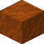 | **Ziemia** | `dirt` | **Kopanie:** 0,6 s (łopatą 0,2 s) **Skąd:** zniszczony blok: Blok trawy **Przydaje się do:** Ziemia kamienista, Czarnoziem, Ściółka leśna |
| 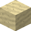 | **Piasek** | `sand` | **Kopanie:** 0,55 s (łopatą 0,18 s) **Przydaje się do:** Piaskowiec, Tynk wapienny |
|  | **Woda** | `water` | - |
| 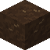 | **Czarnoziem** | `humus` | **Kopanie:** 0,6 s (łopatą 0,2 s) **Przepis:** Czarnoziem |
| 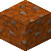 | **Ziemia kamienista** | `coarse_dirt` | **Kopanie:** 0,7 s (łopatą 0,23 s) **Przepis:** Ziemia kamienista x4 |
| 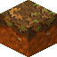 | **Ściółka leśna** | `forest_floor` | **Kopanie:** 0,6 s (łopatą 0,2 s) **Przepis:** Ściółka leśna |
| 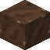 | **Błoto** | `mud` | **Kopanie:** 0,6 s (łopatą 0,2 s) |
| 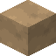 | **Glina** | `clay` | **Kopanie:** 0,6 s (łopatą 0,2 s) **Przydaje się do:** Tynk ochrowy, Terakota |
|  | **Żwir** | `gravel` | **Kopanie:** 0,7 s (łopatą 0,23 s) **Przydaje się do:** Ziemia kamienista |
| 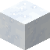 | **Śnieg** | `snow` | **Kopanie:** 0,4 s (łopatą 0,13 s) **Przepis:** Śnieg **Przydaje się do:** Warstwa śniegu |
|  | **Warstwa śniegu** | `snow_layer` | **Kopanie:** 0,4 s (łopatą 0,13 s) **Przepis:** Warstwa śniegu x4 **Przydaje się do:** Śnieg |
| 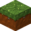 | **Mech** | `moss` | **Kopanie:** 0,6 s (łopatą 0,2 s) **Przepis:** Mech **Przydaje się do:** Kępki mchu |
|  | **Sadzonka borówki** | `blueberry_sapling` | **Kopanie:** od razu **Rośnie:** w: Krzak borówki (kilka owoców) **Skąd:** zniszczony blok: Krzak borówki (po zbiorze); zniszczony blok: Krzak borówki (kilka owoców); zniszczony blok: Krzak borówki (pełen owoców); posadzony przedmiot: Borówki |
| 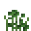 | **Krzak borówki (po zbiorze)** | `blueberry_bush` | **Kopanie:** od razu **Daje:** Sadzonka borówki **Rośnie:** w: Krzak borówki (kilka owoców) |
| 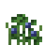 | **Krzak borówki (kilka owoców)** | `blueberry_bush_few` | **Kopanie:** od razu **Daje:** Sadzonka borówki **Zbiór (PPM):** Borówki 1-3 **Rośnie:** w: Krzak borówki (pełen owoców) **Skąd:** wyrasta z: Sadzonka borówki; wyrasta z: Krzak borówki (po zbiorze) |
| 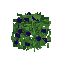 | **Krzak borówki (pełen owoców)** | `blueberry_bush_full` | **Kopanie:** od razu **Daje:** Sadzonka borówki **Zbiór (PPM):** Borówki 3-5 **Skąd:** wyrasta z: Krzak borówki (kilka owoców) |

## Skały

| | Nazwa | W komendach | Najważniejsze |
|---|---|---|---|
|  | **Kamień** | `stone` | **Kopanie:** 2,2 s (kilofem 0,73 s) **Przydaje się do:** Polerowany kamień, Siekiera, Kilof, Łopata |
| 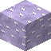 | **Lepidolit** | `lepidolite` | **Kopanie:** 2,5 s (kilofem 0,83 s) **Przydaje się do:** Lampa |
|  | **Meteoryt** | `meteorite` | **Kopanie:** 4,5 s (kilofem 1,5 s) **Świeci:** 7 / 15 |
|  | **Granit** | `granite` | **Kopanie:** 2,8 s (kilofem 0,93 s) **Przydaje się do:** Siekiera, Kilof, Łopata |
| 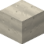 | **Wapień** | `limestone` | **Kopanie:** 1,8 s (kilofem 0,6 s) **Przydaje się do:** Tynk wapienny, Siekiera, Kilof, Łopata |
| 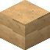 | **Piaskowiec** | `sandstone` | **Kopanie:** 1,8 s (kilofem 0,6 s) **Przepis:** Piaskowiec **Przydaje się do:** Siekiera, Kilof, Łopata |
| 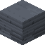 | **Łupek** | `slate` | **Kopanie:** 2,2 s (kilofem 0,73 s) **Przydaje się do:** Siekiera, Kilof, Łopata |
|  | **Bazalt** | `basalt` | **Kopanie:** 2,8 s (kilofem 0,93 s) **Przydaje się do:** Ciemne deski, Siekiera, Kilof, Łopata |

## Drewno

| | Nazwa | W komendach | Najważniejsze |
|---|---|---|---|
|  | **Pień świerka** | `spruce_log` | **Kopanie:** 2 s (siekierą 0,67 s) **Siekierą (PPM):** Okorowany pień świerka **Przydaje się do:** Deski świerkowe |
| 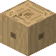 | **Okorowany pień świerka** | `spruce_log_stripped` | **Kopanie:** 2 s (siekierą 0,67 s) **Skąd:** siekierą (PPM) z bloku: Pień świerka **Przydaje się do:** Deski świerkowe |
| 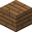 | **Deski świerkowe** | `spruce_planks` | **Kopanie:** 2 s (siekierą 0,67 s) **Przepis:** Deski świerkowe x4 **Przydaje się do:** Ciemne deski, Patyk |
| 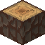 | **Pień sosny** | `pine_log` | **Kopanie:** 2 s (siekierą 0,67 s) **Siekierą (PPM):** Okorowany pień sosny **Skąd:** zniszczony blok: Pień sosny z żywicą **Przydaje się do:** Deski sosnowe |
| 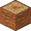 | **Pień sosny (górny)** | `pine_log_upper` | **Kopanie:** 2 s (siekierą 0,67 s) **Siekierą (PPM):** Okorowany pień sosny **Przydaje się do:** Deski sosnowe |
| 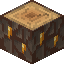 | **Pień sosny z żywicą** | `pine_log_resin` | **Kopanie:** 2 s (siekierą 0,67 s) **Daje:** Pień sosny **Zbiór (PPM):** Żywica 1-2 **Siekierą (PPM):** Okorowany pień sosny **Przydaje się do:** Deski sosnowe |
| 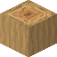 | **Okorowany pień sosny** | `pine_log_stripped` | **Kopanie:** 2 s (siekierą 0,67 s) **Skąd:** siekierą (PPM) z bloku: Pień sosny; siekierą (PPM) z bloku: Pień sosny (górny); siekierą (PPM) z bloku: Pień sosny z żywicą **Przydaje się do:** Deski sosnowe |
| 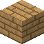 | **Deski sosnowe** | `pine_planks` | **Kopanie:** 2 s (siekierą 0,67 s) **Przepis:** Deski sosnowe x4 **Przydaje się do:** Ciemne deski, Patyk |
| 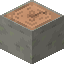 | **Pień buka** | `beech_log` | **Kopanie:** 2 s (siekierą 0,67 s) **Siekierą (PPM):** Okorowany pień buka **Przydaje się do:** Deski bukowe |
| 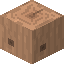 | **Okorowany pień buka** | `beech_log_stripped` | **Kopanie:** 2 s (siekierą 0,67 s) **Skąd:** siekierą (PPM) z bloku: Pień buka **Przydaje się do:** Deski bukowe |
| 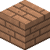 | **Deski bukowe** | `beech_planks` | **Kopanie:** 2 s (siekierą 0,67 s) **Przepis:** Deski bukowe x4 **Przydaje się do:** Ciemne deski, Patyk |
| 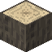 | **Pień lipy** | `linden_log` | **Kopanie:** 2 s (siekierą 0,67 s) **Siekierą (PPM):** Okorowany pień lipy **Przydaje się do:** Deski lipowe |
| 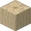 | **Okorowany pień lipy** | `linden_log_stripped` | **Kopanie:** 2 s (siekierą 0,67 s) **Skąd:** siekierą (PPM) z bloku: Pień lipy **Przydaje się do:** Deski lipowe |
| 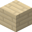 | **Deski lipowe** | `linden_planks` | **Kopanie:** 2 s (siekierą 0,67 s) **Przepis:** Deski lipowe x4 **Przydaje się do:** Ciemne deski, Patyk |
|  | **Pień dębu** | `oak_log` | **Kopanie:** 2 s (siekierą 0,67 s) **Siekierą (PPM):** Okorowany pień dębu **Przydaje się do:** Deski dębowe |
| 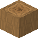 | **Okorowany pień dębu** | `oak_log_stripped` | **Kopanie:** 2 s (siekierą 0,67 s) **Skąd:** siekierą (PPM) z bloku: Pień dębu **Przydaje się do:** Deski dębowe |
|  | **Deski dębowe** | `oak_planks` | **Kopanie:** 2 s (siekierą 0,67 s) **Przepis:** Deski dębowe x4 **Przydaje się do:** Ciemne deski, Patyk |
| 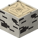 | **Pień brzozy** | `birch_log` | **Kopanie:** 2 s (siekierą 0,67 s) **Siekierą (PPM):** Okorowany pień brzozy + Kora brzozowa **Przydaje się do:** Deski brzozowe |
| 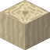 | **Okorowany pień brzozy** | `birch_log_stripped` | **Kopanie:** 2 s (siekierą 0,67 s) **Skąd:** siekierą (PPM) z bloku: Pień brzozy **Przydaje się do:** Deski brzozowe |
| 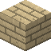 | **Deski brzozowe** | `birch_planks` | **Kopanie:** 2 s (siekierą 0,67 s) **Przepis:** Deski brzozowe x4 **Przydaje się do:** Ciemne deski, Patyk |
| 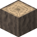 | **Pień jabłoni** | `jablon_log` | **Kopanie:** 2 s (siekierą 0,67 s) **Siekierą (PPM):** Okorowany pień jabłoni **Paczka drzewa:** assets/drzewa/jablon **Przydaje się do:** Deski jabłoniowe |
| 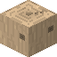 | **Okorowany pień jabłoni** | `jablon_log_stripped` | **Kopanie:** 2 s (siekierą 0,67 s) **Paczka drzewa:** assets/drzewa/jablon **Skąd:** siekierą (PPM) z bloku: Pień jabłoni **Przydaje się do:** Deski jabłoniowe |
| 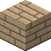 | **Deski jabłoniowe** | `jablon_planks` | **Kopanie:** 2 s (siekierą 0,67 s) **Paczka drzewa:** assets/drzewa/jablon **Przepis:** Deski jabłoniowe x4 **Przydaje się do:** Ciemne deski, Patyk |
| 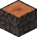 | **Pień olchy** | `olcha_log` | **Kopanie:** 2 s (siekierą 0,67 s) **Siekierą (PPM):** Okorowany pień olchy **Paczka drzewa:** assets/drzewa/olcha **Przydaje się do:** Deski olchowe |
| 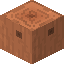 | **Okorowany pień olchy** | `olcha_log_stripped` | **Kopanie:** 2 s (siekierą 0,67 s) **Paczka drzewa:** assets/drzewa/olcha **Skąd:** siekierą (PPM) z bloku: Pień olchy **Przydaje się do:** Deski olchowe |
| 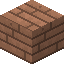 | **Deski olchowe** | `olcha_planks` | **Kopanie:** 2 s (siekierą 0,67 s) **Paczka drzewa:** assets/drzewa/olcha **Przepis:** Deski olchowe x4 **Przydaje się do:** Ciemne deski, Patyk |
| 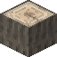 | **Pień wierzby** | `wierzba_log` | **Kopanie:** 2 s (siekierą 0,67 s) **Siekierą (PPM):** Okorowany pień wierzby **Paczka drzewa:** assets/drzewa/wierzba **Przydaje się do:** Deski wierzbowe |
| 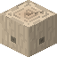 | **Okorowany pień wierzby** | `wierzba_log_stripped` | **Kopanie:** 2 s (siekierą 0,67 s) **Paczka drzewa:** assets/drzewa/wierzba **Skąd:** siekierą (PPM) z bloku: Pień wierzby **Przydaje się do:** Deski wierzbowe |
| 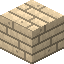 | **Deski wierzbowe** | `wierzba_planks` | **Kopanie:** 2 s (siekierą 0,67 s) **Paczka drzewa:** assets/drzewa/wierzba **Przepis:** Deski wierzbowe x4 **Przydaje się do:** Ciemne deski, Patyk |

## Budulec

| | Nazwa | W komendach | Najważniejsze |
|---|---|---|---|
| 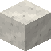 | **Tynk wapienny** | `lime_plaster` | **Kopanie:** 2,2 s (kilofem 0,73 s) **Przepis:** Tynk wapienny x4 **Przydaje się do:** Tynk ochrowy |
| 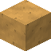 | **Tynk ochrowy** | `ochre_plaster` | **Kopanie:** 2,2 s (kilofem 0,73 s) **Przepis:** Tynk ochrowy x4 |
| 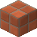 | **Terakota** | `terracotta` | **Kopanie:** 2,2 s (kilofem 0,73 s) **Przepis:** Terakota x4 |
|  | **Polerowany kamień** | `polished_stone` | **Kopanie:** 2,2 s (kilofem 0,73 s) **Przepis:** Polerowany kamień x4 |
| 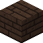 | **Ciemne deski** | `dark_planks` | **Kopanie:** 2 s (siekierą 0,67 s) **Przepis:** Ciemne deski x3 |

## Rośliny

| | Nazwa | W komendach | Najważniejsze |
|---|---|---|---|
|  | **Krótka trawa** | `short_grass` | **Kopanie:** od razu |
| 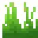 | **Wysoka trawa** | `tall_grass` | **Kopanie:** od razu |
| 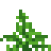 | **Paproć** | `fern` | **Kopanie:** od razu **Przydaje się do:** Zielona lampa |
| 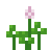 | **Koniczyna** | `clover` | **Kopanie:** od razu **Przydaje się do:** Zielona lampa |
| 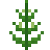 | **Pokrzywa** | `nettle` | **Kopanie:** od razu **Przydaje się do:** Zielona lampa |
|  | **Babka zwyczajna** | `plantain` | **Kopanie:** od razu |
|  | **Mak** | `poppy` | **Kopanie:** od razu **Przydaje się do:** Czerwona lampa |
|  | **Chaber** | `cornflower` | **Kopanie:** od razu **Przydaje się do:** Niebieska lampa |
|  | **Rumianek** | `chamomile` | **Kopanie:** od razu |
|  | **Mniszek** | `dandelion` | **Kopanie:** od razu |
|  | **Kępki mchu** | `moss_carpet` | **Kopanie:** od razu **Przepis:** Kępki mchu x4 **Przydaje się do:** Mech |
|  | **Trzcina** | `reed` | **Kopanie:** od razu |
|  | **Wrzos** | `heather` | **Kopanie:** od razu **Przydaje się do:** Fioletowa lampa |
|  | **Krokus** | `crocus` | **Kopanie:** od razu **Przydaje się do:** Fioletowa lampa |
|  | **Piaskownica (trawa wydmowa)** | `dune_grass` | **Kopanie:** od razu |
|  | **Sadzonka truskawki** | `strawberry_sapling` | **Kopanie:** od razu **Rośnie:** w: Krzak truskawki **Skąd:** zniszczony blok: Krzak truskawki; zniszczony blok: Krzak truskawki (kilka owoców); zniszczony blok: Krzak truskawki (pełen owoców); posadzony przedmiot: Truskawki |
|  | **Krzak truskawki** | `strawberry_bush` | **Kopanie:** od razu **Daje:** Sadzonka truskawki **Rośnie:** w: Krzak truskawki (kilka owoców) **Skąd:** wyrasta z: Sadzonka truskawki |
|  | **Krzak truskawki (kilka owoców)** | `strawberry_bush_few` | **Kopanie:** od razu **Daje:** Sadzonka truskawki **Zbiór (PPM):** Truskawki 1-2 **Rośnie:** w: Krzak truskawki (pełen owoców) **Skąd:** wyrasta z: Krzak truskawki |
|  | **Krzak truskawki (pełen owoców)** | `strawberry_bush_full` | **Kopanie:** od razu **Daje:** Sadzonka truskawki **Zbiór (PPM):** Truskawki 2-4 **Skąd:** wyrasta z: Krzak truskawki (kilka owoców) |
|  | **Sadzonka jeżyny** | `blackberry_sapling` | **Kopanie:** od razu **Rośnie:** w: Krzak jeżyny **Skąd:** zniszczony blok: Krzak jeżyny; zniszczony blok: Krzak jeżyny (kilka owoców); zniszczony blok: Krzak jeżyny (pełen owoców); posadzony przedmiot: Jeżyny |
|  | **Krzak jeżyny** | `blackberry_bush` | **Kopanie:** od razu **Daje:** Sadzonka jeżyny **Rośnie:** w: Krzak jeżyny (kilka owoców) **Skąd:** wyrasta z: Sadzonka jeżyny |
|  | **Krzak jeżyny (kilka owoców)** | `blackberry_bush_few` | **Kopanie:** od razu **Daje:** Sadzonka jeżyny **Zbiór (PPM):** Jeżyny 1-2 **Rośnie:** w: Krzak jeżyny (pełen owoców) **Skąd:** wyrasta z: Krzak jeżyny |
|  | **Krzak jeżyny (pełen owoców)** | `blackberry_bush_full` | **Kopanie:** od razu **Daje:** Sadzonka jeżyny **Zbiór (PPM):** Jeżyny 2-4 **Skąd:** wyrasta z: Krzak jeżyny (kilka owoców) |
|  | **Sadzonka papryczki chili** | `chili_sapling` | **Kopanie:** od razu **Rośnie:** w: Krzak papryczki chili **Skąd:** zniszczony blok: Krzak papryczki chili; zniszczony blok: Krzak papryczki chili (kilka papryczek); zniszczony blok: Krzak papryczki chili (pełen papryczek); posadzony przedmiot: Papryczki chili |
|  | **Krzak papryczki chili** | `chili_bush` | **Kopanie:** od razu **Daje:** Sadzonka papryczki chili **Rośnie:** w: Krzak papryczki chili (kilka papryczek) **Skąd:** wyrasta z: Sadzonka papryczki chili |
|  | **Krzak papryczki chili (kilka papryczek)** | `chili_bush_few` | **Kopanie:** od razu **Daje:** Sadzonka papryczki chili **Zbiór (PPM):** Papryczki chili 1-2 **Rośnie:** w: Krzak papryczki chili (pełen papryczek) **Skąd:** wyrasta z: Krzak papryczki chili |
|  | **Krzak papryczki chili (pełen papryczek)** | `chili_bush_full` | **Kopanie:** od razu **Daje:** Sadzonka papryczki chili **Zbiór (PPM):** Papryczki chili 2-4 **Skąd:** wyrasta z: Krzak papryczki chili (kilka papryczek) |
|  | **Sadzonka leszczyny** | `hazel_sapling` | **Kopanie:** od razu **Rośnie:** w: Leszczyna **Skąd:** zniszczony blok: Leszczyna; zniszczony blok: Leszczyna (kilka orzechów); zniszczony blok: Leszczyna (pełna orzechów); posadzony przedmiot: Orzech laskowy |
|  | **Leszczyna** | `hazel_bush` | **Kopanie:** od razu **Daje:** Sadzonka leszczyny **Rośnie:** w: Leszczyna (kilka orzechów) **Skąd:** wyrasta z: Sadzonka leszczyny |
|  | **Leszczyna (kilka orzechów)** | `hazel_bush_few` | **Kopanie:** od razu **Daje:** Sadzonka leszczyny **Zbiór (PPM):** Orzech laskowy 1-2 **Rośnie:** w: Leszczyna (pełna orzechów) **Skąd:** wyrasta z: Leszczyna |
|  | **Leszczyna (pełna orzechów)** | `hazel_bush_full` | **Kopanie:** od razu **Daje:** Sadzonka leszczyny **Zbiór (PPM):** Orzech laskowy 2-3 **Skąd:** wyrasta z: Leszczyna (kilka orzechów) |
|  | **Igliwie świerka** | `spruce_leaves` | **Kopanie:** 0,35 s **Czasem wypada:** Sadzonka świerka (5%), Szyszka świerka (8%) **Przydaje się do:** Ściółka leśna, Wieniec świerkowy |
|  | **Sadzonka świerka** | `spruce_sapling` | **Kopanie:** od razu **Rośnie:** w drzewo, średnio po 5 min **Skąd:** czasem z bloku: Igliwie świerka (5%); posadzony przedmiot: Szyszka świerka |
|  | **Igliwie sosny** | `pine_leaves` | **Kopanie:** 0,35 s **Czasem wypada:** Sadzonka sosny (5%), Szyszka sosny (8%) **Przydaje się do:** Ściółka leśna |
|  | **Sadzonka sosny** | `pine_sapling` | **Kopanie:** od razu **Rośnie:** w drzewo, średnio po 5 min **Skąd:** czasem z bloku: Igliwie sosny (5%); posadzony przedmiot: Szyszka sosny |
|  | **Liście buka** | `beech_leaves` | **Kopanie:** 0,35 s **Czasem wypada:** Sadzonka buka (5%), Orzeszki bukowe (8%) **Przydaje się do:** Opadłe liście buka |
|  | **Sadzonka buka** | `beech_sapling` | **Kopanie:** od razu **Rośnie:** w drzewo, średnio po 5 min **Skąd:** czasem z bloku: Liście buka (5%); posadzony przedmiot: Orzeszki bukowe |
|  | **Liście lipy** | `linden_leaves` | **Kopanie:** 0,35 s **Czasem wypada:** Sadzonka lipy (6%) **Skąd:** zniszczony blok: Kwitnące liście lipy |
|  | **Kwitnące liście lipy** | `linden_leaves_flowering` | **Kopanie:** 0,35 s **Daje:** Liście lipy **Czasem wypada:** Sadzonka lipy (6%) **Zbiór (PPM):** Kwiat lipy 1-2 |
|  | **Sadzonka lipy** | `linden_sapling` | **Kopanie:** od razu **Rośnie:** w drzewo, średnio po 5 min **Skąd:** czasem z bloku: Liście lipy (6%); czasem z bloku: Kwitnące liście lipy (6%); posadzony przedmiot: Kwiat lipy |
|  | **Liście dębu** | `oak_leaves` | **Kopanie:** 0,35 s **Czasem wypada:** Sadzonka dębu (5%), Żołądź (10%) **Przydaje się do:** Opadłe liście dębu |
|  | **Sadzonka dębu** | `oak_sapling` | **Kopanie:** od razu **Rośnie:** w drzewo, średnio po 5 min **Skąd:** czasem z bloku: Liście dębu (5%); posadzony przedmiot: Żołądź |
|  | **Liście brzozy** | `birch_leaves` | **Kopanie:** 0,35 s **Czasem wypada:** Sadzonka brzozy (7%) |
|  | **Sadzonka brzozy** | `birch_sapling` | **Kopanie:** od razu **Rośnie:** w drzewo, średnio po 5 min **Skąd:** czasem z bloku: Liście brzozy (7%) |
|  | **Liście jabłoni** | `jablon_leaves` | **Kopanie:** 0,35 s **Czasem wypada:** Sadzonka jabłoni (5%), Jabłko (5%) **Paczka drzewa:** assets/drzewa/jablon **Skąd:** zniszczony blok: Liście jabłoni z jabłkami; zniszczony blok: Liście jabłoni (jabłka odrastają) **Przydaje się do:** Opadłe liście jabłoni |
|  | **Liście jabłoni z jabłkami** | `jablon_leaves_jablka` | **Kopanie:** 0,35 s **Daje:** Liście jabłoni **Czasem wypada:** Sadzonka jabłoni (5%), Jabłko (5%) **Zbiór (PPM):** Jabłko 1-2 **Paczka drzewa:** assets/drzewa/jablon **Skąd:** wyrasta z: Liście jabłoni (jabłka odrastają) |
|  | **Sadzonka jabłoni** | `jablon_sapling` | **Kopanie:** od razu **Rośnie:** w drzewo, średnio po 5 min **Paczka drzewa:** assets/drzewa/jablon **Skąd:** czasem z bloku: Liście jabłoni (5%); czasem z bloku: Liście jabłoni z jabłkami (5%); czasem z bloku: Liście jabłoni (jabłka odrastają) (5%); posadzony przedmiot: Jabłko |
|  | **Liście olchy** | `olcha_leaves` | **Kopanie:** 0,35 s **Czasem wypada:** Sadzonka olchy (4%), Szyszeczki olchy (6%) **Paczka drzewa:** assets/drzewa/olcha **Przydaje się do:** Opadłe liście olchy |
|  | **Sadzonka olchy** | `olcha_sapling` | **Kopanie:** od razu **Rośnie:** w drzewo, średnio po 5 min **Paczka drzewa:** assets/drzewa/olcha **Skąd:** czasem z bloku: Liście olchy (4%); posadzony przedmiot: Szyszeczki olchy |
|  | **Liście wierzby** | `wierzba_leaves` | **Kopanie:** 0,35 s **Czasem wypada:** Sadzonka wierzby (4%), Bazie (6%) **Paczka drzewa:** assets/drzewa/wierzba **Przydaje się do:** Opadłe liście wierzby |
|  | **Sadzonka wierzby** | `wierzba_sapling` | **Kopanie:** od razu **Rośnie:** w drzewo, średnio po 5 min **Paczka drzewa:** assets/drzewa/wierzba **Skąd:** czasem z bloku: Liście wierzby (4%); posadzony przedmiot: Bazie |
|  | **Turzyca rzeczna** | `river_sedge` | **Kopanie:** od razu |
|  | **Pałka wodna** | `cattail` | **Kopanie:** od razu **Skąd:** zniszczony blok: Pałka wodna (w wodzie) |
|  | **Krwawnica pospolita** | `purple_loosestrife` | **Kopanie:** od razu |
|  | **Wywłócznik** | `water_milfoil` | - |
|  | **Grzybień biały** | `water_lily` | - |
|  | **Rzęsa wodna** | `duckweed` | - |
|  | **Młody amarantus** | `amarantus_etap1` | **Kopanie:** od razu **Rośnie:** w: Amarantus (zawiązuje wiechy) **Skąd:** zniszczony blok: Amarantus (zawiązuje wiechy); zniszczony blok: Amarantus (dojrzałe wiechy) |
|  | **Amarantus (zawiązuje wiechy)** | `amarantus_etap2` | **Kopanie:** od razu **Daje:** Młody amarantus **Rośnie:** w: Amarantus (dojrzałe wiechy) **Skąd:** wyrasta z: Młody amarantus |
|  | **Amarantus (dojrzałe wiechy)** | `amarantus_etap3` | **Kopanie:** od razu **Daje:** Młody amarantus **Zbiór (PPM):** Wiecha amarantusa 1-3 **Skąd:** wyrasta z: Amarantus (zawiązuje wiechy) |
|  | **Młoda kocanka** | `kocanka_etap1` | **Kopanie:** od razu **Rośnie:** w: Kocanka (pąki) **Skąd:** zniszczony blok: Kocanka (pąki); zniszczony blok: Kocanka (kwitnie) |
|  | **Kocanka (pąki)** | `kocanka_etap2` | **Kopanie:** od razu **Daje:** Młoda kocanka **Rośnie:** w: Kocanka (kwitnie) **Skąd:** wyrasta z: Młoda kocanka |
|  | **Kocanka (kwitnie)** | `kocanka_etap3` | **Kopanie:** od razu **Daje:** Młoda kocanka **Zbiór (PPM):** Bukiet kocanki 1-2 **Skąd:** wyrasta z: Kocanka (pąki) |
|  | **Młoda lawenda** | `lawenda_etap1` | **Kopanie:** od razu **Rośnie:** w: Lawenda (pąki) **Skąd:** zniszczony blok: Lawenda (pąki); zniszczony blok: Lawenda (kwitnie) |
|  | **Lawenda (pąki)** | `lawenda_etap2` | **Kopanie:** od razu **Daje:** Młoda lawenda **Rośnie:** w: Lawenda (kwitnie) **Skąd:** wyrasta z: Młoda lawenda |
|  | **Lawenda (kwitnie)** | `lawenda_etap3` | **Kopanie:** od razu **Daje:** Młoda lawenda **Zbiór (PPM):** Bukiet lawendy 1-2 **Skąd:** wyrasta z: Lawenda (pąki) |
|  | **Młoda piwonia** | `piwonia_etap1` | **Kopanie:** od razu **Rośnie:** w: Piwonia (pąki) **Skąd:** zniszczony blok: Piwonia (pąki); zniszczony blok: Piwonia (kwitnie) |
|  | **Piwonia (pąki)** | `piwonia_etap2` | **Kopanie:** od razu **Daje:** Młoda piwonia **Rośnie:** w: Piwonia (kwitnie) **Skąd:** wyrasta z: Młoda piwonia |
|  | **Piwonia (kwitnie)** | `piwonia_etap3` | **Kopanie:** od razu **Daje:** Młoda piwonia **Zbiór (PPM):** Kwiat piwonii 1-2 **Skąd:** wyrasta z: Piwonia (pąki) |
|  | **Młody zawilec** | `zawilec_etap1` | **Kopanie:** od razu **Rośnie:** w: Zawilec (pąki) **Skąd:** zniszczony blok: Zawilec (pąki); zniszczony blok: Zawilec (kwitnie) |
|  | **Zawilec (pąki)** | `zawilec_etap2` | **Kopanie:** od razu **Daje:** Młody zawilec **Rośnie:** w: Zawilec (kwitnie) **Skąd:** wyrasta z: Młody zawilec |
|  | **Zawilec (kwitnie)** | `zawilec_etap3` | **Kopanie:** od razu **Daje:** Młody zawilec **Zbiór (PPM):** Kwiat zawilca 1-2 **Skąd:** wyrasta z: Zawilec (pąki) |
|  | **Młody dzwonek** | `dzwonek_etap1` | **Kopanie:** od razu **Rośnie:** w: Dzwonek (pąki) **Skąd:** zniszczony blok: Dzwonek (pąki); zniszczony blok: Dzwonek (kwitnie) |
|  | **Dzwonek (pąki)** | `dzwonek_etap2` | **Kopanie:** od razu **Daje:** Młody dzwonek **Rośnie:** w: Dzwonek (kwitnie) **Skąd:** wyrasta z: Młody dzwonek |
|  | **Dzwonek (kwitnie)** | `dzwonek_etap3` | **Kopanie:** od razu **Daje:** Młody dzwonek **Zbiór (PPM):** Kwiat dzwonka 1-3 **Skąd:** wyrasta z: Dzwonek (pąki) |
|  | **Młoda szałwia** | `szalwia_etap1` | **Kopanie:** od razu **Rośnie:** w: Szałwia (pąki) **Skąd:** zniszczony blok: Szałwia (pąki); zniszczony blok: Szałwia (kwitnie) |
|  | **Szałwia (pąki)** | `szalwia_etap2` | **Kopanie:** od razu **Daje:** Młoda szałwia **Rośnie:** w: Szałwia (kwitnie) **Skąd:** wyrasta z: Młoda szałwia |
|  | **Szałwia (kwitnie)** | `szalwia_etap3` | **Kopanie:** od razu **Daje:** Młoda szałwia **Zbiór (PPM):** Liście szałwii 1-3 **Skąd:** wyrasta z: Szałwia (pąki) |
|  | **Młody nagietek** | `nagietek_etap1` | **Kopanie:** od razu **Rośnie:** w: Nagietek (pąki) **Skąd:** zniszczony blok: Nagietek (pąki); zniszczony blok: Nagietek (kwitnie) |
|  | **Nagietek (pąki)** | `nagietek_etap2` | **Kopanie:** od razu **Daje:** Młody nagietek **Rośnie:** w: Nagietek (kwitnie) **Skąd:** wyrasta z: Młody nagietek |
|  | **Nagietek (kwitnie)** | `nagietek_etap3` | **Kopanie:** od razu **Daje:** Młody nagietek **Zbiór (PPM):** Kwiat nagietka 1-3 **Skąd:** wyrasta z: Nagietek (pąki) |
|  | **Młoda cynia** | `cynia_etap1` | **Kopanie:** od razu **Rośnie:** w: Cynia (pąki) **Skąd:** zniszczony blok: Cynia (pąki); zniszczony blok: Cynia (kwitnie) |
|  | **Cynia (pąki)** | `cynia_etap2` | **Kopanie:** od razu **Daje:** Młoda cynia **Rośnie:** w: Cynia (kwitnie) **Skąd:** wyrasta z: Młoda cynia |
|  | **Cynia (kwitnie)** | `cynia_etap3` | **Kopanie:** od razu **Daje:** Młoda cynia **Zbiór (PPM):** Kwiat cynii 1-2 **Skąd:** wyrasta z: Cynia (pąki) |
|  | **Młody mikołajek** | `mikolajek_etap1` | **Kopanie:** od razu **Rośnie:** w: Mikołajek (pąki) **Skąd:** zniszczony blok: Mikołajek (pąki); zniszczony blok: Mikołajek (kwitnie) |
|  | **Mikołajek (pąki)** | `mikolajek_etap2` | **Kopanie:** od razu **Daje:** Młody mikołajek **Rośnie:** w: Mikołajek (kwitnie) **Skąd:** wyrasta z: Młody mikołajek |
|  | **Mikołajek (kwitnie)** | `mikolajek_etap3` | **Kopanie:** od razu **Daje:** Młody mikołajek **Zbiór (PPM):** Kwiat mikołajka 1-2 **Skąd:** wyrasta z: Mikołajek (pąki) |
|  | **Młody barwinek** | `barwinek_etap1` | **Kopanie:** od razu **Rośnie:** w: Barwinek (pąki) **Skąd:** zniszczony blok: Barwinek (pąki); zniszczony blok: Barwinek (kwitnie) |
|  | **Barwinek (pąki)** | `barwinek_etap2` | **Kopanie:** od razu **Daje:** Młody barwinek **Rośnie:** w: Barwinek (kwitnie) **Skąd:** wyrasta z: Młody barwinek |
|  | **Barwinek (kwitnie)** | `barwinek_etap3` | **Kopanie:** od razu **Daje:** Młody barwinek **Zbiór (PPM):** Kwiat barwinka 1-2 **Skąd:** wyrasta z: Barwinek (pąki) |
|  | **Młody len** | `len_etap1` | **Kopanie:** od razu **Rośnie:** w: Len (kwitnie) **Skąd:** zniszczony blok: Len (kwitnie); zniszczony blok: Len (dojrzały, suchy) |
|  | **Len (kwitnie)** | `len_etap2` | **Kopanie:** od razu **Daje:** Młody len **Rośnie:** w: Len (dojrzały, suchy) **Skąd:** wyrasta z: Młody len |
|  | **Len (dojrzały, suchy)** | `len_etap3` | **Kopanie:** od razu **Daje:** Młody len **Zbiór (PPM):** Wiązka lnu 1-2 **Skąd:** wyrasta z: Len (kwitnie) |
|  | **Młoda gorczyca** | `gorczyca_etap1` | **Kopanie:** od razu **Rośnie:** w: Gorczyca (kwitnie) **Skąd:** zniszczony blok: Gorczyca (kwitnie); zniszczony blok: Gorczyca (strąki) |
|  | **Gorczyca (kwitnie)** | `gorczyca_etap2` | **Kopanie:** od razu **Daje:** Młoda gorczyca **Rośnie:** w: Gorczyca (strąki) **Skąd:** wyrasta z: Młoda gorczyca |
|  | **Gorczyca (strąki)** | `gorczyca_etap3` | **Kopanie:** od razu **Daje:** Młoda gorczyca **Zbiór (PPM):** Nasiona gorczycy 1-3 **Skąd:** wyrasta z: Gorczyca (kwitnie) |
|  | **Młody porost oliwkowy** | `porostoliwkowy_etap1` | **Kopanie:** od razu **Rośnie:** w: Porost oliwkowy **Skąd:** zniszczony blok: Porost oliwkowy; zniszczony blok: Porost oliwkowy (duża plecha) |
|  | **Porost oliwkowy** | `porostoliwkowy_etap2` | **Kopanie:** od razu **Daje:** Młody porost oliwkowy **Rośnie:** w: Porost oliwkowy (duża plecha) **Skąd:** wyrasta z: Młody porost oliwkowy |
|  | **Porost oliwkowy (duża plecha)** | `porostoliwkowy_etap3` | **Kopanie:** od razu **Daje:** Młody porost oliwkowy **Zbiór (PPM):** Plecha porostu oliwkowego 1-2 **Skąd:** wyrasta z: Porost oliwkowy |
|  | **Młody porost iglasty** | `porostiglasty_etap1` | **Kopanie:** od razu **Rośnie:** w: Porost iglasty **Skąd:** zniszczony blok: Porost iglasty; zniszczony blok: Porost iglasty (gęsty) |
|  | **Porost iglasty** | `porostiglasty_etap2` | **Kopanie:** od razu **Daje:** Młody porost iglasty **Rośnie:** w: Porost iglasty (gęsty) **Skąd:** wyrasta z: Młody porost iglasty |
|  | **Porost iglasty (gęsty)** | `porostiglasty_etap3` | **Kopanie:** od razu **Daje:** Młody porost iglasty **Zbiór (PPM):** Gałązki porostu iglastego 1-2 **Skąd:** wyrasta z: Porost iglasty |
|  | **Żółta ochra (kropki)** | `ochra_etap1` | **Kopanie:** od razu **Rośnie:** w: Żółta ochra **Skąd:** zniszczony blok: Żółta ochra; zniszczony blok: Żółta ochra (skorupa) |
|  | **Żółta ochra** | `ochra_etap2` | **Kopanie:** od razu **Daje:** Żółta ochra (kropki) **Rośnie:** w: Żółta ochra (skorupa) **Skąd:** wyrasta z: Żółta ochra (kropki) |
|  | **Żółta ochra (skorupa)** | `ochra_etap3` | **Kopanie:** od razu **Daje:** Żółta ochra (kropki) **Zbiór (PPM):** Grudka żółtej ochry 1-2 **Skąd:** wyrasta z: Żółta ochra |
|  | **Młoda huba** | `huba_etap1` | **Kopanie:** od razu **Rośnie:** w: Huba **Skąd:** zniszczony blok: Huba; zniszczony blok: Huba (stara, piętrowa) |
|  | **Huba** | `huba_etap2` | **Kopanie:** od razu **Daje:** Młoda huba **Rośnie:** w: Huba (stara, piętrowa) **Skąd:** wyrasta z: Młoda huba |
|  | **Huba (stara, piętrowa)** | `huba_etap3` | **Kopanie:** od razu **Daje:** Młoda huba **Zbiór (PPM):** Huba 1-2 **Skąd:** wyrasta z: Huba |

## Światło

| | Nazwa | W komendach | Najważniejsze |
|---|---|---|---|
|  | **Lampa** | `lamp` | **Kopanie:** 0,45 s **Świeci:** 15 / 15 **Przepis:** Lampa x2, Lampa **Przydaje się do:** Czerwona lampa, Zielona lampa, Niebieska lampa, Fioletowa lampa, Czerwona lampa |
|  | **Czerwona lampa** | `lamp_red` | **Kopanie:** 0,45 s **Świeci:** 15 / 15 **Przepis:** Czerwona lampa, Czerwona lampa |
|  | **Zielona lampa** | `lamp_green` | **Kopanie:** 0,45 s **Świeci:** 15 / 15 **Przepis:** Zielona lampa |
|  | **Niebieska lampa** | `lamp_blue` | **Kopanie:** 0,45 s **Świeci:** 15 / 15 **Przepis:** Niebieska lampa **Przydaje się do:** Lampa |
|  | **Fioletowa lampa** | `lamp_purple` | **Kopanie:** 0,45 s **Świeci:** 15 / 15 **Przepis:** Fioletowa lampa |

## Ozdoby

| | Nazwa | W komendach | Najważniejsze |
|---|---|---|---|
|  | **Wieniec świerkowy** | `spruce_wreath` | **Kopanie:** od razu **Skąd:** zniszczony blok: Wieniec świerkowy **Przepis:** Wieniec świerkowy |
|  | **Opadłe liście buka** | `beech_leaf_litter` | **Kopanie:** od razu **Przepis:** Opadłe liście buka x2 **Przydaje się do:** Czarnoziem |
|  | **Opadłe liście dębu** | `oak_leaf_litter` | **Kopanie:** od razu **Przepis:** Opadłe liście dębu x2 **Przydaje się do:** Czarnoziem |
|  | **Opadłe liście jabłoni** | `jablon_leaf_litter` | **Kopanie:** od razu **Paczka drzewa:** assets/drzewa/jablon **Przepis:** Opadłe liście jabłoni x2 **Przydaje się do:** Czarnoziem |
|  | **Opadłe liście olchy** | `olcha_leaf_litter` | **Kopanie:** od razu **Paczka drzewa:** assets/drzewa/olcha **Przepis:** Opadłe liście olchy x2 **Przydaje się do:** Czarnoziem |
|  | **Opadłe liście wierzby** | `wierzba_leaf_litter` | **Kopanie:** od razu **Paczka drzewa:** assets/drzewa/wierzba **Przepis:** Opadłe liście wierzby x2 **Przydaje się do:** Czarnoziem |
