# Osiągnięcia

> Ta strona jest generowana z kodu gry (`python tools/wiki.py`) - nie zmieniaj jej ręcznie, zmiany przepadną przy następnym generowaniu.

Wersja gry **0.15.0** - 31 osiągnięć. Księga osiągnięć: klawisz **L**. Uwaga, spoilery: sekretne osiągnięcia są tu opisane (w grze widać tylko „???”).

## Zwykłe (10 pkt)

| | Tytuł | Jak zdobyć | Komentarz |
|---|---|---|---|
| 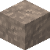 | **Od czegoś trzeba zacząć** | Zniszcz pierwszy blok. | „Świat właśnie zrobił się o jeden blok mniejszy. Brawo... chyba.” |
| 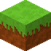 | **Architekt amator** | Postaw pierwszy blok. | „Stoi. Krzywo, ale stoi.” |
| 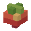 | **Witaminki** | Zbierz owoce z krzaka (PPM). | „Babcia byłaby dumna. Krzak trochę mniej.” |
| 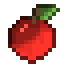 | **Sadownik** | Zbierz owoce z drzewa owocowego (PPM na liściach z owocami). | „Jabłko pada niedaleko od jabłoni. Tym razem - prosto do kieszeni.” |
| 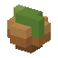 | **Zielone palce** | Posadź owoc, orzech albo szyszkę. | „Teraz najtrudniejsza część ogrodnictwa: czekanie.” |
| 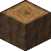 | **Drwal** | Zetnij pień drzewa. | „Drzewo nawet nie zdążyło krzyknąć „uwaga!”.” |
| 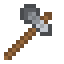 | **Ostrze w ruch** | W trybie przygody zetnij pień drzewa siekierą (idzie trzy razy szybciej niż ręką). | „Ręce bolą mniej. Drzewo - bardziej.” |
|  | **Prawie robi różnicę** *(sekret)* | W trybie przygody kop blok i puść przycisk, gdy jest już prawie rozbity. | „Blok odetchnął z ulgą. Na razie.” |
| 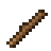 | **Złota rączka** | Wytwórz coś w ekwipunku (siatka 2 x 2 - E). | „Z dwóch desek cztery patyki. Matematyka się nie zgadza, ale działa.” |
|  | **Kolorowe światła** | Zrób kolorową lampę (lampa i coś w tym kolorze). | „Disco w jaskini. Nietoperze są zachwycone.” |
| 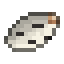 | **Brzozowy papirus** | Zdejmij siekierą korę z brzozy (PPM siekierą na pniu). | „Dawniej pisano na niej listy. Ty możesz napisać listę zakupów.” |
| 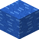 | **Mokra robota** | Popływaj w wodzie. | „Potwierdzone naukowo: woda jest mokra.” |
|  | **Nocny marek** | Bądź w świecie o północy. | „Porządni gracze już dawno śpią. Ty nie jesteś porządnym graczem.” |
| 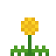 | **Złota godzina** | Popatrz prosto na zachodzące (albo wschodzące) słońce. | „Fotografowie nazywają to złotą godziną. Ty nazywasz to: jeszcze jeden blok i kończę.” |

## Rzadkie (25 pkt)

| | Tytuł | Jak zdobyć | Komentarz |
|---|---|---|---|
| 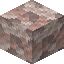 | **Murarz** | Postaw 500 bloków. | „Pięćset bloków. Kręgosłup pamięta każdy z nich.” |
| 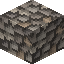 | **Głębinowiec** | Zanurkuj 10 bloków pod powierzchnię wody. | „Ryb brak, ale za to jest ciemno, mokro i trochę strasznie.” |
|  | **Ponad chmurami** | Wzleć na wysokość 1000 bloków. | „Stąd wszystko wygląda tak malutko. Ty też.” |
| 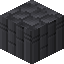 | **Naoczny świadek** | Bądź najwyżej 60 bloków od miejsca, w które uderzy meteoryt. | „Spadło. Ty nie. Tym razem.” |
| 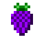 | **Pełne kosze** | Zbierz owoce z każdego rodzaju krzaka. | „Truskawki, jeżyny, chili i orzechy. Dieta jak marzenie, zwłaszcza to chili.” |
| 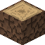 | **Leśniczy** | Zetnij pień każdego z sześciu gatunków drzew: świerka, sosny, buka, lipy, dębu i brzozy. | „Znasz już las od środka. Las ciebie też - i prosi o chwilę przerwy.” |
| 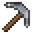 | **Komplet narzędzi** | Zrób siekierę, kilof i łopatę (postęp liczy się w księdze). | „Teraz brakuje tylko skrzynki na narzędzia. I garażu. I warsztatu.” |
| 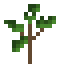 | **Z małego ziarenka** | Wyhoduj drzewo z sadzonki. | „Wyrosło! Teraz tylko sto lat i będzie z niego porządny dąb. Albo brzoza.” |
|  | **Kopalnia w kieszeni** | Zagraj na telefonie albo tablecie i zniszcz blok palcem. | „Bateria właśnie zaczęła się pocić.” |
|  | **Lokator z ikonką** | Zagraj w aplikacji na telefon (zainstalowanej, z ikonką na ekranie). | „Gra zamieszkała na twoim telefonie. Czynszu nie płaci.” |
| 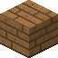 | **Promyk słońca** | Stań w plamie słońca pod dachem (słońce wpada przez okno albo dziurę w ścianie). | „Jak kot na parapecie. Brakuje tylko mruczenia.” |

## Bardzo rzadkie (50 pkt)

| | Tytuł | Jak zdobyć | Komentarz |
|---|---|---|---|
|  | **Dzień jak noc** | Zobacz pełne zaćmienie słońca. | „Słońce na chwilę zrobiło sobie przerwę. Ty jak zwykle nie.” |
| 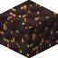 | **Kosmiczny złom** | Wykop blok meteorytu. | „Kawałek nieba w kieszeni. Jeszcze ciepły.” |
|  | **Houston, mamy widok** *(sekret)* | Wyleć w kosmos. | „Mały krok dla gracza, wielki skok dla... a nie, to też tylko gracz.” |
|  | **Koniec świata** | Dojdź do granicy świata (30000 bloków od środka). | „Dalej nic nie ma. Sprawdzaliśmy. Dwa razy.” |

## Legendarne (100 pkt)

| | Tytuł | Jak zdobyć | Komentarz |
|---|---|---|---|
|  | **Problem spadł z nieba** *(sekret)* | Wyląduj jako meteoryt. | „Tym razem problemem byłeś ty.” |
|  | **Skok do basenu** *(sekret)* | Wpadnij do wody prosto z kosmosu. | „Najdroższy skok do wody w historii. Sędziowie dają 10/10, ryby 0/10.” |
