# Osiągnięcia

> Ta strona jest generowana z kodu gry (`python tools/wiki.py`) - nie zmieniaj jej ręcznie, zmiany przepadną przy następnym generowaniu.

Wersja gry **1.20.0** - 106 osiągnięć. Księga osiągnięć: klawisz **L**. Uwaga, spoilery: sekretne osiągnięcia są tu opisane (w grze widać tylko „???”).

## Zwykłe (10 pkt)

| | Tytuł | Jak zdobyć | Komentarz |
|---|---|---|---|
| 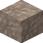 | **Od czegoś trzeba zacząć** | Zniszcz pierwszy blok. | „Świat właśnie zrobił się o jeden blok mniejszy. Brawo... chyba.” |
| 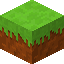 | **Architekt amator** | Postaw pierwszy blok. | „Stoi. Krzywo, ale stoi.” |
|  | **Witaminki** | Zbierz owoce z krzaka (PPM). | „Babcia byłaby dumna. Krzak trochę mniej.” |
| 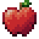 | **Sadownik** | Zbierz owoce z drzewa owocowego (PPM na liściach z owocami). | „Jabłko pada niedaleko od jabłoni. Tym razem - prosto do kieszeni.” |
| 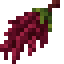 | **Wyższy od ciebie** | Zetnij nożem wiechy z dojrzałego amarantusa (rośnie kępami na łąkach, ma 2 bloki wysokości). | „Dwa metry rośliny, a najładniejsze i tak zwisa do samej ziemi.” |
| 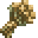 | **Nieśmiertelnik** | Zetnij nożem bukiet z kwitnącej kocanki (niska, srebrzysta kępka na piasku w borach i na plażach). | „Zasuszona nie traci koloru - stąd druga nazwa: nieśmiertelnik.” |
| 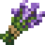 | **Zapach lata** | Zetnij nożem bukiet z kwitnącej lawendy (krzaczki z fioletowymi kłosami na łąkach i halach). | „Mole uciekają, pszczoły się zlatują, a szafa pachnie jak u babci.” |
| 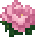 | **Róża bez kolców** | Zetnij nożem kwiat z kwitnącej piwonii (krzaki z różowymi kwiatami na skrajach lasów liściastych i w brzezinach). | „Pachnie prawie jak róża, a nie kłuje. W sam raz do wazonu.” |
| 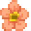 | **Pierwszy zwiastun** | Zetnij nożem kwiat z kwitnącego zawilca (niskie kępki z brzoskwiniowymi kwiatami w buczynach i lasach liściastych). | „Zakwitł, zanim drzewa rozwinęły liście. Pośpiech się opłacił.” |
| 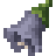 | **Kto dzwoni?** | Zetnij nożem kwiat z kwitnącego dzwonka gołębiego (zwisające, liliowe dzwonki na halach i w skalistych górach). | „Dzwonki nie dzwonią. Sprawdzone trzy razy.” |
| 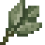 | **Ogródek zielarza** | Zetnij nożem liście z kwitnącej szałwii (szarozielone krzaczki z fioletowymi kłosami na łąkach i w skalistych górach). | „Do herbaty, do pieczeni, do płukania gardła. Szałwia nie wybrzydza.” |
|  | **Słoneczko** | Zetnij nożem kwiat z kwitnącego nagietka (pomarańczowe koszyczki na łąkach i plażach). | „Otwiera się rano, zamyka wieczorem. Ma lepszy rytm dnia niż niejeden gracz.” |
| 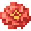 | **Piętrowy kwiat** | Zetnij nożem kwiat z kwitnącej cynii (koralowe kwiaty na prostych łodygach w brzezinach i na łąkach). | „Piętro na piętrze płatków. Cynia nie zna umiaru - i dobrze.” |
| 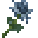 | **Kłujący błękit** | Zetnij nożem kwiat z kwitnącego mikołajka (niebieskie główki na gwiazdach kolców, na plażach i w skalistych górach). | „Niebieski, kłujący i dumny z tego. Nie przytulać.” |
| 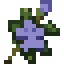 | **Dywan z kwiatów** | Zetnij nożem kwiat z kwitnącego barwinka (płoży się po ziemi i łączy w dywany kwiatów w lasach liściastych, buczynach i na łąkach). | „Barwinek nie rośnie sam - rozkłada się, łączy z sąsiadami i robi z lasu salon.” |
| 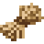 | **Lniana robota** | Zetnij nożem wiązkę z dojrzałego, suchego lnu (najpierw kwitnie na niebiesko - hale i łąki). | „Najpierw błękitne kwiaty, potem złote łodygi. Do lnianej koszuli jeszcze trochę brakuje.” |
| 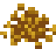 | **Ziarnko gorczycy** | Zetnij nożem nasiona z gorczycy pełnej złotych strąków (żółto kwitnie w brzezinach i na łąkach). | „Najmniejsze z nasion, a roślina wyrosła większa niż one wszystkie razem.” |
| 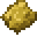 | **Cierpliwość kamienia** | Zbierz duży porost ze skały albo pnia (oliwkowy, iglasty albo żółtą ochrę). | „Rośnie kilka milimetrów na rok. Ten tutaj pamięta czasy, kiedy świat był jeszcze płaski.” |
| 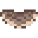 | **Półka na pniu** | Zbierz hubę ze starej, piętrowej huby na pniu drzewa (lasy liściaste i buczyny). | „Drzewo nie prosiło o półki. Dostało je i tak.” |
| 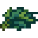 | **Błękit z zieleni** | Zetnij nożem liście z kwitnącego indygowca - rozłożystego krzewu z fioletowymi gronami (brzeziny, skraje łąk). | „Zielone liście, a w środku najgłębszy granat świata. Natura lubi niespodzianki.” |
| 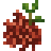 | **Czerwień spod ziemi** | Wykop korzeń z kwitnącej marzanny barwierskiej (mokradła i lasy - szukaj kremowych kwiatków z czerwonym środkiem). | „Na górze skromne kwiatki, a pod ziemią cała czerwień. Marzanna zawsze była tajemnicza.” |
| 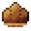 | **Zielone palce** | Posadź owoc, orzech albo szyszkę. | „Teraz najtrudniejsza część ogrodnictwa: czekanie.” |
| 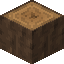 | **Drwal** | Zetnij pień drzewa. | „Drzewo nawet nie zdążyło krzyknąć „uwaga!”.” |
| 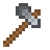 | **Ostrze w ruch** | W trybie przygody zetnij pień drzewa siekierą (idzie trzy razy szybciej niż ręką). | „Ręce bolą mniej. Drzewo - bardziej.” |
|  | **Prawie robi różnicę** *(sekret)* | W trybie przygody kop blok i puść przycisk, gdy jest już prawie rozbity. | „Blok odetchnął z ulgą. Na razie.” |
| 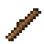 | **Złota rączka** | Wytwórz coś w ekwipunku (siatka 2 x 2 - E). | „Z dwóch desek cztery patyki. Matematyka się nie zgadza, ale działa.” |
|  | **Stolarz** | Zrób coś na stole stolarskim (deski na lewą część blatu, PPM w wyrób). | „Schody do nieba to na razie schody do szopy. Ale zawsze.” |
|  | **Kolorowe światła** | Zrób kolorową lampę (lampa i coś w tym kolorze). | „Disco w jaskini. Nietoperze są zachwycone.” |
| 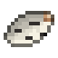 | **Brzozowy papirus** | Zdejmij siekierą korę z brzozy (PPM siekierą na pniu). | „Dawniej pisano na niej listy. Ty możesz napisać listę zakupów.” |
|  | **Mokra robota** | Popływaj w wodzie. | „Potwierdzone naukowo: woda jest mokra.” |
|  | **Nocny marek** | Bądź w świecie o północy. | „Porządni gracze już dawno śpią. Ty nie jesteś porządnym graczem.” |
| 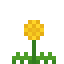 | **Złota godzina** | Popatrz prosto na zachodzące (albo wschodzące) słońce. | „Fotografowie nazywają to złotą godziną. Ty nazywasz to: jeszcze jeden blok i kończę.” |
| 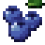 | **Borówkowy język** | Zbierz borówki z krzaka (rosną w borach i świerczynach). | „Język fioletowy, palce fioletowe, koszulka też. Było warto.” |
|  | **Prosto z krzewu** | Zbierz owoce z krzewu jagodowego (np. maliny, porzeczki albo aronię). | „Połowa do koszyka, połowa do buzi. Koszyk nie protestuje.” |
|  | **Zapach czerwca** | Zerwij płatki dzikiej róży albo kwiaty bzu czarnego z kwitnącego krzewu. | „Krzew zakwitnie jeszcze raz. Owoców z tej gałązki już nie będzie - coś za coś.” |
|  | **Własny krzew** | Posadź owoc krzewu jagodowego na rozgrzebanej ziemi. | „Teraz tylko poczekać. Krzew się nie spieszy, ty też nie musisz.” |
|  | **Coś na ciepło** | Ugotuj potrawę w glinianym garnku nad ogniskiem. | „Woda, ogień i trochę cierpliwości. Reszta to już kuchnia.” |
|  | **Runo leśne** | Zbierz żurawinę, borówki brusznice i poziomki (PPM na roślinie z owocami). | „Wszystko rośnie przy samej ziemi. Kolana to zapamiętają.” |
|  | **Grządka** | Posadź na rozgrzebanej ziemi żurawinę, brusznicę, poziomki, pestki dyni albo cukinię. | „Niskie to to, ale twoje.” |
|  | **Dyniowe żniwa** | Pokrój dynię na kawałki (dynia w siatce wytwarzania). | „Cztery kawałki i garść pestek na przyszły rok. Dynia myśli o wszystkim.” |
|  | **Nocny sąsiad** | Spotkaj jeżyka - podejdź do niego na kilka kroków, gdy żeruje po zmierzchu. | „Mieszka w krzewie obok. Wychodzi, kiedy ty kładziesz się spać.” |
|  | **Z ręki** | Nakarm jeżyka jagodami z ręki (PPM z owocami w dłoni; podejdź powoli). | „Mlask, mlask. Od teraz jesteś „ten z jagodami".” |
|  | **Nowe szaty** | Zagraj z własną paczką tekstur (Ustawienia → Tekstury). | „Ten sam kamień, tylko w wyższej rozdzielczości. Dalej twardy.” |
| 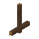 | **Już wiem, co i jak** | Ukończ samouczek. | „Drewno, ogień, kolacja, sen. Reszta to już tylko szczegóły.” |
|  | **Smacznego** | Zjedz tyle, żeby zaliczyć posiłek. | „Brzuch przestał burczeć. Na jakieś pięć minut.” |
| 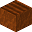 | **Rolnik z przypadku** | Rozgrzeb ziemię łopatą (PPM) - powstanie pole. | „Dziura w ziemi, ale twoja. I coś na niej wyrośnie.” |
| 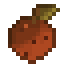 | **Kolacja przy ognisku** | Upiecz coś nad płonącym ogniskiem (trzymaj PPM z jedzeniem). | „Lekko przypalone. Czyli idealne.” |
|  | **Grawitacja działa** | Stłucz nogę, spadając z wysokości. | „Ziemia była bliżej, niż się wydawało. A potem nagle bardzo blisko.” |
| 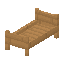 | **Pościelone** | Pościel stelaż łóżka (PPM pościelą na stelażu). | „Mama mówiła, żeby ścielić łóżko. Nie mówiła, że najpierw trzeba je zbudować.” |
| 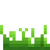 | **Pod gołym niebem** | Prześpij noc na gołej ziemi. | „Gwiazdy piękne, kamień pod łopatką - mniej.” |
|  | **Coś na rozgrzewkę** | Wypij napar z ziół (kubek ziół podgrzany nad ogniskiem). | „Smakuje jak łąka. W dobrym sensie.” |
| 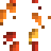 | **Złota jesień** | Doczekaj jesieni: liście klonów czerwienieją, brzóz żółkną, dębów brązowieją - im dalej w jesień, tym mocniej. | „Drzewa zmieniają garderobę. Tobie zostaje ta sama koszula.” |
| 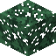 | **Pierwszy szron** | Doczekaj zimy: liście szarzeją, a w chłodnych stronach bieli je cienki śnieg. | „Cicho, biało i zimno w palce. Pogoda dopiero się rozkręca.” |
|  | **Pierwsze krople** | Bądź w miejscu, nad które pogoda przyniosła deszcz (front albo przelotny opad). | „Prognoza mówiła: weź parasol. Ale parasoli jeszcze nie wymyślono.” |
|  | **Wiatr we włosach** | Poczuj naprawdę silny wiatr - taki, jaki niesie front chłodny albo burza. | „Fryzura do poprawki. Kapelusz - gdybyś go miał - już trzy biomy dalej.” |
|  | **Ani jednej chmurki** | Bądź w środku wyżu w biały dzień: nad tobą samo niebieskie niebo. | „Idealna pogoda na cokolwiek. Szkoda, że cokolwiek to znowu kopanie.” |
| 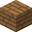 | **Niech sobie pada** | Przeczekaj deszcz pod dachem, w jaskini albo pod gęstą koroną drzewa - tam krople nie dolatują. | „Dach: wynalazek, który docenia się dopiero w deszczu.” |
|  | **Mleko** | Wejdź w gęstą poranną mgłę (zbiera się przed świtem przy czystym niebie i słabym wietrze, najczęściej jesienią). | „Widoczność: własne buty. I to tylko lewy.” |
|  | **Raz, dwa, trzy...** | Bądź nie dalej niż kilometr od pioruna, który bije w ziemię - i policz sekundy do grzmotu (trzy sekundy to kilometr). | „Fizyka dźwięku w praktyce. Stanie pod drzewem w praktyce: zły pomysł.” |
| 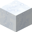 | **Kulki lodu** | Wyjdź pod gołe niebo, gdy pada grad (krótko, w samym środku najsilniejszych burz). | „Darmowy lód do napojów. Dostawa prosto na głowę.” |
|  | **Pierwszy śnieg** | Bądź tam, gdzie pada śnieg - zimą, w chłodnych stronach świata albo wysoko w górach, gdy w dolinie pada deszcz. | „Złapany na język: smakuje jak chmura. Wiadomo.” |
|  | **Biało, bielutko** | Stań pod gołym niebem tam, gdzie ziemię przykrył śnieg. | „Ślady na świeżym śniegu: jedyny dowód, że ktoś tu w ogóle wychodzi z domu.” |
|  | **Srebrny poranek** | Zobacz szron: osiada w mroźną, pogodną i cichą noc, a rano znika. | „Trawa chrupie pod butami. Drugie śniadanie też by się przydało.” |
| 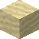 | **Piasek w zębach** | Znajdź się w burzy piaskowej: na pustyni, gdy mocno wieje (przed frontem chłodnym albo przy burzy). | „Chrupie. Darmowy peeling całego ciała w cenie.” |
| 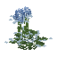 | **Nie dotykać** | Wejdź w kłującą roślinę. | „Mikołajek nie przynosi prezentów. Mikołajek kłuje.” |
| 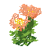 | **Coś wisi w powietrzu** | Doczekaj zmiany pory roku. | „Wczoraj jedno kwitło, dziś drugie. Kalendarz nie pyta o zgodę.” |

## Rzadkie (25 pkt)

| | Tytuł | Jak zdobyć | Komentarz |
|---|---|---|---|
|  | **Kuchmistrz** | Ugotuj każdą z sześciu potraw. | „Garnek ten sam, a za każdym razem pachnie inaczej.” |
|  | **Biały kruk wśród jeży** | Spotkaj jeżyka albinosa. | „Kremowe kolce, czerwone oczka. Trafia się raz na kilkadziesiąt jeży.” |
| 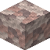 | **Murarz** | Postaw 500 bloków. | „Pięćset bloków. Kręgosłup pamięta każdy z nich.” |
| 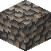 | **Głębinowiec** | Zanurkuj 10 bloków pod powierzchnię wody. | „Ryb brak, ale za to jest ciemno, mokro i trochę strasznie.” |
|  | **Ponad chmurami** | Wzleć na wysokość 1000 bloków. | „Stąd wszystko wygląda tak malutko. Ty też.” |
| 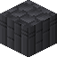 | **Naoczny świadek** | Bądź najwyżej 60 bloków od miejsca, w które uderzy meteoryt. | „Spadło. Ty nie. Tym razem.” |
| 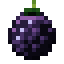 | **Pełne kosze** | Zbierz owoce z każdego rodzaju krzaka. | „Truskawki, jeżyny, chili i orzechy. Dieta jak marzenie, zwłaszcza to chili.” |
|  | **Jagodowy ogród** | Zbierz owoce wszystkich krzewów jagodowych: aronię, porzeczki czerwone i czarne, agrest zielony i czerwony, maliny czerwone i żółte, owoce dzikiej róży, bzu czarnego i rokitnika. | „Dziesięć smaków, od cierpkiej aronii po kwaśny rokitnik. Dżem zrobi się sam - w kieszeni.” |
| 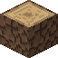 | **Leśniczy** | Zetnij pień każdego z sześciu gatunków drzew: świerka, sosny, buka, lipy, dębu i brzozy. | „Znasz już las od środka. Las ciebie też - i prosi o chwilę przerwy.” |
|  | **Smaki dalekich stron** | Zjedz figę, owoc baobabu, jagody draceny, kwiaty jukki, orzeszki araukarii i kokos (zbiera się je PPM z liści, na których rosną). | „Sześć smaków, sześć stref klimatycznych. Żołądek prosi o przewodnik.” |
|  | **Ogrodnik przypływów** | Posadź namorzyn w płytkiej wodzie (sadzonka albo siewka kliknięta w piaszczyste lub błotniste dno). | „Inni sadzą w ziemi. Ty postanowiłeś zaufać morzu.” |
|  | **Siedem kolorów** | Zobacz tęczę: niskie słońce za plecami, deszcz przed tobą. | „Garnka złota na końcu nie ma. Sprawdzono. Dwa razy.” |
|  | **O włos** | Przeżyj uderzenie pioruna bliżej niż 50 bloków od siebie. | „Włosy stanęły dęba. To nie ze strachu, to elektrostatyka. Na pewno.” |
|  | **Zadymka** | Wyjdź w śnieżycę: gęsty śnieg i wiatr od 6 bloków na sekundę. | „Widoczność: czubek własnego nosa. I to zamarznięty.” |
|  | **Ściana** | Daj się połknąć ścianie pyłu (haboob), która idzie przez pustynię przed frontem chłodnym albo burzą. | „Najpierw horyzont zrobił się brązowy. Potem zniknął. Potem zniknęło wszystko.” |
|  | **Diabełek** | Wejdź w wir pyłowy - wstają nad pustynią w upalne, słoneczne i bezwietrzne popołudnia. | „Kręci się, szumi, sypie w oczy. Jak młodszy brat, tylko z piasku.” |
|  | **Wilk morski** | Bądź na otwartym morzu w czasie sztormu - na tratwie albo wpław. | „Fale jak domy. No, jak domki. Dobrze: jak pół bloku. Ale mokre!” |
|  | **Głowa w chmurach** | Wleć w niską chmurę (podstawa chmur jest wysoko nad najwyższymi górami). | „Biało, mokro i nic nie widać. Dokładnie tak, jak mówili.” |
| 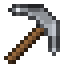 | **Komplet narzędzi** | Zrób siekierę, kilof i łopatę (postęp liczy się w księdze). | „Teraz brakuje tylko skrzynki na narzędzia. I garażu. I warsztatu.” |
| 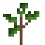 | **Z małego ziarenka** | Wyhoduj drzewo z sadzonki. | „Wyrosło! Teraz tylko sto lat i będzie z niego porządny dąb. Albo brzoza.” |
|  | **Kopalnia w kieszeni** | Zagraj na telefonie albo tablecie i zniszcz blok palcem. | „Bateria właśnie zaczęła się pocić.” |
|  | **Lokator z ikonką** | Zagraj w aplikacji na telefon (zainstalowanej, z ikonką na ekranie). | „Gra zamieszkała na twoim telefonie. Czynszu nie płaci.” |
|  | **Spływ** | Daj się ponieść nurtowi rzeki przez 100 bloków. | „Wiosło? Jakie wiosło? Rzeka wie, dokąd płynie.” |
| 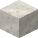 | **Projektant wnętrz** | Postaw każdy z pięciu budulców: tynk wapienny, tynk ochrowy, terakotę, polerowany kamień i ciemne deski. | „Biel optycznie powiększa wnętrze. Ciemne deski - optycznie zmniejszają rachunki za prąd.” |
| 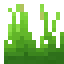 | **Turysta** | Odwiedź każdy z 20 biomów lądowych: łąkę, lasy, góry, mokradła, wydmy... (/biom lista). | „Łąka, bór, bagno, szczyt. Pocztówki wyślesz później.” |
|  | **Dach świata** | Stań na śniegu na ośnieżonym szczycie. | „Widok jak z pocztówki, wiatr jak z zamrażarki.” |
|  | **Promyk słońca** | Stań w plamie słońca pod dachem (słońce wpada przez okno albo dziurę w ścianie). | „Jak kot na parapecie. Brakuje tylko mruczenia.” |
| 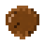 | **Śniadanie, obiad, kolacja** | Zalicz trzy posiłki jednego dnia. | „Trzy posiłki dziennie. Organizm jest w szoku, ale wdzięczny.” |
| 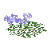 | **Morze kwiatów** | Stań w środku miejsca, które opanowała jedna roślina. | „Ktoś tu przesadził. Dosłownie.” |
| 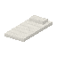 | **Jak w puchu** | Prześpij noc w pościelonym łóżku. | „Własne łóżko. Od teraz każda ziemianka to już dom.” |
|  | **Zielarz** | Wypij wszystkie trzy rodzaje naparów: na sen, leczniczy i wzmacniający. | „Na wszystko jest zioło. Trzeba tylko wiedzieć, które.” |
|  | **Nie polecam** *(sekret)* | Strać przytomność pod wodą i obudź się na brzegu. | „Ryby patrzyły. Żadna nie pomogła.” |

## Bardzo rzadkie (50 pkt)

| | Tytuł | Jak zdobyć | Komentarz |
|---|---|---|---|
|  | **Drzewa świata** | Zetnij pień każdego z trzynastu drzew z dalekich stron: jodły, baobabu, palmy kokosowej, modrzewia, namorzynu, puchowca, jukki, osiki, araukarii, figowca, draceny, cedru i sosny ościstej (/biom znajdz sawanna, pustynia, deszczowy, namorzyny). | „Od namorzynów po granicę śniegu. Paszport pełen słojów.” |
|  | **Cztery pory roku** | Bądź w świecie wiosną, latem, jesienią i zimą. | „Pełny obrót. Vivaldi napisał o tym koncert, ty po prostu przetrwałeś.” |
|  | **Dzień jak noc** | Zobacz pełne zaćmienie słońca. | „Słońce na chwilę zrobiło sobie przerwę. Ty jak zwykle nie.” |
|  | **Kosmiczny złom** | Wykop blok meteorytu. | „Kawałek nieba w kieszeni. Jeszcze ciepły.” |
|  | **Houston, mamy widok** *(sekret)* | Wyleć w kosmos. | „Mały krok dla gracza, wielki skok dla... a nie, to też tylko gracz.” |
|  | **Koniec świata** | Dojdź do granicy świata (30000 bloków od środka). | „Dalej nic nie ma. Sprawdzaliśmy. Dwa razy.” |

## Legendarne (100 pkt)

| | Tytuł | Jak zdobyć | Komentarz |
|---|---|---|---|
|  | **Problem spadł z nieba** *(sekret)* | Wyląduj jako meteoryt. | „Tym razem problemem byłeś ty.” |
|  | **Skok do basenu** *(sekret)* | Wpadnij do wody prosto z kosmosu. | „Najdroższy skok do wody w historii. Sędziowie dają 10/10, ryby 0/10.” |
