# Przedmioty

> Ta strona jest generowana z kodu gry (`python tools/wiki.py`) - nie zmieniaj jej ręcznie, zmiany przepadną przy następnym generowaniu.

Wersja gry **0.55.0** - 48 przedmiotów. Przedmiotu nie da się postawić jak bloku; owoce i nasiona posadzone na ziemi (PPM) wyrastają w krzak albo drzewo, narzędzia przyspieszają kopanie.

## Drewno

| | Nazwa | W komendach | Najważniejsze |
|---|---|---|---|
| 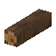 | **Opał — dąb** | `oak_firewood` | **Przepis:** Opał — dąb x4 |
| 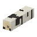 | **Opał — brzoza** | `birch_firewood` | **Przepis:** Opał — brzoza x4 |
| 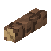 | **Opał — świerk** | `spruce_firewood` | **Przepis:** Opał — świerk x4 |
| 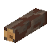 | **Opał — sosna** | `pine_firewood` | **Przepis:** Opał — sosna x4 |
| 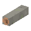 | **Opał — buk** | `beech_firewood` | **Przepis:** Opał — buk x4 |
| 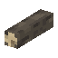 | **Opał — lipa** | `linden_firewood` | **Przepis:** Opał — lipa x4 |
| 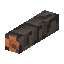 | **Opał — olcha** | `olcha_firewood` | **Przepis:** Opał — olcha x4 |
| 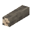 | **Opał — wierzba** | `wierzba_firewood` | **Przepis:** Opał — wierzba x4 |
| 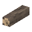 | **Opał — jabłoń** | `jablon_firewood` | **Przepis:** Opał — jabłoń x4 |

## Rośliny

| | Nazwa | W komendach | Najważniejsze |
|---|---|---|---|
| 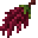 | **Wiecha amarantusa** | `amarantus_wiecha` | **Skąd:** zbiór (PPM): Amarantus (dojrzałe wiechy) **Przydaje się do:** Czerwona lampa |
| 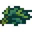 | **Liście indygowca** | `indygowiec_liscie` | **Skąd:** zbiór (PPM): Indygowiec (kwitnie) **Przydaje się do:** Niebieska lampa |
| 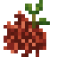 | **Korzeń marzanny** | `marzanna_korzen` | **Skąd:** zbiór (PPM): Marzanna (kwitnie) **Przydaje się do:** Czerwona lampa |

## Owoce i nasiona

| | Nazwa | W komendach | Najważniejsze |
|---|---|---|---|
|  | **Truskawki** | `strawberry` | **Posadzony (PPM na ziemi):** Sadzonka truskawki **Skąd:** zbiór (PPM): Krzak truskawki (kilka owoców); zbiór (PPM): Krzak truskawki (pełen owoców) **Przydaje się do:** Czerwona lampa |
|  | **Jeżyny** | `blackberry` | **Posadzony (PPM na ziemi):** Sadzonka jeżyny **Skąd:** zbiór (PPM): Krzak jeżyny (kilka owoców); zbiór (PPM): Krzak jeżyny (pełen owoców) **Przydaje się do:** Fioletowa lampa |
|  | **Papryczki chili** | `chili_pepper` | **Posadzony (PPM na ziemi):** Sadzonka papryczki chili **Skąd:** zbiór (PPM): Krzak papryczki chili (kilka papryczek); zbiór (PPM): Krzak papryczki chili (pełen papryczek) **Przydaje się do:** Czerwona lampa |
|  | **Orzech laskowy** | `hazelnut` | **Posadzony (PPM na ziemi):** Sadzonka leszczyny **Skąd:** zbiór (PPM): Leszczyna (kilka orzechów); zbiór (PPM): Leszczyna (pełna orzechów) |
|  | **Borówki** | `blueberry` | **Posadzony (PPM na ziemi):** Sadzonka borówki **Skąd:** zbiór (PPM): Krzak borówki (kilka owoców); zbiór (PPM): Krzak borówki (pełen owoców) **Przydaje się do:** Niebieska lampa |
|  | **Szyszka świerka** | `spruce_cone` | **Posadzony (PPM na ziemi):** Sadzonka świerka **Skąd:** czasem z bloku: Igliwie świerka (8%) **Przydaje się do:** Wieniec świerkowy |
|  | **Szyszka sosny** | `pine_cone` | **Posadzony (PPM na ziemi):** Sadzonka sosny **Skąd:** czasem z bloku: Igliwie sosny (8%) **Przydaje się do:** Wieniec świerkowy |
|  | **Orzeszki bukowe** | `beechnuts` | **Posadzony (PPM na ziemi):** Sadzonka buka **Skąd:** czasem z bloku: Liście buka (8%) |
|  | **Kwiat lipy** | `linden_flower` | **Posadzony (PPM na ziemi):** Sadzonka lipy **Skąd:** zbiór (PPM): Kwitnące liście lipy |
|  | **Żołądź** | `acorn` | **Posadzony (PPM na ziemi):** Sadzonka dębu **Skąd:** czasem z bloku: Liście dębu (10%) |
|  | **Jabłko** | `jablon_jablko` | **Posadzony (PPM na ziemi):** Sadzonka jabłoni **Paczka drzewa:** assets/drzewa/jablon **Skąd:** czasem z bloku: Liście jabłoni (5%); czasem z bloku: Liście jabłoni z jabłkami (5%); zbiór (PPM): Liście jabłoni z jabłkami; czasem z bloku: Liście jabłoni (jabłka odrastają) (5%) **Przydaje się do:** Czerwona lampa |
| 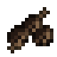 | **Szyszeczki olchy** | `olcha_szyszki` | **Posadzony (PPM na ziemi):** Sadzonka olchy **Paczka drzewa:** assets/drzewa/olcha **Skąd:** czasem z bloku: Liście olchy (6%) |
| 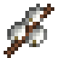 | **Bazie** | `wierzba_bazie` | **Posadzony (PPM na ziemi):** Sadzonka wierzby **Paczka drzewa:** assets/drzewa/wierzba **Skąd:** czasem z bloku: Liście wierzby (6%) **Przydaje się do:** Lampa |

## Ozdoby

| | Nazwa | W komendach | Najważniejsze |
|---|---|---|---|
| 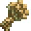 | **Bukiet kocanki** | `kocanka_bukiet` | **Skąd:** zbiór (PPM): Kocanka (kwitnie) |
| 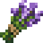 | **Bukiet lawendy** | `lawenda_bukiet` | **Skąd:** zbiór (PPM): Lawenda (kwitnie) |
| 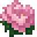 | **Kwiat piwonii** | `piwonia_kwiat` | **Skąd:** zbiór (PPM): Piwonia (kwitnie) |
| 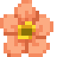 | **Kwiat zawilca** | `zawilec_kwiat` | **Skąd:** zbiór (PPM): Zawilec (kwitnie) |
| 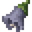 | **Kwiat dzwonka** | `dzwonek_kwiat` | **Skąd:** zbiór (PPM): Dzwonek (kwitnie) |
| 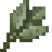 | **Liście szałwii** | `szalwia_lisc` | **Skąd:** zbiór (PPM): Szałwia (kwitnie) |
| 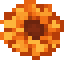 | **Kwiat nagietka** | `nagietek_kwiat` | **Skąd:** zbiór (PPM): Nagietek (kwitnie) |
| 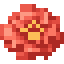 | **Kwiat cynii** | `cynia_kwiat` | **Skąd:** zbiór (PPM): Cynia (kwitnie) |
| 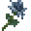 | **Kwiat mikołajka** | `mikolajek_kwiat` | **Skąd:** zbiór (PPM): Mikołajek (kwitnie) |
| 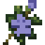 | **Kwiat barwinka** | `barwinek_kwiat` | **Skąd:** zbiór (PPM): Barwinek (kwitnie) |
| 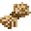 | **Wiązka lnu** | `len_wiazka` | **Skąd:** zbiór (PPM): Len (dojrzały, suchy) |
| 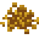 | **Nasiona gorczycy** | `gorczyca_nasiona` | **Skąd:** zbiór (PPM): Gorczyca (strąki) |
| 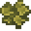 | **Plecha porostu oliwkowego** | `porostoliwkowy_plecha` | **Skąd:** zbiór (PPM): Porost oliwkowy (duża plecha) |
| 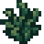 | **Gałązki porostu iglastego** | `porostiglasty_galazki` | **Skąd:** zbiór (PPM): Porost iglasty (gęsty) |
| 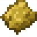 | **Grudka żółtej ochry** | `ochra_grudka` | **Skąd:** zbiór (PPM): Żółta ochra (skorupa) |
| 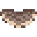 | **Huba** | `huba_huba` | **Skąd:** zbiór (PPM): Huba (stara, piętrowa) |

## Narzędzia i surowce

| | Nazwa | W komendach | Najważniejsze |
|---|---|---|---|
| 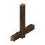 | **Starter ognia** | `fire_starter` | **Przepis:** Starter ognia |
|  | **Żywica** | `resin` | **Skąd:** zbiór (PPM): Pień sosny z żywicą **Przydaje się do:** Lampa |
|  | **Kora brzozowa** | `birch_bark` | **Skąd:** okorowanie siekierą: Pień brzozy **Przydaje się do:** Lampa |
|  | **Siekiera** | `axe` | **Narzędzie:** kopie 3 razy szybciej: drewno **Przepis:** Siekiera **Przydaje się do:** Opał — dąb, Opał — brzoza, Opał — świerk, Opał — sosna, Opał — buk, Opał — lipa, Opał — olcha, Opał — wierzba, Opał — jabłoń |
|  | **Kilof** | `pickaxe` | **Narzędzie:** kopie 3 razy szybciej: kamień **Przepis:** Kilof |
|  | **Łopata** | `shovel` | **Narzędzie:** kopie 3 razy szybciej: trawa, ziemia, piasek, żwir, błoto, snow **Przepis:** Łopata |
|  | **Patyk** | `stick` | **Przepis:** Patyk x4 **Przydaje się do:** Starter ognia, Siekiera, Kilof, Łopata |
