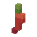
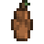
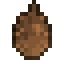
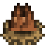
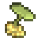
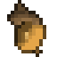
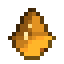
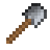

# Przedmioty

> Ta strona jest generowana z kodu gry (`python tools/wiki.py`) - nie zmieniaj jej ręcznie, zmiany przepadną przy następnym generowaniu.

Wersja gry **0.16.0** - 16 przedmiotów. Przedmiotu nie da się postawić jak bloku; owoce i nasiona posadzone na ziemi (PPM) wyrastają w krzak albo drzewo, narzędzia przyspieszają kopanie.

## Owoce i nasiona

| | Nazwa | W komendach | Najważniejsze |
|---|---|---|---|
|  | **Truskawki** | `strawberry` | **Posadzony (PPM na ziemi):** Sadzonka truskawki **Skąd:** zbiór (PPM): Krzak truskawki (kilka owoców); zbiór (PPM): Krzak truskawki (pełen owoców) **Przydaje się do:** Czerwona lampa |
|  | **Jeżyny** | `blackberry` | **Posadzony (PPM na ziemi):** Sadzonka jeżyny **Skąd:** zbiór (PPM): Krzak jeżyny (kilka owoców); zbiór (PPM): Krzak jeżyny (pełen owoców) **Przydaje się do:** Fioletowa lampa |
|  | **Papryczki chili** | `chili_pepper` | **Posadzony (PPM na ziemi):** Sadzonka papryczki chili **Skąd:** zbiór (PPM): Krzak papryczki chili (kilka papryczek); zbiór (PPM): Krzak papryczki chili (pełen papryczek) **Przydaje się do:** Czerwona lampa |
|  | **Orzech laskowy** | `hazelnut` | **Posadzony (PPM na ziemi):** Sadzonka leszczyny **Skąd:** zbiór (PPM): Leszczyna (kilka orzechów); zbiór (PPM): Leszczyna (pełna orzechów) |
|  | **Szyszka świerka** | `spruce_cone` | **Posadzony (PPM na ziemi):** Sadzonka świerka **Skąd:** czasem z bloku: Igliwie świerka (8%) **Przydaje się do:** Wieniec świerkowy |
|  | **Szyszka sosny** | `pine_cone` | **Posadzony (PPM na ziemi):** Sadzonka sosny **Skąd:** czasem z bloku: Igliwie sosny (8%) **Przydaje się do:** Wieniec świerkowy |
|  | **Orzeszki bukowe** | `beechnuts` | **Posadzony (PPM na ziemi):** Sadzonka buka **Skąd:** czasem z bloku: Liście buka (8%) |
|  | **Kwiat lipy** | `linden_flower` | **Posadzony (PPM na ziemi):** Sadzonka lipy **Skąd:** zbiór (PPM): Kwitnące liście lipy |
|  | **Żołądź** | `acorn` | **Posadzony (PPM na ziemi):** Sadzonka dębu **Skąd:** czasem z bloku: Liście dębu (10%) |
|  | **Jabłko** | `jablon_jablko` | **Posadzony (PPM na ziemi):** Sadzonka jabłoni **Paczka drzewa:** assets/drzewa/jablon **Skąd:** czasem z bloku: Liście jabłoni (5%); czasem z bloku: Liście jabłoni z jabłkami (5%); zbiór (PPM): Liście jabłoni z jabłkami; czasem z bloku: Liście jabłoni (jabłka odrastają) (5%) **Przydaje się do:** Czerwona lampa |

## Narzędzia i surowce

| | Nazwa | W komendach | Najważniejsze |
|---|---|---|---|
|  | **Żywica** | `resin` | **Skąd:** zbiór (PPM): Pień sosny z żywicą **Przydaje się do:** Lampa |
|  | **Kora brzozowa** | `birch_bark` | **Skąd:** okorowanie siekierą: Pień brzozy **Przydaje się do:** Lampa |
|  | **Siekiera** | `axe` | **Narzędzie:** kopie 3 razy szybciej: drewno **Przepis:** Siekiera |
|  | **Kilof** | `pickaxe` | **Narzędzie:** kopie 3 razy szybciej: kamień **Przepis:** Kilof |
|  | **Łopata** | `shovel` | **Narzędzie:** kopie 3 razy szybciej: trawa, ziemia, piasek, żwir, błoto **Przepis:** Łopata |
|  | **Patyk** | `stick` | **Przepis:** Patyk x4 **Przydaje się do:** Siekiera, Kilof, Łopata |
