# Przedmioty

> Ta strona jest generowana z kodu gry (`python tools/wiki.py`) - nie zmieniaj jej ręcznie, zmiany przepadną przy następnym generowaniu.

Wersja gry **0.93.0** - 93 przedmiotów. Przedmiotu nie da się postawić jak bloku; owoce i nasiona posadzone na ziemi (PPM) wyrastają w krzak albo drzewo, narzędzia przyspieszają kopanie.

## Drewno

| | Nazwa | W komendach | Najważniejsze |
|---|---|---|---|
|  | **Opał — dąb** | `oak_firewood` | **Przepis:** Opał — dąb x4 |
|  | **Opał — brzoza** | `birch_firewood` | **Przepis:** Opał — brzoza x4 |
|  | **Opał — świerk** | `spruce_firewood` | **Przepis:** Opał — świerk x4 |
|  | **Opał — sosna** | `pine_firewood` | **Przepis:** Opał — sosna x4 |
|  | **Opał — buk** | `beech_firewood` | **Przepis:** Opał — buk x4 |
|  | **Opał — lipa** | `linden_firewood` | **Przepis:** Opał — lipa x4 |
|  | **Opał — olcha** | `olcha_firewood` | **Przepis:** Opał — olcha x4 |
|  | **Opał — wierzba** | `wierzba_firewood` | **Przepis:** Opał — wierzba x4 |
|  | **Opał — jabłoń** | `jablon_firewood` | **Przepis:** Opał — jabłoń x4 |
| 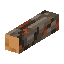 | **Opał — akacja** | `acacia_firewood` | **Przepis:** Opał — akacja x4 |
| 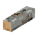 | **Opał — cypryśnik** | `bald_cypress_firewood` | **Przepis:** Opał — cypryśnik x4 |
| 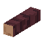 | **Opał — wiśnia** | `cherry_firewood` | **Przepis:** Opał — wiśnia x4 |
| 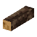 | **Opał — klon** | `maple_firewood` | **Przepis:** Opał — klon x4 |
| 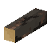 | **Opał — kosodrzewina** | `mugo_firewood` | **Przepis:** Opał — kosodrzewina x4 |
| 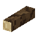 | **Opał — oliwka** | `olive_firewood` | **Przepis:** Opał — oliwka x4 |
| 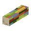 | **Opał — eukaliptus** | `rainbow_eucalyptus_firewood` | **Przepis:** Opał — eukaliptus x4 |
| 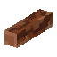 | **Opał — sekwoja** | `sequoia_firewood` | **Przepis:** Opał — sekwoja x4 |
| 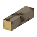 | **Opał — miłorząb** | `ginkgo_firewood` | **Przepis:** Opał — miłorząb x4 |
| 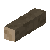 | **Opał — jakaranda** | `jacaranda_firewood` | **Przepis:** Opał — jakaranda x4 |

## Rośliny

| | Nazwa | W komendach | Najważniejsze |
|---|---|---|---|
|  | **Wiecha amarantusa** | `amarantus_wiecha` | **Skąd:** zbiór (PPM): Amarantus (dojrzałe wiechy) **Przydaje się do:** Czerwona lampa, Barwnik czerwony |
|  | **Liście indygowca** | `indygowiec_liscie` | **Skąd:** zbiór (PPM): Indygowiec (kwitnie) **Przydaje się do:** Niebieska lampa, Barwnik niebieski |
|  | **Korzeń marzanny** | `marzanna_korzen` | **Skąd:** zbiór (PPM): Marzanna (kwitnie) **Przydaje się do:** Czerwona lampa, Barwnik czerwony |

## Owoce i nasiona

| | Nazwa | W komendach | Najważniejsze |
|---|---|---|---|
| 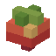 | **Truskawki** | `strawberry` | **Posadzony (PPM na ziemi):** Sadzonka truskawki **Skąd:** zbiór (PPM): Krzak truskawki (kilka owoców); zbiór (PPM): Krzak truskawki (pełen owoców) **Przydaje się do:** Czerwona lampa, Barwnik czerwony |
| 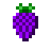 | **Jeżyny** | `blackberry` | **Posadzony (PPM na ziemi):** Sadzonka jeżyny **Skąd:** zbiór (PPM): Krzak jeżyny (kilka owoców); zbiór (PPM): Krzak jeżyny (pełen owoców) **Przydaje się do:** Fioletowa lampa, Barwnik fioletowy |
|  | **Papryczki chili** | `chili_pepper` | **Posadzony (PPM na ziemi):** Sadzonka papryczki chili **Skąd:** zbiór (PPM): Krzak papryczki chili (kilka papryczek); zbiór (PPM): Krzak papryczki chili (pełen papryczek) **Przydaje się do:** Czerwona lampa, Barwnik czerwony |
| 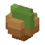 | **Orzech laskowy** | `hazelnut` | **Posadzony (PPM na ziemi):** Sadzonka leszczyny **Skąd:** zbiór (PPM): Leszczyna (kilka orzechów); zbiór (PPM): Leszczyna (pełna orzechów) |
|  | **Borówki** | `blueberry` | **Posadzony (PPM na ziemi):** Sadzonka borówki **Skąd:** zbiór (PPM): Krzak borówki (kilka owoców); zbiór (PPM): Krzak borówki (pełen owoców) **Przydaje się do:** Niebieska lampa, Barwnik niebieski |
|  | **Szyszka świerka** | `spruce_cone` | **Posadzony (PPM na ziemi):** Sadzonka świerka **Skąd:** czasem z bloku: Igliwie świerka (8%) **Przydaje się do:** Wieniec świerkowy |
|  | **Szyszka sosny** | `pine_cone` | **Posadzony (PPM na ziemi):** Sadzonka sosny **Skąd:** czasem z bloku: Igliwie sosny (8%) **Przydaje się do:** Wieniec świerkowy |
|  | **Orzeszki bukowe** | `beechnuts` | **Posadzony (PPM na ziemi):** Sadzonka buka **Skąd:** czasem z bloku: Liście buka (8%) |
|  | **Kwiat lipy** | `linden_flower` | **Posadzony (PPM na ziemi):** Sadzonka lipy **Skąd:** zbiór (PPM): Kwitnące liście lipy |
|  | **Żołądź** | `acorn` | **Posadzony (PPM na ziemi):** Sadzonka dębu **Skąd:** czasem z bloku: Liście dębu (10%) **Przydaje się do:** Barwnik brązowy |
|  | **Jabłko** | `jablon_jablko` | **Posadzony (PPM na ziemi):** Sadzonka jabłoni **Skąd:** czasem z bloku: Liście jabłoni (5%); czasem z bloku: Liście jabłoni z jabłkami (5%); zbiór (PPM): Liście jabłoni z jabłkami; czasem z bloku: Liście jabłoni (jabłka odrastają) (5%) **Przydaje się do:** Czerwona lampa |
|  | **Szyszeczki olchy** | `olcha_szyszki` | **Posadzony (PPM na ziemi):** Sadzonka olchy **Skąd:** czasem z bloku: Liście olchy (6%) |
|  | **Bazie** | `wierzba_bazie` | **Posadzony (PPM na ziemi):** Sadzonka wierzby **Skąd:** czasem z bloku: Liście wierzby (6%) **Przydaje się do:** Lampa |
| 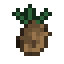 | **Szyszka kosodrzewiny** | `mugo_cone` | **Posadzony (PPM na ziemi):** Sadzonka kosodrzewiny **Skąd:** czasem z bloku: Igliwie kosodrzewiny (7%); czasem z bloku: Igliwie kosodrzewiny z młodymi pędami (7%) |
| 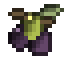 | **Oliwki** | `olive_oliwki` | **Posadzony (PPM na ziemi):** Sadzonka oliwki **Skąd:** czasem z bloku: Liście oliwki (5%); czasem z bloku: Liście oliwki z oliwkami (5%); zbiór (PPM): Liście oliwki z oliwkami; czasem z bloku: Liście oliwki (oliwki odrastają) (5%) |
| 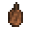 | **Szyszka sekwoi** | `sequoia_cone` | **Posadzony (PPM na ziemi):** Sadzonka sekwoi **Skąd:** czasem z bloku: Igliwie sekwoi (6%); czasem z bloku: Igliwie sekwoi z szyszkami (6%); zbiór (PPM): Igliwie sekwoi z szyszkami; czasem z bloku: Igliwie sekwoi (szyszki odrastają) (6%) |

## Ozdoby

| | Nazwa | W komendach | Najważniejsze |
|---|---|---|---|
|  | **Bukiet kocanki** | `kocanka_bukiet` | **Skąd:** zbiór (PPM): Kocanka (kwitnie) |
|  | **Bukiet lawendy** | `lawenda_bukiet` | **Skąd:** zbiór (PPM): Lawenda (kwitnie) |
|  | **Kwiat piwonii** | `piwonia_kwiat` | **Skąd:** zbiór (PPM): Piwonia (kwitnie) |
|  | **Kwiat zawilca** | `zawilec_kwiat` | **Skąd:** zbiór (PPM): Zawilec (kwitnie) |
|  | **Kwiat dzwonka** | `dzwonek_kwiat` | **Skąd:** zbiór (PPM): Dzwonek (kwitnie) |
|  | **Liście szałwii** | `szalwia_lisc` | **Skąd:** zbiór (PPM): Szałwia (kwitnie) |
|  | **Kwiat nagietka** | `nagietek_kwiat` | **Skąd:** zbiór (PPM): Nagietek (kwitnie) |
|  | **Kwiat cynii** | `cynia_kwiat` | **Skąd:** zbiór (PPM): Cynia (kwitnie) |
|  | **Kwiat mikołajka** | `mikolajek_kwiat` | **Skąd:** zbiór (PPM): Mikołajek (kwitnie) |
|  | **Kwiat barwinka** | `barwinek_kwiat` | **Skąd:** zbiór (PPM): Barwinek (kwitnie) |
|  | **Wiązka lnu** | `len_wiazka` | **Skąd:** zbiór (PPM): Len (dojrzały, suchy) |
|  | **Nasiona gorczycy** | `gorczyca_nasiona` | **Skąd:** zbiór (PPM): Gorczyca (strąki) |
|  | **Plecha porostu oliwkowego** | `porostoliwkowy_plecha` | **Skąd:** zbiór (PPM): Porost oliwkowy (duża plecha) |
|  | **Gałązki porostu iglastego** | `porostiglasty_galazki` | **Skąd:** zbiór (PPM): Porost iglasty (gęsty) |
|  | **Grudka żółtej ochry** | `ochra_grudka` | **Skąd:** zbiór (PPM): Żółta ochra (skorupa) |
|  | **Huba** | `huba_huba` | **Skąd:** zbiór (PPM): Huba (stara, piętrowa) |

## Narzędzia i surowce

| | Nazwa | W komendach | Najważniejsze |
|---|---|---|---|
| 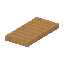 | **Tratwa** | `raft` | **Przepis:** Tratwa |
|  | **Barwnik biały** | `dye_white` | **Przepis:** Barwnik biały **Przydaje się do:** Pochodnia biała, Barwnik jasnoniebieski, Barwnik limonkowy, Barwnik różowy, Barwnik szary, Barwnik jasnoszary |
|  | **Barwnik pomarańczowy** | `dye_orange` | **Przepis:** Barwnik pomarańczowy x2 **Przydaje się do:** Pochodnia pomarańczowa |
|  | **Barwnik purpurowy** | `dye_magenta` | **Przepis:** Barwnik purpurowy x2 **Przydaje się do:** Pochodnia purpurowa |
|  | **Barwnik jasnoniebieski** | `dye_light_blue` | **Przepis:** Barwnik jasnoniebieski x2 **Przydaje się do:** Pochodnia jasnoniebieska |
| 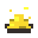 | **Barwnik żółty** | `dye_yellow` | **Przepis:** Barwnik żółty **Przydaje się do:** Pochodnia żółta, Barwnik pomarańczowy |
|  | **Barwnik limonkowy** | `dye_lime` | **Przepis:** Barwnik limonkowy x2 **Przydaje się do:** Pochodnia limonkowa |
|  | **Barwnik różowy** | `dye_pink` | **Przepis:** Barwnik różowy x2 **Przydaje się do:** Pochodnia różowa, Barwnik purpurowy |
| 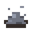 | **Barwnik szary** | `dye_gray` | **Przepis:** Barwnik szary x2 **Przydaje się do:** Pochodnia szara, Barwnik jasnoszary |
| 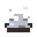 | **Barwnik jasnoszary** | `dye_light_gray` | **Przepis:** Barwnik jasnoszary x2 **Przydaje się do:** Pochodnia jasnoszara |
|  | **Barwnik turkusowy** | `dye_cyan` | **Przepis:** Barwnik turkusowy x2 **Przydaje się do:** Pochodnia turkusowa |
|  | **Barwnik fioletowy** | `dye_purple` | **Przepis:** Barwnik fioletowy **Przydaje się do:** Pochodnia fioletowa, Barwnik purpurowy |
|  | **Barwnik niebieski** | `dye_blue` | **Przepis:** Barwnik niebieski **Przydaje się do:** Pochodnia niebieska, Barwnik jasnoniebieski, Barwnik turkusowy, Barwnik czarny |
| 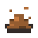 | **Barwnik brązowy** | `dye_brown` | **Przepis:** Barwnik brązowy **Przydaje się do:** Pochodnia brązowa |
| 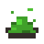 | **Barwnik zielony** | `dye_green` | **Przepis:** Barwnik zielony **Przydaje się do:** Pochodnia zielona, Barwnik limonkowy, Barwnik turkusowy, Barwnik czarny |
|  | **Barwnik czerwony** | `dye_red` | **Przepis:** Barwnik czerwony **Przydaje się do:** Pochodnia czerwona, Barwnik pomarańczowy, Barwnik różowy, Barwnik czarny |
| 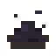 | **Barwnik czarny** | `dye_black` | **Przepis:** Barwnik czarny x3 **Przydaje się do:** Pochodnia czarna, Barwnik szary |
| 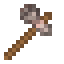 | **Siekiera granitowa** | `axe_granite` | **Narzędzie:** kopie 3 razy szybciej: drewno **Przepis:** Siekiera granitowa **Przydaje się do:** Opał — dąb, Opał — brzoza, Opał — świerk, Opał — sosna, Opał — buk, Opał — lipa, Opał — olcha, Opał — wierzba, Opał — jabłoń, Opał — akacja, Opał — cypryśnik, Opał — wiśnia, Opał — klon, Opał — kosodrzewina, Opał — oliwka, Opał — eukaliptus, Opał — sekwoja, Opał — miłorząb, Opał — jakaranda |
| 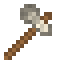 | **Siekiera wapienna** | `axe_limestone` | **Narzędzie:** kopie 3 razy szybciej: drewno **Przepis:** Siekiera wapienna **Przydaje się do:** Opał — dąb, Opał — brzoza, Opał — świerk, Opał — sosna, Opał — buk, Opał — lipa, Opał — olcha, Opał — wierzba, Opał — jabłoń, Opał — akacja, Opał — cypryśnik, Opał — wiśnia, Opał — klon, Opał — kosodrzewina, Opał — oliwka, Opał — eukaliptus, Opał — sekwoja, Opał — miłorząb, Opał — jakaranda |
| 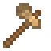 | **Siekiera piaskowcowa** | `axe_sandstone` | **Narzędzie:** kopie 3 razy szybciej: drewno **Przepis:** Siekiera piaskowcowa **Przydaje się do:** Opał — dąb, Opał — brzoza, Opał — świerk, Opał — sosna, Opał — buk, Opał — lipa, Opał — olcha, Opał — wierzba, Opał — jabłoń, Opał — akacja, Opał — cypryśnik, Opał — wiśnia, Opał — klon, Opał — kosodrzewina, Opał — oliwka, Opał — eukaliptus, Opał — sekwoja, Opał — miłorząb, Opał — jakaranda |
| 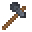 | **Siekiera łupkowa** | `axe_slate` | **Narzędzie:** kopie 3 razy szybciej: drewno **Przepis:** Siekiera łupkowa **Przydaje się do:** Opał — dąb, Opał — brzoza, Opał — świerk, Opał — sosna, Opał — buk, Opał — lipa, Opał — olcha, Opał — wierzba, Opał — jabłoń, Opał — akacja, Opał — cypryśnik, Opał — wiśnia, Opał — klon, Opał — kosodrzewina, Opał — oliwka, Opał — eukaliptus, Opał — sekwoja, Opał — miłorząb, Opał — jakaranda |
| 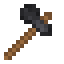 | **Siekiera bazaltowa** | `axe_basalt` | **Narzędzie:** kopie 3 razy szybciej: drewno **Przepis:** Siekiera bazaltowa **Przydaje się do:** Opał — dąb, Opał — brzoza, Opał — świerk, Opał — sosna, Opał — buk, Opał — lipa, Opał — olcha, Opał — wierzba, Opał — jabłoń, Opał — akacja, Opał — cypryśnik, Opał — wiśnia, Opał — klon, Opał — kosodrzewina, Opał — oliwka, Opał — eukaliptus, Opał — sekwoja, Opał — miłorząb, Opał — jakaranda |
| 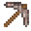 | **Kilof granitowy** | `pickaxe_granite` | **Narzędzie:** kopie 3 razy szybciej: kamień **Przepis:** Kilof granitowy |
| 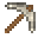 | **Kilof wapienny** | `pickaxe_limestone` | **Narzędzie:** kopie 3 razy szybciej: kamień **Przepis:** Kilof wapienny |
| 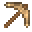 | **Kilof piaskowcowy** | `pickaxe_sandstone` | **Narzędzie:** kopie 3 razy szybciej: kamień **Przepis:** Kilof piaskowcowy |
| 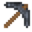 | **Kilof łupkowy** | `pickaxe_slate` | **Narzędzie:** kopie 3 razy szybciej: kamień **Przepis:** Kilof łupkowy |
| 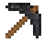 | **Kilof bazaltowy** | `pickaxe_basalt` | **Narzędzie:** kopie 3 razy szybciej: kamień **Przepis:** Kilof bazaltowy |
| 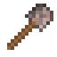 | **Łopata granitowa** | `shovel_granite` | **Narzędzie:** kopie 3 razy szybciej: trawa, ziemia, piasek, żwir, błoto, snow **Przepis:** Łopata granitowa |
| 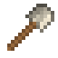 | **Łopata wapienna** | `shovel_limestone` | **Narzędzie:** kopie 3 razy szybciej: trawa, ziemia, piasek, żwir, błoto, snow **Przepis:** Łopata wapienna |
| 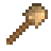 | **Łopata piaskowcowa** | `shovel_sandstone` | **Narzędzie:** kopie 3 razy szybciej: trawa, ziemia, piasek, żwir, błoto, snow **Przepis:** Łopata piaskowcowa |
| 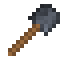 | **Łopata łupkowa** | `shovel_slate` | **Narzędzie:** kopie 3 razy szybciej: trawa, ziemia, piasek, żwir, błoto, snow **Przepis:** Łopata łupkowa |
| 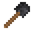 | **Łopata bazaltowa** | `shovel_basalt` | **Narzędzie:** kopie 3 razy szybciej: trawa, ziemia, piasek, żwir, błoto, snow **Przepis:** Łopata bazaltowa |
|  | **Starter ognia** | `fire_starter` | **Przepis:** Starter ognia |
|  | **Żywica** | `resin` | **Skąd:** zbiór (PPM): Pień sosny z żywicą **Przydaje się do:** Pochodnia, Lampa |
| 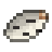 | **Kora brzozowa** | `birch_bark` | **Skąd:** okorowanie siekierą: Pień brzozy **Przydaje się do:** Lampa |
| 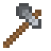 | **Siekiera** | `axe` | **Narzędzie:** kopie 3 razy szybciej: drewno **Przepis:** Siekiera **Przydaje się do:** Opał — dąb, Opał — brzoza, Opał — świerk, Opał — sosna, Opał — buk, Opał — lipa, Opał — olcha, Opał — wierzba, Opał — jabłoń, Opał — akacja, Opał — cypryśnik, Opał — wiśnia, Opał — klon, Opał — kosodrzewina, Opał — oliwka, Opał — eukaliptus, Opał — sekwoja, Opał — miłorząb, Opał — jakaranda |
| 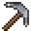 | **Kilof** | `pickaxe` | **Narzędzie:** kopie 3 razy szybciej: kamień **Przepis:** Kilof |
|  | **Łopata** | `shovel` | **Narzędzie:** kopie 3 razy szybciej: trawa, ziemia, piasek, żwir, błoto, snow **Przepis:** Łopata |
| 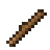 | **Patyk** | `stick` | **Przepis:** Patyk x4 **Przydaje się do:** Stół stolarski świerkowy, Stół stolarski sosnowy, Stół stolarski bukowy, Stół stolarski lipowy, Stół stolarski dębowy, Stół stolarski brzozowy, Stół stolarski z ciemnego drewna, Stół stolarski jabłoniowy, Stół stolarski olchowy, Stół stolarski wierzbowy, Stół stolarski z akacji, Stół stolarski z cypryśnika, Stół stolarski wiśniowy, Stół stolarski klonowy, Stół stolarski z kosodrzewiny, Stół stolarski oliwkowy, Stół stolarski eukaliptusowy, Stół stolarski sekwojowy, Stół stolarski miłorzębowy, Stół stolarski jakarandowy, Pochodnia, Starter ognia, Siekiera, Kilof, Łopata |
