# Przedmioty

> Ta strona jest generowana z kodu gry (`python tools/wiki.py`) - nie zmieniaj jej ręcznie, zmiany przepadną przy następnym generowaniu.

Wersja gry **1.15.0** - 178 przedmiotów. Przedmiotu nie da się postawić jak bloku; owoce i nasiona posadzone na ziemi (PPM) wyrastają w krzak albo drzewo, narzędzia przyspieszają kopanie.

## Drewno

| | Nazwa | W komendach | Najważniejsze |
|---|---|---|---|
| 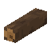 | **Opał — dąb** | `oak_firewood` | **Przepis:** Opał — dąb x4 **Służy też jako:** opał do ogniska |
|  | **Opał — brzoza** | `birch_firewood` | **Przepis:** Opał — brzoza x4 **Służy też jako:** opał do ogniska |
| 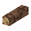 | **Opał — świerk** | `spruce_firewood` | **Przepis:** Opał — świerk x4 **Służy też jako:** opał do ogniska |
| 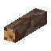 | **Opał — sosna** | `pine_firewood` | **Przepis:** Opał — sosna x4 **Służy też jako:** opał do ogniska |
| 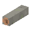 | **Opał — buk** | `beech_firewood` | **Przepis:** Opał — buk x4 **Służy też jako:** opał do ogniska |
| 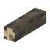 | **Opał — lipa** | `linden_firewood` | **Przepis:** Opał — lipa x4 **Służy też jako:** opał do ogniska |
| 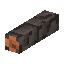 | **Opał — olcha** | `olcha_firewood` | **Przepis:** Opał — olcha x4 **Służy też jako:** opał do ogniska |
| 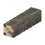 | **Opał — wierzba** | `wierzba_firewood` | **Przepis:** Opał — wierzba x4 **Służy też jako:** opał do ogniska |
| 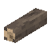 | **Opał — jabłoń** | `jablon_firewood` | **Przepis:** Opał — jabłoń x4 **Służy też jako:** opał do ogniska |
| 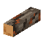 | **Opał — akacja** | `acacia_firewood` | **Przepis:** Opał — akacja x4 **Służy też jako:** opał do ogniska |
| 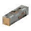 | **Opał — cypryśnik** | `bald_cypress_firewood` | **Przepis:** Opał — cypryśnik x4 **Służy też jako:** opał do ogniska |
| 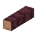 | **Opał — wiśnia** | `cherry_firewood` | **Przepis:** Opał — wiśnia x4 **Służy też jako:** opał do ogniska |
| 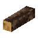 | **Opał — klon** | `maple_firewood` | **Przepis:** Opał — klon x4 **Służy też jako:** opał do ogniska |
| 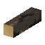 | **Opał — kosodrzewina** | `mugo_firewood` | **Przepis:** Opał — kosodrzewina x4 **Służy też jako:** opał do ogniska |
| 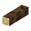 | **Opał — oliwka** | `olive_firewood` | **Przepis:** Opał — oliwka x4 **Służy też jako:** opał do ogniska |
| 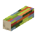 | **Opał — eukaliptus** | `rainbow_eucalyptus_firewood` | **Przepis:** Opał — eukaliptus x4 **Służy też jako:** opał do ogniska |
| 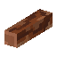 | **Opał — sekwoja** | `sequoia_firewood` | **Przepis:** Opał — sekwoja x4 **Służy też jako:** opał do ogniska |
| 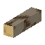 | **Opał — miłorząb** | `ginkgo_firewood` | **Przepis:** Opał — miłorząb x4 **Służy też jako:** opał do ogniska |
| 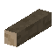 | **Opał — jakaranda** | `jacaranda_firewood` | **Przepis:** Opał — jakaranda x4 **Służy też jako:** opał do ogniska |
|  | **Opał — jodła** | `fir_firewood` | **Przepis:** Opał — jodła x4 **Służy też jako:** opał do ogniska |
|  | **Opał — baobab** | `baobab_firewood` | **Przepis:** Opał — baobab x4 **Służy też jako:** opał do ogniska |
|  | **Opał — palma kokosowa** | `coconut_palm_firewood` | **Przepis:** Opał — palma kokosowa x4 **Służy też jako:** opał do ogniska |
|  | **Opał — modrzew** | `larch_firewood` | **Przepis:** Opał — modrzew x4 **Służy też jako:** opał do ogniska |
|  | **Opał — namorzyn** | `mangrove_firewood` | **Przepis:** Opał — namorzyn x4 **Służy też jako:** opał do ogniska |
|  | **Opał — puchowiec** | `kapok_firewood` | **Przepis:** Opał — puchowiec x4 **Służy też jako:** opał do ogniska |
|  | **Opał — jukka** | `joshua_tree_firewood` | **Przepis:** Opał — jukka x4 **Służy też jako:** opał do ogniska |
|  | **Opał — osika** | `aspen_firewood` | **Przepis:** Opał — osika x4 **Służy też jako:** opał do ogniska |
|  | **Opał — araukaria** | `araucaria_firewood` | **Przepis:** Opał — araukaria x4 **Służy też jako:** opał do ogniska |
|  | **Opał — figowiec** | `banyan_firewood` | **Przepis:** Opał — figowiec x4 **Służy też jako:** opał do ogniska |
|  | **Opał — dracena** | `dragon_tree_firewood` | **Przepis:** Opał — dracena x4 **Służy też jako:** opał do ogniska |
|  | **Opał — cedr** | `cedar_firewood` | **Przepis:** Opał — cedr x4 **Służy też jako:** opał do ogniska |
|  | **Opał — sosna oścista** | `bristlecone_firewood` | **Przepis:** Opał — sosna oścista x4 **Służy też jako:** opał do ogniska |
|  | **Kora brzozowa** | `birch_bark` | **Skąd:** okorowanie siekierą: Pień brzozy **Przydaje się do:** Lampa **Służy też jako:** podpałka (1,5 raza szybsza od trawy) |
| 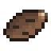 | **Kora świerka** | `spruce_bark` | **Służy też jako:** podpałka (1,25 raza szybsza od trawy) |
| 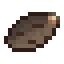 | **Kora sosny** | `pine_bark` | **Służy też jako:** podpałka (1,25 raza szybsza od trawy) |
| 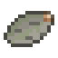 | **Kora buka** | `beech_bark` | **Służy też jako:** podpałka |
|  | **Kora lipy** | `linden_bark` | **Służy też jako:** podpałka |
| 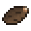 | **Kora dębu** | `oak_bark` | **Służy też jako:** podpałka |
|  | **Kora jabłoni** | `jablon_bark` | **Służy też jako:** podpałka |
|  | **Kora olchy** | `olcha_bark` | **Służy też jako:** podpałka |
| 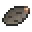 | **Kora wierzby** | `wierzba_bark` | **Służy też jako:** podpałka |
| 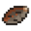 | **Kora akacji** | `acacia_bark` | **Służy też jako:** podpałka |
| 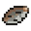 | **Kora cypryśnika** | `bald_cypress_bark` | **Służy też jako:** podpałka |
| 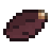 | **Kora wiśni** | `cherry_bark` | **Służy też jako:** podpałka |
| 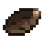 | **Kora klonu** | `maple_bark` | **Służy też jako:** podpałka |
|  | **Kora kosodrzewiny** | `mugo_bark` | **Służy też jako:** podpałka (1,25 raza szybsza od trawy) |
| 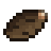 | **Kora oliwki** | `olive_bark` | **Służy też jako:** podpałka |
| 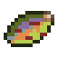 | **Kora eukaliptusa** | `rainbow_eucalyptus_bark` | **Służy też jako:** podpałka (1,25 raza szybsza od trawy) |
| 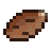 | **Kora sekwoi** | `sequoia_bark` | **Służy też jako:** podpałka |
| 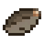 | **Kora miłorzębu** | `ginkgo_bark` | **Służy też jako:** podpałka |
| 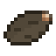 | **Kora jakarandy** | `jacaranda_bark` | **Służy też jako:** podpałka |
|  | **Kora jodły** | `fir_bark` | **Służy też jako:** podpałka |
|  | **Kora baobabu** | `baobab_bark` | **Służy też jako:** podpałka |
|  | **Kora palmy kokosowej** | `coconut_palm_bark` | **Służy też jako:** podpałka |
|  | **Kora modrzewia** | `larch_bark` | **Służy też jako:** podpałka |
|  | **Kora namorzynu** | `mangrove_bark` | **Służy też jako:** podpałka |
|  | **Kora puchowca** | `kapok_bark` | **Służy też jako:** podpałka |
|  | **Kora jukki** | `joshua_tree_bark` | **Służy też jako:** podpałka |
|  | **Kora osiki** | `aspen_bark` | **Służy też jako:** podpałka |
|  | **Kora araukarii** | `araucaria_bark` | **Służy też jako:** podpałka |
|  | **Kora figowca** | `banyan_bark` | **Służy też jako:** podpałka |
|  | **Kora draceny** | `dragon_tree_bark` | **Służy też jako:** podpałka |
|  | **Kora cedru** | `cedar_bark` | **Służy też jako:** podpałka |
|  | **Kora sosny ościstej** | `bristlecone_bark` | **Służy też jako:** podpałka |

## Jedzenie i nasiona

| | Nazwa | W komendach | Najważniejsze |
|---|---|---|---|
|  | **Truskawki** | `strawberry` | **Posadzony (PPM na ziemi):** Sadzonka truskawki **Skąd:** zbiór (PPM): Krzak truskawki (kilka owoców); zbiór (PPM): Krzak truskawki (pełen owoców) **Przydaje się do:** Czerwona lampa, Barwnik czerwony **Służy też jako:** jedzenie |
| 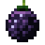 | **Jeżyny** | `blackberry` | **Posadzony (PPM na ziemi):** Sadzonka jeżyny **Skąd:** zbiór (PPM): Krzak jeżyny (kilka owoców); zbiór (PPM): Krzak jeżyny (pełen owoców) **Przydaje się do:** Fioletowa lampa, Barwnik fioletowy **Służy też jako:** jedzenie |
|  | **Papryczki chili** | `chili_pepper` | **Posadzony (PPM na ziemi):** Sadzonka papryczki chili **Skąd:** zbiór (PPM): Krzak papryczki chili (kilka papryczek); zbiór (PPM): Krzak papryczki chili (pełen papryczek) **Przydaje się do:** Czerwona lampa, Barwnik czerwony **Służy też jako:** jedzenie |
| 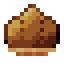 | **Orzech laskowy** | `hazelnut` | **Posadzony (PPM na ziemi):** Sadzonka leszczyny **Skąd:** zbiór (PPM): Leszczyna (kilka orzechów); zbiór (PPM): Leszczyna (pełna orzechów) **Służy też jako:** jedzenie; pieczenie nad ogniskiem: Prażone orzechy laskowe |
| 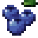 | **Borówki** | `blueberry` | **Posadzony (PPM na ziemi):** Sadzonka borówki **Skąd:** zbiór (PPM): Krzak borówki (kilka owoców); zbiór (PPM): Krzak borówki (pełen owoców) **Przydaje się do:** Niebieska lampa, Barwnik niebieski **Służy też jako:** jedzenie |
| 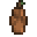 | **Szyszka świerka** | `spruce_cone` | **Posadzony (PPM na ziemi):** Sadzonka świerka **Skąd:** czasem z bloku: Igliwie świerka (8%) **Przydaje się do:** Wieniec świerkowy |
| 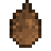 | **Szyszka sosny** | `pine_cone` | **Posadzony (PPM na ziemi):** Sadzonka sosny **Skąd:** czasem z bloku: Igliwie sosny (8%) **Przydaje się do:** Wieniec świerkowy |
| 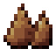 | **Orzeszki bukowe** | `beechnuts` | **Posadzony (PPM na ziemi):** Sadzonka buka **Skąd:** czasem z bloku: Liście buka (8%) **Służy też jako:** jedzenie; pieczenie nad ogniskiem: Prażone orzeszki bukowe |
| 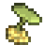 | **Kwiat lipy** | `linden_flower` | **Posadzony (PPM na ziemi):** Sadzonka lipy **Skąd:** zbiór (PPM): Kwitnące liście lipy **Przydaje się do:** Kubek ziół na sen |
| 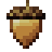 | **Żołądź** | `acorn` | **Posadzony (PPM na ziemi):** Sadzonka dębu **Skąd:** czasem z bloku: Liście dębu (10%) **Przydaje się do:** Barwnik brązowy **Służy też jako:** jedzenie; pieczenie nad ogniskiem: Prażony żołądź |
| 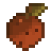 | **Pieczone jabłko** | `roasted_apple` | **Skąd:** nad płonącym ogniskiem (trzymany PPM): Jabłko **Służy też jako:** jedzenie |
| 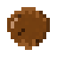 | **Prażone orzechy laskowe** | `roasted_hazelnut` | **Skąd:** nad płonącym ogniskiem (trzymany PPM): Orzech laskowy **Służy też jako:** jedzenie |
| 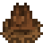 | **Prażone orzeszki bukowe** | `roasted_beechnuts` | **Skąd:** nad płonącym ogniskiem (trzymany PPM): Orzeszki bukowe **Służy też jako:** jedzenie |
| 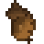 | **Prażony żołądź** | `roasted_acorn` | **Skąd:** nad płonącym ogniskiem (trzymany PPM): Żołądź **Służy też jako:** jedzenie |
| 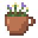 | **Kubek ziół na sen** | `brew_calm` | **Przepis:** Kubek ziół na sen **Służy też jako:** parzenie nad ogniskiem: Napar na sen |
| 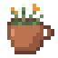 | **Kubek ziół leczniczych** | `brew_heal` | **Przepis:** Kubek ziół leczniczych **Służy też jako:** parzenie nad ogniskiem: Napar leczniczy |
| 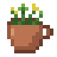 | **Kubek ziół wzmacniających** | `brew_vigor` | **Przepis:** Kubek ziół wzmacniających **Służy też jako:** parzenie nad ogniskiem: Napar wzmacniający |
|  | **Napar na sen** | `tea_calm` | **Skąd:** nad płonącym ogniskiem (trzymany PPM): Kubek ziół na sen **Służy też jako:** napar (spokój) |
|  | **Napar leczniczy** | `tea_heal` | **Skąd:** nad płonącym ogniskiem (trzymany PPM): Kubek ziół leczniczych **Służy też jako:** napar (gojenie) |
|  | **Napar wzmacniający** | `tea_vigor` | **Skąd:** nad płonącym ogniskiem (trzymany PPM): Kubek ziół wzmacniających **Służy też jako:** napar (wigor) |
|  | **Jabłko** | `jablon_jablko` | **Posadzony (PPM na ziemi):** Sadzonka jabłoni **Skąd:** czasem z bloku: Liście jabłoni (5%); czasem z bloku: Liście jabłoni z jabłkami (5%); zbiór (PPM): Liście jabłoni z jabłkami; czasem z bloku: Liście jabłoni (jabłka odrastają) (5%) **Przydaje się do:** Czerwona lampa **Służy też jako:** jedzenie; pieczenie nad ogniskiem: Pieczone jabłko |
| 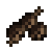 | **Szyszeczki olchy** | `olcha_szyszki` | **Posadzony (PPM na ziemi):** Sadzonka olchy **Skąd:** czasem z bloku: Liście olchy (6%) **Przydaje się do:** Wieniec świerkowy |
| 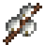 | **Bazie** | `wierzba_bazie` | **Posadzony (PPM na ziemi):** Sadzonka wierzby **Skąd:** czasem z bloku: Liście wierzby (6%) **Przydaje się do:** Lampa |
| 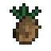 | **Szyszka kosodrzewiny** | `mugo_cone` | **Posadzony (PPM na ziemi):** Sadzonka kosodrzewiny **Skąd:** czasem z bloku: Igliwie kosodrzewiny (7%); czasem z bloku: Igliwie kosodrzewiny z młodymi pędami (7%) **Przydaje się do:** Wieniec świerkowy |
|  | **Oliwki** | `olive_oliwki` | **Posadzony (PPM na ziemi):** Sadzonka oliwki **Skąd:** czasem z bloku: Liście oliwki (5%); czasem z bloku: Liście oliwki z oliwkami (5%); zbiór (PPM): Liście oliwki z oliwkami; czasem z bloku: Liście oliwki (oliwki odrastają) (5%) **Przydaje się do:** Pochodnia, Lampa **Służy też jako:** jedzenie |
|  | **Szyszka sekwoi** | `sequoia_cone` | **Posadzony (PPM na ziemi):** Sadzonka sekwoi **Skąd:** czasem z bloku: Igliwie sekwoi (6%); czasem z bloku: Igliwie sekwoi z szyszkami (6%); zbiór (PPM): Igliwie sekwoi z szyszkami; czasem z bloku: Igliwie sekwoi (szyszki odrastają) (6%) **Przydaje się do:** Wieniec świerkowy |
|  | **Szyszka jodły** | `fir_cone` | **Posadzony (PPM na ziemi):** Sadzonka jodły **Skąd:** czasem z bloku: Igliwie jodły (3%); czasem z bloku: Igliwie jodły z szyszkami (3%); zbiór (PPM): Igliwie jodły z szyszkami; czasem z bloku: Igliwie jodły (szyszki odrastają) (3%) **Służy też jako:** podpałka (1,5 raza szybsza od trawy) |
|  | **Owoc baobabu** | `baobab_fruit` | **Posadzony (PPM na ziemi):** Sadzonka baobabu **Skąd:** czasem z bloku: Liście baobabu (3%); czasem z bloku: Liście baobabu z kwiatami (3%); czasem z bloku: Liście baobabu z owocami (3%); zbiór (PPM): Liście baobabu z owocami; czasem z bloku: Liście baobabu (owoce odrastają) (3%) **Służy też jako:** jedzenie |
|  | **Kokos** | `coconut_palm_kokos` | **Posadzony (PPM na ziemi):** Sadzonka palmy kokosowej **Skąd:** zbiór (PPM): Liście palmy z kokosami **Służy też jako:** jedzenie |
|  | **Szyszka modrzewia** | `larch_cone` | **Posadzony (PPM na ziemi):** Sadzonka modrzewia **Skąd:** czasem z bloku: Igliwie modrzewia (3%); czasem z bloku: Złote igliwie modrzewia (3%); czasem z bloku: Igliwie modrzewia z szyszkami (3%); zbiór (PPM): Igliwie modrzewia z szyszkami; czasem z bloku: Igliwie modrzewia (szyszki odrastają) (3%) **Służy też jako:** podpałka (1,5 raza szybsza od trawy) |
|  | **Siewka namorzynu** | `mangrove_propagule` | **Posadzony (PPM na ziemi):** Sadzonka namorzynu **Skąd:** czasem z bloku: Liście namorzynu (3%); czasem z bloku: Liście namorzynu z siewkami (3%); zbiór (PPM): Liście namorzynu z siewkami; czasem z bloku: Liście namorzynu (siewki odrastają) (3%) |
|  | **Kwiaty jukki** | `joshua_tree_flowers` | **Skąd:** czasem z bloku: Liście jukki (3%); czasem z bloku: Liście jukki z kwiatami (3%); zbiór (PPM): Liście jukki z kwiatami; czasem z bloku: Liście jukki (kwiaty odrastają) (3%) **Służy też jako:** jedzenie |
|  | **Orzeszki araukarii** | `araucaria_nuts` | **Posadzony (PPM na ziemi):** Sadzonka araukarii **Skąd:** czasem z bloku: Igliwie araukarii (3%); czasem z bloku: Igliwie araukarii z szyszkami (3%); zbiór (PPM): Igliwie araukarii z szyszkami; czasem z bloku: Igliwie araukarii (szyszki odrastają) (3%) **Służy też jako:** jedzenie |
|  | **Figa** | `banyan_fig` | **Posadzony (PPM na ziemi):** Sadzonka figowca **Skąd:** czasem z bloku: Liście figowca (3%); czasem z bloku: Liście figowca z figami (3%); zbiór (PPM): Liście figowca z figami; czasem z bloku: Liście figowca (figi odrastają) (3%) **Służy też jako:** jedzenie |
|  | **Jagody draceny** | `dragon_tree_berries` | **Posadzony (PPM na ziemi):** Sadzonka draceny **Skąd:** czasem z bloku: Liście draceny (3%); czasem z bloku: Liście draceny z jagodami (3%); zbiór (PPM): Liście draceny z jagodami; czasem z bloku: Liście draceny (jagody odrastają) (3%) **Służy też jako:** jedzenie |
|  | **Szyszka cedru** | `cedar_cone` | **Posadzony (PPM na ziemi):** Sadzonka cedru **Skąd:** czasem z bloku: Igliwie cedru (3%); czasem z bloku: Igliwie cedru z szyszkami (3%); zbiór (PPM): Igliwie cedru z szyszkami; czasem z bloku: Igliwie cedru (szyszki odrastają) (3%) **Służy też jako:** podpałka (1,5 raza szybsza od trawy) |
|  | **Szyszka sosny ościstej** | `bristlecone_cone` | **Posadzony (PPM na ziemi):** Sadzonka sosny ościstej **Skąd:** czasem z bloku: Igliwie sosny ościstej (3%); czasem z bloku: Igliwie sosny ościstej z szyszkami (3%); zbiór (PPM): Igliwie sosny ościstej z szyszkami; czasem z bloku: Igliwie sosny ościstej (szyszki odrastają) (3%) **Służy też jako:** podpałka (1,5 raza szybsza od trawy) |

## Narzędzia i surowce

| | Nazwa | W komendach | Najważniejsze |
|---|---|---|---|
|  | **Tratwa** | `raft` | **Przepis:** Tratwa **Służy też jako:** pływanie: PPM na wodzie |
|  | **Barwnik biały** | `dye_white` | **Przepis:** Barwnik biały **Przydaje się do:** Pochodnia biała, Barwnik jasnoniebieski, Barwnik limonkowy, Barwnik różowy, Barwnik szary, Barwnik jasnoszary |
|  | **Barwnik pomarańczowy** | `dye_orange` | **Przepis:** Barwnik pomarańczowy, Barwnik pomarańczowy x2 **Przydaje się do:** Pochodnia pomarańczowa |
|  | **Barwnik purpurowy** | `dye_magenta` | **Przepis:** Barwnik purpurowy x2 **Przydaje się do:** Pochodnia purpurowa |
|  | **Barwnik jasnoniebieski** | `dye_light_blue` | **Przepis:** Barwnik jasnoniebieski x2 **Przydaje się do:** Pochodnia jasnoniebieska |
|  | **Barwnik żółty** | `dye_yellow` | **Przepis:** Barwnik żółty **Przydaje się do:** Pochodnia żółta, Barwnik pomarańczowy |
|  | **Barwnik limonkowy** | `dye_lime` | **Przepis:** Barwnik limonkowy x2 **Przydaje się do:** Pochodnia limonkowa |
|  | **Barwnik różowy** | `dye_pink` | **Przepis:** Barwnik różowy, Barwnik różowy x2 **Przydaje się do:** Pochodnia różowa, Barwnik purpurowy |
|  | **Barwnik szary** | `dye_gray` | **Przepis:** Barwnik szary x2 **Przydaje się do:** Pochodnia szara, Barwnik jasnoszary |
|  | **Barwnik jasnoszary** | `dye_light_gray` | **Przepis:** Barwnik jasnoszary x2 **Przydaje się do:** Pochodnia jasnoszara |
|  | **Barwnik turkusowy** | `dye_cyan` | **Przepis:** Barwnik turkusowy x2 **Przydaje się do:** Pochodnia turkusowa |
|  | **Barwnik fioletowy** | `dye_purple` | **Przepis:** Barwnik fioletowy **Przydaje się do:** Pochodnia fioletowa, Barwnik purpurowy |
|  | **Barwnik niebieski** | `dye_blue` | **Przepis:** Barwnik niebieski **Przydaje się do:** Pochodnia niebieska, Barwnik jasnoniebieski, Barwnik turkusowy, Barwnik czarny |
|  | **Barwnik brązowy** | `dye_brown` | **Przepis:** Barwnik brązowy **Przydaje się do:** Pochodnia brązowa |
|  | **Barwnik zielony** | `dye_green` | **Przepis:** Barwnik zielony **Przydaje się do:** Pochodnia zielona, Barwnik limonkowy, Barwnik turkusowy, Barwnik czarny |
|  | **Barwnik czerwony** | `dye_red` | **Przepis:** Barwnik czerwony **Przydaje się do:** Pochodnia czerwona, Barwnik pomarańczowy, Barwnik różowy, Barwnik czarny |
|  | **Barwnik czarny** | `dye_black` | **Przepis:** Barwnik czarny x3 **Przydaje się do:** Pochodnia czarna, Barwnik szary |
|  | **Siekiera granitowa** | `axe_granite` | **Narzędzie:** kopie 3 razy szybciej: drewno **Przepis:** Siekiera granitowa **Przydaje się do:** Opał — dąb, Opał — brzoza, Opał — świerk, Opał — sosna, Opał — buk, Opał — lipa, Opał — olcha, Opał — wierzba, Opał — jabłoń, Opał — akacja, Opał — cypryśnik, Opał — wiśnia, Opał — klon, Opał — kosodrzewina, Opał — oliwka, Opał — eukaliptus, Opał — sekwoja, Opał — miłorząb, Opał — jakaranda, Opał — jodła, Opał — baobab, Opał — palma kokosowa, Opał — modrzew, Opał — namorzyn, Opał — puchowiec, Opał — jukka, Opał — osika, Opał — araukaria, Opał — figowiec, Opał — dracena, Opał — cedr, Opał — sosna oścista |
|  | **Siekiera wapienna** | `axe_limestone` | **Narzędzie:** kopie 3 razy szybciej: drewno **Przepis:** Siekiera wapienna **Przydaje się do:** Opał — dąb, Opał — brzoza, Opał — świerk, Opał — sosna, Opał — buk, Opał — lipa, Opał — olcha, Opał — wierzba, Opał — jabłoń, Opał — akacja, Opał — cypryśnik, Opał — wiśnia, Opał — klon, Opał — kosodrzewina, Opał — oliwka, Opał — eukaliptus, Opał — sekwoja, Opał — miłorząb, Opał — jakaranda, Opał — jodła, Opał — baobab, Opał — palma kokosowa, Opał — modrzew, Opał — namorzyn, Opał — puchowiec, Opał — jukka, Opał — osika, Opał — araukaria, Opał — figowiec, Opał — dracena, Opał — cedr, Opał — sosna oścista |
|  | **Siekiera piaskowcowa** | `axe_sandstone` | **Narzędzie:** kopie 3 razy szybciej: drewno **Przepis:** Siekiera piaskowcowa **Przydaje się do:** Opał — dąb, Opał — brzoza, Opał — świerk, Opał — sosna, Opał — buk, Opał — lipa, Opał — olcha, Opał — wierzba, Opał — jabłoń, Opał — akacja, Opał — cypryśnik, Opał — wiśnia, Opał — klon, Opał — kosodrzewina, Opał — oliwka, Opał — eukaliptus, Opał — sekwoja, Opał — miłorząb, Opał — jakaranda, Opał — jodła, Opał — baobab, Opał — palma kokosowa, Opał — modrzew, Opał — namorzyn, Opał — puchowiec, Opał — jukka, Opał — osika, Opał — araukaria, Opał — figowiec, Opał — dracena, Opał — cedr, Opał — sosna oścista |
|  | **Siekiera łupkowa** | `axe_slate` | **Narzędzie:** kopie 3 razy szybciej: drewno **Przepis:** Siekiera łupkowa **Przydaje się do:** Opał — dąb, Opał — brzoza, Opał — świerk, Opał — sosna, Opał — buk, Opał — lipa, Opał — olcha, Opał — wierzba, Opał — jabłoń, Opał — akacja, Opał — cypryśnik, Opał — wiśnia, Opał — klon, Opał — kosodrzewina, Opał — oliwka, Opał — eukaliptus, Opał — sekwoja, Opał — miłorząb, Opał — jakaranda, Opał — jodła, Opał — baobab, Opał — palma kokosowa, Opał — modrzew, Opał — namorzyn, Opał — puchowiec, Opał — jukka, Opał — osika, Opał — araukaria, Opał — figowiec, Opał — dracena, Opał — cedr, Opał — sosna oścista |
|  | **Siekiera bazaltowa** | `axe_basalt` | **Narzędzie:** kopie 3 razy szybciej: drewno **Przepis:** Siekiera bazaltowa **Przydaje się do:** Opał — dąb, Opał — brzoza, Opał — świerk, Opał — sosna, Opał — buk, Opał — lipa, Opał — olcha, Opał — wierzba, Opał — jabłoń, Opał — akacja, Opał — cypryśnik, Opał — wiśnia, Opał — klon, Opał — kosodrzewina, Opał — oliwka, Opał — eukaliptus, Opał — sekwoja, Opał — miłorząb, Opał — jakaranda, Opał — jodła, Opał — baobab, Opał — palma kokosowa, Opał — modrzew, Opał — namorzyn, Opał — puchowiec, Opał — jukka, Opał — osika, Opał — araukaria, Opał — figowiec, Opał — dracena, Opał — cedr, Opał — sosna oścista |
|  | **Kilof granitowy** | `pickaxe_granite` | **Narzędzie:** kopie 3 razy szybciej: kamień **Przepis:** Kilof granitowy |
|  | **Kilof wapienny** | `pickaxe_limestone` | **Narzędzie:** kopie 3 razy szybciej: kamień **Przepis:** Kilof wapienny |
|  | **Kilof piaskowcowy** | `pickaxe_sandstone` | **Narzędzie:** kopie 3 razy szybciej: kamień **Przepis:** Kilof piaskowcowy |
|  | **Kilof łupkowy** | `pickaxe_slate` | **Narzędzie:** kopie 3 razy szybciej: kamień **Przepis:** Kilof łupkowy |
|  | **Kilof bazaltowy** | `pickaxe_basalt` | **Narzędzie:** kopie 3 razy szybciej: kamień **Przepis:** Kilof bazaltowy |
|  | **Łopata granitowa** | `shovel_granite` | **Narzędzie:** kopie 3 razy szybciej: trawa, ziemia, piasek, żwir, błoto, snow **Przepis:** Łopata granitowa |
|  | **Łopata wapienna** | `shovel_limestone` | **Narzędzie:** kopie 3 razy szybciej: trawa, ziemia, piasek, żwir, błoto, snow **Przepis:** Łopata wapienna |
|  | **Łopata piaskowcowa** | `shovel_sandstone` | **Narzędzie:** kopie 3 razy szybciej: trawa, ziemia, piasek, żwir, błoto, snow **Przepis:** Łopata piaskowcowa |
|  | **Łopata łupkowa** | `shovel_slate` | **Narzędzie:** kopie 3 razy szybciej: trawa, ziemia, piasek, żwir, błoto, snow **Przepis:** Łopata łupkowa |
|  | **Łopata bazaltowa** | `shovel_basalt` | **Narzędzie:** kopie 3 razy szybciej: trawa, ziemia, piasek, żwir, błoto, snow **Przepis:** Łopata bazaltowa |
|  | **Nóż granitowy** | `knife_granite` | **Narzędzie:** kopie 3 razy szybciej:  **Przepis:** Nóż granitowy |
|  | **Nóż wapienny** | `knife_limestone` | **Narzędzie:** kopie 3 razy szybciej:  **Przepis:** Nóż wapienny |
|  | **Nóż piaskowcowy** | `knife_sandstone` | **Narzędzie:** kopie 3 razy szybciej:  **Przepis:** Nóż piaskowcowy |
|  | **Nóż łupkowy** | `knife_slate` | **Narzędzie:** kopie 3 razy szybciej:  **Przepis:** Nóż łupkowy |
|  | **Nóż bazaltowy** | `knife_basalt` | **Narzędzie:** kopie 3 razy szybciej:  **Przepis:** Nóż bazaltowy |
|  | **Mokry kubek z gliny** | `wet_clay_cup` | **Przepis:** Mokry kubek z gliny x2 **Służy też jako:** suszenie na słońcu: Gliniany kubek |
|  | **Mokra cegła z gliny** | `wet_clay_brick` | **Przepis:** Mokra cegła z gliny x2 **Służy też jako:** suszenie na słońcu: Cegła |
|  | **Cegła** | `clay_brick` | **Skąd:** wysuszenie na słońcu (wyrzucony w dzień pod gołym niebem): Mokra cegła z gliny **Przydaje się do:** Cegły |
|  | **Mokry kubek z czerwonej gliny** | `wet_red_clay_cup` | **Przepis:** Mokry kubek z czerwonej gliny x2 **Służy też jako:** suszenie na słońcu: Czerwony gliniany kubek |
|  | **Mokra cegła z czerwonej gliny** | `wet_red_clay_brick` | **Przepis:** Mokra cegła z czerwonej gliny x2 **Służy też jako:** suszenie na słońcu: Czerwona cegła |
|  | **Czerwona cegła** | `red_clay_brick` | **Skąd:** wysuszenie na słońcu (wyrzucony w dzień pod gołym niebem): Mokra cegła z czerwonej gliny **Przydaje się do:** Czerwone cegły |
|  | **Czerwony gliniany kubek** | `red_clay_cup` | **Skąd:** wysuszenie na słońcu (wyrzucony w dzień pod gołym niebem): Mokry kubek z czerwonej gliny **Przydaje się do:** Kubek ziół na sen, Kubek ziół leczniczych, Kubek ziół wzmacniających |
|  | **Mokry kubek z białej gliny** | `wet_white_clay_cup` | **Przepis:** Mokry kubek z białej gliny x2 **Służy też jako:** suszenie na słońcu: Biały gliniany kubek |
|  | **Mokra cegła z białej gliny** | `wet_white_clay_brick` | **Przepis:** Mokra cegła z białej gliny x2 **Służy też jako:** suszenie na słońcu: Biała cegła |
|  | **Biała cegła** | `white_clay_brick` | **Skąd:** wysuszenie na słońcu (wyrzucony w dzień pod gołym niebem): Mokra cegła z białej gliny **Przydaje się do:** Białe cegły |
|  | **Biały gliniany kubek** | `white_clay_cup` | **Skąd:** wysuszenie na słońcu (wyrzucony w dzień pod gołym niebem): Mokry kubek z białej gliny **Przydaje się do:** Kubek ziół na sen, Kubek ziół leczniczych, Kubek ziół wzmacniających |
|  | **Starter ognia** | `fire_starter` | **Przepis:** Starter ognia **Służy też jako:** rozpalanie ogniska |
|  | **Żywica** | `resin` | **Skąd:** zbiór (PPM): Pień sosny z żywicą **Przydaje się do:** Pochodnia, Lampa |
|  | **Słoma** | `straw` | **Przepis:** Słoma **Przydaje się do:** Słomiana pościel **Służy też jako:** podpałka (1,25 raza szybsza od trawy) |
|  | **Gliniany kubek** | `clay_cup` | **Skąd:** wysuszenie na słońcu (wyrzucony w dzień pod gołym niebem): Mokry kubek z gliny **Przydaje się do:** Kubek ziół na sen, Kubek ziół leczniczych, Kubek ziół wzmacniających |
|  | **Siekiera** | `axe` | **Narzędzie:** kopie 3 razy szybciej: drewno **Przepis:** Siekiera **Przydaje się do:** Opał — dąb, Opał — brzoza, Opał — świerk, Opał — sosna, Opał — buk, Opał — lipa, Opał — olcha, Opał — wierzba, Opał — jabłoń, Opał — akacja, Opał — cypryśnik, Opał — wiśnia, Opał — klon, Opał — kosodrzewina, Opał — oliwka, Opał — eukaliptus, Opał — sekwoja, Opał — miłorząb, Opał — jakaranda, Opał — jodła, Opał — baobab, Opał — palma kokosowa, Opał — modrzew, Opał — namorzyn, Opał — puchowiec, Opał — jukka, Opał — osika, Opał — araukaria, Opał — figowiec, Opał — dracena, Opał — cedr, Opał — sosna oścista |
|  | **Kilof** | `pickaxe` | **Narzędzie:** kopie 3 razy szybciej: kamień **Przepis:** Kilof |
|  | **Łopata** | `shovel` | **Narzędzie:** kopie 3 razy szybciej: trawa, ziemia, piasek, żwir, błoto, snow **Przepis:** Łopata |
|  | **Nóż** | `knife` | **Narzędzie:** kopie 3 razy szybciej:  **Przepis:** Nóż |
|  | **Patyk** | `stick` | **Przepis:** Patyk x4 **Przydaje się do:** Pochodnia, Stół stolarski świerkowy, Stół stolarski sosnowy, Stół stolarski bukowy, Stół stolarski lipowy, Stół stolarski dębowy, Stół stolarski brzozowy, Stół stolarski z ciemnego drewna, Stół stolarski jabłoniowy, Stół stolarski olchowy, Stół stolarski wierzbowy, Stół stolarski z akacji, Stół stolarski z cypryśnika, Stół stolarski wiśniowy, Stół stolarski klonowy, Stół stolarski z kosodrzewiny, Stół stolarski oliwkowy, Stół stolarski eukaliptusowy, Stół stolarski sekwojowy, Stół stolarski miłorzębowy, Stół stolarski jakarandowy, Stół stolarski jodłowy, Stół stolarski baobabowy, Stół stolarski palmowy, Stół stolarski modrzewiowy, Stół stolarski namorzynowy, Stół stolarski z puchowca, Stół stolarski z jukki, Stół stolarski osikowy, Stół stolarski araukariowy, Stół stolarski figowcowy, Stół stolarski z draceny, Stół stolarski cedrowy, Stół stolarski z sosny ościstej, Starter ognia, Siekiera, Kilof, Łopata, Nóż |
|  | **Puch puchowca (kapok)** | `kapok_fluff` | **Skąd:** czasem z bloku: Liście puchowca (3%); czasem z bloku: Liście puchowca z puchem (3%); zbiór (PPM): Liście puchowca z puchem; czasem z bloku: Liście puchowca (puch odrasta) (3%) **Służy też jako:** podpałka (2 razy szybsza od trawy) |
|  | **Wiecha amarantusa** | `amarantus_wiecha` | **Skąd:** zbiór (PPM): Amarantus (dojrzałe wiechy) **Przydaje się do:** Czerwona lampa, Wianek z kwiatów, Barwnik czerwony |
|  | **Bukiet kocanki** | `kocanka_bukiet` | **Skąd:** zbiór (PPM): Kocanka (kwitnie) **Przydaje się do:** Wianek z kwiatów, Barwnik żółty |
|  | **Bukiet lawendy** | `lawenda_bukiet` | **Skąd:** zbiór (PPM): Lawenda (kwitnie) **Przydaje się do:** Kubek ziół na sen, Fioletowa lampa, Wianek z kwiatów, Barwnik fioletowy |
|  | **Kwiat piwonii** | `piwonia_kwiat` | **Skąd:** zbiór (PPM): Piwonia (kwitnie) **Przydaje się do:** Wianek z kwiatów, Barwnik różowy |
|  | **Kwiat zawilca** | `zawilec_kwiat` | **Skąd:** zbiór (PPM): Zawilec (kwitnie) **Przydaje się do:** Wianek z kwiatów, Barwnik różowy |
|  | **Kwiat dzwonka** | `dzwonek_kwiat` | **Skąd:** zbiór (PPM): Dzwonek (kwitnie) **Przydaje się do:** Fioletowa lampa, Wianek z kwiatów, Barwnik fioletowy |
|  | **Liście szałwii** | `szalwia_lisc` | **Skąd:** zbiór (PPM): Szałwia (kwitnie) **Przydaje się do:** Kubek ziół leczniczych, Zielona lampa, Barwnik zielony |
|  | **Kwiat nagietka** | `nagietek_kwiat` | **Skąd:** zbiór (PPM): Nagietek (kwitnie) **Przydaje się do:** Kubek ziół leczniczych, Wianek z kwiatów, Barwnik pomarańczowy |
|  | **Kwiat cynii** | `cynia_kwiat` | **Skąd:** zbiór (PPM): Cynia (kwitnie) **Przydaje się do:** Wianek z kwiatów, Barwnik pomarańczowy |
|  | **Kwiat mikołajka** | `mikolajek_kwiat` | **Skąd:** zbiór (PPM): Mikołajek (kwitnie) **Przydaje się do:** Niebieska lampa, Wianek z kwiatów, Barwnik niebieski |
|  | **Kwiat barwinka** | `barwinek_kwiat` | **Skąd:** zbiór (PPM): Barwinek (kwitnie) **Przydaje się do:** Niebieska lampa, Wianek z kwiatów, Barwnik niebieski |
|  | **Wiązka lnu** | `len_wiazka` | **Skąd:** zbiór (PPM): Len (dojrzały, suchy) **Przydaje się do:** Lniana pościel |
|  | **Nasiona gorczycy** | `gorczyca_nasiona` | **Skąd:** zbiór (PPM): Gorczyca (strąki) **Przydaje się do:** Kubek ziół wzmacniających, Barwnik żółty |
|  | **Plecha porostu oliwkowego** | `porostoliwkowy_plecha` | **Skąd:** zbiór (PPM): Porost oliwkowy (duża plecha) **Przydaje się do:** Zielona lampa, Barwnik zielony |
|  | **Gałązki porostu iglastego** | `porostiglasty_galazki` | **Skąd:** zbiór (PPM): Porost iglasty (gęsty) **Przydaje się do:** Zielona lampa, Barwnik zielony **Służy też jako:** podpałka (1,5 raza szybsza od trawy) |
|  | **Grudka żółtej ochry** | `ochra_grudka` | **Skąd:** zbiór (PPM): Żółta ochra (skorupa) **Przydaje się do:** Tynk ochrowy, Barwnik żółty |
|  | **Huba** | `huba_huba` | **Skąd:** zbiór (PPM): Huba (stara, piętrowa) **Przydaje się do:** Barwnik brązowy **Służy też jako:** podpałka (2 razy szybsza od trawy) |
|  | **Liście indygowca** | `indygowiec_liscie` | **Skąd:** zbiór (PPM): Indygowiec (kwitnie) **Przydaje się do:** Niebieska lampa, Barwnik niebieski |
|  | **Korzeń marzanny** | `marzanna_korzen` | **Skąd:** zbiór (PPM): Marzanna (kwitnie) **Przydaje się do:** Czerwona lampa, Barwnik czerwony |
