# Przepisy

> Ta strona jest generowana z kodu gry (`python tools/wiki.py`) - nie zmieniaj jej ręcznie, zmiany przepadną przy następnym generowaniu.

Wersja gry **0.47.0** - 39 przepisów. Wytwarza się w ekwipunku (**E**): siatka 2 x 2 obok miejsc ekwipunku, wynik po prawej (klik - weź, Shift + klik - ile się da). Przycisk 📖 *Przepisy* otwiera księgę - klik na przepisie sam układa składniki. Przepisy *z kształtem* można przesuwać po siatce i odbijać w poziomie; przepisy *bez kształtu* - obojętne, gdzie leżą składniki. Z czatu: `/przepisy`, `/wytworz <przepis>`.

## Ziemia

### Warstwa śniegu x4

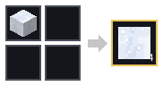

1 x Śnieg (bez kształtu). Nazwa przepisu: `snow_layer`.

### Śnieg

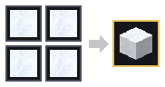

4 x Warstwa śniegu (z kształtem). Nazwa przepisu: `snow`.

### Mech

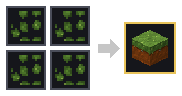

4 x Kępki mchu (z kształtem). Nazwa przepisu: `moss`.

### Ziemia kamienista x4

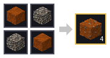

2 x Ziemia + 2 x Żwir (z kształtem). Nazwa przepisu: `coarse_dirt`.

### Czarnoziem

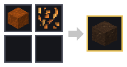

1 x Ziemia + 1 x opadłe liście (dowolne) (bez kształtu). Nazwa przepisu: `humus`. Ziemia z próchnicą z opadłych liści.

### Ściółka leśna

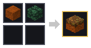

1 x Ziemia + 1 x igliwie (świerka albo sosny) (bez kształtu). Nazwa przepisu: `forest_floor`.

## Skały

### Piaskowiec

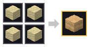

4 x Piasek (z kształtem). Nazwa przepisu: `sandstone`.

## Drewno

### Deski świerkowe x4

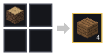

1 x pień świerka (też okorowany) (bez kształtu). Nazwa przepisu: `spruce_planks`.

### Deski sosnowe x4

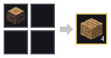

1 x pień sosny (też okorowany) (bez kształtu). Nazwa przepisu: `pine_planks`.

### Deski bukowe x4

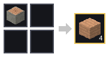

1 x pień buka (też okorowany) (bez kształtu). Nazwa przepisu: `beech_planks`.

### Deski lipowe x4

1 x pień lipy (też okorowany) (bez kształtu). Nazwa przepisu: `linden_planks`.

### Deski dębowe x4

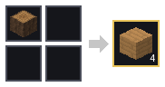

1 x pień dębu (też okorowany) (bez kształtu). Nazwa przepisu: `oak_planks`.

### Deski brzozowe x4

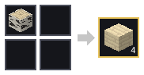

1 x pień brzozy (też okorowany) (bez kształtu). Nazwa przepisu: `birch_planks`.

### Deski jabłoniowe x4

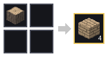

1 x pień jabłoni (też okorowany) (bez kształtu). Nazwa przepisu: `jablon_planks`.

### Deski olchowe x4

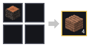

1 x pień olchy (też okorowany) (bez kształtu). Nazwa przepisu: `olcha_planks`.

### Deski wierzbowe x4

1 x pień wierzby (też okorowany) (bez kształtu). Nazwa przepisu: `wierzba_planks`.

## Budulec

### Tynk wapienny x4

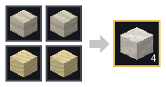

2 x Wapień + 2 x Piasek (bez kształtu). Nazwa przepisu: `lime_plaster`. Biały - odbija dużo światła, pokój jest jasny.

### Tynk ochrowy x4

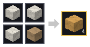

3 x Tynk wapienny + 1 x Glina (bez kształtu). Nazwa przepisu: `ochre_plaster`. Ciepły, żółty - zabarwia odbite światło.

### Terakota x4

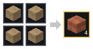

4 x Glina (z kształtem). Nazwa przepisu: `terracotta`. Czerwone płytki - ciepłe, czerwonawe światło w pokoju.

### Polerowany kamień x4

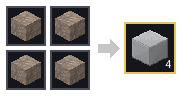

4 x Kamień (z kształtem). Nazwa przepisu: `polished_stone`. Gładki i błyszczący - odbija najwięcej światła.

### Ciemne deski x3

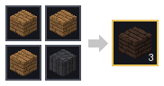

3 x deski (dowolne) + 1 x Bazalt (bez kształtu). Nazwa przepisu: `dark_planks`. Bejcowane na ciemno - pochłaniają światło, pokój jest mroczny.

## Rośliny

### Kępki mchu x4

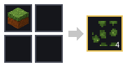

1 x Mech (bez kształtu). Nazwa przepisu: `moss_carpet`.

## Światło

### Lampa x2

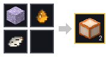

1 x Lepidolit + 1 x Żywica + 1 x Kora brzozowa (bez kształtu). Nazwa przepisu: `lamp`. Lepidolit z gór, żywica z sosny, kora z brzozy (siekierą).

### Czerwona lampa

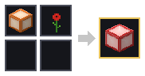

1 x Lampa + 1 x coś czerwonego (mak, truskawki, papryczki chili, wiecha amarantusa) (bez kształtu). Nazwa przepisu: `lamp_red`.

### Zielona lampa

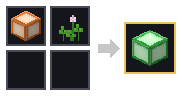

1 x Lampa + 1 x coś zielonego (koniczyna, pokrzywa, paproć) (bez kształtu). Nazwa przepisu: `lamp_green`.

### Niebieska lampa

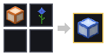

1 x Lampa + 1 x coś niebieskiego (chaber, borówki) (bez kształtu). Nazwa przepisu: `lamp_blue`.

### Fioletowa lampa

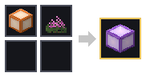

1 x Lampa + 1 x coś fioletowego (jeżyny, wrzos, krokus) (bez kształtu). Nazwa przepisu: `lamp_purple`.

### Czerwona lampa

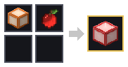

1 x Lampa + 1 x Jabłko (bez kształtu). Nazwa przepisu: `jablon_czerwona_lampa`. Jabłko też jest czerwone.

### Lampa

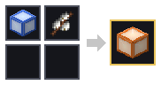

1 x Niebieska lampa + 1 x Bazie (bez kształtu). Nazwa przepisu: `wierzba_srebrna_lampa`. Bazie zdejmują z lampy niebieski kolor.

## Ozdoby

### Wieniec świerkowy

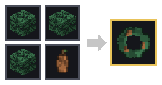

3 x Igliwie świerka + 1 x szyszka (świerka albo sosny) (z kształtem). Nazwa przepisu: `spruce_wreath`.

### Opadłe liście buka x2

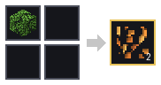

1 x Liście buka (bez kształtu). Nazwa przepisu: `beech_leaf_litter`.

### Opadłe liście dębu x2

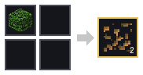

1 x Liście dębu (bez kształtu). Nazwa przepisu: `oak_leaf_litter`.

### Opadłe liście jabłoni x2

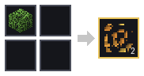

1 x Liście jabłoni (bez kształtu). Nazwa przepisu: `jablon_leaf_litter`.

### Opadłe liście olchy x2

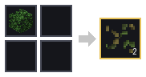

1 x Liście olchy (bez kształtu). Nazwa przepisu: `olcha_leaf_litter`.

### Opadłe liście wierzby x2

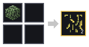

1 x Liście wierzby (bez kształtu). Nazwa przepisu: `wierzba_leaf_litter`.

## Narzędzia i surowce

### Patyk x4

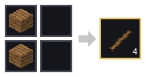

2 x deski (dowolne) (z kształtem). Nazwa przepisu: `stick`.

### Siekiera

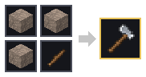

3 x skała (kamień, granit, wapień, piaskowiec, łupek, bazalt) + 1 x Patyk (z kształtem). Nazwa przepisu: `axe`. Drewno kopie się 3 razy szybciej; PPM na pniu - okorowanie.

### Kilof

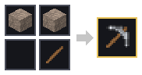

2 x skała (kamień, granit, wapień, piaskowiec, łupek, bazalt) + 1 x Patyk (z kształtem). Nazwa przepisu: `pickaxe`. Skały kopie się 3 razy szybciej.

### Łopata

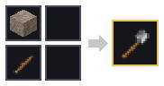

1 x skała (kamień, granit, wapień, piaskowiec, łupek, bazalt) + 1 x Patyk (z kształtem). Nazwa przepisu: `shovel`. Ziemię, piasek, żwir i błoto kopie się 3 razy szybciej.

## Grupy składników

Składnik z grupy to dowolna rzecz z listy (np. patyki z desek różnych drzew).

- **deski (dowolne)**: Deski świerkowe, Deski sosnowe, Deski bukowe, Deski lipowe, Deski dębowe, Deski brzozowe, Deski jabłoniowe, Deski olchowe, Deski wierzbowe
- **skała (kamień, granit, wapień, piaskowiec, łupek, bazalt)**: Kamień, Granit, Wapień, Piaskowiec, Łupek, Bazalt
- **szyszka (świerka albo sosny)**: Szyszka świerka, Szyszka sosny
- **igliwie (świerka albo sosny)**: Igliwie świerka, Igliwie sosny
- **opadłe liście (dowolne)**: Opadłe liście buka, Opadłe liście dębu, Opadłe liście jabłoni, Opadłe liście olchy, Opadłe liście wierzby
- **coś czerwonego (mak, truskawki, papryczki chili, wiecha amarantusa)**: Mak, Truskawki, Papryczki chili, Wiecha amarantusa
- **coś zielonego (koniczyna, pokrzywa, paproć)**: Koniczyna, Pokrzywa, Paproć
- **coś niebieskiego (chaber, borówki)**: Chaber, Borówki
- **coś fioletowego (jeżyny, wrzos, krokus)**: Jeżyny, Wrzos, Krokus
- **pień (gatunek)**: zwykły, okorowany, a u sosny także górny i z żywicą
