# Przepisy

> Ta strona jest generowana z kodu gry (`python tools/wiki.py`) - nie zmieniaj jej ręcznie, zmiany przepadną przy następnym generowaniu.

Wersja gry **0.67.0** - 82 przepisów. Wytwarza się w ekwipunku (**E**): siatka 2 x 2 obok miejsc ekwipunku, wynik po prawej (klik - weź, Shift + klik - ile się da). Przycisk 📖 *Przepisy* otwiera księgę - klik na przepisie sam układa składniki. Przepisy *z kształtem* można przesuwać po siatce i odbijać w poziomie; przepisy *bez kształtu* - obojętne, gdzie leżą składniki. Z czatu: `/przepisy`, `/wytworz <przepis>`.

## Ziemia

### Warstwa śniegu x4

1 x Śnieg (bez kształtu). Nazwa przepisu: `snow_layer`.

### Śnieg

4 x Warstwa śniegu (z kształtem). Nazwa przepisu: `snow`.

### Mech

4 x Kępki mchu (z kształtem). Nazwa przepisu: `moss`.

### Ziemia kamienista x4

2 x Ziemia + 2 x Żwir (z kształtem). Nazwa przepisu: `coarse_dirt`.

### Czarnoziem

1 x Ziemia + 1 x opadłe liście (dowolne) (bez kształtu). Nazwa przepisu: `humus`. Ziemia z próchnicą z opadłych liści.

### Ściółka leśna

1 x Ziemia + 1 x igliwie (świerka albo sosny) (bez kształtu). Nazwa przepisu: `forest_floor`.

## Skały

### Piaskowiec

4 x Piasek (z kształtem). Nazwa przepisu: `sandstone`.

## Drewno

### Opał — dąb x4

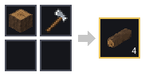

1 x pień dębu (też okorowany) + 1 x Siekiera (bez kształtu). Nazwa przepisu: `oak_firewood`. Siekiera zostaje. Opał: PPM na ziemię, potem dokładaj do 6 polan.

### Opał — brzoza x4

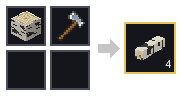

1 x pień brzozy (też okorowany) + 1 x Siekiera (bez kształtu). Nazwa przepisu: `birch_firewood`. Siekiera zostaje. Opał: PPM na ziemię, potem dokładaj do 6 polan.

### Opał — świerk x4

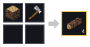

1 x pień świerka (też okorowany) + 1 x Siekiera (bez kształtu). Nazwa przepisu: `spruce_firewood`. Siekiera zostaje. Opał: PPM na ziemię, potem dokładaj do 6 polan.

### Opał — sosna x4

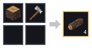

1 x pień sosny (też okorowany) + 1 x Siekiera (bez kształtu). Nazwa przepisu: `pine_firewood`. Siekiera zostaje. Opał: PPM na ziemię, potem dokładaj do 6 polan.

### Opał — buk x4

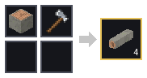

1 x pień buka (też okorowany) + 1 x Siekiera (bez kształtu). Nazwa przepisu: `beech_firewood`. Siekiera zostaje. Opał: PPM na ziemię, potem dokładaj do 6 polan.

### Opał — lipa x4

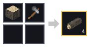

1 x pień lipy (też okorowany) + 1 x Siekiera (bez kształtu). Nazwa przepisu: `linden_firewood`. Siekiera zostaje. Opał: PPM na ziemię, potem dokładaj do 6 polan.

### Opał — olcha x4

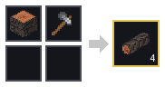

1 x pień olchy (też okorowany) + 1 x Siekiera (bez kształtu). Nazwa przepisu: `olcha_firewood`. Siekiera zostaje. Opał: PPM na ziemię, potem dokładaj do 6 polan.

### Opał — wierzba x4

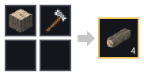

1 x pień wierzby (też okorowany) + 1 x Siekiera (bez kształtu). Nazwa przepisu: `wierzba_firewood`. Siekiera zostaje. Opał: PPM na ziemię, potem dokładaj do 6 polan.

### Opał — jabłoń x4

1 x pień jabłoni (też okorowany) + 1 x Siekiera (bez kształtu). Nazwa przepisu: `jablon_firewood`. Siekiera zostaje. Opał: PPM na ziemię, potem dokładaj do 6 polan.

### Deski świerkowe x4

1 x pień świerka (też okorowany) (bez kształtu). Nazwa przepisu: `spruce_planks`.

### Deski sosnowe x4

1 x pień sosny (też okorowany) (bez kształtu). Nazwa przepisu: `pine_planks`.

### Deski bukowe x4

1 x pień buka (też okorowany) (bez kształtu). Nazwa przepisu: `beech_planks`.

### Deski lipowe x4

1 x pień lipy (też okorowany) (bez kształtu). Nazwa przepisu: `linden_planks`.

### Deski dębowe x4

1 x pień dębu (też okorowany) (bez kształtu). Nazwa przepisu: `oak_planks`.

### Deski brzozowe x4

1 x pień brzozy (też okorowany) (bez kształtu). Nazwa przepisu: `birch_planks`.

### Deski jabłoniowe x4

1 x pień jabłoni (też okorowany) (bez kształtu). Nazwa przepisu: `jablon_planks`.

### Deski olchowe x4

1 x pień olchy (też okorowany) (bez kształtu). Nazwa przepisu: `olcha_planks`.

### Deski wierzbowe x4

1 x pień wierzby (też okorowany) (bez kształtu). Nazwa przepisu: `wierzba_planks`.

## Budulec

### Tynk wapienny x4

2 x Wapień + 2 x Piasek (bez kształtu). Nazwa przepisu: `lime_plaster`. Biały - odbija dużo światła, pokój jest jasny.

### Tynk ochrowy x4

3 x Tynk wapienny + 1 x Glina (bez kształtu). Nazwa przepisu: `ochre_plaster`. Ciepły, żółty - zabarwia odbite światło.

### Terakota x4

4 x Glina (z kształtem). Nazwa przepisu: `terracotta`. Czerwone płytki - ciepłe, czerwonawe światło w pokoju.

### Polerowany kamień x4

4 x Kamień (z kształtem). Nazwa przepisu: `polished_stone`. Gładki i błyszczący - odbija najwięcej światła.

### Ciemne deski x3

3 x deski (dowolne) + 1 x Bazalt (bez kształtu). Nazwa przepisu: `dark_planks`. Bejcowane na ciemno - pochłaniają światło, pokój jest mroczny.

## Rośliny

### Kępki mchu x4

1 x Mech (bez kształtu). Nazwa przepisu: `moss_carpet`.

## Światło

### Pochodnia x4

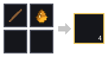

1 x Patyk + 1 x Żywica (bez kształtu). Nazwa przepisu: `torch`. Żywicę zbierz PPM z pnia sosny. Pochodnię postaw na podłożu albo na ścianie.

### Pochodnia biała

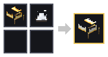

1 x pochodnia (dowolny kolor) + 1 x Barwnik biały (bez kształtu). Nazwa przepisu: `torch_white`. Zmienia końcówki płomienia i odcień światła. Postawioną pochodnię można też zabarwić PPM.

### Pochodnia pomarańczowa

1 x pochodnia (dowolny kolor) + 1 x Barwnik pomarańczowy (bez kształtu). Nazwa przepisu: `torch_orange`. Zmienia końcówki płomienia i odcień światła. Postawioną pochodnię można też zabarwić PPM.

### Pochodnia purpurowa

1 x pochodnia (dowolny kolor) + 1 x Barwnik purpurowy (bez kształtu). Nazwa przepisu: `torch_magenta`. Zmienia końcówki płomienia i odcień światła. Postawioną pochodnię można też zabarwić PPM.

### Pochodnia jasnoniebieska

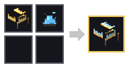

1 x pochodnia (dowolny kolor) + 1 x Barwnik jasnoniebieski (bez kształtu). Nazwa przepisu: `torch_light_blue`. Zmienia końcówki płomienia i odcień światła. Postawioną pochodnię można też zabarwić PPM.

### Pochodnia żółta

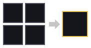

1 x pochodnia (dowolny kolor) + 1 x Barwnik żółty (bez kształtu). Nazwa przepisu: `torch_yellow`. Zmienia końcówki płomienia i odcień światła. Postawioną pochodnię można też zabarwić PPM.

### Pochodnia limonkowa

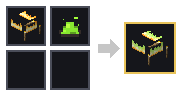

1 x pochodnia (dowolny kolor) + 1 x Barwnik limonkowy (bez kształtu). Nazwa przepisu: `torch_lime`. Zmienia końcówki płomienia i odcień światła. Postawioną pochodnię można też zabarwić PPM.

### Pochodnia różowa

1 x pochodnia (dowolny kolor) + 1 x Barwnik różowy (bez kształtu). Nazwa przepisu: `torch_pink`. Zmienia końcówki płomienia i odcień światła. Postawioną pochodnię można też zabarwić PPM.

### Pochodnia szara

1 x pochodnia (dowolny kolor) + 1 x Barwnik szary (bez kształtu). Nazwa przepisu: `torch_gray`. Zmienia końcówki płomienia i odcień światła. Postawioną pochodnię można też zabarwić PPM.

### Pochodnia jasnoszara

1 x pochodnia (dowolny kolor) + 1 x Barwnik jasnoszary (bez kształtu). Nazwa przepisu: `torch_light_gray`. Zmienia końcówki płomienia i odcień światła. Postawioną pochodnię można też zabarwić PPM.

### Pochodnia turkusowa

1 x pochodnia (dowolny kolor) + 1 x Barwnik turkusowy (bez kształtu). Nazwa przepisu: `torch_cyan`. Zmienia końcówki płomienia i odcień światła. Postawioną pochodnię można też zabarwić PPM.

### Pochodnia fioletowa

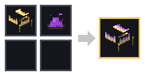

1 x pochodnia (dowolny kolor) + 1 x Barwnik fioletowy (bez kształtu). Nazwa przepisu: `torch_purple`. Zmienia końcówki płomienia i odcień światła. Postawioną pochodnię można też zabarwić PPM.

### Pochodnia niebieska

1 x pochodnia (dowolny kolor) + 1 x Barwnik niebieski (bez kształtu). Nazwa przepisu: `torch_blue`. Zmienia końcówki płomienia i odcień światła. Postawioną pochodnię można też zabarwić PPM.

### Pochodnia brązowa

1 x pochodnia (dowolny kolor) + 1 x Barwnik brązowy (bez kształtu). Nazwa przepisu: `torch_brown`. Zmienia końcówki płomienia i odcień światła. Postawioną pochodnię można też zabarwić PPM.

### Pochodnia zielona

1 x pochodnia (dowolny kolor) + 1 x Barwnik zielony (bez kształtu). Nazwa przepisu: `torch_green`. Zmienia końcówki płomienia i odcień światła. Postawioną pochodnię można też zabarwić PPM.

### Pochodnia czerwona

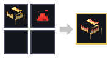

1 x pochodnia (dowolny kolor) + 1 x Barwnik czerwony (bez kształtu). Nazwa przepisu: `torch_red`. Zmienia końcówki płomienia i odcień światła. Postawioną pochodnię można też zabarwić PPM.

### Pochodnia czarna

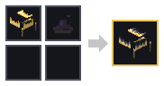

1 x pochodnia (dowolny kolor) + 1 x Barwnik czarny (bez kształtu). Nazwa przepisu: `torch_black`. Zmienia końcówki płomienia i odcień światła. Postawioną pochodnię można też zabarwić PPM.

### Lampa x2

1 x Lepidolit + 1 x Żywica + 1 x Kora brzozowa (bez kształtu). Nazwa przepisu: `lamp`. Lepidolit z gór, żywica z sosny, kora z brzozy (siekierą).

### Czerwona lampa

1 x Lampa + 1 x coś czerwonego (mak, truskawki, papryczki chili, wiecha amarantusa, korzeń marzanny) (bez kształtu). Nazwa przepisu: `lamp_red`.

### Zielona lampa

1 x Lampa + 1 x coś zielonego (koniczyna, pokrzywa, paproć) (bez kształtu). Nazwa przepisu: `lamp_green`.

### Niebieska lampa

1 x Lampa + 1 x coś niebieskiego (chaber, borówki, liście indygowca) (bez kształtu). Nazwa przepisu: `lamp_blue`.

### Fioletowa lampa

1 x Lampa + 1 x coś fioletowego (jeżyny, wrzos, krokus) (bez kształtu). Nazwa przepisu: `lamp_purple`.

### Czerwona lampa

1 x Lampa + 1 x Jabłko (bez kształtu). Nazwa przepisu: `jablon_czerwona_lampa`. Jabłko też jest czerwone.

### Lampa

1 x Niebieska lampa + 1 x Bazie (bez kształtu). Nazwa przepisu: `wierzba_srebrna_lampa`. Bazie zdejmują z lampy niebieski kolor.

## Ozdoby

### Wieniec świerkowy

3 x Igliwie świerka + 1 x szyszka (świerka albo sosny) (z kształtem). Nazwa przepisu: `spruce_wreath`.

### Opadłe liście buka x2

1 x Liście buka (bez kształtu). Nazwa przepisu: `beech_leaf_litter`.

### Opadłe liście dębu x2

1 x Liście dębu (bez kształtu). Nazwa przepisu: `oak_leaf_litter`.

### Opadłe liście jabłoni x2

1 x Liście jabłoni (bez kształtu). Nazwa przepisu: `jablon_leaf_litter`.

### Opadłe liście olchy x2

1 x Liście olchy (bez kształtu). Nazwa przepisu: `olcha_leaf_litter`.

### Opadłe liście wierzby x2

1 x Liście wierzby (bez kształtu). Nazwa przepisu: `wierzba_leaf_litter`.

## Narzędzia i surowce

### Starter ognia

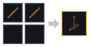

2 x Patyk (bez kształtu). Nazwa przepisu: `fire_starter`. 6 polan + trawa; przytrzymaj PPM starterem przez 5 sekund.

### Barwnik czerwony

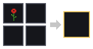

1 x coś czerwonego (mak, truskawki, papryczki chili, wiecha amarantusa, korzeń marzanny) (bez kształtu). Nazwa przepisu: `dye_red`. Barwnikiem kliknij PPM postawioną pochodnię albo połącz go z pochodnią w tej siatce.

### Barwnik żółty

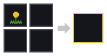

1 x Mniszek (bez kształtu). Nazwa przepisu: `dye_yellow`. Barwnikiem kliknij PPM postawioną pochodnię albo połącz go z pochodnią w tej siatce.

### Barwnik biały

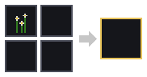

1 x Rumianek (bez kształtu). Nazwa przepisu: `dye_white`. Barwnikiem kliknij PPM postawioną pochodnię albo połącz go z pochodnią w tej siatce.

### Barwnik zielony

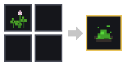

1 x coś zielonego (koniczyna, pokrzywa, paproć) (bez kształtu). Nazwa przepisu: `dye_green`. Barwnikiem kliknij PPM postawioną pochodnię albo połącz go z pochodnią w tej siatce.

### Barwnik niebieski

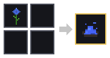

1 x coś niebieskiego (chaber, borówki, liście indygowca) (bez kształtu). Nazwa przepisu: `dye_blue`. Barwnikiem kliknij PPM postawioną pochodnię albo połącz go z pochodnią w tej siatce.

### Barwnik fioletowy

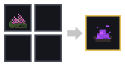

1 x coś fioletowego (jeżyny, wrzos, krokus) (bez kształtu). Nazwa przepisu: `dye_purple`. Barwnikiem kliknij PPM postawioną pochodnię albo połącz go z pochodnią w tej siatce.

### Barwnik brązowy

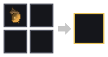

1 x Żołądź (bez kształtu). Nazwa przepisu: `dye_brown`. Barwnikiem kliknij PPM postawioną pochodnię albo połącz go z pochodnią w tej siatce.

### Barwnik pomarańczowy x2

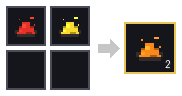

1 x Barwnik czerwony + 1 x Barwnik żółty (bez kształtu). Nazwa przepisu: `dye_orange`. Mieszanie barwników.

### Barwnik purpurowy x2

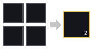

1 x Barwnik fioletowy + 1 x Barwnik różowy (bez kształtu). Nazwa przepisu: `dye_magenta`. Mieszanie barwników.

### Barwnik jasnoniebieski x2

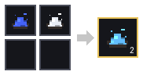

1 x Barwnik niebieski + 1 x Barwnik biały (bez kształtu). Nazwa przepisu: `dye_light_blue`. Mieszanie barwników.

### Barwnik limonkowy x2

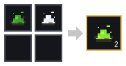

1 x Barwnik zielony + 1 x Barwnik biały (bez kształtu). Nazwa przepisu: `dye_lime`. Mieszanie barwników.

### Barwnik różowy x2

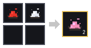

1 x Barwnik czerwony + 1 x Barwnik biały (bez kształtu). Nazwa przepisu: `dye_pink`. Mieszanie barwników.

### Barwnik szary x2

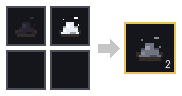

1 x Barwnik czarny + 1 x Barwnik biały (bez kształtu). Nazwa przepisu: `dye_gray`. Mieszanie barwników.

### Barwnik jasnoszary x2

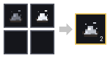

1 x Barwnik szary + 1 x Barwnik biały (bez kształtu). Nazwa przepisu: `dye_light_gray`. Mieszanie barwników.

### Barwnik turkusowy x2

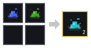

1 x Barwnik niebieski + 1 x Barwnik zielony (bez kształtu). Nazwa przepisu: `dye_cyan`. Mieszanie barwników.

### Barwnik czarny x3

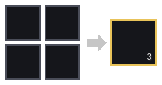

1 x Barwnik czerwony + 1 x Barwnik zielony + 1 x Barwnik niebieski (bez kształtu). Nazwa przepisu: `dye_black`. Mieszanie barwników.

### Patyk x4

2 x deski (dowolne) (z kształtem). Nazwa przepisu: `stick`.

### Siekiera

3 x skała (kamień, granit, wapień, piaskowiec, łupek, bazalt) + 1 x Patyk (z kształtem). Nazwa przepisu: `axe`. Drewno kopie się 3 razy szybciej; PPM na pniu - okorowanie.

### Kilof

2 x skała (kamień, granit, wapień, piaskowiec, łupek, bazalt) + 1 x Patyk (z kształtem). Nazwa przepisu: `pickaxe`. Skały kopie się 3 razy szybciej.

### Łopata

1 x skała (kamień, granit, wapień, piaskowiec, łupek, bazalt) + 1 x Patyk (z kształtem). Nazwa przepisu: `shovel`. Ziemię, piasek, żwir i błoto kopie się 3 razy szybciej.

## Grupy składników

Składnik z grupy to dowolna rzecz z listy (np. patyki z desek różnych drzew).

- **pochodnia (dowolny kolor)**: Pochodnia, Pochodnia biała, Pochodnia pomarańczowa, Pochodnia purpurowa, Pochodnia jasnoniebieska, Pochodnia żółta, Pochodnia limonkowa, Pochodnia różowa, Pochodnia szara, Pochodnia jasnoszara, Pochodnia turkusowa, Pochodnia fioletowa, Pochodnia niebieska, Pochodnia brązowa, Pochodnia zielona, Pochodnia czerwona, Pochodnia czarna
- **deski (dowolne)**: Deski świerkowe, Deski sosnowe, Deski bukowe, Deski lipowe, Deski dębowe, Deski brzozowe, Deski jabłoniowe, Deski olchowe, Deski wierzbowe
- **skała (kamień, granit, wapień, piaskowiec, łupek, bazalt)**: Kamień, Granit, Wapień, Piaskowiec, Łupek, Bazalt
- **szyszka (świerka albo sosny)**: Szyszka świerka, Szyszka sosny
- **igliwie (świerka albo sosny)**: Igliwie świerka, Igliwie sosny
- **opadłe liście (dowolne)**: Opadłe liście buka, Opadłe liście dębu, Opadłe liście jabłoni, Opadłe liście olchy, Opadłe liście wierzby
- **coś czerwonego (mak, truskawki, papryczki chili, wiecha amarantusa, korzeń marzanny)**: Mak, Truskawki, Papryczki chili, Wiecha amarantusa, Korzeń marzanny
- **coś zielonego (koniczyna, pokrzywa, paproć)**: Koniczyna, Pokrzywa, Paproć
- **coś niebieskiego (chaber, borówki, liście indygowca)**: Chaber, Borówki, Liście indygowca
- **coś fioletowego (jeżyny, wrzos, krokus)**: Jeżyny, Wrzos, Krokus
- **pień (gatunek)**: zwykły, okorowany, a u sosny także górny i z żywicą
