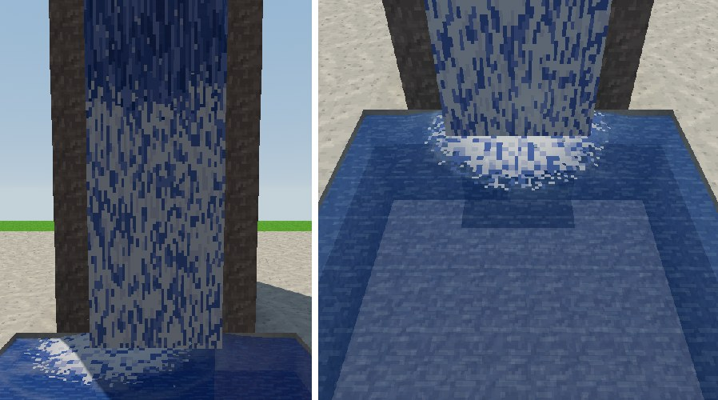

# Pikselowe wodospady 0.87.0

Koncept Kamila: wodospad jak animacja pikselowa, a nie przewijana
tekstura tafli. U krawędzi woda jest ciemna, w pionowych smugach
z jasnymi kreskami. Niżej coraz więcej białej piany z niebieskimi
kreskami, a po kilku blokach spadku woda jest już prawie samą pianą.
Na tafli pod wodospadem leży biała plama piany z kropkami.

## Jak to działa

- **Bez nowych tekstur.** Wszystko liczy shader wody
  (`src/rendering/WaterfallPixels.js`, wpięty w `waterMaterial`
  w `BlockRenderData.js`). Minipiksele mają rozmiar 1/16 bloku w świecie,
  jak piksele tekstur bloków.
- **Smugi.** Każda kolumna minipikseli ma własne smugi długości 4–11 px
  w czterech odcieniach wody i krótkie jasne kreski. Płyną w dół
  o cały piksel naraz (24 px/s), więc piksele zostają ostre.
- **Piana rośnie ze spadkiem.** Licznik spadku z 0.73.0 (1–16, `water.js`)
  jest liczony w sposób ciągły przez bloki, więc między blokami nie ma
  szwu. Pierwsze 1,7 bloku to sama ciemna woda. Do 3,3 bloku kawałki
  smug po kolei zmieniają się w pianę. Niżej jest biel i blady odcień
  wody z kreskami 2–5 px.
- **Kolory z wody.** Odcienie są liczone ze średniego koloru tekstury wody
  (`getAtlasAverage('water')`). Z paczką tekstur wodospad ma jej odcień.
  Oświetlenie, noc i cień działają jak dotąd.
- **Gęsta woda.** Bok spadającej wody prawie nie prześwituje.
- **Z daleka.** Gdy minipiksel jest mniejszy niż piksel ekranu, shader
  bierze średni kolor (woda → piana), więc nic nie migocze.
- **Piana na tafli.** Warstwa piany (`WaterfallFoam.js`) ma pod każdym
  stałym wodospadem gęstą plamę. To biel z kropkami 2 × 2 px w odcieniach
  wody, które odpływają od środka, a brzeg jest postrzępiony. Promień
  rośnie ze spadkiem, od 1,6 do 2,6 bloku. Dalej, jak dotąd, płyną wyspy
  piany niesione nurtem, a kręgi, krople i mgiełka zostają bez zmian.
  Plama korzysta z tych samych miejsc i limitów co kręgi. Nie ma nowych
  rysowań, tekstur ani przeszukiwania świata.

## Sprawdzanie

- `node tools/sprawdz_wodospady_pikselowe_webgl.mjs` (CI: *Pikselowe
  wodospady i piana na tafli*) uruchamia prawdziwą grę i scenę
  `wodospady`. Kolory są czytane z ekranu w punktach świata:
  - górny blok jest ciemny (bez piany), dolne są wyraźnie jaśniejsze,
    z pianą i niebieskimi kreskami;
  - dwa punkty w jednym minipikselu mają ten sam kolor (ostre piksele);
  - po pół sekundy smugi się przesuwają, a skała obok stoi;
  - przed wodospadem na tafli jest biała piana, dalej w sadzawce nie ma.
- W grze: `/scena wodospady` (tryb programisty, spadki 3, 8 i 16 bloków)
  albo `/rzeka wodospad tp` w świecie realistycznym.
