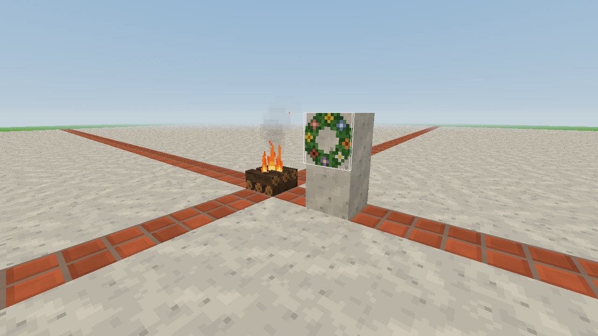

# Zioła, napary i zastosowania plonów (0.98.1)

Do 0.98.0 większość kwiatów, ziół i porostów dało się tylko zebrać -
plon leżał potem w ekwipunku bez użytku. Od 0.98.1 **każdy plon do
czegoś służy**, a gra tego pilnuje: test `tools/sprawdz_zastosowania.mjs`
nie przepuści nowego przedmiotu bez zastosowania.

## Napary

Nowy sposób na poprawę samopoczucia - obok jedzenia i snu.

1. **Gliniany kubek:** 2 gliny → 2 kubki.
2. **Kubek ziół:** kubek + **dwa zioła z jednej grupy** (mogą być różne).
3. **Parzenie:** weź kubek ziół do ręki i **trzymaj PPM na płonącym
   ognisku** przez 4 sekundy (tak jak przy pieczeniu).
4. **Picie:** F albo PPM. Napar da się wypić nawet z pełnym żołądkiem,
   a **kubek wraca** do ekwipunku.

| Napar | Zioła | Co daje | Jak długo |
|---|---|---|---|
| **Napar na sen** | kwiat lipy, bukiet lawendy | najbliższy sen jest głębszy: wysypiasz się szybciej i lepiej niż zwykle w danym miejscu (na posłaniu - do pełna, nawet na gołej ziemi - „wypoczęty") | do najbliższej przespanej nocy, najwyżej 14 godzin gry |
| **Napar leczniczy** | rumianek, babka, liście szałwii, kwiat nagietka | stłuczona noga goi się 3 razy szybciej | 4 godziny gry |
| **Napar wzmacniający** | pokrzywa, nasiona gorczycy | energii ubywa o 1/5 wolniej, kopanie jest trochę szybsze | 5 godzin gry |

Godzina gry to 50 sekund. Działający napar widać w oknie statusu
(klawisz **C**, wiersz *Działa*). Wypicie tego samego naparu drugi raz
odnawia czas, nie wydłuża go.

## Barwniki z każdego kwiatu

Barwnik powstaje z jednej rzeczy w danym kolorze. Nowe źródła:

| Barwnik | Z czego |
|---|---|
| czerwony | mak, truskawki, chili, wiecha amarantusa, korzeń marzanny |
| pomarańczowy | **kwiat nagietka, kwiat cynii** (albo czerwony + żółty) |
| żółty | mniszek, **bukiet kocanki, nasiona gorczycy, grudka żółtej ochry** |
| zielony | koniczyna, pokrzywa, paproć, **liście szałwii, oba porosty** |
| niebieski | chaber, borówki, liście indygowca, **kwiat mikołajka, kwiat barwinka** |
| fioletowy | jeżyny, wrzos, krokus, **bukiet lawendy, kwiat dzwonka** |
| różowy | **kwiat piwonii, kwiat zawilca** (albo czerwony + biały) |
| biały | rumianek |
| brązowy | żołądź, **huba** |

Te same rzeczy barwią lampy (czerwona, zielona, niebieska, fioletowa).

## Podpałka do ogniska

Ognisko rozpala się już nie tylko trawą. Lepsza podpałka skraca
trzymanie startera ognia:

| Podpałka | Rozpalanie |
|---|---|
| trawa (krótka, wysoka, wydmowa), trzcina | 5 sekund |
| słoma | 4 sekundy |
| kora brzozowa, gałązki porostu iglastego | ok. 3,3 sekundy |
| **huba** | 2,5 sekundy |

## Pozostałe zastosowania

- **Wianek z kwiatów:** cztery dowolne kwiaty (polne albo zebrane
  z roślin) w kwadracie 2 × 2. Wiesza się na ścianie jak wieniec
  świerkowy.
- **Oliwki** zastępują żywicę w pochodniach i lampach.
- **Grudka żółtej ochry** zastępuje glinę w żółtym tynku.
- **Każda szyszka** (świerk, sosna, olcha, kosodrzewina, sekwoja) nadaje
  się do wieńca świerkowego.
- **Słoma** powstaje też z trawy wydmowej i trzciny.
- **Wiązka lnu** - lniana pościel ([sen.md](sen.md)).

Co robi dany plon, podpowiada komenda `/rosliny <roślina>` (wiersz
*Do czego*).

## Kategorie w ekwipunku

Dziewięć zakładek zostało, ale każda ma jedną zasadę:

| Zakładka | Co w niej jest |
|---|---|
| Ziemia | ziemia, piasek, śnieg, woda |
| Skały | skały |
| Drewno | pnie, okorowane pnie, deski, opał |
| Budulec | tynki, płytki oraz schody, półbloki, płoty, furtki, drzwi i klapy |
| Rośliny | wszystko, co rośnie: trawy, kwiaty, zioła, krzaki, liście, sadzonki, rośliny wodne, porosty, huby |
| Jedzenie i nasiona | owoce, orzechy, szyszki, pieczone jedzenie, napary |
| Światło | pochodnie i lampy |
| Meble i ozdoby | skrzynie, stoły stolarskie, łóżka, pościel, wieńce, opadłe liście |
| Narzędzia i surowce | narzędzia, patyki, żywica, słoma, barwniki, kubek, plony roślin |

Wcześniej plony roślin były rozrzucone (część w *Roślinach*, część
w *Ozdobach*), a schody i drzwi leżały w *Drewnie* razem z pniami.

## Do testów

- `/energia efekt calm` (albo `heal`, `vigor`, `brak`) - efekt naparu
  bez picia,
- `/daj clay_cup`, `/daj brew_calm`, `/daj tea_heal`, `/daj flower_wreath`,
  `/daj huba_huba`,
- `/rosliny nagietek` - opis rośliny z zastosowaniem plonu.

## Dla programisty

Zastosowania są opisane danymi - nowa roślina dostaje je bez pisania
kodu:

- `assets/rosliny/<roślina>/roslina.json`, pole `przedmiot`:
  - `"grupy"` - grupy składników: kolory (`red`, `orange`, `yellow`,
    `green`, `blue`, `purple`, `pink`, `white`, `brown` - barwnik),
    `flowers` (wianek), `herbs_calm`, `herbs_heal`, `herbs_vigor`
    (napary),
  - `"podpalka"` - ile razy szybciej od trawy rozpala ognisko.
- `src/crafting/recipes.js` - grupy (`GROUPS`) i przepisy; polne rośliny
  (mak, rumianek, pokrzywa...) są wpisane w grupy tam.
- `src/items/foods.js` - napary (`TEAS`), pole `effects` i `returns`;
  `src/items/effects.js` - lista efektów (`EFFECTS`): nowy efekt to jeden
  wpis z mnożnikami.
- `src/game/Wellbeing.js` - `addEffect`, `activeEffects`, `effectFactor`;
  efekty zapisują się ze światem.
- `src/game/CampfireState.js` - `TINDERS` (podpałki).
- `src/blocks/decorations.js` - ozdoby na ścianę (`WALL_DECORATIONS`).
- `src/items/categories.js` - zasady kategorii; `src/items/uses.js` -
  `itemUses(type)`: wszystkie zastosowania rzeczy słowami.
- `tools/tekstury_ziol.py` - ikony kubka, naparów i wianka.
- Test: `node tools/sprawdz_zastosowania.mjs`.
