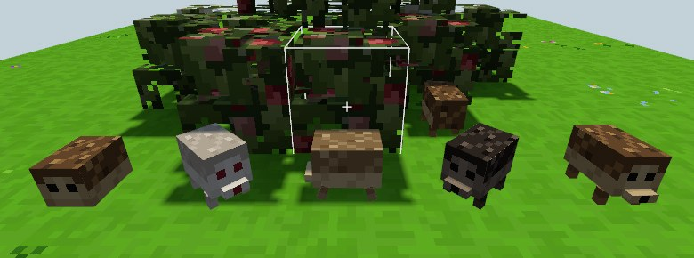

# Zwierzęta

Od 1.18.0 w świecie żyją zwierzęta. Pierwszym jest **jeżyk** - model,
tekstura i animacje Kamila (`tools/wzorce/jezyk/`).

## Zasada: zwierząt się nie krzywdzi

To założenie gry, nie przeoczenie:

- **zwierzęta nie mają zdrowia i nie giną** - uderzenie nic im nie robi
  (jeżyk zwija się w kulkę i czeka, aż dasz mu spokój),
- **w grze nie ma mięsa** i nie będzie: jedzenie to rośliny - a ma ich
  być tyle i tak różnych, żeby mięsa nikomu nie brakowało,
- zwierzęta są dodawane jako **towarzysze i życie świata** (jeżyk) albo
  dla **surowców, które daje się wziąć bez krzywdy**: mleko, wełna,
  pióra, jajka.

Nowe zwierzę = żadnego zdrowia, żadnych łupów z "pokonania", żadnego
osiągnięcia za krzywdę. Test `sprawdz_jezyka.mjs` pilnuje tego dla
jeżyka.

## Jeżyk

| | |
|---|---|
| wielkość | korpus 5 x 5 x 8 pikseli, pyszczek, cztery łapki |
| warianty | brązowy (rysunek Kamila, 55%), ciemny (22%), piaskowy (20%), albinos z czerwonymi oczami (3%) |
| dom | dziki krzew jagodowy - mniej więcej co trzeci ma lokatora |
| pora | nocna: wychodzi o zmierzchu, wraca przed świtem |
| zima | przesypia ją w krzewie |

### Zachowanie

- **W dzień śpi** zwinięty w kulkę w liściach swojego krzewu (w dolnym
  bloku). Przez liście krzewów chodzi jak przez powietrze.
- **O zmierzchu wychodzi na żer**: drepcze w promieniu 9 bloków od
  domu, co chwilę przystaje i węszy. Każdy jeżyk ma trochę inną porę
  wstawania.
- **Przed świtem wraca** do swojego krzewu i zasypia.
- **Zimą śpi** bez przerwy (sen zimowy); budzi się wiosną.
- **Teren**: wchodzi na próg jednego bloku, schodzi do trzech bloków
  w dół, omija wodę i urwiska.

### Jeżyk i człowiek

- **Bieg płoszy**: gdy ktoś biegnie albo idzie zwykłym krokiem bliżej
  niż 3,4 bloku, jeżyk zwija się w kulkę i rozwija dopiero po chwili
  spokoju.
- **Skradanie nie płoszy**: do skradającego się jeżyk tylko odwraca
  pyszczek i patrzy. Dopiero na wyciągnięcie ręki (0,9 bloku) zwija
  się przy każdym ruchu.
- **LPM**: trącony zwija się na kilka sekund. Nic mu się nie dzieje.
- **Jagody w ręce**: jeżyk czuje je z 7 bloków, podchodzi i czeka przy
  ręce. **PPM** - zjada jedną (w przygodzie znika z ekwipunku). Je:
  jagody, truskawki, jeżyny, aronię, porzeczki, agrest, maliny, owoce
  dzikiej róży, bzu i rokitnika oraz jabłka.
- **Zaufanie**: nakarmiony jeżyk przez dwie minuty nie boi się
  biegającego gracza. Trącenie kończy zaufanie.

### Dźwięki, osiągnięcia, komendy

Ciche węszenie, chrupanie i szelest zwijania (słychać z kilkunastu
bloków; `tools/dzwieki.py`, grupa `jez`).

Osiągnięcia: *Nocny sąsiad* (spotkaj jeżyka z bliska), *Z ręki* (nakarm
go), *Biały kruk wśród jeży* (spotkaj albinosa - rzadkie).

Komendy: `/jez` (ile jeżyków jest obok i co robią), `/jez dodaj
[brown|dark|sandy|albino]`, `/jez znajdz` (najbliższy zamieszkany
krzew).

## Liście krzewów jagodowych

Od 1.18.0 przez liście (i gałązki z kwiatami i owocami) krzewów
jagodowych **da się przejść** - gracz idzie w nich wolniej (do 40%
prędkości, gdy jest w nich cały; po pas - mniej więcej 67%). Pień bzu
i leszczyny zostaje twardy. Liście drzew są bez zmian.

Dla reszty gry liście krzewu dalej są blokiem: można na nich stawiać,
celować w nie, zbierać z nich owoce, zatrzymują światło jak dotąd.

## Jak to działa

- `src/world/animals/Hedgehog.js` - zachowanie (bez grafiki): stany
  `sleep`, `idle`, `walk`, `sniff`, `watch`, `curl`, `approach`, `beg`,
  `eat`, `home`.
- `src/game/Hedgehogs.js` - kto gdzie mieszka. Dom wynika z ziarna
  krzewu (`hedgehogHome`), więc ten sam krzew ma zawsze tego samego
  lokatora w tym samym kolorze. Jeżyki pojawiają się do 44 bloków od
  gracza, znikają dalej niż 60, naraz jest ich najwyżej 10.
- `src/rendering/HedgehogRenderer.js` + `HedgehogModelData.js` - model
  z sześciu części i pozy (chód, węszenie, jedzenie, oddech, kulka)
  według animacji z pliku Blockbencha. Dane modelu i tekstury wariantów
  robi `python3 tools/jezyk_model.py`.
- `passable: true` w definicji bloku (`BlockRegistry.isPassableId`) -
  blok bez kolizji dla gracza; `Player.updateBush` liczy, ile ciała
  jest w takich blokach.

## Czego nie ma (luki)

- **Jeżyki nie są zapisywane**: po wczytaniu świata lokator wraca do
  swojego krzewu, a zaufanie po karmieniu przepada.
- **Gra wieloosobowa**: każdy gracz widzi własne jeżyki (te same domy
  i kolory, ale ruch nie jest uzgadniany); jeżyk reaguje tylko na
  gracza przy tym komputerze.
- **Jeżyk nie rzuca cienia** słońca.
- Mieszkają tylko w dzikich krzewach z generatora - w posadzonych przez
  gracza i w krzewach bez jagód (leszczyna też się liczy) nie ma reguł
  osiedlania się; jeżyk z `/jez dodaj` zamieszka w najbliższych liściach.
- Gdy gracz wytnie krzew pod nieobecność jeżyka, ten wraca na miejsce
  po domu i tam zasypia; po oddaleniu się gracza już się nie pojawi.
- Jeżyk nie je sam (nie zbiera owoców z krzewów ani owadów), nie pływa,
  nie ma młodych.
- Podnoszenie jeżyka (i kłucie) oraz kupki liści jako kryjówki -
  w planach.
- Tratwa i inne modele nie zatrzymują jeżyka; skrzydło drzwi liczy się
  tak, jak jego blok.
